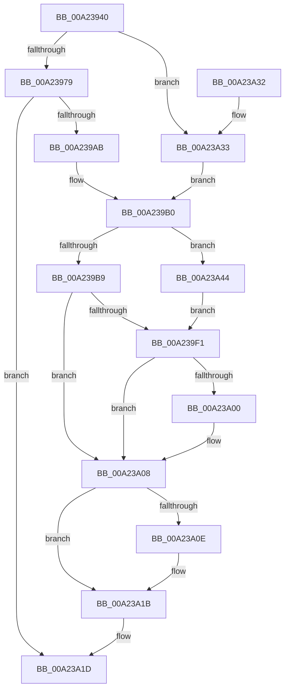

# NtIsProcessInJob

- RVA: `0x00A23940`–`0x00A23A52` (길이 `274` bytes)
- VA: `0x0000000140A23940`
- 실행 섹션: `PAGE`
- PDB 이름 있음: `예`; PDB Function 태그: `아니요`
- unwind 정보 RVA: `0x000AB6F0`
- 디코드: `66`개 명령, `274/274` bytes 표시
- 미해석 바이트: `0` (있으면 어셈블리에 `.byte`로 보존)

> 이 문서는 커널 이미지의 기계어와 PDB 기호를 분석해 생성했습니다. 4번과 5번은 함수 원형과 자료형을 바이너리 사용 방식에서 추정한 C 해석이며 원본 소스 복구 결과는 아닙니다.

## 1. Dependencies

- 직접 호출 지점: **5**; 고유 호출 대상: **5**
- 직접 호출자로 확인된 함수: **0**
- RIP 상대 이미지 참조: **2**

### Outgoing calls
- `0x00A239A2` → [ObpReferenceObjectByHandleWithTag](../86/ObpReferenceObjectByHandleWithTag_function_00869650.md) (function, `0x00869650`)
- `0x00A239E1` → [ObReferenceObjectByHandle](../86/ObReferenceObjectByHandle_function_00868DB0.md) (function, `0x00868DB0`)
- `0x00A239F4` → [PspIsProcessInJob](PspIsProcessInJob_function_00A23A58.md) (function, `0x00A23A58`)
- `0x00A23A03` → [ObfDereferenceObject](../../text/2F/ObfDereferenceObject_function_002F9350.md) (function, `0x002F9350`)
- `0x00A23A16` → [ObfDereferenceObjectWithTag](../../text/2F/ObfDereferenceObjectWithTag_function_002F78E0.md) (function, `0x002F78E0`)

### Direct callers
- 이 함수 시작 RVA로 연결되는 직접 call은 확인되지 않았습니다. 간접 호출은 완전히 역산할 수 없습니다.

### Static image references
- `0x00A2398A` → RVA `0x00FC6A98` (`ALMOSTRO`; read)
- `0x00A239B9` → RVA `0x00FC6C58` (`ALMOSTRO`; read)

## 2. Other-region calls and transfers

- 다른 실행 섹션으로 향하는 call: **2**
  - `0x00A23A03` → [ObfDereferenceObject](../../text/2F/ObfDereferenceObject_function_002F9350.md) (`PAGE` → `.text`)
  - `0x00A23A16` → [ObfDereferenceObjectWithTag](../../text/2F/ObfDereferenceObjectWithTag_function_002F78E0.md) (`PAGE` → `.text`)
- 별도 외부 분기/꼬리 이동을 확인하지 못했습니다.

## 3. Assembly (complete function range)

```asm
00A23940  4C 8B DC                        mov r11, rsp
00A23943  49 89 5B 10                     mov qword ptr [r11 + 0x10], rbx
00A23947  49 89 6B 18                     mov qword ptr [r11 + 0x18], rbp
00A2394B  49 89 73 20                     mov qword ptr [r11 + 0x20], rsi
00A2394F  57                              push rdi
00A23950  48 83 EC 40                     sub rsp, 0x40
00A23954  65 48 8B 1C 25 88 01 00 00      mov rbx, qword ptr gs:[0x188]
00A2395D  48 8B EA                        mov rbp, rdx
00A23960  49 83 63 08 00                  and qword ptr [r11 + 8], 0
00A23965  48 8B F9                        mov rdi, rcx
00A23968  40 8A B3 32 02 00 00            mov sil, byte ptr [rbx + 0x232]
00A2396F  48 83 F9 FF                     cmp rcx, -1
00A23973  0F 84 BA 00 00 00               je 0x140a23a33
00A23979  49 83 63 F0 00                  and qword ptr [r11 - 0x10], 0
00A2397E  49 8D 43 08                     lea rax, [r11 + 8]
00A23982  49 83 63 E8 00                  and qword ptr [r11 - 0x18], 0
00A23987  44 8A CE                        mov r9b, sil
00A2398A  4C 8B 05 07 31 5A 00            mov r8, qword ptr [rip + 0x5a3107]
00A23991  BA 00 10 00 00                  mov edx, 0x1000
00A23996  49 89 43 E0                     mov qword ptr [r11 - 0x20], rax
00A2399A  C7 44 24 20 50 73 4A 62         mov dword ptr [rsp + 0x20], 0x624a7350
00A239A2  E8 A9 5C E4 FF                  call 0x140869650
00A239A7  85 C0                           test eax, eax
00A239A9  78 72                           js 0x140a23a1d
00A239AB  48 8B 5C 24 50                  mov rbx, qword ptr [rsp + 0x50]
00A239B0  48 85 ED                        test rbp, rbp
00A239B3  0F 84 8B 00 00 00               je 0x140a23a44
00A239B9  4C 8B 05 98 32 5A 00            mov r8, qword ptr [rip + 0x5a3298]
00A239C0  48 8D 44 24 50                  lea rax, [rsp + 0x50]
00A239C5  48 83 64 24 28 00               and qword ptr [rsp + 0x28], 0
00A239CB  44 8A CE                        mov r9b, sil
00A239CE  48 83 64 24 50 00               and qword ptr [rsp + 0x50], 0
00A239D4  BA 04 00 00 00                  mov edx, 4
00A239D9  48 8B CD                        mov rcx, rbp
00A239DC  48 89 44 24 20                  mov qword ptr [rsp + 0x20], rax
00A239E1  E8 CA 53 E4 FF                  call 0x140868db0
00A239E6  48 8B 54 24 50                  mov rdx, qword ptr [rsp + 0x50]
00A239EB  8B F0                           mov esi, eax
00A239ED  85 C0                           test eax, eax
00A239EF  78 17                           js 0x140a23a08
00A239F1  48 8B CB                        mov rcx, rbx
00A239F4  E8 5F 00 00 00                  call 0x140a23a58
00A239F9  8B F0                           mov esi, eax
00A239FB  48 85 ED                        test rbp, rbp
00A239FE  74 08                           je 0x140a23a08
00A23A00  48 8B CA                        mov rcx, rdx
00A23A03  E8 48 59 8D FF                  call 0x1402f9350
00A23A08  48 83 FF FF                     cmp rdi, -1
00A23A0C  74 0D                           je 0x140a23a1b
00A23A0E  BA 50 73 4A 62                  mov edx, 0x624a7350
00A23A13  48 8B CB                        mov rcx, rbx
00A23A16  E8 C5 3E 8D FF                  call 0x1402f78e0
00A23A1B  8B C6                           mov eax, esi
00A23A1D  48 8B 5C 24 58                  mov rbx, qword ptr [rsp + 0x58]
00A23A22  48 8B 6C 24 60                  mov rbp, qword ptr [rsp + 0x60]
00A23A27  48 8B 74 24 68                  mov rsi, qword ptr [rsp + 0x68]
00A23A2C  48 83 C4 40                     add rsp, 0x40
00A23A30  5F                              pop rdi
00A23A31  C3                              ret
00A23A32  CC                              int3
00A23A33  48 8B 9B B8 00 00 00            mov rbx, qword ptr [rbx + 0xb8]
00A23A3A  48 89 5C 24 50                  mov qword ptr [rsp + 0x50], rbx
00A23A3F  E9 6C FF FF FF                  jmp 0x140a239b0
00A23A44  48 8B 93 A0 02 00 00            mov rdx, qword ptr [rbx + 0x2a0]
00A23A4B  48 8B 5C 24 50                  mov rbx, qword ptr [rsp + 0x50]
00A23A50  EB 9F                           jmp 0x140a239f1
```

## 4. C-style interpretation (structured pseudocode)

```c
__int64 __fastcall NtIsProcessInJob(__int64 a1, __int64 a2)
{
    __int64 result;
    __int64 v_rsp;
    unsigned __int64 v_stack_m20;
    unsigned int v_stack_m28;
    unsigned __int64 v_stack_p10;
    unsigned __int64 v_stack_p18;
    unsigned __int64 v_stack_p20;
    unsigned __int64 v_stack_p50;
    unsigned __int64 v_stack_p8;

    *(unsigned __int64 *)(v_rsp + 16) = v_rbx;
    *(unsigned __int64 *)(v_rsp + 24) = v_rbp;
    *(unsigned __int64 *)(v_rsp + 32) = v_rsi;
    v_rsp = (v_rsp) - (64);
    if (a1 == -1) goto loc_00A23A33;
    *(unsigned __int64 *)(v_rsp - 32) = v_rsp + 8;
    v_stack_m28 = 0x624A7350ULL;
    result = ObpReferenceObjectByHandleWithTag(a1, (unsigned int)(0x1000ULL), *(unsigned __int64 *)(v_rip + 5910791), (unsigned __int8)(*(unsigned __int8 *)(*(unsigned __int64 *)(gs_base + (0 + 392)) + 562)));
    if (sign_flag) goto loc_00A23A1D;
loc_00A239B0:
    if (a2 == 0) goto loc_00A23A44;
    v_stack_m28 = v_stack_p8;
    result = ObReferenceObjectByHandle(a2, 4, *(unsigned __int64 *)(v_rip + 5911192), (unsigned __int8)(*(unsigned __int8 *)(*(unsigned __int64 *)(gs_base + (0 + 392)) + 562)));
    if (sign_flag) goto loc_00A23A08;
loc_00A239F1:
    result = PspIsProcessInJob(v_stack_p8, v_stack_p8, *(unsigned __int64 *)(v_rip + 5911192), (unsigned __int8)(*(unsigned __int8 *)(*(unsigned __int64 *)(gs_base + (0 + 392)) + 562)));
    if (a2 != 0) {
        a1 = v_stack_p8;
        result = ObfDereferenceObject(a1, v_stack_p8, *(unsigned __int64 *)(v_rip + 5911192), (unsigned __int8)(*(unsigned __int8 *)(*(unsigned __int64 *)(gs_base + (0 + 392)) + 562)));
    }
    if (a1 != -1) {
        a2 = 0x624A7350ULL;
        a1 = v_stack_p8;
        result = ObfDereferenceObjectWithTag(a1, a2, *(unsigned __int64 *)(v_rip + 5911192), (unsigned __int8)(*(unsigned __int8 *)(*(unsigned __int64 *)(gs_base + (0 + 392)) + 562)));
    }
loc_00A23A1D:
    v_rsp = (v_rsp) + (64);
    return (unsigned int)((unsigned int)((unsigned int)((unsigned int)(result))));
loc_00A23A33:
    v_stack_p50 = *(unsigned __int64 *)(v_stack_p10 + 184);
    goto loc_00A239B0;
loc_00A23A44:
    goto loc_00A239F1;
}
```

## 5. (Beta) C Style

```c
int64_t NtIsProcessInJob(int64_t Arg1, int64_t Arg2)
{
    int64_t result;
    int64_t local_rsp;
    uint64_t v_stack_m20;
    uint32_t v_stack_m28;
    uint64_t v_stack_p10;
    uint64_t v_stack_p18;
    uint64_t v_stack_p20;
    uint64_t v_stack_p50;
    uint64_t v_stack_p8;

    *(uint64_t *)(local_rsp + 0x10) = local_rbx;
    *(uint64_t *)(local_rsp + 0x18) = local_rbp;
    *(uint64_t *)(local_rsp + 0x20) = local_rsi;
    local_rsp = (local_rsp) - (64);
    if (Arg1 == -1) goto loc_00A23A33;
    *(uint64_t *)(local_rsp - 0x20) = local_rsp + 8;
    v_stack_m28 = 0x624A7350ULL;
    result = ObpReferenceObjectByHandleWithTag(Arg1, (uint32_t)(0x1000ULL), *(uint64_t *)(v_rip + 0x5A3107), (uint8_t)(*(uint8_t *)(*(uint64_t *)(gs_base + (0 + 0x188)) + 0x232)));
    if (sign_flag) goto loc_00A23A1D;
loc_00A239B0:
    if (Arg2 == 0) goto loc_00A23A44;
    v_stack_m28 = v_stack_p8;
    result = ObReferenceObjectByHandle(Arg2, 4, *(uint64_t *)(v_rip + 0x5A3298), (uint8_t)(*(uint8_t *)(*(uint64_t *)(gs_base + (0 + 0x188)) + 0x232)));
    if (sign_flag) goto loc_00A23A08;
loc_00A239F1:
    result = PspIsProcessInJob(v_stack_p8, v_stack_p8, *(uint64_t *)(v_rip + 0x5A3298), (uint8_t)(*(uint8_t *)(*(uint64_t *)(gs_base + (0 + 0x188)) + 0x232)));
    if (Arg2 != 0) {
        Arg1 = v_stack_p8;
        result = ObfDereferenceObject(Arg1, v_stack_p8, *(uint64_t *)(v_rip + 0x5A3298), (uint8_t)(*(uint8_t *)(*(uint64_t *)(gs_base + (0 + 0x188)) + 0x232)));
    }
    if (Arg1 != -1) {
        Arg2 = 0x624A7350ULL;
        Arg1 = v_stack_p8;
        result = ObfDereferenceObjectWithTag(Arg1, Arg2, *(uint64_t *)(v_rip + 0x5A3298), (uint8_t)(*(uint8_t *)(*(uint64_t *)(gs_base + (0 + 0x188)) + 0x232)));
    }
loc_00A23A1D:
    local_rsp = (local_rsp) + (64);
    return (uint32_t)((uint32_t)((uint32_t)((uint32_t)(result))));
loc_00A23A33:
    v_stack_p50 = *(uint64_t *)(v_stack_p10 + 0xB8);
    goto loc_00A239B0;
loc_00A23A44:
    goto loc_00A239F1;
}
```

## 6. Execution-region graph

[열기: 2D/3D 그래프와 함수 탐색 컨트롤 패널](../../../control-panel.html?section=page&rva=0x00A23940&view=graph)

- 2D 그래프는 위에서 아래로 흐르고, 3D 그래프는 빈 공간을 드래그해 회전합니다. Shift+드래그는 이동, 휠은 확대·축소, 함수 노드 선택은 대상 보고서 이동입니다.

### Static fallback


