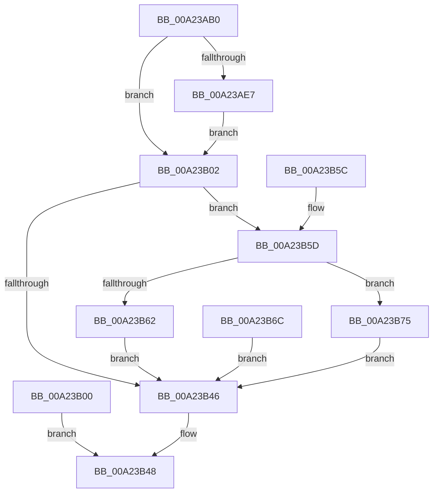

# NtOpenSemaphore

- RVA: `0x00A23AB0`–`0x00A23B7F` (길이 `207` bytes)
- VA: `0x0000000140A23AB0`
- 실행 섹션: `PAGE`
- PDB 이름 있음: `예`; PDB Function 태그: `아니요`
- unwind 정보 RVA: `0x000AB708`
- 디코드: `56`개 명령, `207/207` bytes 표시
- 미해석 바이트: `0` (있으면 어셈블리에 `.byte`로 보존)

> 이 문서는 커널 이미지의 기계어와 PDB 기호를 분석해 생성했습니다. 4번과 5번은 함수 원형과 자료형을 바이너리 사용 방식에서 추정한 C 해석이며 원본 소스 복구 결과는 아닙니다.

## 1. Dependencies

- 직접 호출 지점: **2**; 고유 호출 대상: **2**
- 직접 호출자로 확인된 함수: **0**
- RIP 상대 이미지 참조: **1**

### Outgoing calls
- `0x00A23B09` → [PsGetCurrentSilo](../../text/40/PsGetCurrentSilo_function_004094A0.md) (function, `0x004094A0`)
- `0x00A23B34` → [ObOpenObjectByNameEx](../89/ObOpenObjectByNameEx_function_0089A8A0.md) (function, `0x0089A8A0`)

### Direct callers
- 이 함수 시작 RVA로 연결되는 직접 call은 확인되지 않았습니다. 간접 호출은 완전히 역산할 수 없습니다.

### Static image references
- `0x00A23B02` → RVA `0x00FC52C0` (`ALMOSTRO`; read)

## 2. Other-region calls and transfers

- 다른 실행 섹션으로 향하는 call: **1**
  - `0x00A23B09` → [PsGetCurrentSilo](../../text/40/PsGetCurrentSilo_function_004094A0.md) (`PAGE` → `.text`)
- 별도 외부 분기/꼬리 이동을 확인하지 못했습니다.

## 3. Assembly (complete function range)

```asm
00A23AB0  48 89 5C 24 08                  mov qword ptr [rsp + 8], rbx
00A23AB5  48 89 74 24 10                  mov qword ptr [rsp + 0x10], rsi
00A23ABA  57                              push rdi
00A23ABB  41 56                           push r14
00A23ABD  41 57                           push r15
00A23ABF  48 83 EC 50                     sub rsp, 0x50
00A23AC3  4D 8B F0                        mov r14, r8
00A23AC6  44 8B FA                        mov r15d, edx
00A23AC9  48 8B F9                        mov rdi, rcx
00A23ACC  48 83 64 24 40 00               and qword ptr [rsp + 0x40], 0
00A23AD2  65 48 8B 04 25 88 01 00 00      mov rax, qword ptr gs:[0x188]
00A23ADB  40 8A B0 32 02 00 00            mov sil, byte ptr [rax + 0x232]
00A23AE2  40 84 F6                        test sil, sil
00A23AE5  74 1B                           je 0x140a23b02
00A23AE7  48 BA 00 00 FF FF FF 7F 00 00   movabs rdx, 0x7fffffff0000
00A23AF1  48 3B CA                        cmp rcx, rdx
00A23AF4  48 0F 42 D1                     cmovb rdx, rcx
00A23AF8  48 8B 02                        mov rax, qword ptr [rdx]
00A23AFB  48 89 02                        mov qword ptr [rdx], rax
00A23AFE  EB 02                           jmp 0x140a23b02
00A23B00  EB 46                           jmp 0x140a23b48
00A23B02  48 8B 1D B7 17 5A 00            mov rbx, qword ptr [rip + 0x5a17b7]
00A23B09  E8 92 59 9E FF                  call 0x1404094a0
00A23B0E  48 8D 4C 24 40                  lea rcx, [rsp + 0x40]
00A23B13  48 89 4C 24 38                  mov qword ptr [rsp + 0x38], rcx
00A23B18  48 89 44 24 30                  mov qword ptr [rsp + 0x30], rax
00A23B1D  48 83 64 24 28 00               and qword ptr [rsp + 0x28], 0
00A23B23  44 89 7C 24 20                  mov dword ptr [rsp + 0x20], r15d
00A23B28  45 33 C9                        xor r9d, r9d
00A23B2B  44 8A C6                        mov r8b, sil
00A23B2E  48 8B D3                        mov rdx, rbx
00A23B31  49 8B CE                        mov rcx, r14
00A23B34  E8 67 6D E7 FF                  call 0x14089a8a0
00A23B39  8B D0                           mov edx, eax
00A23B3B  89 84 24 88 00 00 00            mov dword ptr [rsp + 0x88], eax
00A23B42  85 C0                           test eax, eax
00A23B44  79 17                           jns 0x140a23b5d
00A23B46  8B C2                           mov eax, edx
00A23B48  48 8B 5C 24 70                  mov rbx, qword ptr [rsp + 0x70]
00A23B4D  48 8B 74 24 78                  mov rsi, qword ptr [rsp + 0x78]
00A23B52  48 83 C4 50                     add rsp, 0x50
00A23B56  41 5F                           pop r15
00A23B58  41 5E                           pop r14
00A23B5A  5F                              pop rdi
00A23B5B  C3                              ret
00A23B5C  CC                              int3
00A23B5D  40 84 F6                        test sil, sil
00A23B60  74 13                           je 0x140a23b75
00A23B62  48 8B 4C 24 40                  mov rcx, qword ptr [rsp + 0x40]
00A23B67  48 89 0F                        mov qword ptr [rdi], rcx
00A23B6A  EB DA                           jmp 0x140a23b46
00A23B6C  8B 94 24 88 00 00 00            mov edx, dword ptr [rsp + 0x88]
00A23B73  EB D1                           jmp 0x140a23b46
00A23B75  48 8B 44 24 40                  mov rax, qword ptr [rsp + 0x40]
00A23B7A  48 89 07                        mov qword ptr [rdi], rax
00A23B7D  EB C7                           jmp 0x140a23b46
```

## 4. C-style interpretation (structured pseudocode)

```c
__int64 __fastcall NtOpenSemaphore(__int64 a1, int a2, __int64 a3, int a4)
{
    __int64 result;
    __int64 v_rsp;
    unsigned __int64 v_stack_m28;
    unsigned __int64 v_stack_m30;
    unsigned __int64 v_stack_m38;
    unsigned __int64 v_stack_m40;
    unsigned int v_stack_m48;
    unsigned __int64 v_stack_p10;
    unsigned int v_stack_p20;
    unsigned __int64 v_stack_p40;
    unsigned __int64 v_stack_p8;
    unsigned int v_stack_p88;

    v_stack_p8 = v_rbx;
    v_stack_p10 = v_rsi;
    v_rsp = (v_rsp) - (80);
    if ((unsigned __int8)(*(unsigned __int8 *)(*(unsigned __int64 *)(gs_base + (0 + 392)) + 562)) == 0) goto loc_00A23B02;
    if (a1 < a2) { a2 = a1; }
    *(unsigned __int64 *)(a2) = *(unsigned __int64 *)(a2);
    goto loc_00A23B02;
loc_00A23B02:
    result = PsGetCurrentSilo(a1, a2, a3, a4);
    v_stack_m30 = v_stack_m28;
    v_stack_m38 = result;
    v_stack_m48 = (unsigned int)((unsigned int)(a2));
    a4 = 0;
    result = ObOpenObjectByNameEx(a3, *(unsigned __int64 *)(v_rip + 5904311), (unsigned __int8)(*(unsigned __int8 *)(*(unsigned __int64 *)(gs_base + (0 + 392)) + 562)), a4);
    v_stack_p20 = (unsigned int)(result);
    if (!sign_flag) goto loc_00A23B5D;
loc_00A23B46:
loc_00A23B48:
    v_rsp = (v_rsp) + (80);
    return (unsigned int)((unsigned int)((unsigned int)((unsigned int)(result))));
loc_00A23B5D:
    if ((unsigned __int8)(v_stack_p10) == 0) goto loc_00A23B75;
    *(unsigned __int64 *)(a1) = v_stack_p40;
    goto loc_00A23B46;
loc_00A23B75:
    *(unsigned __int64 *)(a1) = v_stack_p40;
    goto loc_00A23B46;
}
```

## 5. (Beta) C Style

```c
int64_t NtOpenSemaphore(void *Arg1, int32_t Arg2, int64_t Arg3, int32_t Arg4)
{
    uint8_t *arg1 = (uint8_t *)Arg1;

    int64_t result;
    int64_t local_rsp;
    uint64_t v_stack_m28;
    uint64_t v_stack_m30;
    uint64_t v_stack_m38;
    uint64_t v_stack_m40;
    uint32_t v_stack_m48;
    uint64_t v_stack_p10;
    uint32_t v_stack_p20;
    uint64_t v_stack_p40;
    uint64_t v_stack_p8;
    uint32_t v_stack_p88;

    v_stack_p8 = local_rbx;
    v_stack_p10 = local_rsi;
    local_rsp = (local_rsp) - (80);
    if ((uint8_t)(*(uint8_t *)(*(uint64_t *)(gs_base + (0 + 0x188)) + 0x232)) == 0) goto loc_00A23B02;
    if (Arg1 < Arg2) { Arg2 = Arg1; }
    *(uint64_t *)(Arg2) = *(uint64_t *)(Arg2);
    goto loc_00A23B02;
loc_00A23B02:
    result = PsGetCurrentSilo(Arg1, Arg2, Arg3, Arg4);
    v_stack_m30 = v_stack_m28;
    v_stack_m38 = result;
    v_stack_m48 = (uint32_t)((uint32_t)(Arg2));
    Arg4 = 0;
    result = ObOpenObjectByNameEx(Arg3, *(uint64_t *)(v_rip + 0x5A17B7), (uint8_t)(*(uint8_t *)(*(uint64_t *)(gs_base + (0 + 0x188)) + 0x232)), Arg4);
    v_stack_p20 = (uint32_t)(result);
    if (!sign_flag) goto loc_00A23B5D;
loc_00A23B46:
loc_00A23B48:
    local_rsp = (local_rsp) + (80);
    return (uint32_t)((uint32_t)((uint32_t)((uint32_t)(result))));
loc_00A23B5D:
    if ((uint8_t)(v_stack_p10) == 0) goto loc_00A23B75;
    *(uint64_t *)(arg1) = v_stack_p40;
    goto loc_00A23B46;
loc_00A23B75:
    *(uint64_t *)(arg1) = v_stack_p40;
    goto loc_00A23B46;
}
```

### 관측된 메모리 오프셋

구조체 형식이 확인되지 않은 접근은 인자 기준의 오프셋으로만 기록했습니다.

| 기준 인자 | 오프셋 표현 | 폭 (bit) | 접근 |
|---|---:|---:|---|
| `Arg1` | `+ 0x0` | `64` | `W` |

## 6. Execution-region graph

[열기: 2D/3D 그래프와 함수 탐색 컨트롤 패널](../../../control-panel.html?section=page&rva=0x00A23AB0&view=graph)

- 2D 그래프는 위에서 아래로 흐르고, 3D 그래프는 빈 공간을 드래그해 회전합니다. Shift+드래그는 이동, 휠은 확대·축소, 함수 노드 선택은 대상 보고서 이동입니다.

### Static fallback


