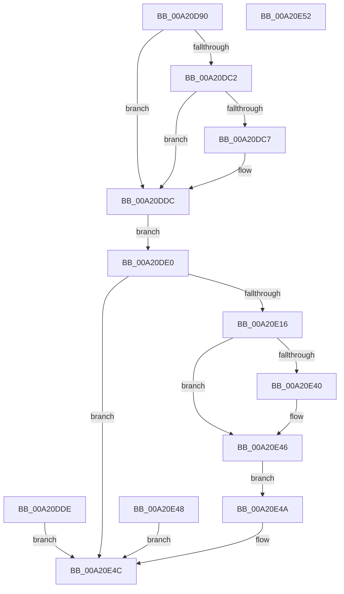

# NtResumeThread

- RVA: `0x00A20D90`–`0x00A20E53` (길이 `195` bytes)
- VA: `0x0000000140A20D90`
- 실행 섹션: `PAGE`
- PDB 이름 있음: `예`; PDB Function 태그: `아니요`
- unwind 정보 RVA: `0x000AAEB0`
- 디코드: `49`개 명령, `195/195` bytes 표시
- 미해석 바이트: `0` (있으면 어셈블리에 `.byte`로 보존)

> 이 문서는 커널 이미지의 기계어와 PDB 기호를 분석해 생성했습니다. 4번과 5번은 함수 원형과 자료형을 바이너리 사용 방식에서 추정한 C 해석이며 원본 소스 복구 결과는 아닙니다.

## 1. Dependencies

- 직접 호출 지점: **3**; 고유 호출 대상: **3**
- 직접 호출자로 확인된 함수: **0**
- RIP 상대 이미지 참조: **1**

### Outgoing calls
- `0x00A20E0D` → [ObpReferenceObjectByHandleWithTag](../86/ObpReferenceObjectByHandleWithTag_function_00869650.md) (function, `0x00869650`)
- `0x00A20E26` → [PsMultiResumeThread](../../text/20/PsMultiResumeThread_function_002027C4.md) (function, `0x002027C4`)
- `0x00A20E35` → [ObfDereferenceObjectWithTag](../../text/2F/ObfDereferenceObjectWithTag_function_002F78E0.md) (function, `0x002F78E0`)

### Direct callers
- 이 함수 시작 RVA로 연결되는 직접 call은 확인되지 않았습니다. 간접 호출은 완전히 역산할 수 없습니다.

### Static image references
- `0x00A20DE0` → RVA `0x00FC6AC8` (`ALMOSTRO`; read)

## 2. Other-region calls and transfers

- 다른 실행 섹션으로 향하는 call: **2**
  - `0x00A20E26` → [PsMultiResumeThread](../../text/20/PsMultiResumeThread_function_002027C4.md) (`PAGE` → `.text`)
  - `0x00A20E35` → [ObfDereferenceObjectWithTag](../../text/2F/ObfDereferenceObjectWithTag_function_002F78E0.md) (`PAGE` → `.text`)
- 별도 외부 분기/꼬리 이동을 확인하지 못했습니다.

## 3. Assembly (complete function range)

```asm
00A20D90  40 53                           push rbx
00A20D92  48 83 EC 50                     sub rsp, 0x50
00A20D96  48 8B DA                        mov rbx, rdx
00A20D99  4C 8B D1                        mov r10, rcx
00A20D9C  C7 44 24 70 00 00 00 00         mov dword ptr [rsp + 0x70], 0
00A20DA4  48 C7 44 24 78 00 00 00 00      mov qword ptr [rsp + 0x78], 0
00A20DAD  65 48 8B 04 25 88 01 00 00      mov rax, qword ptr gs:[0x188]
00A20DB6  44 8A 88 32 02 00 00            mov r9b, byte ptr [rax + 0x232]
00A20DBD  45 84 C9                        test r9b, r9b
00A20DC0  74 1A                           je 0x140a20ddc
00A20DC2  48 85 D2                        test rdx, rdx
00A20DC5  74 15                           je 0x140a20ddc
00A20DC7  48 B9 00 00 FF FF FF 7F 00 00   movabs rcx, 0x7fffffff0000
00A20DD1  48 3B D1                        cmp rdx, rcx
00A20DD4  48 0F 42 CA                     cmovb rcx, rdx
00A20DD8  8B 01                           mov eax, dword ptr [rcx]
00A20DDA  89 01                           mov dword ptr [rcx], eax
00A20DDC  EB 02                           jmp 0x140a20de0
00A20DDE  EB 6C                           jmp 0x140a20e4c
00A20DE0  4C 8B 05 E1 5C 5A 00            mov r8, qword ptr [rip + 0x5a5ce1]
00A20DE7  48 83 64 24 38 00               and qword ptr [rsp + 0x38], 0
00A20DED  48 83 64 24 30 00               and qword ptr [rsp + 0x30], 0
00A20DF3  48 8D 44 24 78                  lea rax, [rsp + 0x78]
00A20DF8  48 89 44 24 28                  mov qword ptr [rsp + 0x28], rax
00A20DFD  C7 44 24 20 50 73 53 75         mov dword ptr [rsp + 0x20], 0x75537350
00A20E05  BA 00 10 00 00                  mov edx, 0x1000
00A20E0A  49 8B CA                        mov rcx, r10
00A20E0D  E8 3E 88 E4 FF                  call 0x140869650
00A20E12  85 C0                           test eax, eax
00A20E14  78 36                           js 0x140a20e4c
00A20E16  41 B8 01 00 00 00               mov r8d, 1
00A20E1C  48 8D 54 24 70                  lea rdx, [rsp + 0x70]
00A20E21  48 8B 4C 24 78                  mov rcx, qword ptr [rsp + 0x78]
00A20E26  E8 99 19 7E FF                  call 0x1402027c4
00A20E2B  BA 50 73 53 75                  mov edx, 0x75537350
00A20E30  48 8B 4C 24 78                  mov rcx, qword ptr [rsp + 0x78]
00A20E35  E8 A6 6A 8D FF                  call 0x1402f78e0
00A20E3A  90                              nop
00A20E3B  48 85 DB                        test rbx, rbx
00A20E3E  74 06                           je 0x140a20e46
00A20E40  8B 44 24 70                     mov eax, dword ptr [rsp + 0x70]
00A20E44  89 03                           mov dword ptr [rbx], eax
00A20E46  EB 02                           jmp 0x140a20e4a
00A20E48  EB 02                           jmp 0x140a20e4c
00A20E4A  33 C0                           xor eax, eax
00A20E4C  48 83 C4 50                     add rsp, 0x50
00A20E50  5B                              pop rbx
00A20E51  C3                              ret
00A20E52  CC                              int3
```

## 4. C-style interpretation (structured pseudocode)

```c
__int64 __fastcall NtResumeThread(__int64 a1, __int64 a2)
{
    __int64 result;
    __int64 v_rsp;
    unsigned __int64 v_stack_m20;
    unsigned __int64 v_stack_m28;
    unsigned __int64 v_stack_m30;
    unsigned int v_stack_m38;
    unsigned int v_stack_p18;
    unsigned __int64 v_stack_p20;

    v_rsp = (v_rsp) - (80);
    v_stack_p18 = 0;
    v_stack_p20 = 0;
    if ((unsigned __int8)(*(unsigned __int8 *)(*(unsigned __int64 *)(gs_base + (0 + 392)) + 562)) == 0) goto loc_00A20DDC;
    result = *(unsigned __int64 *)(gs_base + (0 + 392));
    if (a2 != 0) {
        if (a2 < a1) { a1 = a2; }
        result = *(unsigned int *)(a1);
        *(unsigned int *)(a1) = (unsigned int)(result);
    }
    goto loc_00A20DE0;
loc_00A20DE0:
    v_stack_m30 = v_stack_p20;
    v_stack_m38 = 0x75537350ULL;
    result = ObpReferenceObjectByHandleWithTag(a1, (unsigned int)(0x1000ULL), *(unsigned __int64 *)(v_rip + 5922017), *(unsigned __int8 *)(*(unsigned __int64 *)(gs_base + (0 + 392)) + 562));
    if (sign_flag) goto loc_00A20E4C;
    result = PsMultiResumeThread(v_stack_p20, v_stack_p18, 1, *(unsigned __int8 *)(*(unsigned __int64 *)(gs_base + (0 + 392)) + 562));
    result = ObfDereferenceObjectWithTag(v_stack_p20, (unsigned int)(0x75537350ULL), 1, *(unsigned __int8 *)(*(unsigned __int64 *)(gs_base + (0 + 392)) + 562));
    if (a2 != 0) {
        result = v_stack_p18;
        *(unsigned int *)(a2) = (unsigned int)(result);
    }
    goto loc_00A20E4A;
loc_00A20E4A:
    result = 0;
loc_00A20E4C:
    v_rsp = (v_rsp) + (80);
    return result;
}
```

## 5. (Beta) C Style

```c
int64_t NtResumeThread(int64_t Arg1, int64_t Arg2)
{
    int64_t result;
    int64_t local_rsp;
    uint64_t v_stack_m20;
    uint64_t v_stack_m28;
    uint64_t v_stack_m30;
    uint32_t v_stack_m38;
    uint32_t v_stack_p18;
    uint64_t v_stack_p20;

    local_rsp = (local_rsp) - (80);
    v_stack_p18 = 0;
    v_stack_p20 = 0;
    if ((uint8_t)(*(uint8_t *)(*(uint64_t *)(gs_base + (0 + 0x188)) + 0x232)) == 0) goto loc_00A20DDC;
    result = *(uint64_t *)(gs_base + (0 + 0x188));
    if (Arg2 != 0) {
        if (Arg2 < Arg1) { Arg1 = Arg2; }
        result = *(uint32_t *)(Arg1);
        *(uint32_t *)(Arg1) = (uint32_t)(result);
    }
    goto loc_00A20DE0;
loc_00A20DE0:
    v_stack_m30 = v_stack_p20;
    v_stack_m38 = 0x75537350ULL;
    result = ObpReferenceObjectByHandleWithTag(Arg1, (uint32_t)(0x1000ULL), *(uint64_t *)(v_rip + 0x5A5CE1), *(uint8_t *)(*(uint64_t *)(gs_base + (0 + 0x188)) + 0x232));
    if (sign_flag) goto loc_00A20E4C;
    result = PsMultiResumeThread(v_stack_p20, v_stack_p18, 1, *(uint8_t *)(*(uint64_t *)(gs_base + (0 + 0x188)) + 0x232));
    result = ObfDereferenceObjectWithTag(v_stack_p20, (uint32_t)(0x75537350ULL), 1, *(uint8_t *)(*(uint64_t *)(gs_base + (0 + 0x188)) + 0x232));
    if (Arg2 != 0) {
        result = v_stack_p18;
        *(uint32_t *)(Arg2) = (uint32_t)(result);
    }
    goto loc_00A20E4A;
loc_00A20E4A:
    result = 0;
loc_00A20E4C:
    local_rsp = (local_rsp) + (80);
    return result;
}
```

## 6. Execution-region graph

[열기: 2D/3D 그래프와 함수 탐색 컨트롤 패널](../../../control-panel.html?section=page&rva=0x00A20D90&view=graph)

- 2D 그래프는 위에서 아래로 흐르고, 3D 그래프는 빈 공간을 드래그해 회전합니다. Shift+드래그는 이동, 휠은 확대·축소, 함수 노드 선택은 대상 보고서 이동입니다.

### Static fallback


