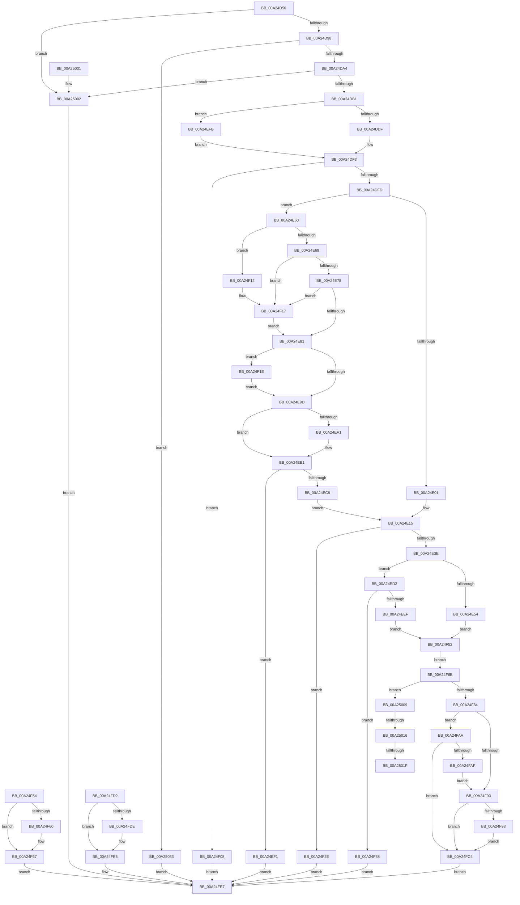

# NtTranslateFilePath

- RVA: `0x00A24D50`–`0x00A2503A` (길이 `746` bytes)
- VA: `0x0000000140A24D50`
- 실행 섹션: `PAGE`
- PDB 이름 있음: `예`; PDB Function 태그: `예`
- unwind 정보 RVA: `0x000AB8CC`
- 디코드: `207`개 명령, `746/746` bytes 표시
- 미해석 바이트: `0` (있으면 어셈블리에 `.byte`로 보존)

> 이 문서는 커널 이미지의 기계어와 PDB 기호를 분석해 생성했습니다. 4번과 5번은 함수 원형과 자료형을 바이너리 사용 방식에서 추정한 C 해석이며 원본 소스 복구 결과는 아닙니다.

## 1. Dependencies

- 직접 호출 지점: **15**; 고유 호출 대상: **8**
- 직접 호출자로 확인된 함수: **0**
- RIP 상대 이미지 참조: **2**

### Outgoing calls
- `0x00A24DA4` → [PsIsCurrentThreadInServerSilo](../../text/43/PsIsCurrentThreadInServerSilo_function_004362E0.md) (function, `0x004362E0`)
- `0x00A24E28` → [ExAllocatePool2](../../poolcode/B8/ExAllocatePool2_function_00B820F0.md) (function, `0x00B820F0`)
- `0x00A24E47` → [memcpy](../../text/6C/memcpy_function_006C6840.md) (function, `0x006C6840`)
- `0x00A24EAC` → [ProbeForWrite](../8E/ProbeForWrite_function_008E91C0.md) (function, `0x008E91C0`)
- `0x00A24EBC` → [SeSinglePrivilegeCheck](../87/SeSinglePrivilegeCheck_function_00871E20.md) (function, `0x00871E20`)
- `0x00A24EDD` → [ExAllocatePool2](../../poolcode/B8/ExAllocatePool2_function_00B820F0.md) (function, `0x00B820F0`)
- `0x00A24F12` → [ExRaiseDatatypeMisalignment](../89/ExRaiseDatatypeMisalignment_function_00899FD0.md) (function, `0x00899FD0`)
- `0x00A24F3D` → [ExFreePoolWithTag](../../poolcode/B8/ExFreePoolWithTag_function_00B82870.md) (function, `0x00B82870`)
- `0x00A24F62` → [ExFreePoolWithTag](../../poolcode/B8/ExFreePoolWithTag_function_00B82870.md) (function, `0x00B82870`)
- `0x00A24F75` → [ExpVerifyFilePath](ExpVerifyFilePath_function_00A257F0.md) (function, `0x00A257F0`)
- `0x00A24F89` → [ExFreePoolWithTag](../../poolcode/B8/ExFreePoolWithTag_function_00B82870.md) (function, `0x00B82870`)
- `0x00A24F9D` → [ExFreePoolWithTag](../../poolcode/B8/ExFreePoolWithTag_function_00B82870.md) (function, `0x00B82870`)
- `0x00A24FBD` → [memcpy](../../text/6C/memcpy_function_006C6840.md) (function, `0x006C6840`)
- `0x00A24FE0` → [ExFreePoolWithTag](../../poolcode/B8/ExFreePoolWithTag_function_00B82870.md) (function, `0x00B82870`)
- `0x00A25028` → [memcpy](../../text/6C/memcpy_function_006C6840.md) (function, `0x006C6840`)

### Direct callers
- 이 함수 시작 RVA로 연결되는 직접 call은 확인되지 않았습니다. 간접 호출은 완전히 역산할 수 없습니다.

### Static image references
- `0x00A24D8B` → RVA `0x00EFF050` (`.data`; read)
- `0x00A24EB5` → RVA `0x00FD9AB8` (`PAGEDATA`; read)

## 2. Other-region calls and transfers

- 다른 실행 섹션으로 향하는 call: **11**
  - `0x00A24DA4` → [PsIsCurrentThreadInServerSilo](../../text/43/PsIsCurrentThreadInServerSilo_function_004362E0.md) (`PAGE` → `.text`)
  - `0x00A24E28` → [ExAllocatePool2](../../poolcode/B8/ExAllocatePool2_function_00B820F0.md) (`PAGE` → `POOLCODE`)
  - `0x00A24E47` → [memcpy](../../text/6C/memcpy_function_006C6840.md) (`PAGE` → `.text`)
  - `0x00A24EDD` → [ExAllocatePool2](../../poolcode/B8/ExAllocatePool2_function_00B820F0.md) (`PAGE` → `POOLCODE`)
  - `0x00A24F3D` → [ExFreePoolWithTag](../../poolcode/B8/ExFreePoolWithTag_function_00B82870.md) (`PAGE` → `POOLCODE`)
  - `0x00A24F62` → [ExFreePoolWithTag](../../poolcode/B8/ExFreePoolWithTag_function_00B82870.md) (`PAGE` → `POOLCODE`)
  - `0x00A24F89` → [ExFreePoolWithTag](../../poolcode/B8/ExFreePoolWithTag_function_00B82870.md) (`PAGE` → `POOLCODE`)
  - `0x00A24F9D` → [ExFreePoolWithTag](../../poolcode/B8/ExFreePoolWithTag_function_00B82870.md) (`PAGE` → `POOLCODE`)
  - `0x00A24FBD` → [memcpy](../../text/6C/memcpy_function_006C6840.md) (`PAGE` → `.text`)
  - `0x00A24FE0` → [ExFreePoolWithTag](../../poolcode/B8/ExFreePoolWithTag_function_00B82870.md) (`PAGE` → `POOLCODE`)
  - `0x00A25028` → [memcpy](../../text/6C/memcpy_function_006C6840.md) (`PAGE` → `.text`)
- call이 아닌 외부 분기/꼬리 이동: **3**
  - `0x00A25010` → [sub_00B37C9A + 0x12](../B3/Unknown_function_00B37C9A.md) (`tail-transfer`)
  - `0x00A25019` → [sub_00B37C9A](../B3/Unknown_function_00B37C9A.md) (`tail-transfer`)
  - `0x00A2502E` → [sub_00B37C9A + 0x5](../B3/Unknown_function_00B37C9A.md) (`tail-transfer`)

## 3. Assembly (complete function range)

```asm
00A24D50  48 8B C4                        mov rax, rsp
00A24D53  48 89 58 08                     mov qword ptr [rax + 8], rbx
00A24D57  48 89 70 10                     mov qword ptr [rax + 0x10], rsi
00A24D5B  4C 89 48 20                     mov qword ptr [rax + 0x20], r9
00A24D5F  4C 89 40 18                     mov qword ptr [rax + 0x18], r8
00A24D63  57                              push rdi
00A24D64  41 54                           push r12
00A24D66  41 55                           push r13
00A24D68  41 56                           push r14
00A24D6A  41 57                           push r15
00A24D6C  48 83 EC 60                     sub rsp, 0x60
00A24D70  49 8B F9                        mov rdi, r9
00A24D73  49 8B F0                        mov rsi, r8
00A24D76  44 8B EA                        mov r13d, edx
00A24D79  48 8B D9                        mov rbx, rcx
00A24D7C  45 33 F6                        xor r14d, r14d
00A24D7F  44 89 70 9C                     mov dword ptr [rax - 0x64], r14d
00A24D83  4C 89 70 B0                     mov qword ptr [rax - 0x50], r14
00A24D87  4C 89 70 A8                     mov qword ptr [rax - 0x58], r14
00A24D8B  83 3D BE A2 4D 00 02            cmp dword ptr [rip + 0x4da2be], 2
00A24D92  0F 85 6A 02 00 00               jne 0x140a25002
00A24D98  8D 42 FF                        lea eax, [rdx - 1]
00A24D9B  83 F8 04                        cmp eax, 4
00A24D9E  0F 87 8F 02 00 00               ja 0x140a25033
00A24DA4  E8 37 15 A1 FF                  call 0x1404362e0
00A24DA9  84 C0                           test al, al
00A24DAB  0F 85 51 02 00 00               jne 0x140a25002
00A24DB1  65 48 8B 04 25 88 01 00 00      mov rax, qword ptr gs:[0x188]
00A24DBA  48 89 44 24 50                  mov qword ptr [rsp + 0x50], rax
00A24DBF  8A 90 32 02 00 00               mov dl, byte ptr [rax + 0x232]
00A24DC5  88 54 24 20                     mov byte ptr [rsp + 0x20], dl
00A24DC9  4C 8D 7B 04                     lea r15, [rbx + 4]
00A24DCD  48 B9 00 00 FF FF FF 7F 00 00   movabs rcx, 0x7fffffff0000
00A24DD7  84 D2                           test dl, dl
00A24DD9  0F 84 1C 01 00 00               je 0x140a24efb
00A24DDF  4C 3B F9                        cmp r15, rcx
00A24DE2  4C 0F 43 F9                     cmovae r15, rcx
00A24DE6  90                              nop
00A24DE7  45 8B 3F                        mov r15d, dword ptr [r15]
00A24DEA  44 89 7C 24 2C                  mov dword ptr [rsp + 0x2c], r15d
00A24DEF  8A 54 24 20                     mov dl, byte ptr [rsp + 0x20]
00A24DF3  41 83 FF 0C                     cmp r15d, 0xc
00A24DF7  0F 82 0B 01 00 00               jb 0x140a24f08
00A24DFD  84 D2                           test dl, dl
00A24DFF  75 5F                           jne 0x140a24e60
00A24E01  8B 0F                           mov ecx, dword ptr [rdi]
00A24E03  89 4C 24 24                     mov dword ptr [rsp + 0x24], ecx
00A24E07  48 8B C6                        mov rax, rsi
00A24E0A  48 F7 D8                        neg rax
00A24E0D  1B FF                           sbb edi, edi
00A24E0F  23 F9                           and edi, ecx
00A24E11  89 7C 24 24                     mov dword ptr [rsp + 0x24], edi
00A24E15  45 8B E7                        mov r12d, r15d
00A24E18  BE 45 6E 76 72                  mov esi, 0x72766e45
00A24E1D  44 8B C6                        mov r8d, esi
00A24E20  41 8B D7                        mov edx, r15d
00A24E23  B9 40 00 00 00                  mov ecx, 0x40
00A24E28  E8 C3 D2 15 00                  call 0x140b820f0
00A24E2D  4C 8B F0                        mov r14, rax
00A24E30  48 89 44 24 38                  mov qword ptr [rsp + 0x38], rax
00A24E35  48 85 C0                        test rax, rax
00A24E38  0F 84 F0 00 00 00               je 0x140a24f2e
00A24E3E  45 8B C4                        mov r8d, r12d
00A24E41  48 8B D3                        mov rdx, rbx
00A24E44  48 8B C8                        mov rcx, rax
00A24E47  E8 F4 19 CA FF                  call 0x1406c6840
00A24E4C  45 89 7E 04                     mov dword ptr [r14 + 4], r15d
00A24E50  85 FF                           test edi, edi
00A24E52  75 7F                           jne 0x140a24ed3
00A24E54  33 F6                           xor esi, esi
00A24E56  48 89 74 24 30                  mov qword ptr [rsp + 0x30], rsi
00A24E5B  E9 F2 00 00 00                  jmp 0x140a24f52
00A24E60  F6 C3 03                        test bl, 3
00A24E63  0F 85 A9 00 00 00               jne 0x140a24f12
00A24E69  41 8B D7                        mov edx, r15d
00A24E6C  48 03 D3                        add rdx, rbx
00A24E6F  48 3B D1                        cmp rdx, rcx
00A24E72  0F 87 9F 00 00 00               ja 0x140a24f17
00A24E78  48 3B D3                        cmp rdx, rbx
00A24E7B  0F 82 96 00 00 00               jb 0x140a24f17
00A24E81  48 3B F9                        cmp rdi, rcx
00A24E84  48 0F 42 CF                     cmovb rcx, rdi
00A24E88  8B 01                           mov eax, dword ptr [rcx]
00A24E8A  89 01                           mov dword ptr [rcx], eax
00A24E8C  8B 3F                           mov edi, dword ptr [rdi]
00A24E8E  89 7C 24 24                     mov dword ptr [rsp + 0x24], edi
00A24E92  8B C7                           mov eax, edi
00A24E94  48 85 F6                        test rsi, rsi
00A24E97  0F 84 81 00 00 00               je 0x140a24f1e
00A24E9D  85 C0                           test eax, eax
00A24E9F  74 10                           je 0x140a24eb1
00A24EA1  8B D0                           mov edx, eax
00A24EA3  41 B8 04 00 00 00               mov r8d, 4
00A24EA9  48 8B CE                        mov rcx, rsi
00A24EAC  E8 0F 43 EC FF                  call 0x1408e91c0
00A24EB1  8A 54 24 20                     mov dl, byte ptr [rsp + 0x20]
00A24EB5  48 8B 0D FC 4B 5B 00            mov rcx, qword ptr [rip + 0x5b4bfc]
00A24EBC  E8 5F CF E4 FF                  call 0x140871e20
00A24EC1  88 44 24 2A                     mov byte ptr [rsp + 0x2a], al
00A24EC5  84 C0                           test al, al
00A24EC7  74 28                           je 0x140a24ef1
00A24EC9  44 8B 7C 24 2C                  mov r15d, dword ptr [rsp + 0x2c]
00A24ECE  E9 42 FF FF FF                  jmp 0x140a24e15
00A24ED3  8B D7                           mov edx, edi
00A24ED5  44 8B C6                        mov r8d, esi
00A24ED8  B9 40 00 00 00                  mov ecx, 0x40
00A24EDD  E8 0E D2 15 00                  call 0x140b820f0
00A24EE2  48 8B F0                        mov rsi, rax
00A24EE5  48 89 44 24 30                  mov qword ptr [rsp + 0x30], rax
00A24EEA  48 85 C0                        test rax, rax
00A24EED  74 49                           je 0x140a24f38
00A24EEF  EB 61                           jmp 0x140a24f52
00A24EF1  B8 61 00 00 C0                  mov eax, 0xc0000061
00A24EF6  E9 EC 00 00 00                  jmp 0x140a24fe7
00A24EFB  45 8B 3F                        mov r15d, dword ptr [r15]
00A24EFE  44 89 7C 24 2C                  mov dword ptr [rsp + 0x2c], r15d
00A24F03  E9 EB FE FF FF                  jmp 0x140a24df3
00A24F08  B8 0D 00 00 C0                  mov eax, 0xc000000d
00A24F0D  E9 D5 00 00 00                  jmp 0x140a24fe7
00A24F12  E8 B9 50 E7 FF                  call 0x140899fd0
00A24F17  8A 01                           mov al, byte ptr [rcx]
00A24F19  E9 63 FF FF FF                  jmp 0x140a24e81
00A24F1E  41 8B FE                        mov edi, r14d
00A24F21  44 89 74 24 24                  mov dword ptr [rsp + 0x24], r14d
00A24F26  41 8B C6                        mov eax, r14d
00A24F29  E9 6F FF FF FF                  jmp 0x140a24e9d
00A24F2E  B8 9A 00 00 C0                  mov eax, 0xc000009a
00A24F33  E9 AF 00 00 00                  jmp 0x140a24fe7
00A24F38  33 D2                           xor edx, edx
00A24F3A  49 8B CE                        mov rcx, r14
00A24F3D  E8 2E D9 15 00                  call 0x140b82870
00A24F42  48 83 64 24 38 00               and qword ptr [rsp + 0x38], 0
00A24F48  B8 9A 00 00 C0                  mov eax, 0xc000009a
00A24F4D  E9 95 00 00 00                  jmp 0x140a24fe7
00A24F52  EB 17                           jmp 0x140a24f6b
00A24F54  8B D8                           mov ebx, eax
00A24F56  48 8B 4C 24 38                  mov rcx, qword ptr [rsp + 0x38]
00A24F5B  48 85 C9                        test rcx, rcx
00A24F5E  74 07                           je 0x140a24f67
00A24F60  33 D2                           xor edx, edx
00A24F62  E8 09 D9 15 00                  call 0x140b82870
00A24F67  8B C3                           mov eax, ebx
00A24F69  EB 7C                           jmp 0x140a24fe7
00A24F6B  41 8B 56 04                     mov edx, dword ptr [r14 + 4]
00A24F6F  49 03 D6                        add rdx, r14
00A24F72  49 8B CE                        mov rcx, r14
00A24F75  E8 76 08 00 00                  call 0x140a257f0
00A24F7A  8B D8                           mov ebx, eax
00A24F7C  85 C0                           test eax, eax
00A24F7E  0F 89 85 00 00 00               jns 0x140a25009
00A24F84  33 D2                           xor edx, edx
00A24F86  49 8B CE                        mov rcx, r14
00A24F89  E8 E2 D8 15 00                  call 0x140b82870
00A24F8E  90                              nop
00A24F8F  85 DB                           test ebx, ebx
00A24F91  79 17                           jns 0x140a24faa
00A24F93  48 85 F6                        test rsi, rsi
00A24F96  74 2C                           je 0x140a24fc4
00A24F98  33 D2                           xor edx, edx
00A24F9A  48 8B CE                        mov rcx, rsi
00A24F9D  E8 CE D8 15 00                  call 0x140b82870
00A24FA2  48 83 64 24 30 00               and qword ptr [rsp + 0x30], 0
00A24FA8  EB 1A                           jmp 0x140a24fc4
00A24FAA  48 85 F6                        test rsi, rsi
00A24FAD  74 15                           je 0x140a24fc4
00A24FAF  44 8B C7                        mov r8d, edi
00A24FB2  48 8B D6                        mov rdx, rsi
00A24FB5  48 8B 8C 24 A0 00 00 00         mov rcx, qword ptr [rsp + 0xa0]
00A24FBD  E8 7E 18 CA FF                  call 0x1406c6840
00A24FC2  EB CF                           jmp 0x140a24f93
00A24FC4  48 8B 84 24 A8 00 00 00         mov rax, qword ptr [rsp + 0xa8]
00A24FCC  89 38                           mov dword ptr [rax], edi
00A24FCE  8B C3                           mov eax, ebx
00A24FD0  EB 15                           jmp 0x140a24fe7
00A24FD2  8B D8                           mov ebx, eax
00A24FD4  48 8B 4C 24 30                  mov rcx, qword ptr [rsp + 0x30]
00A24FD9  48 85 C9                        test rcx, rcx
00A24FDC  74 07                           je 0x140a24fe5
00A24FDE  33 D2                           xor edx, edx
00A24FE0  E8 8B D8 15 00                  call 0x140b82870
00A24FE5  8B C3                           mov eax, ebx
00A24FE7  4C 8D 5C 24 60                  lea r11, [rsp + 0x60]
00A24FEC  49 8B 5B 30                     mov rbx, qword ptr [r11 + 0x30]
00A24FF0  49 8B 73 38                     mov rsi, qword ptr [r11 + 0x38]
00A24FF4  49 8B E3                        mov rsp, r11
00A24FF7  41 5F                           pop r15
00A24FF9  41 5E                           pop r14
00A24FFB  41 5D                           pop r13
00A24FFD  41 5C                           pop r12
00A24FFF  5F                              pop rdi
00A25000  C3                              ret
00A25001  CC                              int3
00A25002  B8 02 00 00 C0                  mov eax, 0xc0000002
00A25007  EB DE                           jmp 0x140a24fe7
00A25009  41 8B 46 08                     mov eax, dword ptr [r14 + 8]
00A2500D  44 3B E8                        cmp r13d, eax
00A25010  0F 85 96 2C 11 00               jne 0x140b37cac
00A25016  41 3B FF                        cmp edi, r15d
00A25019  0F 82 7B 2C 11 00               jb 0x140b37c9a
00A2501F  4D 8B C4                        mov r8, r12
00A25022  49 8B D6                        mov rdx, r14
00A25025  48 8B CE                        mov rcx, rsi
00A25028  E8 13 18 CA FF                  call 0x1406c6840
00A2502D  90                              nop
00A2502E  E9 6C 2C 11 00                  jmp 0x140b37c9f
00A25033  B8 0D 00 00 C0                  mov eax, 0xc000000d
00A25038  EB AD                           jmp 0x140a24fe7
```

## 4. C-style interpretation (structured pseudocode)

```c
__int64 __fastcall NtTranslateFilePath(__int64 a1, __int64 a2, __int64 a3, __int64 a4)
{
    __int64 result;
    __int64 v_r14;
    __int64 v_r15;
    __int64 v_rdi;
    __int64 v_rsi;
    __int64 v_rsp;
    unsigned __int64 v_stack_m28;
    unsigned __int64 v_stack_m38;
    unsigned __int64 v_stack_m50;
    unsigned __int64 v_stack_m58;
    unsigned int v_stack_m5C;
    unsigned __int8 v_stack_m5E;
    unsigned int v_stack_m64;
    unsigned __int8 v_stack_m68;
    unsigned __int64 v_stack_p18;
    unsigned __int64 v_stack_p20;

    *(unsigned __int64 *)(v_rsp + 8) = v_rbx;
    *(unsigned __int64 *)(v_rsp + 16) = v_rsi;
    *(unsigned __int64 *)(v_rsp + 32) = a4;
    *(unsigned __int64 *)(v_rsp + 24) = a3;
    v_rsp = (v_rsp) - (96);
    v_r14 = 0;
    *(unsigned int *)(v_rsp - 100) = 0;
    *(unsigned __int64 *)(v_rsp - 80) = 0;
    *(unsigned __int64 *)(v_rsp - 88) = 0;
    if ((*(unsigned int *)(v_rip + 5087934)) != 2) goto loc_00A25002;
    if (((unsigned int)(a2 - 1)) > 4) goto loc_00A25033;
    result = PsIsCurrentThreadInServerSilo(a1, a2, a3, a4);
    if ((unsigned __int8)(result) != 0) goto loc_00A25002;
    v_stack_m38 = *(unsigned __int64 *)(gs_base + (0 + 392));
    v_stack_m68 = (unsigned __int8)(*(unsigned __int8 *)(*(unsigned __int64 *)(gs_base + (0 + 392)) + 562));
    if ((unsigned __int8)(*(unsigned __int8 *)(*(unsigned __int64 *)(gs_base + (0 + 392)) + 562)) == 0) goto loc_00A24EFB;
    v_r15 = a1 + 4;
    if ((a1 + 4) >= a1) { v_r15 = a1; }
    v_stack_m5C = (unsigned int)((unsigned int)(*(unsigned int *)(v_r15)));
loc_00A24DF3:
    if (((unsigned int)((unsigned int)(*(unsigned int *)(v_r15)))) < 12) goto loc_00A24F08;
    if ((unsigned __int8)(v_stack_m68) != 0) goto loc_00A24E60;
    v_stack_m64 = (unsigned int)((unsigned int)(*(unsigned int *)(a4)));
    result = -(a3);
    v_rdi = (unsigned int)((a4) & ((unsigned int)((unsigned int)(*(unsigned int *)(a4)))));
    v_stack_m64 = (unsigned int)(v_rdi);
loc_00A24E15:
    result = ExAllocatePool2(64, (unsigned int)((unsigned int)((unsigned int)(*(unsigned int *)(v_r15)))), (unsigned int)((unsigned int)((unsigned int)(0x72766E45ULL))), a4);
    v_stack_m50 = result;
    if (result == 0) goto loc_00A24F2E;
    result = memcpy(result, a1, (unsigned int)((unsigned int)((unsigned int)((unsigned int)((unsigned int)(*(unsigned int *)(v_r15)))))), a4);
    *(unsigned int *)(result + 4) = (unsigned int)((unsigned int)(*(unsigned int *)(v_r15)));
    if ((unsigned int)(v_rdi) != 0) goto loc_00A24ED3;
    v_rsi = 0;
    v_stack_m58 = 0;
    goto loc_00A24F52;
loc_00A24E60:
    if ((((unsigned __int8)(a1)) & (3)) != 0) goto loc_00A24F12;
    a2 = ((unsigned int)((unsigned int)((unsigned int)(*(unsigned int *)(v_r15))))) + (a1);
    if (a2 > result) goto loc_00A24F17;
    if (a2 < a1) goto loc_00A24F17;
loc_00A24E81:
    a1 = result;
    if (v_rdi < result) { a1 = v_rdi; }
    *(unsigned int *)(a1) = (unsigned int)((unsigned int)(*(unsigned int *)(a1)));
    v_stack_m64 = (unsigned int)((unsigned int)(*(unsigned int *)(v_rdi)));
    if (0 == 0) goto loc_00A24F1E;
loc_00A24E9D:
    result = (unsigned int)((unsigned int)((unsigned int)(*(unsigned int *)(v_rdi))));
    if ((unsigned int)((unsigned int)((unsigned int)((unsigned int)(*(unsigned int *)(v_rdi))))) != 0) {
        a2 = (unsigned int)((unsigned int)((unsigned int)((unsigned int)(*(unsigned int *)(v_rdi)))));
        a3 = 4;
        a1 = 0;
        result = ProbeForWrite(a1, a2, a3, a4);
    }
    result = SeSinglePrivilegeCheck(*(unsigned __int64 *)(v_rip + 5983228), v_stack_m68, a3, a4);
    v_stack_m5E = (unsigned __int8)(result);
    if ((unsigned __int8)(result) == 0) goto loc_00A24EF1;
    goto loc_00A24E15;
loc_00A24ED3:
    result = ExAllocatePool2(64, (unsigned int)((unsigned int)((unsigned int)(*(unsigned int *)(v_rdi)))), 0, a4);
    v_stack_m58 = result;
    if (result == 0) goto loc_00A24F38;
    goto loc_00A24F52;
loc_00A24EF1:
    goto loc_00A24FE7;
loc_00A24EFB:
    v_stack_m5C = (unsigned int)((unsigned int)(*(unsigned int *)((unsigned int)(v_stack_m5C))));
    goto loc_00A24DF3;
loc_00A24F08:
    goto loc_00A24FE7;
loc_00A24F12:
    result = ExRaiseDatatypeMisalignment(64, (unsigned int)((unsigned int)((unsigned int)(*(unsigned int *)(v_rdi)))), 0, a4);
loc_00A24F17:
    goto loc_00A24E81;
loc_00A24F1E:
    v_stack_m64 = (unsigned int)(result);
    goto loc_00A24E9D;
loc_00A24F2E:
    goto loc_00A24FE7;
loc_00A24F38:
    a2 = 0;
    result = ExFreePoolWithTag(result, a2, 0, a4);
    goto loc_00A24FE7;
loc_00A24F52:
    goto loc_00A24F6B;
loc_00A24F6B:
    a2 = ((unsigned int)(*(unsigned int *)(result + 4))) + (result);
    result = ExpVerifyFilePath(result, a2, 0, a4);
    if (!sign_flag) goto loc_00A25009;
    a2 = 0;
    result = ExFreePoolWithTag(result, a2, 0, a4);
    if (!sign_flag) goto loc_00A24FAA;
loc_00A24F93:
    if (result == 0) goto loc_00A24FC4;
    a2 = 0;
    result = ExFreePoolWithTag(result, a2, 0, a4);
    goto loc_00A24FC4;
loc_00A24FAA:
    if (result == 0) goto loc_00A24FC4;
    result = memcpy(v_stack_p18, result, (unsigned int)((unsigned int)((unsigned int)((unsigned int)(result)))), a4);
    goto loc_00A24F93;
loc_00A24FC4:
    *(unsigned int *)(v_stack_p20) = (unsigned int)((unsigned int)((unsigned int)(result)));
    goto loc_00A24FE7;
loc_00A24FE7:
    return (unsigned int)((unsigned int)((unsigned int)((unsigned int)(result))));
loc_00A25002:
    goto loc_00A24FE7;
loc_00A25009:
    result = memcpy(*(unsigned __int64 *)(v_stack_m28 + 56), result, (unsigned int)((unsigned int)((unsigned int)(*(unsigned int *)(v_r15)))), a4);
loc_00A25033:
    goto loc_00A24FE7;
}
```

## 5. (Beta) C Style

```c
int64_t NtTranslateFilePath(void *Arg1, void *Arg2, int64_t Arg3, void *Arg4)
{
    uint8_t *arg1 = (uint8_t *)Arg1;
    uint8_t *arg2 = (uint8_t *)Arg2;
    uint8_t *arg4 = (uint8_t *)Arg4;

    int64_t result;
    int64_t local_r14;
    int64_t local_r15;
    int64_t local_rdi;
    int64_t local_rsi;
    int64_t local_rsp;
    uint64_t v_stack_m28;
    uint64_t v_stack_m38;
    uint64_t v_stack_m50;
    uint64_t v_stack_m58;
    uint32_t v_stack_m5C;
    uint8_t v_stack_m5E;
    uint32_t v_stack_m64;
    uint8_t v_stack_m68;
    uint64_t v_stack_p18;
    uint64_t v_stack_p20;

    *(uint64_t *)(local_rsp + 0x8) = local_rbx;
    *(uint64_t *)(local_rsp + 0x10) = local_rsi;
    *(void **)(local_rsp + 0x20) = Arg4;
    *(uint64_t *)(local_rsp + 0x18) = Arg3;
    local_rsp = (local_rsp) - (96);
    local_r14 = 0;
    *(uint32_t *)(local_rsp - 0x64) = 0;
    *(uint64_t *)(local_rsp - 0x50) = 0;
    *(uint64_t *)(local_rsp - 0x58) = 0;
    if ((*(uint32_t *)(v_rip + 0x4DA2BE)) != 2) goto loc_00A25002;
    if (((uint32_t)(Arg2 - 1)) > 4) goto loc_00A25033;
    result = PsIsCurrentThreadInServerSilo(Arg1, Arg2, Arg3, Arg4);
    if ((uint8_t)(result) != 0) goto loc_00A25002;
    v_stack_m38 = *(uint64_t *)(gs_base + (0 + 0x188));
    v_stack_m68 = (uint8_t)(*(uint8_t *)(*(uint64_t *)(gs_base + (0 + 0x188)) + 0x232));
    if ((uint8_t)(*(uint8_t *)(*(uint64_t *)(gs_base + (0 + 0x188)) + 0x232)) == 0) goto loc_00A24EFB;
    local_r15 = Arg1 + 4;
    if ((Arg1 + 4) >= Arg1) { local_r15 = Arg1; }
    v_stack_m5C = (uint32_t)((uint32_t)(*(uint32_t *)(local_r15)));
loc_00A24DF3:
    if (((uint32_t)((uint32_t)(*(uint32_t *)(local_r15)))) < 12) goto loc_00A24F08;
    if ((uint8_t)(v_stack_m68) != 0) goto loc_00A24E60;
    v_stack_m64 = (uint32_t)((uint32_t)(*(uint32_t *)(arg4)));
    result = -(Arg3);
    local_rdi = (uint32_t)((Arg4) & ((uint32_t)((uint32_t)(*(uint32_t *)(arg4)))));
    v_stack_m64 = (uint32_t)(local_rdi);
loc_00A24E15:
    result = ExAllocatePool2(64, (uint32_t)((uint32_t)((uint32_t)(*(uint32_t *)(local_r15)))), (uint32_t)((uint32_t)((uint32_t)(0x72766E45ULL))), Arg4);
    v_stack_m50 = result;
    if (result == 0) goto loc_00A24F2E;
    result = memcpy(result, Arg1, (uint32_t)((uint32_t)((uint32_t)((uint32_t)((uint32_t)(*(uint32_t *)(local_r15)))))), Arg4);
    *(uint32_t *)(result + 0x4) = (uint32_t)((uint32_t)(*(uint32_t *)(local_r15)));
    if ((uint32_t)(local_rdi) != 0) goto loc_00A24ED3;
    local_rsi = 0;
    v_stack_m58 = 0;
    goto loc_00A24F52;
loc_00A24E60:
    if ((((uint8_t)(Arg1)) & (3)) != 0) goto loc_00A24F12;
    Arg2 = ((uint32_t)((uint32_t)((uint32_t)(*(uint32_t *)(local_r15))))) + (Arg1);
    if (Arg2 > result) goto loc_00A24F17;
    if (Arg2 < Arg1) goto loc_00A24F17;
loc_00A24E81:
    Arg1 = result;
    if (local_rdi < result) { Arg1 = local_rdi; }
    *(uint32_t *)(arg1) = (uint32_t)((uint32_t)(*(uint32_t *)(arg1)));
    v_stack_m64 = (uint32_t)((uint32_t)(*(uint32_t *)(local_rdi)));
    if (0 == 0) goto loc_00A24F1E;
loc_00A24E9D:
    result = (uint32_t)((uint32_t)((uint32_t)(*(uint32_t *)(local_rdi))));
    if ((uint32_t)((uint32_t)((uint32_t)((uint32_t)(*(uint32_t *)(local_rdi))))) != 0) {
        Arg2 = (uint32_t)((uint32_t)((uint32_t)((uint32_t)(*(uint32_t *)(local_rdi)))));
        Arg3 = 4;
        Arg1 = 0;
        result = ProbeForWrite(Arg1, Arg2, Arg3, Arg4);
    }
    result = SeSinglePrivilegeCheck(*(uint64_t *)(v_rip + 0x5B4BFC), v_stack_m68, Arg3, Arg4);
    v_stack_m5E = (uint8_t)(result);
    if ((uint8_t)(result) == 0) goto loc_00A24EF1;
    goto loc_00A24E15;
loc_00A24ED3:
    result = ExAllocatePool2(64, (uint32_t)((uint32_t)((uint32_t)(*(uint32_t *)(local_rdi)))), 0, Arg4);
    v_stack_m58 = result;
    if (result == 0) goto loc_00A24F38;
    goto loc_00A24F52;
loc_00A24EF1:
    goto loc_00A24FE7;
loc_00A24EFB:
    v_stack_m5C = (uint32_t)((uint32_t)(*(uint32_t *)((uint32_t)(v_stack_m5C))));
    goto loc_00A24DF3;
loc_00A24F08:
    goto loc_00A24FE7;
loc_00A24F12:
    result = ExRaiseDatatypeMisalignment(64, (uint32_t)((uint32_t)((uint32_t)(*(uint32_t *)(local_rdi)))), 0, Arg4);
loc_00A24F17:
    goto loc_00A24E81;
loc_00A24F1E:
    v_stack_m64 = (uint32_t)(result);
    goto loc_00A24E9D;
loc_00A24F2E:
    goto loc_00A24FE7;
loc_00A24F38:
    Arg2 = 0;
    result = ExFreePoolWithTag(result, Arg2, 0, Arg4);
    goto loc_00A24FE7;
loc_00A24F52:
    goto loc_00A24F6B;
loc_00A24F6B:
    Arg2 = ((uint32_t)(*(uint32_t *)(result + 0x4))) + (result);
    result = ExpVerifyFilePath(result, Arg2, 0, Arg4);
    if (!sign_flag) goto loc_00A25009;
    Arg2 = 0;
    result = ExFreePoolWithTag(result, Arg2, 0, Arg4);
    if (!sign_flag) goto loc_00A24FAA;
loc_00A24F93:
    if (result == 0) goto loc_00A24FC4;
    Arg2 = 0;
    result = ExFreePoolWithTag(result, Arg2, 0, Arg4);
    goto loc_00A24FC4;
loc_00A24FAA:
    if (result == 0) goto loc_00A24FC4;
    result = memcpy(v_stack_p18, result, (uint32_t)((uint32_t)((uint32_t)((uint32_t)(result)))), Arg4);
    goto loc_00A24F93;
loc_00A24FC4:
    *(uint32_t *)(v_stack_p20) = (uint32_t)((uint32_t)((uint32_t)(result)));
    goto loc_00A24FE7;
loc_00A24FE7:
    return (uint32_t)((uint32_t)((uint32_t)((uint32_t)(result))));
loc_00A25002:
    goto loc_00A24FE7;
loc_00A25009:
    result = memcpy(*(uint64_t *)(v_stack_m28 + 0x38), result, (uint32_t)((uint32_t)((uint32_t)(*(uint32_t *)(local_r15)))), Arg4);
loc_00A25033:
    goto loc_00A24FE7;
}
```

### 관측된 메모리 오프셋

구조체 형식이 확인되지 않은 접근은 인자 기준의 오프셋으로만 기록했습니다.

| 기준 인자 | 오프셋 표현 | 폭 (bit) | 접근 |
|---|---:|---:|---|
| `Arg1` | `+ 0x0` | `32` | `R` |
| `Arg1` | `+ 0x4` | `64` | `R` |
| `Arg2` | `- 0x1` | `32` | `R` |
| `Arg4` | `+ 0x0` | `32` | `R` |

## 6. Execution-region graph

[열기: 2D/3D 그래프와 함수 탐색 컨트롤 패널](../../../control-panel.html?section=page&rva=0x00A24D50&view=graph)

- 2D 그래프는 위에서 아래로 흐르고, 3D 그래프는 빈 공간을 드래그해 회전합니다. Shift+드래그는 이동, 휠은 확대·축소, 함수 노드 선택은 대상 보고서 이동입니다.

### Static fallback


