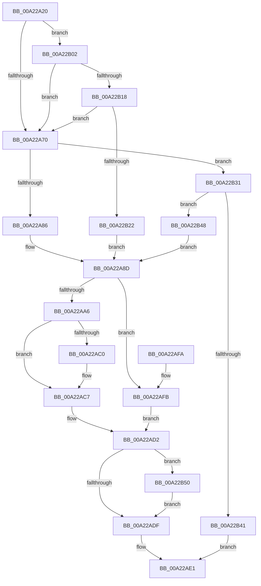

# ObQueryObjectAuditingByHandle

- RVA: `0x00A22A20`–`0x00A22B5E` (길이 `318` bytes)
- VA: `0x0000000140A22A20`
- 실행 섹션: `PAGE`
- PDB 이름 있음: `예`; PDB Function 태그: `아니요`
- unwind 정보 RVA: `0x000AB600`
- 디코드: `78`개 명령, `318/318` bytes 표시
- 미해석 바이트: `0` (있으면 어셈블리에 `.byte`로 보존)

> 이 문서는 커널 이미지의 기계어와 PDB 기호를 분석해 생성했습니다. 4번과 5번은 함수 원형과 자료형을 바이너리 사용 방식에서 추정한 C 해석이며 원본 소스 복구 결과는 아닙니다.

## 1. Dependencies

- 직접 호출 지점: **5**; 고유 호출 대상: **5**
- 직접 호출자로 확인된 함수: **0**
- RIP 상대 이미지 참조: **1**

### Outgoing calls
- `0x00A22A9C` → [ExMapHandleToPointer](../86/ExMapHandleToPointer_function_00868B60.md) (function, `0x00868B60`)
- `0x00A22AC2` → [ExfUnblockPushLock](../../text/2A/ExfUnblockPushLock_function_002A3FE0.md) (function, `0x002A3FE0`)
- `0x00A22AD5` → [KiLeaveCriticalRegionUnsafe](../../text/25/KiLeaveCriticalRegionUnsafe_function_0025F010.md) (function, `0x0025F010`)
- `0x00A22B34` → [ObReferenceProcessHandleTable](../89/ObReferenceProcessHandleTable_function_00893B70.md) (function, `0x00893B70`)
- `0x00A22B57` → [ExReleaseRundownProtection](../../text/34/ExReleaseRundownProtection_function_00349E80.md) (function, `0x00349E80`)

### Direct callers
- 이 함수 시작 RVA로 연결되는 직접 call은 확인되지 않았습니다. 간접 호출은 완전히 역산할 수 없습니다.

### Static image references
- `0x00A22B22` → RVA `0x00F0F5B8` (`.data`; read)

## 2. Other-region calls and transfers

- 다른 실행 섹션으로 향하는 call: **3**
  - `0x00A22AC2` → [ExfUnblockPushLock](../../text/2A/ExfUnblockPushLock_function_002A3FE0.md) (`PAGE` → `.text`)
  - `0x00A22AD5` → [KiLeaveCriticalRegionUnsafe](../../text/25/KiLeaveCriticalRegionUnsafe_function_0025F010.md) (`PAGE` → `.text`)
  - `0x00A22B57` → [ExReleaseRundownProtection](../../text/34/ExReleaseRundownProtection_function_00349E80.md) (`PAGE` → `.text`)
- 별도 외부 분기/꼬리 이동을 확인하지 못했습니다.

## 3. Assembly (complete function range)

```asm
00A22A20  48 89 5C 24 08                  mov qword ptr [rsp + 8], rbx
00A22A25  48 89 6C 24 10                  mov qword ptr [rsp + 0x10], rbp
00A22A2A  48 89 74 24 18                  mov qword ptr [rsp + 0x18], rsi
00A22A2F  57                              push rdi
00A22A30  41 56                           push r14
00A22A32  41 57                           push r15
00A22A34  48 83 EC 20                     sub rsp, 0x20
00A22A38  65 48 8B 04 25 88 01 00 00      mov rax, qword ptr gs:[0x188]
00A22A41  40 32 ED                        xor bpl, bpl
00A22A44  65 4C 8B 34 25 88 01 00 00      mov r14, qword ptr gs:[0x188]
00A22A4D  4C 8B FA                        mov r15, rdx
00A22A50  48 8B D9                        mov rbx, rcx
00A22A53  48 8B B0 B8 00 00 00            mov rsi, qword ptr [rax + 0xb8]
00A22A5A  65 48 8B 04 25 88 01 00 00      mov rax, qword ptr gs:[0x188]
00A22A63  40 38 A8 32 02 00 00            cmp byte ptr [rax + 0x232], bpl
00A22A6A  0F 84 92 00 00 00               je 0x140a22b02
00A22A70  65 48 8B 04 25 88 01 00 00      mov rax, qword ptr gs:[0x188]
00A22A79  80 B8 4A 02 00 00 01            cmp byte ptr [rax + 0x24a], 1
00A22A80  0F 84 AB 00 00 00               je 0x140a22b31
00A22A86  48 8B BE 00 03 00 00            mov rdi, qword ptr [rsi + 0x300]
00A22A8D  66 41 FF 8E E4 01 00 00         dec word ptr [r14 + 0x1e4]
00A22A95  48 8B D3                        mov rdx, rbx
00A22A98  48 8B CF                        mov rcx, rdi
00A22A9B  90                              nop
00A22A9C  E8 BF 60 E4 FF                  call 0x140868b60
00A22AA1  48 85 C0                        test rax, rax
00A22AA4  74 55                           je 0x140a22afb
00A22AA6  48 8B 18                        mov rbx, qword ptr [rax]
00A22AA9  48 C1 FB 11                     sar rbx, 0x11
00A22AAD  F0 48 FF 00                     lock inc qword ptr [rax]
00A22AB1  48 8D 4F 30                     lea rcx, [rdi + 0x30]
00A22AB5  F0 83 0C 24 00                  lock or dword ptr [rsp], 0
00A22ABA  48 83 39 00                     cmp qword ptr [rcx], 0
00A22ABE  74 07                           je 0x140a22ac7
00A22AC0  33 D2                           xor edx, edx
00A22AC2  E8 19 15 88 FF                  call 0x1402a3fe0
00A22AC7  C1 EB 02                        shr ebx, 2
00A22ACA  80 E3 01                        and bl, 1
00A22ACD  41 88 1F                        mov byte ptr [r15], bl
00A22AD0  33 DB                           xor ebx, ebx
00A22AD2  49 8B CE                        mov rcx, r14
00A22AD5  E8 36 C5 83 FF                  call 0x14025f010
00A22ADA  40 84 ED                        test bpl, bpl
00A22ADD  75 71                           jne 0x140a22b50
00A22ADF  8B C3                           mov eax, ebx
00A22AE1  48 8B 5C 24 40                  mov rbx, qword ptr [rsp + 0x40]
00A22AE6  48 8B 6C 24 48                  mov rbp, qword ptr [rsp + 0x48]
00A22AEB  48 8B 74 24 50                  mov rsi, qword ptr [rsp + 0x50]
00A22AF0  48 83 C4 20                     add rsp, 0x20
00A22AF4  41 5F                           pop r15
00A22AF6  41 5E                           pop r14
00A22AF8  5F                              pop rdi
00A22AF9  C3                              ret
00A22AFA  CC                              int3
00A22AFB  BB 08 00 00 C0                  mov ebx, 0xc0000008
00A22B00  EB D0                           jmp 0x140a22ad2
00A22B02  48 C7 C1 00 00 00 80            mov rcx, 0xffffffff80000000
00A22B09  48 8B C3                        mov rax, rbx
00A22B0C  48 23 C1                        and rax, rcx
00A22B0F  48 3B C1                        cmp rax, rcx
00A22B12  0F 85 58 FF FF FF               jne 0x140a22a70
00A22B18  48 83 FB FD                     cmp rbx, -3
00A22B1C  0F 87 4E FF FF FF               ja 0x140a22a70
00A22B22  48 8B 3D 8F CA 4E 00            mov rdi, qword ptr [rip + 0x4eca8f]
00A22B29  48 33 D9                        xor rbx, rcx
00A22B2C  E9 5C FF FF FF                  jmp 0x140a22a8d
00A22B31  48 8B CE                        mov rcx, rsi
00A22B34  E8 37 10 E7 FF                  call 0x140893b70
00A22B39  48 8B F8                        mov rdi, rax
00A22B3C  48 85 C0                        test rax, rax
00A22B3F  75 07                           jne 0x140a22b48
00A22B41  B8 08 00 00 C0                  mov eax, 0xc0000008
00A22B46  EB 99                           jmp 0x140a22ae1
00A22B48  40 B5 01                        mov bpl, 1
00A22B4B  E9 3D FF FF FF                  jmp 0x140a22a8d
00A22B50  48 8D 8E E8 01 00 00            lea rcx, [rsi + 0x1e8]
00A22B57  E8 24 73 92 FF                  call 0x140349e80
00A22B5C  EB 81                           jmp 0x140a22adf
```

## 4. C-style interpretation (structured pseudocode)

```c
__int64 __fastcall ObQueryObjectAuditingByHandle(__int64 a1, __int64 a2)
{
    __int64 result;
    __int64 v_rbp;
    __int64 v_rbx;
    __int64 v_rsp;
    unsigned int v_stack_m38;
    unsigned __int64 v_stack_p10;
    unsigned __int64 v_stack_p18;
    unsigned __int64 v_stack_p8;

    v_stack_p8 = v_rbx;
    v_stack_p10 = v_rbp;
    v_stack_p18 = v_rsi;
    v_rsp = (v_rsp) - (32);
    v_rbp = 0;
    if ((*(unsigned __int8 *)(*(unsigned __int64 *)(gs_base + (0 + 392)) + 562)) == 0) goto loc_00A22B02;
loc_00A22A70:
    if ((*(unsigned __int8 *)(*(unsigned __int64 *)(gs_base + (0 + 392)) + 586)) == 1) goto loc_00A22B31;
loc_00A22A8D:
    result = ExMapHandleToPointer(*(unsigned __int64 *)(*(unsigned __int64 *)(*(unsigned __int64 *)(gs_base + (0 + 392)) + 184) + 768), a1, a3, a4);
    if (result == 0) goto loc_00A22AFB;
    v_rbx = (*(unsigned __int64 *)(result)) >> (17);
    if ((*(unsigned __int64 *)(*(unsigned __int64 *)(*(unsigned __int64 *)(*(unsigned __int64 *)(gs_base + (0 + 392)) + 184) + 768) + 48)) != 0) {
        a2 = 0;
        result = ExfUnblockPushLock(*(unsigned __int64 *)(*(unsigned __int64 *)(*(unsigned __int64 *)(gs_base + (0 + 392)) + 184) + 768) + 48, a2, a3, a4);
    }
    v_rbx = (unsigned int)((v_rbx) >> (2));
    v_rbx = (unsigned __int8)((v_rbx) & (1));
    *(unsigned __int8 *)(a2) = (unsigned __int8)(v_rbx);
    v_rbx = 0;
loc_00A22AD2:
    result = KiLeaveCriticalRegionUnsafe(*(unsigned __int64 *)(gs_base + (0 + 392)), a2, a3, a4);
    if (0 != 0) goto loc_00A22B50;
loc_00A22ADF:
loc_00A22AE1:
    v_rsp = (v_rsp) + (32);
    return 0;
loc_00A22AFB:
    goto loc_00A22AD2;
loc_00A22B02:
    result = ((unsigned int)(0xC0000008ULL)) & (0xFFFFFFFF80000000ULL);
    if (result != 0xFFFFFFFF80000000ULL) goto loc_00A22A70;
    if (((unsigned int)(0xC0000008ULL)) > -3) goto loc_00A22A70;
    v_rbx = ((unsigned int)(0xC0000008ULL)) ^ (0xFFFFFFFF80000000ULL);
    goto loc_00A22A8D;
loc_00A22B31:
    result = ObReferenceProcessHandleTable(v_stack_p18, a2, a3, a4);
    if (result != 0) goto loc_00A22B48;
    goto loc_00A22AE1;
loc_00A22B48:
    goto loc_00A22A8D;
loc_00A22B50:
    result = ExReleaseRundownProtection(v_stack_p18 + 488, a2, a3, a4);
    goto loc_00A22ADF;
}
```

## 5. (Beta) C Style

```c
int64_t ObQueryObjectAuditingByHandle(int64_t Arg1, void *Arg2)
{
    uint8_t *arg2 = (uint8_t *)Arg2;

    int64_t result;
    int64_t local_rbp;
    int64_t local_rbx;
    int64_t local_rsp;
    uint32_t v_stack_m38;
    uint64_t v_stack_p10;
    uint64_t v_stack_p18;
    uint64_t v_stack_p8;

    v_stack_p8 = local_rbx;
    v_stack_p10 = local_rbp;
    v_stack_p18 = local_rsi;
    local_rsp = (local_rsp) - (32);
    local_rbp = 0;
    if ((*(uint8_t *)(*(uint64_t *)(gs_base + (0 + 0x188)) + 0x232)) == 0) goto loc_00A22B02;
loc_00A22A70:
    if ((*(uint8_t *)(*(uint64_t *)(gs_base + (0 + 0x188)) + 0x24A)) == 1) goto loc_00A22B31;
loc_00A22A8D:
    result = ExMapHandleToPointer(*(uint64_t *)(*(uint64_t *)(*(uint64_t *)(gs_base + (0 + 0x188)) + 0xB8) + 0x300), Arg1, a3, a4);
    if (result == 0) goto loc_00A22AFB;
    local_rbx = (*(uint64_t *)(result)) >> (17);
    if ((*(uint64_t *)(*(uint64_t *)(*(uint64_t *)(*(uint64_t *)(gs_base + (0 + 0x188)) + 0xB8) + 0x300) + 0x30)) != 0) {
        Arg2 = 0;
        result = ExfUnblockPushLock(*(uint64_t *)(*(uint64_t *)(*(uint64_t *)(gs_base + (0 + 0x188)) + 0xB8) + 0x300) + 48, Arg2, a3, a4);
    }
    local_rbx = (uint32_t)((local_rbx) >> (2));
    local_rbx = (uint8_t)((local_rbx) & (1));
    *(uint8_t *)(arg2) = (uint8_t)(local_rbx);
    local_rbx = 0;
loc_00A22AD2:
    result = KiLeaveCriticalRegionUnsafe(*(uint64_t *)(gs_base + (0 + 0x188)), Arg2, a3, a4);
    if (0 != 0) goto loc_00A22B50;
loc_00A22ADF:
loc_00A22AE1:
    local_rsp = (local_rsp) + (32);
    return 0;
loc_00A22AFB:
    goto loc_00A22AD2;
loc_00A22B02:
    result = ((uint32_t)(0xC0000008ULL)) & (0xFFFFFFFF80000000ULL);
    if (result != 0xFFFFFFFF80000000ULL) goto loc_00A22A70;
    if (((uint32_t)(0xC0000008ULL)) > -3) goto loc_00A22A70;
    local_rbx = ((uint32_t)(0xC0000008ULL)) ^ (0xFFFFFFFF80000000ULL);
    goto loc_00A22A8D;
loc_00A22B31:
    result = ObReferenceProcessHandleTable(v_stack_p18, Arg2, a3, a4);
    if (result != 0) goto loc_00A22B48;
    goto loc_00A22AE1;
loc_00A22B48:
    goto loc_00A22A8D;
loc_00A22B50:
    result = ExReleaseRundownProtection(v_stack_p18 + 488, Arg2, a3, a4);
    goto loc_00A22ADF;
}
```

### 관측된 메모리 오프셋

구조체 형식이 확인되지 않은 접근은 인자 기준의 오프셋으로만 기록했습니다.

| 기준 인자 | 오프셋 표현 | 폭 (bit) | 접근 |
|---|---:|---:|---|
| `Arg2` | `+ 0x0` | `8` | `W` |

## 6. Execution-region graph

[열기: 2D/3D 그래프와 함수 탐색 컨트롤 패널](../../../control-panel.html?section=page&rva=0x00A22A20&view=graph)

- 2D 그래프는 위에서 아래로 흐르고, 3D 그래프는 빈 공간을 드래그해 회전합니다. Shift+드래그는 이동, 휠은 확대·축소, 함수 노드 선택은 대상 보고서 이동입니다.

### Static fallback


