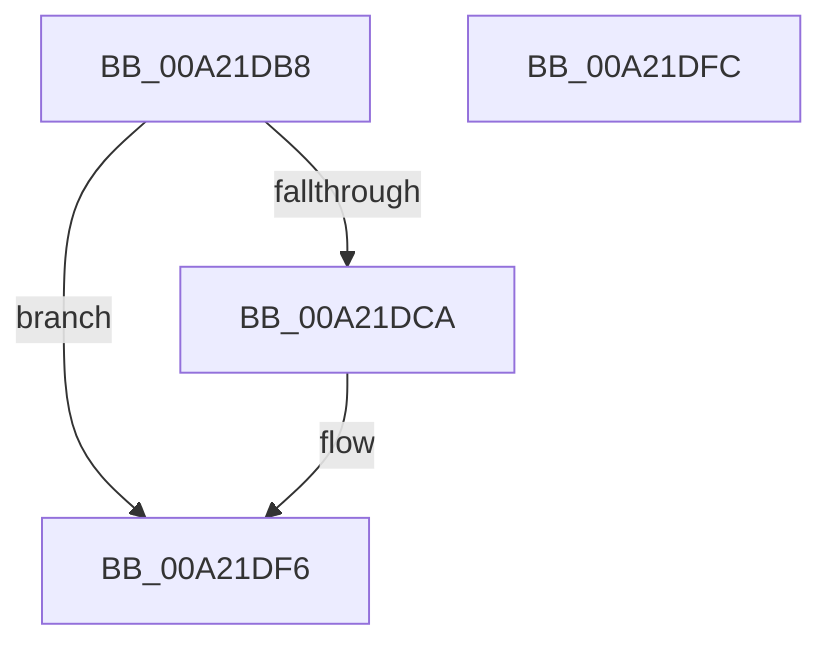

# ObReleaseDuplicateInfo

- RVA: `0x00A21DB8`–`0x00A21DFD` (길이 `69` bytes)
- VA: `0x0000000140A21DB8`
- 실행 섹션: `PAGE`
- PDB 이름 있음: `예`; PDB Function 태그: `아니요`
- unwind 정보 RVA: `0x0005CF00`
- 디코드: `20`개 명령, `69/69` bytes 표시
- 미해석 바이트: `0` (있으면 어셈블리에 `.byte`로 보존)

> 이 문서는 커널 이미지의 기계어와 PDB 기호를 분석해 생성했습니다. 4번과 5번은 함수 원형과 자료형을 바이너리 사용 방식에서 추정한 C 해석이며 원본 소스 복구 결과는 아닙니다.

## 1. Dependencies

- 직접 호출 지점: **3**; 고유 호출 대상: **2**
- 직접 호출자로 확인된 함수: **1**
- RIP 상대 이미지 참조: **0**

### Outgoing calls
- `0x00A21DD1` → [ObpDecrementHandleCount](../86/ObpDecrementHandleCount_function_008632E0.md) (function, `0x008632E0`)
- `0x00A21DDF` → [ObfDereferenceObjectWithTag](../../text/2F/ObfDereferenceObjectWithTag_function_002F78E0.md) (function, `0x002F78E0`)
- `0x00A21DEC` → [ObfDereferenceObjectWithTag](../../text/2F/ObfDereferenceObjectWithTag_function_002F78E0.md) (function, `0x002F78E0`)

### Direct callers
- [AlpcHandleDataDestroyProcedure](AlpcHandleDataDestroyProcedure_function_00A21D50.md) at `0x00A21DA1`

### Static image references
- 디코드된 RIP-relative 메모리 참조가 없습니다.

## 2. Other-region calls and transfers

- 다른 실행 섹션으로 향하는 call: **2**
  - `0x00A21DDF` → [ObfDereferenceObjectWithTag](../../text/2F/ObfDereferenceObjectWithTag_function_002F78E0.md) (`PAGE` → `.text`)
  - `0x00A21DEC` → [ObfDereferenceObjectWithTag](../../text/2F/ObfDereferenceObjectWithTag_function_002F78E0.md) (`PAGE` → `.text`)
- 별도 외부 분기/꼬리 이동을 확인하지 못했습니다.

## 3. Assembly (complete function range)

```asm
00A21DB8  40 53                           push rbx
00A21DBA  48 83 EC 20                     sub rsp, 0x20
00A21DBE  48 8B 51 10                     mov rdx, qword ptr [rcx + 0x10]
00A21DC2  48 8B D9                        mov rbx, rcx
00A21DC5  48 85 D2                        test rdx, rdx
00A21DC8  74 2C                           je 0x140a21df6
00A21DCA  48 8B 09                        mov rcx, qword ptr [rcx]
00A21DCD  48 83 C2 D0                     add rdx, -0x30
00A21DD1  E8 0A 15 E4 FF                  call 0x1408632e0
00A21DD6  48 8B 4B 10                     mov rcx, qword ptr [rbx + 0x10]
00A21DDA  BA 4F 62 44 75                  mov edx, 0x7544624f
00A21DDF  E8 FC 5A 8D FF                  call 0x1402f78e0
00A21DE4  48 8B 0B                        mov rcx, qword ptr [rbx]
00A21DE7  BA 4F 62 44 75                  mov edx, 0x7544624f
00A21DEC  E8 EF 5A 8D FF                  call 0x1402f78e0
00A21DF1  48 83 63 10 00                  and qword ptr [rbx + 0x10], 0
00A21DF6  48 83 C4 20                     add rsp, 0x20
00A21DFA  5B                              pop rbx
00A21DFB  C3                              ret
00A21DFC  CC                              int3
```

## 4. C-style interpretation (structured pseudocode)

```c
__int64 __fastcall ObReleaseDuplicateInfo(__int64 a1)
{
    __int64 result;
    __int64 v_rsp;

    v_rsp = (v_rsp) - (32);
    if (*(unsigned __int64 *)(a1 + 16) != 0) {
        a1 = *(unsigned __int64 *)(a1);
        a2 = (*(unsigned __int64 *)(a1 + 16)) + (-48);
        result = ObpDecrementHandleCount(a1, a2, a3, a4);
        a1 = *(unsigned __int64 *)(a1 + 16);
        a2 = 0x7544624FULL;
        result = ObfDereferenceObjectWithTag(a1, a2, a3, a4);
        a1 = *(unsigned __int64 *)(a1);
        a2 = 0x7544624FULL;
        result = ObfDereferenceObjectWithTag(a1, a2, a3, a4);
    }
    v_rsp = (v_rsp) + (32);
    return result;
}
```

## 5. (Beta) C Style

```c
int64_t ObReleaseDuplicateInfo(void *Arg1)
{
    uint8_t *arg1 = (uint8_t *)Arg1;

    int64_t result;
    int64_t local_rsp;

    local_rsp = (local_rsp) - (32);
    if (*(uint64_t *)(arg1 + 0x10) != 0) {
        Arg1 = *(uint64_t *)(arg1);
        a2 = (*(uint64_t *)(arg1 + 0x10)) + (-48);
        result = ObpDecrementHandleCount(Arg1, a2, a3, a4);
        Arg1 = *(uint64_t *)(arg1 + 0x10);
        a2 = 0x7544624FULL;
        result = ObfDereferenceObjectWithTag(Arg1, a2, a3, a4);
        Arg1 = *(uint64_t *)(arg1);
        a2 = 0x7544624FULL;
        result = ObfDereferenceObjectWithTag(Arg1, a2, a3, a4);
    }
    local_rsp = (local_rsp) + (32);
    return result;
}
```

### 관측된 메모리 오프셋

구조체 형식이 확인되지 않은 접근은 인자 기준의 오프셋으로만 기록했습니다.

| 기준 인자 | 오프셋 표현 | 폭 (bit) | 접근 |
|---|---:|---:|---|
| `Arg1` | `+ 0x0` | `64` | `R` |
| `Arg1` | `+ 0x10` | `64` | `R` |
| `Arg1` | `+ 0x10` | `64` | `R/W` |

## 6. Execution-region graph

[열기: 2D/3D 그래프와 함수 탐색 컨트롤 패널](../../../control-panel.html?section=page&rva=0x00A21DB8&view=graph)

- 2D 그래프는 위에서 아래로 흐르고, 3D 그래프는 빈 공간을 드래그해 회전합니다. Shift+드래그는 이동, 휠은 확대·축소, 함수 노드 선택은 대상 보고서 이동입니다.

### Static fallback


