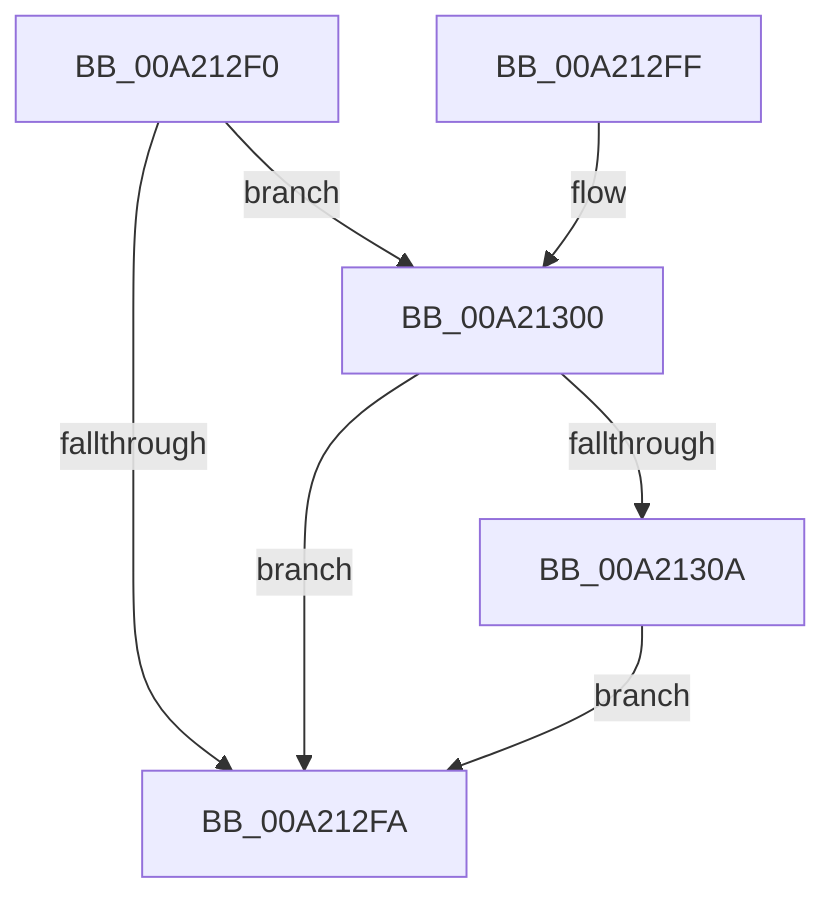

# ObpCloseDirectoryObject

- RVA: `0x00A212F0`–`0x00A21314` (길이 `36` bytes)
- VA: `0x0000000140A212F0`
- 실행 섹션: `PAGE`
- PDB 이름 있음: `예`; PDB Function 태그: `아니요`
- unwind 정보 RVA: `0x0008A618`
- 디코드: `12`개 명령, `36/36` bytes 표시
- 미해석 바이트: `0` (있으면 어셈블리에 `.byte`로 보존)

> 이 문서는 커널 이미지의 기계어와 PDB 기호를 분석해 생성했습니다. 4번과 5번은 함수 원형과 자료형을 바이너리 사용 방식에서 추정한 C 해석이며 원본 소스 복구 결과는 아닙니다.

## 1. Dependencies

- 직접 호출 지점: **1**; 고유 호출 대상: **1**
- 직접 호출자로 확인된 함수: **0**
- RIP 상대 이미지 참조: **0**

### Outgoing calls
- `0x00A2130D` → [ObpRemoveNamespaceFromTable](ObpRemoveNamespaceFromTable_function_00A2131C.md) (function, `0x00A2131C`)

### Direct callers
- 이 함수 시작 RVA로 연결되는 직접 call은 확인되지 않았습니다. 간접 호출은 완전히 역산할 수 없습니다.

### Static image references
- 디코드된 RIP-relative 메모리 참조가 없습니다.

## 2. Other-region calls and transfers

- 다른 실행 섹션으로 향하는 call: **0**
- 별도 외부 분기/꼬리 이동을 확인하지 못했습니다.

## 3. Assembly (complete function range)

```asm
00A212F0  48 83 EC 28                     sub rsp, 0x28
00A212F4  49 83 F9 01                     cmp r9, 1
00A212F8  74 06                           je 0x140a21300
00A212FA  48 83 C4 28                     add rsp, 0x28
00A212FE  C3                              ret
00A212FF  CC                              int3
00A21300  8B 82 50 01 00 00               mov eax, dword ptr [rdx + 0x150]
00A21306  A8 01                           test al, 1
00A21308  74 F0                           je 0x140a212fa
00A2130A  48 8B CA                        mov rcx, rdx
00A2130D  E8 0A 00 00 00                  call 0x140a2131c
00A21312  EB E6                           jmp 0x140a212fa
```

## 4. C-style interpretation (structured pseudocode)

```c
__int64 __fastcall ObpCloseDirectoryObject(__int64 a1, __int64 a2, __int64 a3, __int64 a4)
{
    __int64 result;
    __int64 v_rsp;

    v_rsp = (v_rsp) - (40);
    if (a4 == 1) goto loc_00A21300;
loc_00A212FA:
    v_rsp = (v_rsp) + (40);
    return result;
loc_00A21300:
    if ((((unsigned __int8)((unsigned int)(*(unsigned int *)(a2 + 336)))) & (1)) == 0) goto loc_00A212FA;
    result = ObpRemoveNamespaceFromTable(a2, a2, a3, a4);
    goto loc_00A212FA;
}
```

## 5. (Beta) C Style

```c
int64_t ObpCloseDirectoryObject(int64_t Arg1, void *Arg2, int64_t Arg3, int64_t Arg4)
{
    uint8_t *arg2 = (uint8_t *)Arg2;

    int64_t result;
    int64_t local_rsp;

    local_rsp = (local_rsp) - (40);
    if (Arg4 == 1) goto loc_00A21300;
loc_00A212FA:
    local_rsp = (local_rsp) + (40);
    return result;
loc_00A21300:
    if ((((uint8_t)((uint32_t)(*(uint32_t *)(arg2 + 0x150)))) & (1)) == 0) goto loc_00A212FA;
    result = ObpRemoveNamespaceFromTable(Arg2, Arg2, Arg3, Arg4);
    goto loc_00A212FA;
}
```

### 관측된 메모리 오프셋

구조체 형식이 확인되지 않은 접근은 인자 기준의 오프셋으로만 기록했습니다.

| 기준 인자 | 오프셋 표현 | 폭 (bit) | 접근 |
|---|---:|---:|---|
| `Arg2` | `+ 0x150` | `32` | `R` |

## 6. Execution-region graph

[열기: 2D/3D 그래프와 함수 탐색 컨트롤 패널](../../../control-panel.html?section=page&rva=0x00A212F0&view=graph)

- 2D 그래프는 위에서 아래로 흐르고, 3D 그래프는 빈 공간을 드래그해 회전합니다. Shift+드래그는 이동, 휠은 확대·축소, 함수 노드 선택은 대상 보고서 이동입니다.

### Static fallback


