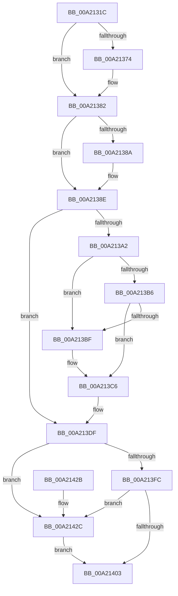

# ObpRemoveNamespaceFromTable

- RVA: `0x00A2131C`–`0x00A21436` (길이 `282` bytes)
- VA: `0x0000000140A2131C`
- 실행 섹션: `PAGE`
- PDB 이름 있음: `예`; PDB Function 태그: `아니요`
- unwind 정보 RVA: `0x0007AC84`
- 디코드: `77`개 명령, `282/282` bytes 표시
- 미해석 바이트: `0` (있으면 어셈블리에 `.byte`로 보존)

> 이 문서는 커널 이미지의 기계어와 PDB 기호를 분석해 생성했습니다. 4번과 5번은 함수 원형과 자료형을 바이너리 사용 방식에서 추정한 C 해석이며 원본 소스 복구 결과는 아닙니다.

## 1. Dependencies

- 직접 호출 지점: **7**; 고유 호출 대상: **7**
- 직접 호출자로 확인된 함수: **2**
- RIP 상대 이미지 참조: **0**

### Outgoing calls
- `0x00A2133C` → [PsGetCurrentServerSiloGlobals](../../text/2F/PsGetCurrentServerSiloGlobals_function_002FE1F0.md) (function, `0x002FE1F0`)
- `0x00A21364` → [KeAbPreAcquire](../../text/21/KeAbPreAcquire_function_00210230.md) (function, `0x00210230`)
- `0x00A2137D` → [ExfAcquirePushLockExclusiveEx](../../text/20/ExfAcquirePushLockExclusiveEx_function_0020FC90.md) (function, `0x0020FC90`)
- `0x00A213D7` → [ObfDereferenceObject](../../text/2F/ObfDereferenceObject_function_002F9350.md) (function, `0x002F9350`)
- `0x00A21406` → [KeAbPostRelease](../../text/2E/KeAbPostRelease_function_002E1600.md) (function, `0x002E1600`)
- `0x00A2140B` → [KeLeaveCriticalRegion](../../text/25/KeLeaveCriticalRegion_function_0025D8B0.md) (function, `0x0025D8B0`)
- `0x00A2142F` → [ExfReleasePushLock](../../text/26/ExfReleasePushLock_function_002638D0.md) (function, `0x002638D0`)

### Direct callers
- [NtDeletePrivateNamespace](../70/NtDeletePrivateNamespace_function_00700920.md) at `0x00700996`
- [ObpCloseDirectoryObject](ObpCloseDirectoryObject_function_00A212F0.md) at `0x00A2130D`

### Static image references
- 디코드된 RIP-relative 메모리 참조가 없습니다.

## 2. Other-region calls and transfers

- 다른 실행 섹션으로 향하는 call: **7**
  - `0x00A2133C` → [PsGetCurrentServerSiloGlobals](../../text/2F/PsGetCurrentServerSiloGlobals_function_002FE1F0.md) (`PAGE` → `.text`)
  - `0x00A21364` → [KeAbPreAcquire](../../text/21/KeAbPreAcquire_function_00210230.md) (`PAGE` → `.text`)
  - `0x00A2137D` → [ExfAcquirePushLockExclusiveEx](../../text/20/ExfAcquirePushLockExclusiveEx_function_0020FC90.md) (`PAGE` → `.text`)
  - `0x00A213D7` → [ObfDereferenceObject](../../text/2F/ObfDereferenceObject_function_002F9350.md) (`PAGE` → `.text`)
  - `0x00A21406` → [KeAbPostRelease](../../text/2E/KeAbPostRelease_function_002E1600.md) (`PAGE` → `.text`)
  - `0x00A2140B` → [KeLeaveCriticalRegion](../../text/25/KeLeaveCriticalRegion_function_0025D8B0.md) (`PAGE` → `.text`)
  - `0x00A2142F` → [ExfReleasePushLock](../../text/26/ExfReleasePushLock_function_002638D0.md) (`PAGE` → `.text`)
- 별도 외부 분기/꼬리 이동을 확인하지 못했습니다.

## 3. Assembly (complete function range)

```asm
00A2131C  48 89 5C 24 08                  mov qword ptr [rsp + 8], rbx
00A21321  48 89 6C 24 10                  mov qword ptr [rsp + 0x10], rbp
00A21326  48 89 74 24 18                  mov qword ptr [rsp + 0x18], rsi
00A2132B  57                              push rdi
00A2132C  41 56                           push r14
00A2132E  41 57                           push r15
00A21330  48 83 EC 20                     sub rsp, 0x20
00A21334  48 8B F9                        mov rdi, rcx
00A21337  BD 21 00 19 C0                  mov ebp, 0xc0190021
00A2133C  E8 AF CE 8D FF                  call 0x1402fe1f0
00A21341  4C 8B F0                        mov r14, rax
00A21344  45 33 C0                        xor r8d, r8d
00A21347  65 48 8B 04 25 88 01 00 00      mov rax, qword ptr gs:[0x188]
00A21350  33 D2                           xor edx, edx
00A21352  49 8D 9E D0 02 00 00            lea rbx, [r14 + 0x2d0]
00A21359  66 FF 88 E4 01 00 00            dec word ptr [rax + 0x1e4]
00A21360  48 8B CB                        mov rcx, rbx
00A21363  90                              nop
00A21364  E8 C7 EE 7E FF                  call 0x140210230
00A21369  F0 48 0F BA 2B 00               lock bts qword ptr [rbx], 0
00A2136F  48 8B F0                        mov rsi, rax
00A21372  73 0E                           jae 0x140a21382
00A21374  4C 8B C3                        mov r8, rbx
00A21377  48 8B D0                        mov rdx, rax
00A2137A  48 8B CB                        mov rcx, rbx
00A2137D  E8 0E E9 7E FF                  call 0x14020fc90
00A21382  45 33 FF                        xor r15d, r15d
00A21385  48 85 F6                        test rsi, rsi
00A21388  74 04                           je 0x140a2138e
00A2138A  C6 46 0A 01                     mov byte ptr [rsi + 0xa], 1
00A2138E  F0 83 8F 50 01 00 00 02         lock or dword ptr [rdi + 0x150], 2
00A21396  48 8B 87 40 01 00 00            mov rax, qword ptr [rdi + 0x140]
00A2139D  48 85 C0                        test rax, rax
00A213A0  74 3D                           je 0x140a213df
00A213A2  4C 89 BF 40 01 00 00            mov qword ptr [rdi + 0x140], r15
00A213A9  4C 89 78 10                     mov qword ptr [rax + 0x10], r15
00A213AD  48 8B 10                        mov rdx, qword ptr [rax]
00A213B0  48 39 42 08                     cmp qword ptr [rdx + 8], rax
00A213B4  75 09                           jne 0x140a213bf
00A213B6  48 8B 48 08                     mov rcx, qword ptr [rax + 8]
00A213BA  48 39 01                        cmp qword ptr [rcx], rax
00A213BD  74 07                           je 0x140a213c6
00A213BF  B9 03 00 00 00                  mov ecx, 3
00A213C4  CD 29                           int 0x29
00A213C6  48 89 11                        mov qword ptr [rcx], rdx
00A213C9  48 89 4A 08                     mov qword ptr [rdx + 8], rcx
00A213CD  48 8B CF                        mov rcx, rdi
00A213D0  41 FF 8E D8 02 00 00            dec dword ptr [r14 + 0x2d8]
00A213D7  E8 74 7F 8D FF                  call 0x1402f9350
00A213DC  41 8B EF                        mov ebp, r15d
00A213DF  0F 0D 0B                        prefetchw byte ptr [rbx]
00A213E2  48 8B 03                        mov rax, qword ptr [rbx]
00A213E5  48 8B C8                        mov rcx, rax
00A213E8  48 83 E1 F0                     and rcx, 0xfffffffffffffff0
00A213EC  48 83 F9 10                     cmp rcx, 0x10
00A213F0  48 8D 50 F0                     lea rdx, [rax - 0x10]
00A213F4  49 0F 46 D7                     cmovbe rdx, r15
00A213F8  A8 02                           test al, 2
00A213FA  75 30                           jne 0x140a2142c
00A213FC  F0 48 0F B1 13                  lock cmpxchg qword ptr [rbx], rdx
00A21401  75 29                           jne 0x140a2142c
00A21403  48 8B CB                        mov rcx, rbx
00A21406  E8 F5 01 8C FF                  call 0x1402e1600
00A2140B  E8 A0 C4 83 FF                  call 0x14025d8b0
00A21410  48 8B 5C 24 40                  mov rbx, qword ptr [rsp + 0x40]
00A21415  8B C5                           mov eax, ebp
00A21417  48 8B 6C 24 48                  mov rbp, qword ptr [rsp + 0x48]
00A2141C  48 8B 74 24 50                  mov rsi, qword ptr [rsp + 0x50]
00A21421  48 83 C4 20                     add rsp, 0x20
00A21425  41 5F                           pop r15
00A21427  41 5E                           pop r14
00A21429  5F                              pop rdi
00A2142A  C3                              ret
00A2142B  CC                              int3
00A2142C  48 8B CB                        mov rcx, rbx
00A2142F  E8 9C 24 84 FF                  call 0x1402638d0
00A21434  EB CD                           jmp 0x140a21403
```

## 4. C-style interpretation (structured pseudocode)

```c
__int64 __fastcall ObpRemoveNamespaceFromTable(__int64 a1, int a2, int a3)
{
    __int64 result;
    __int64 v_r15;
    __int64 v_rsp;
    unsigned __int64 v_stack_p10;
    unsigned __int64 v_stack_p18;
    unsigned __int64 v_stack_p8;

    v_stack_p8 = v_rbx;
    v_stack_p10 = v_rbp;
    v_stack_p18 = v_rsi;
    v_rsp = (v_rsp) - (32);
    result = PsGetCurrentServerSiloGlobals(a1, a2, a3, a4);
    a3 = 0;
    a2 = 0;
    result = KeAbPreAcquire(result + 720, a2, a3, a4);
    if (!(condition_is_above_or_equal)) {
        a3 = result + 720;
        a2 = result;
        a1 = result + 720;
        result = ExfAcquirePushLockExclusiveEx(a1, a2, a3, a4);
    }
    v_r15 = 0;
    if (result != 0) {
        *(unsigned __int8 *)(result + 10) = 1;
    }
    if (*(unsigned __int64 *)(a1 + 320) == 0) goto loc_00A213DF;
    *(unsigned __int64 *)(a1 + 320) = 0;
    *(unsigned __int64 *)(*(unsigned __int64 *)(a1 + 320) + 16) = 0;
    if ((*(unsigned __int64 *)(*(unsigned __int64 *)(*(unsigned __int64 *)(a1 + 320)) + 8)) != (*(unsigned __int64 *)(a1 + 320))) goto loc_00A213BF;
    if ((*(unsigned __int64 *)(*(unsigned __int64 *)(*(unsigned __int64 *)(a1 + 320) + 8))) != (*(unsigned __int64 *)(a1 + 320))) {
        a1 = 3;
    }
    *(unsigned __int64 *)(a1) = *(unsigned __int64 *)(*(unsigned __int64 *)(a1 + 320));
    *(unsigned __int64 *)(*(unsigned __int64 *)(*(unsigned __int64 *)(a1 + 320)) + 8) = a1;
    result = ObfDereferenceObject(a1, *(unsigned __int64 *)(*(unsigned __int64 *)(a1 + 320)), a3, a4);
loc_00A213DF:
    a1 = (*(unsigned __int64 *)(result + 720)) & (-16);
    a2 = *(unsigned __int64 *)(result + 720) - 16;
    if (a1 <= 16) { a2 = 0; }
    if ((((unsigned __int8)(*(unsigned __int64 *)(result + 720))) & (2)) != 0) goto loc_00A2142C;
    if ((((unsigned __int8)(*(unsigned __int64 *)(result + 720))) & (2)) != 0) goto loc_00A2142C;
loc_00A21403:
    result = KeAbPostRelease(result + 720, a2, a3, a4);
    result = KeLeaveCriticalRegion(result + 720, a2, a3, a4);
    v_rsp = (v_rsp) + (32);
    return 0;
loc_00A2142C:
    result = ExfReleasePushLock(v_stack_p8, a2, a3, a4);
    goto loc_00A21403;
}
```

## 5. (Beta) C Style

```c
int64_t ObpRemoveNamespaceFromTable(void *Arg1, int32_t Arg2, int32_t Arg3)
{
    uint8_t *arg1 = (uint8_t *)Arg1;

    int64_t result;
    int64_t local_r15;
    int64_t local_rsp;
    uint64_t v_stack_p10;
    uint64_t v_stack_p18;
    uint64_t v_stack_p8;

    v_stack_p8 = local_rbx;
    v_stack_p10 = local_rbp;
    v_stack_p18 = local_rsi;
    local_rsp = (local_rsp) - (32);
    result = PsGetCurrentServerSiloGlobals(Arg1, Arg2, Arg3, a4);
    Arg3 = 0;
    Arg2 = 0;
    result = KeAbPreAcquire(result + 720, Arg2, Arg3, a4);
    if (!(condition_is_above_or_equal)) {
        Arg3 = result + 720;
        Arg2 = result;
        Arg1 = result + 720;
        result = ExfAcquirePushLockExclusiveEx(Arg1, Arg2, Arg3, a4);
    }
    local_r15 = 0;
    if (result != 0) {
        *(uint8_t *)(result + 0xA) = 1;
    }
    if (*(uint64_t *)(arg1 + 0x140) == 0) goto loc_00A213DF;
    *(uint64_t *)(arg1 + 0x140) = 0;
    *(uint64_t *)(*(uint64_t *)(arg1 + 0x140) + 0x10) = 0;
    if ((*(uint64_t *)(*(uint64_t *)(*(uint64_t *)(arg1 + 0x140)) + 0x8)) != (*(uint64_t *)(arg1 + 0x140))) goto loc_00A213BF;
    if ((*(uint64_t *)(*(uint64_t *)(*(uint64_t *)(arg1 + 0x140) + 0x8))) != (*(uint64_t *)(arg1 + 0x140))) {
        Arg1 = 3;
    }
    *(uint64_t *)(arg1) = *(uint64_t *)(*(uint64_t *)(arg1 + 0x140));
    *(void **)(*(uint64_t *)(*(uint64_t *)(arg1 + 0x140)) + 0x8) = Arg1;
    result = ObfDereferenceObject(Arg1, *(uint64_t *)(*(uint64_t *)(arg1 + 0x140)), Arg3, a4);
loc_00A213DF:
    Arg1 = (*(uint64_t *)(result + 0x2D0)) & (-16);
    Arg2 = *(uint64_t *)(result + 0x2D0) - 16;
    if (Arg1 <= 16) { Arg2 = 0; }
    if ((((uint8_t)(*(uint64_t *)(result + 0x2D0))) & (2)) != 0) goto loc_00A2142C;
    if ((((uint8_t)(*(uint64_t *)(result + 0x2D0))) & (2)) != 0) goto loc_00A2142C;
loc_00A21403:
    result = KeAbPostRelease(result + 720, Arg2, Arg3, a4);
    result = KeLeaveCriticalRegion(result + 720, Arg2, Arg3, a4);
    local_rsp = (local_rsp) + (32);
    return 0;
loc_00A2142C:
    result = ExfReleasePushLock(v_stack_p8, Arg2, Arg3, a4);
    goto loc_00A21403;
}
```

### 관측된 메모리 오프셋

구조체 형식이 확인되지 않은 접근은 인자 기준의 오프셋으로만 기록했습니다.

| 기준 인자 | 오프셋 표현 | 폭 (bit) | 접근 |
|---|---:|---:|---|
| `Arg1` | `+ 0x140` | `64` | `R` |
| `Arg1` | `+ 0x140` | `64` | `W` |
| `Arg1` | `+ 0x150` | `32` | `R/W` |

## 6. Execution-region graph

[열기: 2D/3D 그래프와 함수 탐색 컨트롤 패널](../../../control-panel.html?section=page&rva=0x00A2131C&view=graph)

- 2D 그래프는 위에서 아래로 흐르고, 3D 그래프는 빈 공간을 드래그해 회전합니다. Shift+드래그는 이동, 휠은 확대·축소, 함수 노드 선택은 대상 보고서 이동입니다.

### Static fallback


