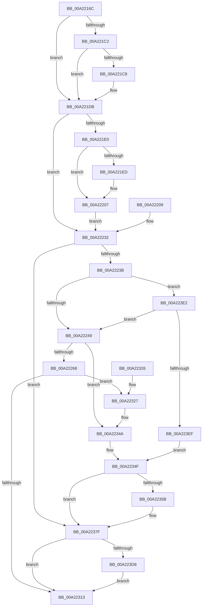

# PerfLogImageUnload

- RVA: `0x00A2216C`–`0x00A223F9` (길이 `653` bytes)
- VA: `0x0000000140A2216C`
- 실행 섹션: `PAGE`
- PDB 이름 있음: `예`; PDB Function 태그: `아니요`
- unwind 정보 RVA: `0x000AB4D0`
- 디코드: `156`개 명령, `653/653` bytes 표시
- 미해석 바이트: `0` (있으면 어셈블리에 `.byte`로 보존)

> 이 문서는 커널 이미지의 기계어와 PDB 기호를 분석해 생성했습니다. 4번과 5번은 함수 원형과 자료형을 바이너리 사용 방식에서 추정한 C 해석이며 원본 소스 복구 결과는 아닙니다.

## 1. Dependencies

- 직접 호출 지점: **14**; 고유 호출 대상: **12**
- 직접 호출자로 확인된 함수: **2**
- RIP 상대 이미지 참조: **5**

### Outgoing calls
- `0x00A221D6` → [EtwpCoverageSamplerUnloadImage](EtwpCoverageSamplerUnloadImage_function_00A22400.md) (function, `0x00A22400`)
- `0x00A221E3` → [RtlImageNtHeader](../../text/44/RtlImageNtHeader_function_00443B60.md) (function, `0x00443B60`)
- `0x00A22257` → [ExAllocatePool2](../../poolcode/B8/ExAllocatePool2_function_00B820F0.md) (function, `0x00B820F0`)
- `0x00A2226B` → [ObfReferenceObject](../../text/20/ObfReferenceObject_function_0020FA20.md) (function, `0x0020FA20`)
- `0x00A22273` → [ObfReferenceObject](../../text/20/ObfReferenceObject_function_0020FA20.md) (function, `0x0020FA20`)
- `0x00A222FA` → [KeInitializeApc](../../text/42/KeInitializeApc_function_00428510.md) (function, `0x00428510`)
- `0x00A2230A` → [KeInsertQueueApc](../../text/20/KeInsertQueueApc_function_00203F10.md) (function, `0x00203F10`)
- `0x00A2232C` → [ExFreePoolWithTag](../../poolcode/B8/ExFreePoolWithTag_function_00B82870.md) (function, `0x00B82870`)
- `0x00A22334` → [ObfDereferenceObject](../../text/2F/ObfDereferenceObject_function_002F9350.md) (function, `0x002F9350`)
- `0x00A2233C` → [ObfDereferenceObject](../../text/2F/ObfDereferenceObject_function_002F9350.md) (function, `0x002F9350`)
- `0x00A2236C` → [guard_dispatch_icall](../../text/6B/guard_dispatch_icall_function_006BAAD0.md) (function, `0x006BAAD0`)
- `0x00A223C5` → [EtwpTraceImageUnload](../../text/44/EtwpTraceImageUnload_function_0044C048.md) (function, `0x0044C048`)
- `0x00A223D8` → [FsRtlReleaseFileNameInformation](../97/FsRtlReleaseFileNameInformation_function_0097DB90.md) (function, `0x0097DB90`)
- `0x00A223E2` → [KeAreAllApcsDisabled](../../text/2F/KeAreAllApcsDisabled_function_002F7AC0.md) (function, `0x002F7AC0`)

### Direct callers
- [MiUnmapViewOfSection](../88/MiUnmapViewOfSection_function_0088A4C4.md) at `0x0088A77F`
- [MiUnloadSystemImage](../AA/MiUnloadSystemImage_function_00AA2FD4.md) at `0x00AA337D`

### Static image references
- `0x00A221B3` → RVA `0x00FC6AA8` (`ALMOSTRO`; read)
- `0x00A222D5` → RVA `0x0044BF50` (`EtwpTraceImageUnloadApc`; read)
- `0x00A222E1` → RVA `0x00650810` (`EtwpCancelTraceImageUnloadApc`; read)
- `0x00A222ED` → RVA `0x0049E550` (`EmpCheckErrataList`; read)
- `0x00A2234F` → RVA `0x00E65BF0` (`.data`; read)

## 2. Other-region calls and transfers

- 다른 실행 섹션으로 향하는 call: **12**
  - `0x00A221E3` → [RtlImageNtHeader](../../text/44/RtlImageNtHeader_function_00443B60.md) (`PAGE` → `.text`)
  - `0x00A22257` → [ExAllocatePool2](../../poolcode/B8/ExAllocatePool2_function_00B820F0.md) (`PAGE` → `POOLCODE`)
  - `0x00A2226B` → [ObfReferenceObject](../../text/20/ObfReferenceObject_function_0020FA20.md) (`PAGE` → `.text`)
  - `0x00A22273` → [ObfReferenceObject](../../text/20/ObfReferenceObject_function_0020FA20.md) (`PAGE` → `.text`)
  - `0x00A222FA` → [KeInitializeApc](../../text/42/KeInitializeApc_function_00428510.md) (`PAGE` → `.text`)
  - `0x00A2230A` → [KeInsertQueueApc](../../text/20/KeInsertQueueApc_function_00203F10.md) (`PAGE` → `.text`)
  - `0x00A2232C` → [ExFreePoolWithTag](../../poolcode/B8/ExFreePoolWithTag_function_00B82870.md) (`PAGE` → `POOLCODE`)
  - `0x00A22334` → [ObfDereferenceObject](../../text/2F/ObfDereferenceObject_function_002F9350.md) (`PAGE` → `.text`)
  - `0x00A2233C` → [ObfDereferenceObject](../../text/2F/ObfDereferenceObject_function_002F9350.md) (`PAGE` → `.text`)
  - `0x00A2236C` → [guard_dispatch_icall](../../text/6B/guard_dispatch_icall_function_006BAAD0.md) (`PAGE` → `.text`)
  - `0x00A223C5` → [EtwpTraceImageUnload](../../text/44/EtwpTraceImageUnload_function_0044C048.md) (`PAGE` → `.text`)
  - `0x00A223E2` → [KeAreAllApcsDisabled](../../text/2F/KeAreAllApcsDisabled_function_002F7AC0.md) (`PAGE` → `.text`)
- 별도 외부 분기/꼬리 이동을 확인하지 못했습니다.

## 3. Assembly (complete function range)

```asm
00A2216C  48 8B C4                        mov rax, rsp
00A2216F  4C 89 48 20                     mov qword ptr [rax + 0x20], r9
00A22173  4C 89 40 18                     mov qword ptr [rax + 0x18], r8
00A22177  48 89 50 10                     mov qword ptr [rax + 0x10], rdx
00A2217B  48 89 48 08                     mov qword ptr [rax + 8], rcx
00A2217F  53                              push rbx
00A22180  56                              push rsi
00A22181  57                              push rdi
00A22182  41 54                           push r12
00A22184  41 55                           push r13
00A22186  41 56                           push r14
00A22188  41 57                           push r15
00A2218A  48 81 EC 80 00 00 00            sub rsp, 0x80
00A22191  4D 8B E1                        mov r12, r9
00A22194  49 8B D8                        mov rbx, r8
00A22197  4C 8B FA                        mov r15, rdx
00A2219A  4C 8B E9                        mov r13, rcx
00A2219D  33 FF                           xor edi, edi
00A2219F  48 89 78 A0                     mov qword ptr [rax - 0x60], rdi
00A221A3  0F 57 C0                        xorps xmm0, xmm0
00A221A6  0F 11 40 B0                     movups xmmword ptr [rax - 0x50], xmm0
00A221AA  48 21 78 A8                     and qword ptr [rax - 0x58], rdi
00A221AE  33 F6                           xor esi, esi
00A221B0  89 70 98                        mov dword ptr [rax - 0x68], esi
00A221B3  48 8B 05 EE 48 5A 00            mov rax, qword ptr [rip + 0x5a48ee]
00A221BA  48 05 EC 12 00 00               add rax, 0x12ec
00A221C0  74 19                           je 0x140a221db
00A221C2  8B 00                           mov eax, dword ptr [rax]
00A221C4  A8 04                           test al, 4
00A221C6  74 13                           je 0x140a221db
00A221C8  4C 8B 84 24 E0 00 00 00         mov r8, qword ptr [rsp + 0xe0]
00A221D0  49 8B D1                        mov rdx, r9
00A221D3  48 8B CB                        mov rcx, rbx
00A221D6  E8 25 02 00 00                  call 0x140a22400
00A221DB  48 85 DB                        test rbx, rbx
00A221DE  74 52                           je 0x140a22232
00A221E0  49 8B CC                        mov rcx, r12
00A221E3  E8 78 19 A2 FF                  call 0x140443b60
00A221E8  48 85 C0                        test rax, rax
00A221EB  74 1A                           je 0x140a22207
00A221ED  8B 48 58                        mov ecx, dword ptr [rax + 0x58]
00A221F0  89 8C 24 E8 00 00 00            mov dword ptr [rsp + 0xe8], ecx
00A221F7  8B 70 08                        mov esi, dword ptr [rax + 8]
00A221FA  89 74 24 50                     mov dword ptr [rsp + 0x50], esi
00A221FE  48 8B 78 30                     mov rdi, qword ptr [rax + 0x30]
00A22202  48 89 7C 24 58                  mov qword ptr [rsp + 0x58], rdi
00A22207  EB 29                           jmp 0x140a22232
00A22209  4C 8B A4 24 D8 00 00 00         mov r12, qword ptr [rsp + 0xd8]
00A22211  48 8B 9C 24 D0 00 00 00         mov rbx, qword ptr [rsp + 0xd0]
00A22219  4C 8B BC 24 C8 00 00 00         mov r15, qword ptr [rsp + 0xc8]
00A22221  4C 8B AC 24 C0 00 00 00         mov r13, qword ptr [rsp + 0xc0]
00A22229  48 8B 7C 24 58                  mov rdi, qword ptr [rsp + 0x58]
00A2222E  8B 74 24 50                     mov esi, dword ptr [rsp + 0x50]
00A22232  4D 85 FF                        test r15, r15
00A22235  0F 84 44 01 00 00               je 0x140a2237f
00A2223B  83 BC 24 00 01 00 00 00         cmp dword ptr [rsp + 0x100], 0
00A22243  0F 84 99 01 00 00               je 0x140a223e2
00A22249  BA 90 00 00 00                  mov edx, 0x90
00A2224E  8D 4A B0                        lea ecx, [rdx - 0x50]
00A22251  41 B8 45 74 77 41               mov r8d, 0x41777445
00A22257  E8 94 FE 15 00                  call 0x140b820f0
00A2225C  4C 8B F0                        mov r14, rax
00A2225F  48 85 C0                        test rax, rax
00A22262  0F 84 E2 00 00 00               je 0x140a2234a
00A22268  48 8B CB                        mov rcx, rbx
00A2226B  E8 B0 D7 7E FF                  call 0x14020fa20
00A22270  49 8B CF                        mov rcx, r15
00A22273  E8 A8 D7 7E FF                  call 0x14020fa20
00A22278  4D 89 7E 58                     mov qword ptr [r14 + 0x58], r15
00A2227C  49 89 5E 60                     mov qword ptr [r14 + 0x60], rbx
00A22280  4D 89 66 68                     mov qword ptr [r14 + 0x68], r12
00A22284  48 8B 8C 24 E0 00 00 00         mov rcx, qword ptr [rsp + 0xe0]
00A2228C  49 89 4E 70                     mov qword ptr [r14 + 0x70], rcx
00A22290  8B 8C 24 E8 00 00 00            mov ecx, dword ptr [rsp + 0xe8]
00A22297  41 89 4E 78                     mov dword ptr [r14 + 0x78], ecx
00A2229B  41 89 76 7C                     mov dword ptr [r14 + 0x7c], esi
00A2229F  8B 84 24 F0 00 00 00            mov eax, dword ptr [rsp + 0xf0]
00A222A6  41 89 86 80 00 00 00            mov dword ptr [r14 + 0x80], eax
00A222AD  8B 84 24 F8 00 00 00            mov eax, dword ptr [rsp + 0xf8]
00A222B4  41 89 86 84 00 00 00            mov dword ptr [r14 + 0x84], eax
00A222BB  49 89 BE 88 00 00 00            mov qword ptr [r14 + 0x88], rdi
00A222C2  65 48 8B 14 25 88 01 00 00      mov rdx, qword ptr gs:[0x188]
00A222CB  4C 89 74 24 38                  mov qword ptr [rsp + 0x38], r14
00A222D0  C6 44 24 30 00                  mov byte ptr [rsp + 0x30], 0
00A222D5  48 8D 05 74 9C A2 FF            lea rax, [rip - 0x5d638c]
00A222DC  48 89 44 24 28                  mov qword ptr [rsp + 0x28], rax
00A222E1  48 8D 05 28 E5 C2 FF            lea rax, [rip - 0x3d1ad8]
00A222E8  48 89 44 24 20                  mov qword ptr [rsp + 0x20], rax
00A222ED  4C 8D 0D 5C C2 A7 FF            lea r9, [rip - 0x583da4]
00A222F4  45 33 C0                        xor r8d, r8d
00A222F7  49 8B CE                        mov rcx, r14
00A222FA  E8 11 62 A0 FF                  call 0x140428510
00A222FF  45 33 C9                        xor r9d, r9d
00A22302  45 33 C0                        xor r8d, r8d
00A22305  33 D2                           xor edx, edx
00A22307  49 8B CE                        mov rcx, r14
00A2230A  E8 01 1C 7E FF                  call 0x140203f10
00A2230F  84 C0                           test al, al
00A22311  74 14                           je 0x140a22327
00A22313  48 81 C4 80 00 00 00            add rsp, 0x80
00A2231A  41 5F                           pop r15
00A2231C  41 5E                           pop r14
00A2231E  41 5D                           pop r13
00A22320  41 5C                           pop r12
00A22322  5F                              pop rdi
00A22323  5E                              pop rsi
00A22324  5B                              pop rbx
00A22325  C3                              ret
00A22326  CC                              int3
00A22327  33 D2                           xor edx, edx
00A22329  49 8B CE                        mov rcx, r14
00A2232C  E8 3F 05 16 00                  call 0x140b82870
00A22331  49 8B CF                        mov rcx, r15
00A22334  E8 17 70 8D FF                  call 0x1402f9350
00A22339  48 8B CB                        mov rcx, rbx
00A2233C  E8 0F 70 8D FF                  call 0x1402f9350
00A22341  48 8B 7C 24 58                  mov rdi, qword ptr [rsp + 0x58]
00A22346  8B 74 24 50                     mov esi, dword ptr [rsp + 0x50]
00A2234A  BA 00 02 00 00                  mov edx, 0x200
00A2234F  48 8B 05 9A 38 44 00            mov rax, qword ptr [rip + 0x44389a]
00A22356  48 85 C0                        test rax, rax
00A22359  74 24                           je 0x140a2237f
00A2235B  48 8B 40 18                     mov rax, qword ptr [rax + 0x18]
00A2235F  4C 8D 4C 24 60                  lea r9, [rsp + 0x60]
00A22364  4C 8D 44 24 68                  lea r8, [rsp + 0x68]
00A22369  49 8B CF                        mov rcx, r15
00A2236C  E8 5F 87 C9 FF                  call 0x1406baad0
00A22371  48 8D 4C 24 68                  lea rcx, [rsp + 0x68]
00A22376  85 C0                           test eax, eax
00A22378  49 0F 48 CD                     cmovs rcx, r13
00A2237C  4C 8B E9                        mov r13, rcx
00A2237F  8B 84 24 00 01 00 00            mov eax, dword ptr [rsp + 0x100]
00A22386  89 44 24 48                     mov dword ptr [rsp + 0x48], eax
00A2238A  48 89 7C 24 40                  mov qword ptr [rsp + 0x40], rdi
00A2238F  8B 84 24 F8 00 00 00            mov eax, dword ptr [rsp + 0xf8]
00A22396  89 44 24 38                     mov dword ptr [rsp + 0x38], eax
00A2239A  8B 84 24 F0 00 00 00            mov eax, dword ptr [rsp + 0xf0]
00A223A1  89 44 24 30                     mov dword ptr [rsp + 0x30], eax
00A223A5  89 74 24 28                     mov dword ptr [rsp + 0x28], esi
00A223A9  8B 84 24 E8 00 00 00            mov eax, dword ptr [rsp + 0xe8]
00A223B0  89 44 24 20                     mov dword ptr [rsp + 0x20], eax
00A223B4  4C 8B 8C 24 E0 00 00 00         mov r9, qword ptr [rsp + 0xe0]
00A223BC  4D 8B C4                        mov r8, r12
00A223BF  48 8B D3                        mov rdx, rbx
00A223C2  49 8B CD                        mov rcx, r13
00A223C5  E8 7E 9C A2 FF                  call 0x14044c048
00A223CA  48 8B 4C 24 60                  mov rcx, qword ptr [rsp + 0x60]
00A223CF  48 85 C9                        test rcx, rcx
00A223D2  0F 84 3B FF FF FF               je 0x140a22313
00A223D8  E8 B3 B7 F5 FF                  call 0x14097db90
00A223DD  E9 31 FF FF FF                  jmp 0x140a22313
00A223E2  E8 D9 56 8D FF                  call 0x1402f7ac0
00A223E7  84 C0                           test al, al
00A223E9  0F 85 5A FE FF FF               jne 0x140a22249
00A223EF  BA 00 04 00 00                  mov edx, 0x400
00A223F4  E9 56 FF FF FF                  jmp 0x140a2234f
```

## 4. C-style interpretation (structured pseudocode)

```c
__int64 __fastcall PerfLogImageUnload(__int64 a1, __int64 a2, __int64 a3, __int64 a4, __int64 a5, unsigned int a6, unsigned int a7, unsigned int a8, unsigned int a9)
{
    __int64 result;
    __int64 v_r13;
    __int64 v_rdi;
    __int64 v_rsi;
    __int64 v_rsp;
    unsigned __int64 v_stack_m60;
    unsigned int v_stack_m68;
    unsigned __int64 v_stack_m80;
    unsigned __int8 v_stack_m88;
    unsigned __int64 v_stack_m90;
    unsigned __int64 v_stack_m98;
    unsigned __int64 v_stack_p10;
    unsigned __int64 v_stack_p18;
    unsigned __int64 v_stack_p20;
    unsigned int v_stack_p28;
    unsigned int v_stack_p30;
    unsigned int v_stack_p38;
    unsigned __int64 v_stack_p40;
    unsigned int v_stack_p48;
    unsigned int v_stack_p50;
    unsigned __int64 v_stack_p58;
    unsigned __int64 v_stack_p60;
    unsigned __int64 v_stack_p68;
    unsigned __int64 v_stack_p8;

    *(unsigned __int64 *)(v_rsp + 32) = a4;
    *(unsigned __int64 *)(v_rsp + 24) = a3;
    *(unsigned __int64 *)(v_rsp + 16) = a2;
    *(unsigned __int64 *)(v_rsp + 8) = a1;
    v_rsp = (v_rsp) - (128);
    v_rdi = 0;
    *(unsigned __int64 *)(v_rsp - 96) = 0;
    *(unsigned __int64 *)(v_rsp - 80) = v_xmm0;
    v_rsi = 0;
    *(unsigned int *)(v_rsp - 104) = 0;
    result = (*(unsigned __int64 *)(v_rip + 5916910)) + (0x12ECULL);
    if (condition_is_equal) goto loc_00A221DB;
    result = (unsigned int)(*(unsigned int *)(result));
    if ((((unsigned __int8)((unsigned int)(*(unsigned int *)(result)))) & (4)) != 0) {
        a3 = a5;
        a2 = a4;
        a1 = a3;
        result = EtwpCoverageSamplerUnloadImage(a1, a2, a3, a4);
    }
    if (a3 == 0) goto loc_00A22232;
    result = RtlImageNtHeader(a4, a2, a3, a4);
    if (result != 0) {
        a1 = *(unsigned int *)(result + 88);
        v_stack_p30 = (unsigned int)(a1);
        v_rsi = *(unsigned int *)(result + 8);
        v_stack_m68 = (unsigned int)(v_rsi);
        v_rdi = *(unsigned __int64 *)(result + 48);
        v_stack_m60 = v_rdi;
    }
    goto loc_00A22232;
loc_00A22232:
    if (a2 == 0) goto loc_00A2237F;
    if (a9 == 0) goto loc_00A223E2;
loc_00A22249:
    result = ExAllocatePool2(144 - 80, 144, (unsigned int)(0x41777445ULL), a4);
    if (result == 0) goto loc_00A2234A;
    result = ObfReferenceObject(a3, 144, (unsigned int)(0x41777445ULL), a4);
    result = ObfReferenceObject(a2, 144, (unsigned int)(0x41777445ULL), a4);
    *(unsigned __int64 *)(result + 88) = a2;
    *(unsigned __int64 *)(result + 96) = a3;
    *(unsigned __int64 *)(result + 104) = a4;
    *(unsigned __int64 *)(result + 112) = a5;
    *(unsigned int *)(result + 120) = (unsigned int)((unsigned int)(a6));
    *(unsigned int *)(result + 124) = (unsigned int)(v_rsi);
    *(unsigned int *)(result + 128) = (unsigned int)((unsigned int)(a7));
    *(unsigned int *)(result + 132) = (unsigned int)((unsigned int)(a8));
    *(unsigned __int64 *)(result + 136) = v_rdi;
    v_stack_m80 = result;
    v_stack_m88 = 0;
    v_stack_m90 = v_rip - 6120332;
    v_stack_m98 = v_rip - 4004568;
    a3 = 0;
    result = KeInitializeApc(result, *(unsigned __int64 *)(gs_base + (0 + 392)), a3, v_rip - 5782948);
    a4 = 0;
    a3 = 0;
    a2 = 0;
    result = KeInsertQueueApc(result, a2, a3, a4);
    if ((unsigned __int8)(result) == 0) goto loc_00A22327;
loc_00A22313:
    v_rsp = (v_rsp) + (128);
    return result;
loc_00A22327:
    a2 = 0;
    result = ExFreePoolWithTag(result, a2, a3, a4);
    result = ObfDereferenceObject(0, a2, a3, a4);
    result = ObfDereferenceObject(0, a2, a3, a4);
loc_00A2234A:
loc_00A2234F:
    result = *(unsigned __int64 *)(v_rip + 4470938);
    v_r13 = a1;
    if (*(unsigned __int64 *)(v_rip + 4470938) != 0) {
        result = *(unsigned __int64 *)(*(unsigned __int64 *)(v_rip + 4470938) + 24);
        a4 = v_stack_p60;
        a3 = v_stack_p68;
        a1 = 0;
        result = guard_dispatch_icall(a1, 512, a3, a4);
        a1 = v_stack_p68;
        if (sign_flag) { a1 = a1; }
        v_r13 = a1;
    }
    v_stack_p48 = (unsigned int)((unsigned int)(a9));
    v_stack_p40 = v_stack_p58;
    v_stack_p38 = (unsigned int)((unsigned int)(a8));
    v_stack_p30 = (unsigned int)((unsigned int)(a7));
    v_stack_p28 = (unsigned int)((unsigned int)(v_stack_p50));
    v_stack_p20 = (unsigned int)((unsigned int)(a6));
    result = EtwpTraceImageUnload(v_r13, a3, a4, a5);
    if (v_stack_p60 == 0) goto loc_00A22313;
    result = FsRtlReleaseFileNameInformation(v_stack_p60, a3, a4, a5);
    goto loc_00A22313;
loc_00A223E2:
    result = KeAreAllApcsDisabled(v_stack_p60, a3, a4, a5);
    if ((unsigned __int8)(result) != 0) goto loc_00A22249;
    goto loc_00A2234F;
}
```

## 5. (Beta) C Style

```c
int64_t PerfLogImageUnload(int64_t Arg1, int64_t Arg2, int64_t Arg3, int64_t Arg4, int64_t Arg5, uint32_t Arg6, uint32_t Arg7, uint32_t Arg8, uint32_t Arg9)
{
    int64_t result;
    int64_t local_r13;
    int64_t local_rdi;
    int64_t local_rsi;
    int64_t local_rsp;
    uint64_t v_stack_m60;
    uint32_t v_stack_m68;
    uint64_t v_stack_m80;
    uint8_t v_stack_m88;
    uint64_t v_stack_m90;
    uint64_t v_stack_m98;
    uint64_t v_stack_p10;
    uint64_t v_stack_p18;
    uint64_t v_stack_p20;
    uint32_t v_stack_p28;
    uint32_t v_stack_p30;
    uint32_t v_stack_p38;
    uint64_t v_stack_p40;
    uint32_t v_stack_p48;
    uint32_t v_stack_p50;
    uint64_t v_stack_p58;
    uint64_t v_stack_p60;
    uint64_t v_stack_p68;
    uint64_t v_stack_p8;

    *(uint64_t *)(local_rsp + 0x20) = Arg4;
    *(uint64_t *)(local_rsp + 0x18) = Arg3;
    *(uint64_t *)(local_rsp + 0x10) = Arg2;
    *(uint64_t *)(local_rsp + 0x8) = Arg1;
    local_rsp = (local_rsp) - (128);
    local_rdi = 0;
    *(uint64_t *)(local_rsp - 0x60) = 0;
    *(uint64_t *)(local_rsp - 0x50) = v_xmm0;
    local_rsi = 0;
    *(uint32_t *)(local_rsp - 0x68) = 0;
    result = (*(uint64_t *)(v_rip + 0x5A48EE)) + (0x12ECULL);
    if (condition_is_equal) goto loc_00A221DB;
    result = (uint32_t)(*(uint32_t *)(result));
    if ((((uint8_t)((uint32_t)(*(uint32_t *)(result)))) & (4)) != 0) {
        Arg3 = Arg5;
        Arg2 = Arg4;
        Arg1 = Arg3;
        result = EtwpCoverageSamplerUnloadImage(Arg1, Arg2, Arg3, Arg4);
    }
    if (Arg3 == 0) goto loc_00A22232;
    result = RtlImageNtHeader(Arg4, Arg2, Arg3, Arg4);
    if (result != 0) {
        Arg1 = *(uint32_t *)(result + 0x58);
        v_stack_p30 = (uint32_t)(Arg1);
        local_rsi = *(uint32_t *)(result + 0x8);
        v_stack_m68 = (uint32_t)(local_rsi);
        local_rdi = *(uint64_t *)(result + 0x30);
        v_stack_m60 = local_rdi;
    }
    goto loc_00A22232;
loc_00A22232:
    if (Arg2 == 0) goto loc_00A2237F;
    if (Arg9 == 0) goto loc_00A223E2;
loc_00A22249:
    result = ExAllocatePool2(144 - 80, 144, (uint32_t)(0x41777445ULL), Arg4);
    if (result == 0) goto loc_00A2234A;
    result = ObfReferenceObject(Arg3, 144, (uint32_t)(0x41777445ULL), Arg4);
    result = ObfReferenceObject(Arg2, 144, (uint32_t)(0x41777445ULL), Arg4);
    *(uint64_t *)(result + 0x58) = Arg2;
    *(uint64_t *)(result + 0x60) = Arg3;
    *(uint64_t *)(result + 0x68) = Arg4;
    *(uint64_t *)(result + 0x70) = Arg5;
    *(uint32_t *)(result + 0x78) = (uint32_t)((uint32_t)(Arg6));
    *(uint32_t *)(result + 0x7C) = (uint32_t)(local_rsi);
    *(uint32_t *)(result + 0x80) = (uint32_t)((uint32_t)(Arg7));
    *(uint32_t *)(result + 0x84) = (uint32_t)((uint32_t)(Arg8));
    *(uint64_t *)(result + 0x88) = local_rdi;
    v_stack_m80 = result;
    v_stack_m88 = 0;
    v_stack_m90 = v_rip - 6120332;
    v_stack_m98 = v_rip - 4004568;
    Arg3 = 0;
    result = KeInitializeApc(result, *(uint64_t *)(gs_base + (0 + 0x188)), Arg3, v_rip - 5782948);
    Arg4 = 0;
    Arg3 = 0;
    Arg2 = 0;
    result = KeInsertQueueApc(result, Arg2, Arg3, Arg4);
    if ((uint8_t)(result) == 0) goto loc_00A22327;
loc_00A22313:
    local_rsp = (local_rsp) + (128);
    return result;
loc_00A22327:
    Arg2 = 0;
    result = ExFreePoolWithTag(result, Arg2, Arg3, Arg4);
    result = ObfDereferenceObject(0, Arg2, Arg3, Arg4);
    result = ObfDereferenceObject(0, Arg2, Arg3, Arg4);
loc_00A2234A:
loc_00A2234F:
    result = *(uint64_t *)(v_rip + 0x44389A);
    local_r13 = Arg1;
    if (*(uint64_t *)(v_rip + 0x44389A) != 0) {
        result = *(uint64_t *)(*(uint64_t *)(v_rip + 0x44389A) + 0x18);
        Arg4 = v_stack_p60;
        Arg3 = v_stack_p68;
        Arg1 = 0;
        result = guard_dispatch_icall(Arg1, 512, Arg3, Arg4);
        Arg1 = v_stack_p68;
        if (sign_flag) { Arg1 = Arg1; }
        local_r13 = Arg1;
    }
    v_stack_p48 = (uint32_t)((uint32_t)(Arg9));
    v_stack_p40 = v_stack_p58;
    v_stack_p38 = (uint32_t)((uint32_t)(Arg8));
    v_stack_p30 = (uint32_t)((uint32_t)(Arg7));
    v_stack_p28 = (uint32_t)((uint32_t)(v_stack_p50));
    v_stack_p20 = (uint32_t)((uint32_t)(Arg6));
    result = EtwpTraceImageUnload(local_r13, Arg3, Arg4, Arg5);
    if (v_stack_p60 == 0) goto loc_00A22313;
    result = FsRtlReleaseFileNameInformation(v_stack_p60, Arg3, Arg4, Arg5);
    goto loc_00A22313;
loc_00A223E2:
    result = KeAreAllApcsDisabled(v_stack_p60, Arg3, Arg4, Arg5);
    if ((uint8_t)(result) != 0) goto loc_00A22249;
    goto loc_00A2234F;
}
```

## 6. Execution-region graph

[열기: 2D/3D 그래프와 함수 탐색 컨트롤 패널](../../../control-panel.html?section=page&rva=0x00A2216C&view=graph)

- 2D 그래프는 위에서 아래로 흐르고, 3D 그래프는 빈 공간을 드래그해 회전합니다. Shift+드래그는 이동, 휠은 확대·축소, 함수 노드 선택은 대상 보고서 이동입니다.

### Static fallback


