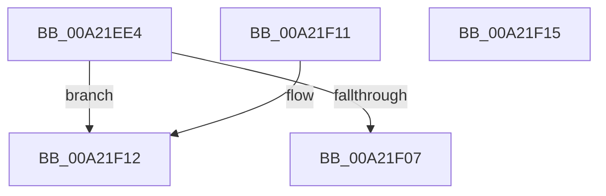

# PfSnIsSectionPrefetchedAfterPhase

- RVA: `0x00A21EE4`–`0x00A21F16` (길이 `50` bytes)
- VA: `0x0000000140A21EE4`
- 실행 섹션: `PAGE`
- PDB 이름 있음: `예`; PDB Function 태그: `아니요`
- unwind 정보 RVA: `0x000DB714`
- 디코드: `19`개 명령, `50/50` bytes 표시
- 미해석 바이트: `0` (있으면 어셈블리에 `.byte`로 보존)

> 이 문서는 커널 이미지의 기계어와 PDB 기호를 분석해 생성했습니다. 4번과 5번은 함수 원형과 자료형을 바이너리 사용 방식에서 추정한 C 해석이며 원본 소스 복구 결과는 아닙니다.

## 1. Dependencies

- 직접 호출 지점: **0**; 고유 호출 대상: **0**
- 직접 호출자로 확인된 함수: **1**
- RIP 상대 이미지 참조: **0**

### Outgoing calls
- 직접 디코드된 call 명령이 없습니다.

### Direct callers
- [PfSnGetSectionObject](../8A/PfSnGetSectionObject_function_008A9448.md) at `0x008A9A11`

### Static image references
- 디코드된 RIP-relative 메모리 참조가 없습니다.

## 2. Other-region calls and transfers

- 다른 실행 섹션으로 향하는 call: **0**
- 별도 외부 분기/꼬리 이동을 확인하지 못했습니다.

## 3. Assembly (complete function range)

```asm
00A21EE4  44 8B 49 14                     mov r9d, dword ptr [rcx + 0x14]
00A21EE8  41 8B C1                        mov eax, r9d
00A21EEB  D1 E8                           shr eax, 1
00A21EED  41 C1 E9 08                     shr r9d, 8
00A21EF1  83 FA 01                        cmp edx, 1
00A21EF4  44 0F 45 C8                     cmovne r9d, eax
00A21EF8  41 83 E1 7F                     and r9d, 0x7f
00A21EFC  41 0F BD C9                     bsr ecx, r9d
00A21F00  0F 95 C0                        setne al
00A21F03  84 C0                           test al, al
00A21F05  74 0B                           je 0x140a21f12
00A21F07  41 0F BD C0                     bsr eax, r8d
00A21F0B  3B C8                           cmp ecx, eax
00A21F0D  0F 97 C0                        seta al
00A21F10  C3                              ret
00A21F11  CC                              int3
00A21F12  32 C0                           xor al, al
00A21F14  C3                              ret
00A21F15  CC                              int3
```

## 4. C-style interpretation (structured pseudocode)

```c
__int64 __fastcall PfSnIsSectionPrefetchedAfterPhase(__int64 a1, int a2, int a3)
{
    __int64 result;

    result = (unsigned int)(((unsigned int)((unsigned int)((unsigned int)(*(unsigned int *)(a1 + 20))))) >> (1));
    a4 = (unsigned int)(((unsigned int)(*(unsigned int *)(a1 + 20))) >> (8));
    if (a2 != 1) { a4 = (unsigned int)(result); }
    a4 = (unsigned int)((a4) & (127));
    result = (condition_is_not_equal) ? 1 : 0;
    if ((unsigned __int8)(result) == 0) goto loc_00A21F12;
    result = (((unsigned int)(a1)) > ((unsigned int)(result))) ? 1 : 0;
    return result;
loc_00A21F12:
    result = 0;
    return result;
}
```

## 5. (Beta) C Style

```c
int64_t PfSnIsSectionPrefetchedAfterPhase(void *Arg1, int32_t Arg2, int32_t Arg3)
{
    uint8_t *arg1 = (uint8_t *)Arg1;

    int64_t result;

    result = (uint32_t)(((uint32_t)((uint32_t)((uint32_t)(*(uint32_t *)(arg1 + 0x14))))) >> (1));
    a4 = (uint32_t)(((uint32_t)(*(uint32_t *)(arg1 + 0x14))) >> (8));
    if (Arg2 != 1) { a4 = (uint32_t)(result); }
    a4 = (uint32_t)((a4) & (127));
    result = (condition_is_not_equal) ? 1 : 0;
    if ((uint8_t)(result) == 0) goto loc_00A21F12;
    result = (((uint32_t)(Arg1)) > ((uint32_t)(result))) ? 1 : 0;
    return result;
loc_00A21F12:
    result = 0;
    return result;
}
```

### 관측된 메모리 오프셋

구조체 형식이 확인되지 않은 접근은 인자 기준의 오프셋으로만 기록했습니다.

| 기준 인자 | 오프셋 표현 | 폭 (bit) | 접근 |
|---|---:|---:|---|
| `Arg1` | `+ 0x14` | `32` | `R` |

## 6. Execution-region graph

[열기: 2D/3D 그래프와 함수 탐색 컨트롤 패널](../../../control-panel.html?section=page&rva=0x00A21EE4&view=graph)

- 2D 그래프는 위에서 아래로 흐르고, 3D 그래프는 빈 공간을 드래그해 회전합니다. Shift+드래그는 이동, 휠은 확대·축소, 함수 노드 선택은 대상 보고서 이동입니다.

### Static fallback


