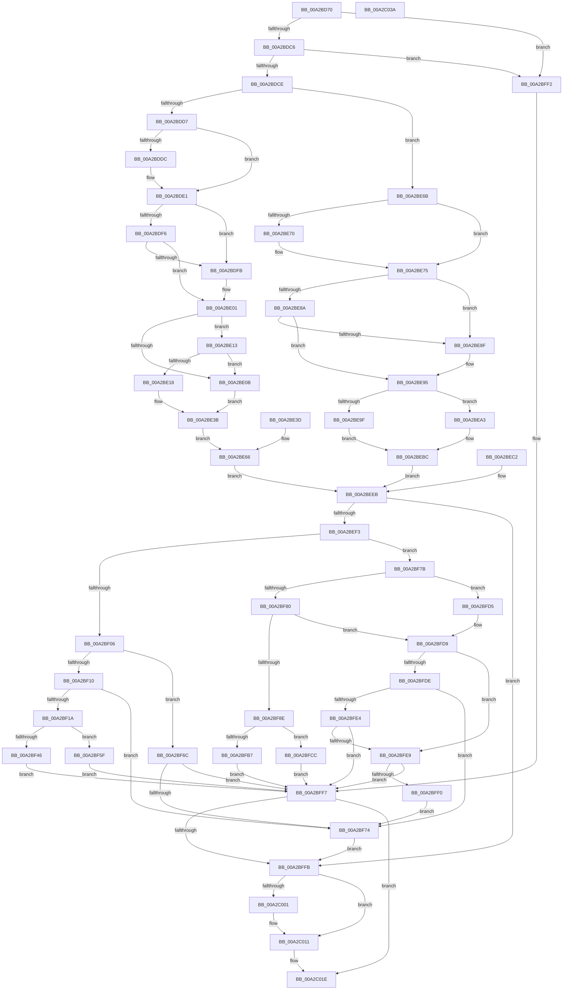

# PiCMCaptureDeviceListInputData

- RVA: `0x00A2BD70`–`0x00A2C03B` (길이 `715` bytes)
- VA: `0x0000000140A2BD70`
- 실행 섹션: `PAGE`
- PDB 이름 있음: `예`; PDB Function 태그: `아니요`
- unwind 정보 RVA: `0x000AC3C0`
- 디코드: `199`개 명령, `715/715` bytes 표시
- 미해석 바이트: `0` (있으면 어셈블리에 `.byte`로 보존)

> 이 문서는 커널 이미지의 기계어와 PDB 기호를 분석해 생성했습니다. 4번과 5번은 함수 원형과 자료형을 바이너리 사용 방식에서 추정한 C 해석이며 원본 소스 복구 결과는 아닙니다.

## 1. Dependencies

- 직접 호출 지점: **6**; 고유 호출 대상: **4**
- 직접 호출자로 확인된 함수: **1**
- RIP 상대 이미지 참조: **0**

### Outgoing calls
- `0x00A2BDDC` → [ExRaiseDatatypeMisalignment](../89/ExRaiseDatatypeMisalignment_function_00899FD0.md) (function, `0x00899FD0`)
- `0x00A2BE70` → [ExRaiseDatatypeMisalignment](../89/ExRaiseDatatypeMisalignment_function_00899FD0.md) (function, `0x00899FD0`)
- `0x00A2BEFD` → [Feature_KernelPnP_DeviceListFilterUpdates__private_IsEnabledDeviceUsageNoInline](../../text/4F/Feature_KernelPnP_DeviceListFilterUpdates__private_IsEnabledDeviceUsageNoInline_function_004F576C.md) (function, `0x004F576C`)
- `0x00A2BF3B` → [PiControlMakeUserModeCallersCopy](../8E/PiControlMakeUserModeCallersCopy_function_008E4630.md) (function, `0x008E4630`)
- `0x00A2BFAC` → [PiControlMakeUserModeCallersCopy](../8E/PiControlMakeUserModeCallersCopy_function_008E4630.md) (function, `0x008E4630`)
- `0x00A2C00C` → [PiControlFreeUserModeCallersBuffer](../../text/44/PiControlFreeUserModeCallersBuffer_function_00448990.md) (function, `0x00448990`)

### Direct callers
- [PiCMGetDeviceIdList](PiCMGetDeviceIdList_function_00A2BAAC.md) at `0x00A2BB06`

### Static image references
- 디코드된 RIP-relative 메모리 참조가 없습니다.

## 2. Other-region calls and transfers

- 다른 실행 섹션으로 향하는 call: **2**
  - `0x00A2BEFD` → [Feature_KernelPnP_DeviceListFilterUpdates__private_IsEnabledDeviceUsageNoInline](../../text/4F/Feature_KernelPnP_DeviceListFilterUpdates__private_IsEnabledDeviceUsageNoInline_function_004F576C.md) (`PAGE` → `.text`)
  - `0x00A2C00C` → [PiControlFreeUserModeCallersBuffer](../../text/44/PiControlFreeUserModeCallersBuffer_function_00448990.md) (`PAGE` → `.text`)
- 별도 외부 분기/꼬리 이동을 확인하지 못했습니다.

## 3. Assembly (complete function range)

```asm
00A2BD70  48 89 5C 24 10                  mov qword ptr [rsp + 0x10], rbx
00A2BD75  48 89 74 24 18                  mov qword ptr [rsp + 0x18], rsi
00A2BD7A  4C 89 4C 24 20                  mov qword ptr [rsp + 0x20], r9
00A2BD7F  57                              push rdi
00A2BD80  41 54                           push r12
00A2BD82  41 55                           push r13
00A2BD84  41 56                           push r14
00A2BD86  41 57                           push r15
00A2BD88  48 83 EC 50                     sub rsp, 0x50
00A2BD8C  4D 8B F1                        mov r14, r9
00A2BD8F  4D 8B E1                        mov r12, r9
00A2BD92  4C 89 4C 24 40                  mov qword ptr [rsp + 0x40], r9
00A2BD97  33 FF                           xor edi, edi
00A2BD99  89 7C 24 38                     mov dword ptr [rsp + 0x38], edi
00A2BD9D  65 48 8B 04 25 88 01 00 00      mov rax, qword ptr gs:[0x188]
00A2BDA6  8A 80 32 02 00 00               mov al, byte ptr [rax + 0x232]
00A2BDAC  88 84 24 80 00 00 00            mov byte ptr [rsp + 0x80], al
00A2BDB3  88 44 24 30                     mov byte ptr [rsp + 0x30], al
00A2BDB7  8B DF                           mov ebx, edi
00A2BDB9  89 5C 24 34                     mov dword ptr [rsp + 0x34], ebx
00A2BDBD  48 85 C9                        test rcx, rcx
00A2BDC0  0F 84 2C 02 00 00               je 0x140a2bff2
00A2BDC6  85 D2                           test edx, edx
00A2BDC8  0F 84 24 02 00 00               je 0x140a2bff2
00A2BDCE  45 85 C0                        test r8d, r8d
00A2BDD1  0F 84 94 00 00 00               je 0x140a2be6b
00A2BDD7  F6 C1 03                        test cl, 3
00A2BDDA  74 05                           je 0x140a2bde1
00A2BDDC  E8 EF E1 E6 FF                  call 0x140899fd0
00A2BDE1  44 8B C2                        mov r8d, edx
00A2BDE4  4C 03 C1                        add r8, rcx
00A2BDE7  48 B8 00 00 FF FF FF 7F 00 00   movabs rax, 0x7fffffff0000
00A2BDF1  4C 3B C0                        cmp r8, rax
00A2BDF4  77 05                           ja 0x140a2bdfb
00A2BDF6  4C 3B C1                        cmp r8, rcx
00A2BDF9  73 06                           jae 0x140a2be01
00A2BDFB  8A 00                           mov al, byte ptr [rax]
00A2BDFD  8B 5C 24 34                     mov ebx, dword ptr [rsp + 0x34]
00A2BE01  BE 0D 00 00 C0                  mov esi, 0xc000000d
00A2BE06  83 FA 14                        cmp edx, 0x14
00A2BE09  73 08                           jae 0x140a2be13
00A2BE0B  8B DE                           mov ebx, esi
00A2BE0D  89 5C 24 34                     mov dword ptr [rsp + 0x34], ebx
00A2BE11  EB 28                           jmp 0x140a2be3b
00A2BE13  83 39 14                        cmp dword ptr [rcx], 0x14
00A2BE16  75 F3                           jne 0x140a2be0b
00A2BE18  41 C7 01 18 00 00 00            mov dword ptr [r9], 0x18
00A2BE1F  8B 41 04                        mov eax, dword ptr [rcx + 4]
00A2BE22  41 89 41 04                     mov dword ptr [r9 + 4], eax
00A2BE26  8B 41 08                        mov eax, dword ptr [rcx + 8]
00A2BE29  49 89 41 08                     mov qword ptr [r9 + 8], rax
00A2BE2D  8B 41 0C                        mov eax, dword ptr [rcx + 0xc]
00A2BE30  41 89 41 10                     mov dword ptr [r9 + 0x10], eax
00A2BE34  8B 41 10                        mov eax, dword ptr [rcx + 0x10]
00A2BE37  41 89 41 14                     mov dword ptr [r9 + 0x14], eax
00A2BE3B  EB 29                           jmp 0x140a2be66
00A2BE3D  8B D8                           mov ebx, eax
00A2BE3F  89 44 24 34                     mov dword ptr [rsp + 0x34], eax
00A2BE43  33 FF                           xor edi, edi
00A2BE45  BE 0D 00 00 C0                  mov esi, 0xc000000d
00A2BE4A  4C 8B B4 24 98 00 00 00         mov r14, qword ptr [rsp + 0x98]
00A2BE52  89 7C 24 38                     mov dword ptr [rsp + 0x38], edi
00A2BE56  8A 44 24 30                     mov al, byte ptr [rsp + 0x30]
00A2BE5A  88 84 24 80 00 00 00            mov byte ptr [rsp + 0x80], al
00A2BE61  4C 8B 64 24 40                  mov r12, qword ptr [rsp + 0x40]
00A2BE66  E9 80 00 00 00                  jmp 0x140a2beeb
00A2BE6B  F6 C1 07                        test cl, 7
00A2BE6E  74 05                           je 0x140a2be75
00A2BE70  E8 5B E1 E6 FF                  call 0x140899fd0
00A2BE75  44 8B C2                        mov r8d, edx
00A2BE78  4C 03 C1                        add r8, rcx
00A2BE7B  48 B8 00 00 FF FF FF 7F 00 00   movabs rax, 0x7fffffff0000
00A2BE85  4C 3B C0                        cmp r8, rax
00A2BE88  77 05                           ja 0x140a2be8f
00A2BE8A  4C 3B C1                        cmp r8, rcx
00A2BE8D  73 06                           jae 0x140a2be95
00A2BE8F  8A 00                           mov al, byte ptr [rax]
00A2BE91  8B 5C 24 34                     mov ebx, dword ptr [rsp + 0x34]
00A2BE95  BE 0D 00 00 C0                  mov esi, 0xc000000d
00A2BE9A  83 FA 18                        cmp edx, 0x18
00A2BE9D  73 04                           jae 0x140a2bea3
00A2BE9F  8B DE                           mov ebx, esi
00A2BEA1  EB 19                           jmp 0x140a2bebc
00A2BEA3  0F 10 01                        movups xmm0, xmmword ptr [rcx]
00A2BEA6  41 0F 11 01                     movups xmmword ptr [r9], xmm0
00A2BEAA  F2 0F 10 49 10                  movsd xmm1, qword ptr [rcx + 0x10]
00A2BEAF  F2 41 0F 11 49 10               movsd qword ptr [r9 + 0x10], xmm1
00A2BEB5  41 83 39 18                     cmp dword ptr [r9], 0x18
00A2BEB9  0F 45 DE                        cmovne ebx, esi
00A2BEBC  89 5C 24 34                     mov dword ptr [rsp + 0x34], ebx
00A2BEC0  EB 29                           jmp 0x140a2beeb
00A2BEC2  8B D8                           mov ebx, eax
00A2BEC4  89 44 24 34                     mov dword ptr [rsp + 0x34], eax
00A2BEC8  33 FF                           xor edi, edi
00A2BECA  BE 0D 00 00 C0                  mov esi, 0xc000000d
00A2BECF  4C 8B B4 24 98 00 00 00         mov r14, qword ptr [rsp + 0x98]
00A2BED7  89 7C 24 38                     mov dword ptr [rsp + 0x38], edi
00A2BEDB  8A 44 24 30                     mov al, byte ptr [rsp + 0x30]
00A2BEDF  88 84 24 80 00 00 00            mov byte ptr [rsp + 0x80], al
00A2BEE6  4C 8B 64 24 40                  mov r12, qword ptr [rsp + 0x40]
00A2BEEB  85 DB                           test ebx, ebx
00A2BEED  0F 88 08 01 00 00               js 0x140a2bffb
00A2BEF3  4D 8D 7E 08                     lea r15, [r14 + 8]
00A2BEF7  4D 8B 2F                        mov r13, qword ptr [r15]
00A2BEFA  49 89 3F                        mov qword ptr [r15], rdi
00A2BEFD  E8 6A 98 AC FF                  call 0x1404f576c
00A2BF02  85 C0                           test eax, eax
00A2BF04  74 75                           je 0x140a2bf7b
00A2BF06  41 8B 4C 24 10                  mov ecx, dword ptr [r12 + 0x10]
00A2BF0B  4D 85 ED                        test r13, r13
00A2BF0E  74 5C                           je 0x140a2bf6c
00A2BF10  8D 41 FE                        lea eax, [rcx - 2]
00A2BF13  3D FE 01 00 00                  cmp eax, 0x1fe
00A2BF18  77 5A                           ja 0x140a2bf74
00A2BF1A  BE 01 00 00 00                  mov esi, 1
00A2BF1F  89 74 24 28                     mov dword ptr [rsp + 0x28], esi
00A2BF23  8A 84 24 80 00 00 00            mov al, byte ptr [rsp + 0x80]
00A2BF2A  88 44 24 20                     mov byte ptr [rsp + 0x20], al
00A2BF2E  44 8D 4E 01                     lea r9d, [rsi + 1]
00A2BF32  44 8B C1                        mov r8d, ecx
00A2BF35  49 8B D5                        mov rdx, r13
00A2BF38  49 8B CF                        mov rcx, r15
00A2BF3B  E8 F0 86 EB FF                  call 0x1408e4630
00A2BF40  8B D8                           mov ebx, eax
00A2BF42  85 C0                           test eax, eax
00A2BF44  78 19                           js 0x140a2bf5f
00A2BF46  89 74 24 38                     mov dword ptr [rsp + 0x38], esi
00A2BF4A  41 8B 54 24 10                  mov edx, dword ptr [r12 + 0x10]
00A2BF4F  48 D1 EA                        shr rdx, 1
00A2BF52  49 8B 0F                        mov rcx, qword ptr [r15]
00A2BF55  66 89 7C 51 FE                  mov word ptr [rcx + rdx*2 - 2], di
00A2BF5A  E9 98 00 00 00                  jmp 0x140a2bff7
00A2BF5F  49 89 3F                        mov qword ptr [r15], rdi
00A2BF62  41 89 7C 24 10                  mov dword ptr [r12 + 0x10], edi
00A2BF67  E9 8B 00 00 00                  jmp 0x140a2bff7
00A2BF6C  85 C9                           test ecx, ecx
00A2BF6E  0F 84 83 00 00 00               je 0x140a2bff7
00A2BF74  8B DE                           mov ebx, esi
00A2BF76  E9 80 00 00 00                  jmp 0x140a2bffb
00A2BF7B  4D 85 ED                        test r13, r13
00A2BF7E  74 55                           je 0x140a2bfd5
00A2BF80  4D 8D 66 10                     lea r12, [r14 + 0x10]
00A2BF84  45 8B 04 24                     mov r8d, dword ptr [r12]
00A2BF88  41 83 F8 02                     cmp r8d, 2
00A2BF8C  72 4B                           jb 0x140a2bfd9
00A2BF8E  BE 01 00 00 00                  mov esi, 1
00A2BF93  89 74 24 28                     mov dword ptr [rsp + 0x28], esi
00A2BF97  8A 84 24 80 00 00 00            mov al, byte ptr [rsp + 0x80]
00A2BF9E  88 44 24 20                     mov byte ptr [rsp + 0x20], al
00A2BFA2  44 8D 4E 01                     lea r9d, [rsi + 1]
00A2BFA6  49 8B D5                        mov rdx, r13
00A2BFA9  49 8B CF                        mov rcx, r15
00A2BFAC  E8 7F 86 EB FF                  call 0x1408e4630
00A2BFB1  8B D8                           mov ebx, eax
00A2BFB3  85 C0                           test eax, eax
00A2BFB5  78 15                           js 0x140a2bfcc
00A2BFB7  89 74 24 38                     mov dword ptr [rsp + 0x38], esi
00A2BFBB  41 8B 0C 24                     mov ecx, dword ptr [r12]
00A2BFBF  48 D1 E9                        shr rcx, 1
00A2BFC2  49 8B 07                        mov rax, qword ptr [r15]
00A2BFC5  66 89 7C 48 FE                  mov word ptr [rax + rcx*2 - 2], di
00A2BFCA  EB 2B                           jmp 0x140a2bff7
00A2BFCC  49 89 3F                        mov qword ptr [r15], rdi
00A2BFCF  41 89 3C 24                     mov dword ptr [r12], edi
00A2BFD3  EB 22                           jmp 0x140a2bff7
00A2BFD5  49 83 C4 10                     add r12, 0x10
00A2BFD9  4D 85 ED                        test r13, r13
00A2BFDC  75 0B                           jne 0x140a2bfe9
00A2BFDE  41 39 3C 24                     cmp dword ptr [r12], edi
00A2BFE2  77 90                           ja 0x140a2bf74
00A2BFE4  4D 85 ED                        test r13, r13
00A2BFE7  74 0E                           je 0x140a2bff7
00A2BFE9  41 83 3C 24 02                  cmp dword ptr [r12], 2
00A2BFEE  73 07                           jae 0x140a2bff7
00A2BFF0  EB 82                           jmp 0x140a2bf74
00A2BFF2  BB 0D 00 00 C0                  mov ebx, 0xc000000d
00A2BFF7  85 DB                           test ebx, ebx
00A2BFF9  79 23                           jns 0x140a2c01e
00A2BFFB  39 7C 24 38                     cmp dword ptr [rsp + 0x38], edi
00A2BFFF  74 10                           je 0x140a2c011
00A2C001  49 8B 56 08                     mov rdx, qword ptr [r14 + 8]
00A2C005  8A 8C 24 80 00 00 00            mov cl, byte ptr [rsp + 0x80]
00A2C00C  E8 7F C9 A1 FF                  call 0x140448990
00A2C011  0F 57 C0                        xorps xmm0, xmm0
00A2C014  33 C0                           xor eax, eax
00A2C016  41 0F 11 06                     movups xmmword ptr [r14], xmm0
00A2C01A  49 89 46 10                     mov qword ptr [r14 + 0x10], rax
00A2C01E  8B C3                           mov eax, ebx
00A2C020  4C 8D 5C 24 50                  lea r11, [rsp + 0x50]
00A2C025  49 8B 5B 38                     mov rbx, qword ptr [r11 + 0x38]
00A2C029  49 8B 73 40                     mov rsi, qword ptr [r11 + 0x40]
00A2C02D  49 8B E3                        mov rsp, r11
00A2C030  41 5F                           pop r15
00A2C032  41 5E                           pop r14
00A2C034  41 5D                           pop r13
00A2C036  41 5C                           pop r12
00A2C038  5F                              pop rdi
00A2C039  C3                              ret
00A2C03A  CC                              int3
```

## 4. C-style interpretation (structured pseudocode)

```c
__int64 __fastcall PiCMCaptureDeviceListInputData(__int64 a1, int a2, int a3, __int64 a4)
{
    __int64 result;
    __int64 v_r12;
    __int64 v_rbx;
    __int64 v_rdi;
    __int64 v_rsp;
    unsigned __int64 v_stack_m28;
    unsigned __int64 v_stack_m38;
    unsigned int v_stack_m40;
    unsigned int v_stack_m44;
    unsigned __int8 v_stack_m48;
    unsigned int v_stack_m50;
    unsigned __int8 v_stack_m58;
    unsigned __int64 v_stack_p10;
    unsigned __int64 v_stack_p18;
    unsigned __int64 v_stack_p20;
    unsigned __int8 v_stack_p8;

    v_stack_p10 = v_rbx;
    v_stack_p18 = v_rsi;
    v_stack_p20 = a4;
    v_rsp = (v_rsp) - (80);
    v_stack_m38 = a4;
    v_rdi = 0;
    v_stack_m40 = 0;
    v_stack_p8 = (unsigned __int8)(*(unsigned __int8 *)(*(unsigned __int64 *)(gs_base + (0 + 392)) + 562));
    v_stack_m48 = (unsigned __int8)(*(unsigned __int8 *)(*(unsigned __int64 *)(gs_base + (0 + 392)) + 562));
    v_stack_m44 = 0;
    if (a1 == 0) goto loc_00A2BFF2;
    if (a2 == 0) goto loc_00A2BFF2;
    if (a3 == 0) goto loc_00A2BE6B;
    result = *(unsigned __int8 *)(*(unsigned __int64 *)(gs_base + (0 + 392)) + 562);
    if ((((unsigned __int8)(a1)) & (3)) != 0) {
        result = ExRaiseDatatypeMisalignment(a1, a2, a3, a4);
    }
    a3 = ((unsigned int)(a2)) + (a1);
    if (a3 > result) goto loc_00A2BDFB;
    v_rbx = 0;
    if (a3 < a1) {
        result = *(unsigned __int8 *)(result);
        v_rbx = v_stack_m44;
    }
    if (a2 >= 20) goto loc_00A2BE13;
loc_00A2BE0B:
    v_stack_m44 = (unsigned int)((unsigned int)((unsigned int)((unsigned int)(0xC000000DULL))));
    goto loc_00A2BE3B;
loc_00A2BE13:
    if ((*(unsigned int *)(a1)) != 20) goto loc_00A2BE0B;
    *(unsigned int *)(a4) = 24;
    *(unsigned int *)(a4 + 4) = (unsigned int)((unsigned int)(*(unsigned int *)(a1 + 4)));
    *(unsigned __int64 *)(a4 + 8) = (unsigned int)(*(unsigned int *)(a1 + 8));
    *(unsigned int *)(a4 + 16) = (unsigned int)((unsigned int)(*(unsigned int *)(a1 + 12)));
    *(unsigned int *)(a4 + 20) = (unsigned int)((unsigned int)(*(unsigned int *)(a1 + 16)));
loc_00A2BE3B:
    goto loc_00A2BE66;
loc_00A2BE66:
    goto loc_00A2BEEB;
loc_00A2BE6B:
    result = (unsigned int)(*(unsigned int *)(a1 + 16));
    if ((((unsigned __int8)(a1)) & (7)) != 0) {
        result = ExRaiseDatatypeMisalignment(a1, a2, a3, a4);
    }
    a3 = ((unsigned int)(a2)) + (a1);
    if (a3 > result) goto loc_00A2BE8F;
    v_rbx = (unsigned int)((unsigned int)((unsigned int)(0xC000000DULL)));
    if (a3 < a1) {
        result = *(unsigned __int8 *)(result);
        v_rbx = v_stack_m44;
    }
    if (a2 >= 24) goto loc_00A2BEA3;
    goto loc_00A2BEBC;
loc_00A2BEA3:
    *(unsigned __int64 *)(a4) = v_xmm0;
    *(unsigned __int64 *)(a4 + 16) = v_xmm1;
    v_rbx = (unsigned int)((unsigned int)((unsigned int)(0xC000000DULL)));
    if ((*(unsigned int *)(a4)) != 24) { v_rbx = (unsigned int)((unsigned int)(0xC000000DULL)); }
loc_00A2BEBC:
    v_stack_m44 = (unsigned int)(v_rbx);
    goto loc_00A2BEEB;
loc_00A2BEEB:
    if (sign_flag) goto loc_00A2BFFB;
    *(unsigned __int64 *)(a4 + 8) = 0;
    result = Feature_KernelPnP_DeviceListFilterUpdates__private_IsEnabledDeviceUsageNoInline(a1, a2, a3, a4);
    if ((unsigned int)(result) == 0) goto loc_00A2BF7B;
    if (*(unsigned __int64 *)(a4 + 8) == 0) goto loc_00A2BF6C;
    if (((unsigned int)((unsigned int)(*(unsigned int *)(a4 + 16)) - 2)) > 510) goto loc_00A2BF74;
    v_stack_m50 = 1;
    v_stack_m58 = (unsigned __int8)(v_stack_p8);
    result = PiControlMakeUserModeCallersCopy(a4 + 8, *(unsigned __int64 *)(a4 + 8), (unsigned int)((unsigned int)((unsigned int)(*(unsigned int *)(a4 + 16)))), 1 + 1);
    if (sign_flag) goto loc_00A2BF5F;
    v_stack_m40 = 1;
    a2 = ((unsigned int)(*(unsigned int *)(a4 + 16))) >> (1);
    *(unsigned __int16 *)(*(unsigned __int64 *)(a4 + 8) + a2 * 2 - 2) = 0;
    goto loc_00A2BFF7;
loc_00A2BF5F:
    *(unsigned __int64 *)(a4 + 8) = 0;
    *(unsigned int *)(a4 + 16) = 0;
    goto loc_00A2BFF7;
loc_00A2BF6C:
    if ((unsigned int)(*(unsigned __int64 *)(a4 + 8)) == 0) goto loc_00A2BFF7;
loc_00A2BF74:
    goto loc_00A2BFFB;
loc_00A2BF7B:
    if (*(unsigned __int64 *)(a4 + 8) == 0) goto loc_00A2BFD5;
    if (((unsigned int)((unsigned int)(*(unsigned int *)(a4 + 16)))) < 2) goto loc_00A2BFD9;
    v_stack_m50 = 1;
    v_stack_m58 = (unsigned __int8)(v_stack_p8);
    result = PiControlMakeUserModeCallersCopy(a4 + 8, *(unsigned __int64 *)(a4 + 8), (unsigned int)(*(unsigned int *)(a4 + 16)), 1 + 1);
    if (sign_flag) goto loc_00A2BFCC;
    v_stack_m40 = 1;
    a1 = ((unsigned int)(*(unsigned int *)(a4 + 16))) >> (1);
    *(unsigned __int16 *)(*(unsigned __int64 *)(a4 + 8) + a1 * 2 - 2) = 0;
    goto loc_00A2BFF7;
loc_00A2BFCC:
    *(unsigned __int64 *)(a4 + 8) = 0;
    *(unsigned int *)(a4 + 16) = 0;
    goto loc_00A2BFF7;
loc_00A2BFD5:
    v_r12 = (a4 + 16) + (16);
loc_00A2BFD9:
    if (*(unsigned __int64 *)(a4 + 8) != 0) goto loc_00A2BFE9;
    if ((*(unsigned int *)(v_r12)) > 0) goto loc_00A2BF74;
    if (*(unsigned __int64 *)(a4 + 8) == 0) goto loc_00A2BFF7;
loc_00A2BFE9:
    if ((*(unsigned int *)(v_r12)) >= 2) goto loc_00A2BFF7;
    goto loc_00A2BF74;
loc_00A2BFF2:
loc_00A2BFF7:
    if (!sign_flag) goto loc_00A2C01E;
loc_00A2BFFB:
    result = *(unsigned __int64 *)(a4 + 8);
    if (v_stack_m40 != 0) {
        a2 = *(unsigned __int64 *)(a4 + 8);
        a1 = v_stack_p8;
        result = PiControlFreeUserModeCallersBuffer(a1, a2, (unsigned int)(*(unsigned int *)(a4 + 16)), 1 + 1);
    }
    result = 0;
    *(unsigned __int64 *)(a4) = v_xmm0;
    *(unsigned __int64 *)(a4 + 16) = 0;
loc_00A2C01E:
    return (unsigned int)((unsigned int)((unsigned int)(0xC000000DULL)));
}
```

## 5. (Beta) C Style

```c
int64_t PiCMCaptureDeviceListInputData(int64_t Arg1, int32_t Arg2, int32_t Arg3, void *Arg4)
{
    uint8_t *arg4 = (uint8_t *)Arg4;

    int64_t result;
    int64_t local_r12;
    int64_t local_rbx;
    int64_t local_rdi;
    int64_t local_rsp;
    uint64_t v_stack_m28;
    uint64_t v_stack_m38;
    uint32_t v_stack_m40;
    uint32_t v_stack_m44;
    uint8_t v_stack_m48;
    uint32_t v_stack_m50;
    uint8_t v_stack_m58;
    uint64_t v_stack_p10;
    uint64_t v_stack_p18;
    uint64_t v_stack_p20;
    uint8_t v_stack_p8;

    v_stack_p10 = local_rbx;
    v_stack_p18 = local_rsi;
    v_stack_p20 = Arg4;
    local_rsp = (local_rsp) - (80);
    v_stack_m38 = Arg4;
    local_rdi = 0;
    v_stack_m40 = 0;
    v_stack_p8 = (uint8_t)(*(uint8_t *)(*(uint64_t *)(gs_base + (0 + 0x188)) + 0x232));
    v_stack_m48 = (uint8_t)(*(uint8_t *)(*(uint64_t *)(gs_base + (0 + 0x188)) + 0x232));
    v_stack_m44 = 0;
    if (Arg1 == 0) goto loc_00A2BFF2;
    if (Arg2 == 0) goto loc_00A2BFF2;
    if (Arg3 == 0) goto loc_00A2BE6B;
    result = *(uint8_t *)(*(uint64_t *)(gs_base + (0 + 0x188)) + 0x232);
    if ((((uint8_t)(Arg1)) & (3)) != 0) {
        result = ExRaiseDatatypeMisalignment(Arg1, Arg2, Arg3, Arg4);
    }
    Arg3 = ((uint32_t)(Arg2)) + (Arg1);
    if (Arg3 > result) goto loc_00A2BDFB;
    local_rbx = 0;
    if (Arg3 < Arg1) {
        result = *(uint8_t *)(result);
        local_rbx = v_stack_m44;
    }
    if (Arg2 >= 20) goto loc_00A2BE13;
loc_00A2BE0B:
    v_stack_m44 = (uint32_t)((uint32_t)((uint32_t)((uint32_t)(0xC000000DULL))));
    goto loc_00A2BE3B;
loc_00A2BE13:
    if ((*(uint32_t *)(Arg1)) != 20) goto loc_00A2BE0B;
    *(uint32_t *)(arg4) = 24;
    *(uint32_t *)(arg4 + 0x4) = (uint32_t)((uint32_t)(*(uint32_t *)(Arg1 + 0x4)));
    *(uint64_t *)(arg4 + 0x8) = (uint32_t)(*(uint32_t *)(Arg1 + 0x8));
    *(uint32_t *)(arg4 + 0x10) = (uint32_t)((uint32_t)(*(uint32_t *)(Arg1 + 0xC)));
    *(uint32_t *)(arg4 + 0x14) = (uint32_t)((uint32_t)(*(uint32_t *)(Arg1 + 0x10)));
loc_00A2BE3B:
    goto loc_00A2BE66;
loc_00A2BE66:
    goto loc_00A2BEEB;
loc_00A2BE6B:
    result = (uint32_t)(*(uint32_t *)(Arg1 + 0x10));
    if ((((uint8_t)(Arg1)) & (7)) != 0) {
        result = ExRaiseDatatypeMisalignment(Arg1, Arg2, Arg3, Arg4);
    }
    Arg3 = ((uint32_t)(Arg2)) + (Arg1);
    if (Arg3 > result) goto loc_00A2BE8F;
    local_rbx = (uint32_t)((uint32_t)((uint32_t)(0xC000000DULL)));
    if (Arg3 < Arg1) {
        result = *(uint8_t *)(result);
        local_rbx = v_stack_m44;
    }
    if (Arg2 >= 24) goto loc_00A2BEA3;
    goto loc_00A2BEBC;
loc_00A2BEA3:
    *(uint64_t *)(arg4) = v_xmm0;
    *(uint64_t *)(arg4 + 0x10) = v_xmm1;
    local_rbx = (uint32_t)((uint32_t)((uint32_t)(0xC000000DULL)));
    if ((*(uint32_t *)(arg4)) != 24) { local_rbx = (uint32_t)((uint32_t)(0xC000000DULL)); }
loc_00A2BEBC:
    v_stack_m44 = (uint32_t)(local_rbx);
    goto loc_00A2BEEB;
loc_00A2BEEB:
    if (sign_flag) goto loc_00A2BFFB;
    *(uint64_t *)(arg4 + 0x8) = 0;
    result = Feature_KernelPnP_DeviceListFilterUpdates__private_IsEnabledDeviceUsageNoInline(Arg1, Arg2, Arg3, Arg4);
    if ((uint32_t)(result) == 0) goto loc_00A2BF7B;
    if (*(uint64_t *)(arg4 + 0x8) == 0) goto loc_00A2BF6C;
    if (((uint32_t)((uint32_t)(*(uint32_t *)(arg4 + 0x10)) - 2)) > 510) goto loc_00A2BF74;
    v_stack_m50 = 1;
    v_stack_m58 = (uint8_t)(v_stack_p8);
    result = PiControlMakeUserModeCallersCopy(Arg4 + 8, *(uint64_t *)(arg4 + 0x8), (uint32_t)((uint32_t)((uint32_t)(*(uint32_t *)(arg4 + 0x10)))), 1 + 1);
    if (sign_flag) goto loc_00A2BF5F;
    v_stack_m40 = 1;
    Arg2 = ((uint32_t)(*(uint32_t *)(arg4 + 0x10))) >> (1);
    *(uint16_t *)(*(uint64_t *)(arg4 + 0x8) + Arg2 * 2 - 0x2) = 0;
    goto loc_00A2BFF7;
loc_00A2BF5F:
    *(uint64_t *)(arg4 + 0x8) = 0;
    *(uint32_t *)(arg4 + 0x10) = 0;
    goto loc_00A2BFF7;
loc_00A2BF6C:
    if ((uint32_t)(*(uint64_t *)(arg4 + 0x8)) == 0) goto loc_00A2BFF7;
loc_00A2BF74:
    goto loc_00A2BFFB;
loc_00A2BF7B:
    if (*(uint64_t *)(arg4 + 0x8) == 0) goto loc_00A2BFD5;
    if (((uint32_t)((uint32_t)(*(uint32_t *)(arg4 + 0x10)))) < 2) goto loc_00A2BFD9;
    v_stack_m50 = 1;
    v_stack_m58 = (uint8_t)(v_stack_p8);
    result = PiControlMakeUserModeCallersCopy(Arg4 + 8, *(uint64_t *)(arg4 + 0x8), (uint32_t)(*(uint32_t *)(arg4 + 0x10)), 1 + 1);
    if (sign_flag) goto loc_00A2BFCC;
    v_stack_m40 = 1;
    Arg1 = ((uint32_t)(*(uint32_t *)(arg4 + 0x10))) >> (1);
    *(uint16_t *)(*(uint64_t *)(arg4 + 0x8) + Arg1 * 2 - 0x2) = 0;
    goto loc_00A2BFF7;
loc_00A2BFCC:
    *(uint64_t *)(arg4 + 0x8) = 0;
    *(uint32_t *)(arg4 + 0x10) = 0;
    goto loc_00A2BFF7;
loc_00A2BFD5:
    local_r12 = (Arg4 + 16) + (16);
loc_00A2BFD9:
    if (*(uint64_t *)(arg4 + 0x8) != 0) goto loc_00A2BFE9;
    if ((*(uint32_t *)(local_r12)) > 0) goto loc_00A2BF74;
    if (*(uint64_t *)(arg4 + 0x8) == 0) goto loc_00A2BFF7;
loc_00A2BFE9:
    if ((*(uint32_t *)(local_r12)) >= 2) goto loc_00A2BFF7;
    goto loc_00A2BF74;
loc_00A2BFF2:
loc_00A2BFF7:
    if (!sign_flag) goto loc_00A2C01E;
loc_00A2BFFB:
    result = *(uint64_t *)(arg4 + 0x8);
    if (v_stack_m40 != 0) {
        Arg2 = *(uint64_t *)(arg4 + 0x8);
        Arg1 = v_stack_p8;
        result = PiControlFreeUserModeCallersBuffer(Arg1, Arg2, (uint32_t)(*(uint32_t *)(arg4 + 0x10)), 1 + 1);
    }
    result = 0;
    *(uint64_t *)(arg4) = v_xmm0;
    *(uint64_t *)(arg4 + 0x10) = 0;
loc_00A2C01E:
    return (uint32_t)((uint32_t)((uint32_t)(0xC000000DULL)));
}
```

### 관측된 메모리 오프셋

구조체 형식이 확인되지 않은 접근은 인자 기준의 오프셋으로만 기록했습니다.

| 기준 인자 | 오프셋 표현 | 폭 (bit) | 접근 |
|---|---:|---:|---|
| `Arg4` | `+ 0x0` | `32` | `R` |
| `Arg4` | `+ 0x0` | `32` | `W` |
| `Arg4` | `+ 0x0` | `64` | `R` |
| `Arg4` | `+ 0x0` | `64` | `W` |
| `Arg4` | `+ 0x0` | `128` | `R` |
| `Arg4` | `+ 0x8` | `64` | `R` |
| `Arg4` | `+ 0x10` | `32` | `R` |
| `Arg4` | `+ 0x10` | `32` | `W` |
| `Arg4` | `+ 0x10` | `64` | `R` |
| `Arg4` | `+ 0x10` | `64` | `W` |

## 6. Execution-region graph

[열기: 2D/3D 그래프와 함수 탐색 컨트롤 패널](../../../control-panel.html?section=page&rva=0x00A2BD70&view=graph)

- 2D 그래프는 위에서 아래로 흐르고, 3D 그래프는 빈 공간을 드래그해 회전합니다. Shift+드래그는 이동, 휠은 확대·축소, 함수 노드 선택은 대상 보고서 이동입니다.

### Static fallback


