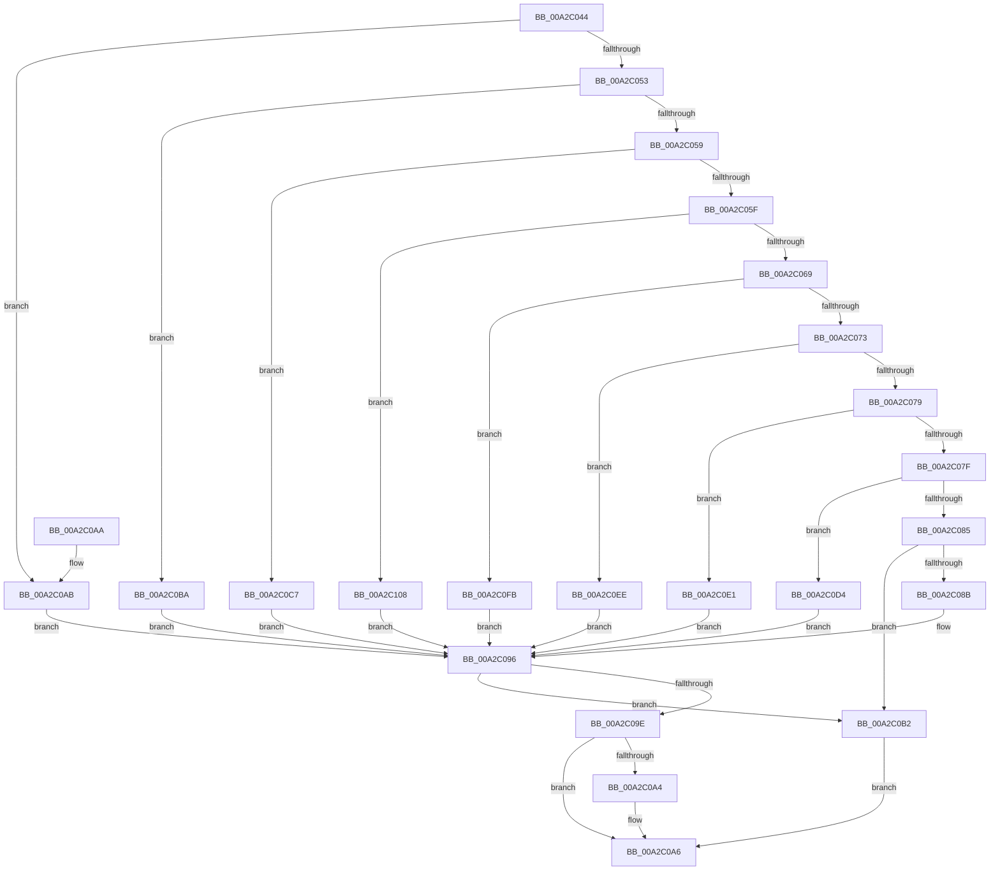

# PiCMConvertDeviceListFilters

- RVA: `0x00A2C044`–`0x00A2C115` (길이 `209` bytes)
- VA: `0x0000000140A2C044`
- 실행 섹션: `PAGE`
- PDB 이름 있음: `예`; PDB Function 태그: `아니요`
- unwind 정보 RVA: `0x000DB714`
- 디코드: `56`개 명령, `209/209` bytes 표시
- 미해석 바이트: `0` (있으면 어셈블리에 `.byte`로 보존)

> 이 문서는 커널 이미지의 기계어와 PDB 기호를 분석해 생성했습니다. 4번과 5번은 함수 원형과 자료형을 바이너리 사용 방식에서 추정한 C 해석이며 원본 소스 복구 결과는 아닙니다.

## 1. Dependencies

- 직접 호출 지점: **0**; 고유 호출 대상: **0**
- 직접 호출자로 확인된 함수: **1**
- RIP 상대 이미지 참조: **0**

### Outgoing calls
- 직접 디코드된 call 명령이 없습니다.

### Direct callers
- [PiCMGetDeviceIdList](PiCMGetDeviceIdList_function_00A2BAAC.md) at `0x00A2BB8D`

### Static image references
- 디코드된 RIP-relative 메모리 참조가 없습니다.

## 2. Other-region calls and transfers

- 다른 실행 섹션으로 향하는 call: **0**
- 별도 외부 분기/꼬리 이동을 확인하지 못했습니다.

## 3. Assembly (complete function range)

```asm
00A2C044  45 33 C9                        xor r9d, r9d
00A2C047  44 0F B7 C1                     movzx r8d, cx
00A2C04B  44 89 0A                        mov dword ptr [rdx], r9d
00A2C04E  45 85 C0                        test r8d, r8d
00A2C051  74 58                           je 0x140a2c0ab
00A2C053  41 83 E8 01                     sub r8d, 1
00A2C057  74 61                           je 0x140a2c0ba
00A2C059  41 83 E8 01                     sub r8d, 1
00A2C05D  74 68                           je 0x140a2c0c7
00A2C05F  41 83 E8 02                     sub r8d, 2
00A2C063  0F 84 9F 00 00 00               je 0x140a2c108
00A2C069  41 83 E8 04                     sub r8d, 4
00A2C06D  0F 84 88 00 00 00               je 0x140a2c0fb
00A2C073  41 83 E8 08                     sub r8d, 8
00A2C077  74 75                           je 0x140a2c0ee
00A2C079  41 83 E8 10                     sub r8d, 0x10
00A2C07D  74 62                           je 0x140a2c0e1
00A2C07F  41 83 E8 20                     sub r8d, 0x20
00A2C083  74 4F                           je 0x140a2c0d4
00A2C085  41 83 F8 40                     cmp r8d, 0x40
00A2C089  75 27                           jne 0x140a2c0b2
00A2C08B  C7 02 80 00 00 00               mov dword ptr [rdx], 0x80
00A2C091  B8 80 01 00 00                  mov eax, 0x180
00A2C096  F7 C1 00 00 FC FF               test ecx, 0xfffc0000
00A2C09C  75 14                           jne 0x140a2c0b2
00A2C09E  0F BA E1 10                     bt ecx, 0x10
00A2C0A2  73 02                           jae 0x140a2c0a6
00A2C0A4  89 02                           mov dword ptr [rdx], eax
00A2C0A6  41 8B C1                        mov eax, r9d
00A2C0A9  C3                              ret
00A2C0AA  CC                              int3
00A2C0AB  B8 00 01 00 00                  mov eax, 0x100
00A2C0B0  EB E4                           jmp 0x140a2c096
00A2C0B2  41 B9 0D 00 00 C0               mov r9d, 0xc000000d
00A2C0B8  EB EC                           jmp 0x140a2c0a6
00A2C0BA  C7 02 01 00 00 00               mov dword ptr [rdx], 1
00A2C0C0  B8 01 01 00 00                  mov eax, 0x101
00A2C0C5  EB CF                           jmp 0x140a2c096
00A2C0C7  C7 02 02 00 00 00               mov dword ptr [rdx], 2
00A2C0CD  B8 02 01 00 00                  mov eax, 0x102
00A2C0D2  EB C2                           jmp 0x140a2c096
00A2C0D4  C7 02 40 00 00 00               mov dword ptr [rdx], 0x40
00A2C0DA  B8 40 01 00 00                  mov eax, 0x140
00A2C0DF  EB B5                           jmp 0x140a2c096
00A2C0E1  C7 02 20 00 00 00               mov dword ptr [rdx], 0x20
00A2C0E7  B8 20 01 00 00                  mov eax, 0x120
00A2C0EC  EB A8                           jmp 0x140a2c096
00A2C0EE  C7 02 10 00 00 00               mov dword ptr [rdx], 0x10
00A2C0F4  B8 10 01 00 00                  mov eax, 0x110
00A2C0F9  EB 9B                           jmp 0x140a2c096
00A2C0FB  C7 02 08 00 00 00               mov dword ptr [rdx], 8
00A2C101  B8 08 01 00 00                  mov eax, 0x108
00A2C106  EB 8E                           jmp 0x140a2c096
00A2C108  C7 02 04 00 00 00               mov dword ptr [rdx], 4
00A2C10E  B8 04 01 00 00                  mov eax, 0x104
00A2C113  EB 81                           jmp 0x140a2c096
```

## 4. C-style interpretation (structured pseudocode)

```c
__int64 __fastcall PiCMConvertDeviceListFilters(int a1, __int64 a2, __int64 a3, int a4)
{
    a4 = 0;
    *(unsigned int *)(a2) = 0;
    if ((unsigned int)((unsigned __int16)(a1)) == 0) goto loc_00A2C0AB;
    a3 = (unsigned int)(((unsigned __int16)(a1)) - (1));
    if (condition_is_equal) goto loc_00A2C0BA;
    a3 = (unsigned int)((a3) - (1));
    if (condition_is_equal) goto loc_00A2C0C7;
    a3 = (unsigned int)((a3) - (2));
    if (condition_is_equal) goto loc_00A2C108;
    a3 = (unsigned int)((a3) - (4));
    if (condition_is_equal) goto loc_00A2C0FB;
    a3 = (unsigned int)((a3) - (8));
    if (condition_is_equal) goto loc_00A2C0EE;
    a3 = (unsigned int)((a3) - (16));
    if (condition_is_equal) goto loc_00A2C0E1;
    a3 = (unsigned int)((a3) - (32));
    if (condition_is_equal) goto loc_00A2C0D4;
    if (((unsigned int)(a3)) != 64) goto loc_00A2C0B2;
    *(unsigned int *)(a2) = 128;
loc_00A2C096:
    if (((a1) & (0xFFFC0000ULL)) != 0) goto loc_00A2C0B2;
    if (!(condition_is_above_or_equal)) {
        *(unsigned int *)(a2) = 384;
    }
    return 0;
loc_00A2C0AB:
    goto loc_00A2C096;
loc_00A2C0B2:
    goto loc_00A2C0A6;
loc_00A2C0BA:
    *(unsigned int *)(a2) = 1;
    goto loc_00A2C096;
loc_00A2C0C7:
    *(unsigned int *)(a2) = 2;
    goto loc_00A2C096;
loc_00A2C0D4:
    *(unsigned int *)(a2) = 64;
    goto loc_00A2C096;
loc_00A2C0E1:
    *(unsigned int *)(a2) = 32;
    goto loc_00A2C096;
loc_00A2C0EE:
    *(unsigned int *)(a2) = 16;
    goto loc_00A2C096;
loc_00A2C0FB:
    *(unsigned int *)(a2) = 8;
    goto loc_00A2C096;
loc_00A2C108:
    *(unsigned int *)(a2) = 4;
    goto loc_00A2C096;
}
```

## 5. (Beta) C Style

```c
int64_t PiCMConvertDeviceListFilters(int32_t Arg1, void *Arg2, int64_t Arg3, int32_t Arg4)
{
    uint8_t *arg2 = (uint8_t *)Arg2;

    Arg4 = 0;
    *(uint32_t *)(arg2) = 0;
    if ((uint32_t)((uint16_t)(Arg1)) == 0) goto loc_00A2C0AB;
    Arg3 = (uint32_t)(((uint16_t)(Arg1)) - (1));
    if (condition_is_equal) goto loc_00A2C0BA;
    Arg3 = (uint32_t)((Arg3) - (1));
    if (condition_is_equal) goto loc_00A2C0C7;
    Arg3 = (uint32_t)((Arg3) - (2));
    if (condition_is_equal) goto loc_00A2C108;
    Arg3 = (uint32_t)((Arg3) - (4));
    if (condition_is_equal) goto loc_00A2C0FB;
    Arg3 = (uint32_t)((Arg3) - (8));
    if (condition_is_equal) goto loc_00A2C0EE;
    Arg3 = (uint32_t)((Arg3) - (16));
    if (condition_is_equal) goto loc_00A2C0E1;
    Arg3 = (uint32_t)((Arg3) - (32));
    if (condition_is_equal) goto loc_00A2C0D4;
    if (((uint32_t)(Arg3)) != 64) goto loc_00A2C0B2;
    *(uint32_t *)(arg2) = 128;
loc_00A2C096:
    if (((Arg1) & (0xFFFC0000ULL)) != 0) goto loc_00A2C0B2;
    if (!(condition_is_above_or_equal)) {
        *(uint32_t *)(arg2) = 384;
    }
    return 0;
loc_00A2C0AB:
    goto loc_00A2C096;
loc_00A2C0B2:
    goto loc_00A2C0A6;
loc_00A2C0BA:
    *(uint32_t *)(arg2) = 1;
    goto loc_00A2C096;
loc_00A2C0C7:
    *(uint32_t *)(arg2) = 2;
    goto loc_00A2C096;
loc_00A2C0D4:
    *(uint32_t *)(arg2) = 64;
    goto loc_00A2C096;
loc_00A2C0E1:
    *(uint32_t *)(arg2) = 32;
    goto loc_00A2C096;
loc_00A2C0EE:
    *(uint32_t *)(arg2) = 16;
    goto loc_00A2C096;
loc_00A2C0FB:
    *(uint32_t *)(arg2) = 8;
    goto loc_00A2C096;
loc_00A2C108:
    *(uint32_t *)(arg2) = 4;
    goto loc_00A2C096;
}
```

### 관측된 메모리 오프셋

구조체 형식이 확인되지 않은 접근은 인자 기준의 오프셋으로만 기록했습니다.

| 기준 인자 | 오프셋 표현 | 폭 (bit) | 접근 |
|---|---:|---:|---|
| `Arg2` | `+ 0x0` | `32` | `W` |

## 6. Execution-region graph

[열기: 2D/3D 그래프와 함수 탐색 컨트롤 패널](../../../control-panel.html?section=page&rva=0x00A2C044&view=graph)

- 2D 그래프는 위에서 아래로 흐르고, 3D 그래프는 빈 공간을 드래그해 회전합니다. Shift+드래그는 이동, 휠은 확대·축소, 함수 노드 선택은 대상 보고서 이동입니다.

### Static fallback


