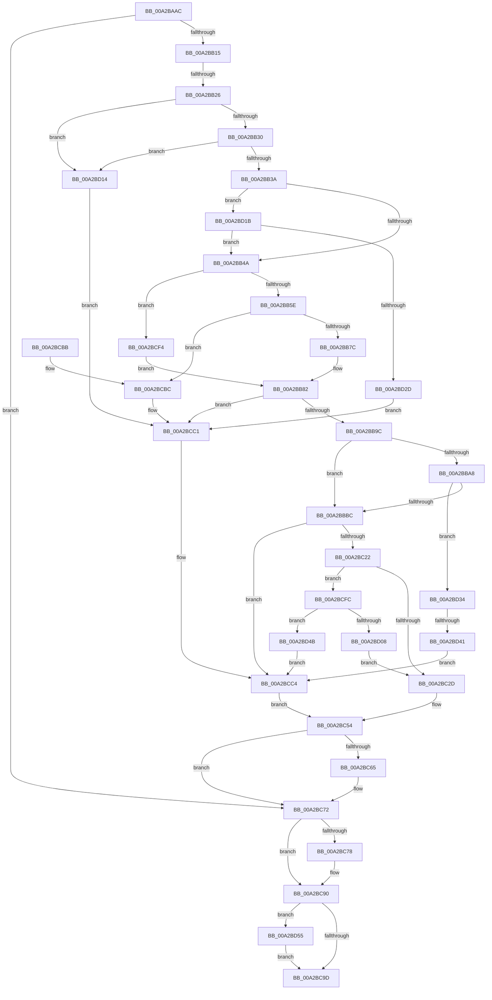

# PiCMGetDeviceIdList

- RVA: `0x00A2BAAC`–`0x00A2BD69` (길이 `701` bytes)
- VA: `0x0000000140A2BAAC`
- 실행 섹션: `PAGE`
- PDB 이름 있음: `예`; PDB Function 태그: `예`
- unwind 정보 RVA: `0x000AC390`
- 디코드: `177`개 명령, `701/701` bytes 표시
- 미해석 바이트: `0` (있으면 어셈블리에 `.byte`로 보존)

> 이 문서는 커널 이미지의 기계어와 PDB 기호를 분석해 생성했습니다. 4번과 5번은 함수 원형과 자료형을 바이너리 사용 방식에서 추정한 C 해석이며 원본 소스 복구 결과는 아닙니다.

## 1. Dependencies

- 직접 호출 지점: **11**; 고유 호출 대상: **11**
- 직접 호출자로 확인된 함수: **1**
- RIP 상대 이미지 참조: **4**

### Outgoing calls
- `0x00A2BB06` → [PiCMCaptureDeviceListInputData](PiCMCaptureDeviceListInputData_function_00A2BD70.md) (function, `0x00A2BD70`)
- `0x00A2BB6B` → [ExAllocatePool2](../../poolcode/B8/ExAllocatePool2_function_00B820F0.md) (function, `0x00B820F0`)
- `0x00A2BB8D` → [PiCMConvertDeviceListFilters](PiCMConvertDeviceListFilters_function_00A2C044.md) (function, `0x00A2C044`)
- `0x00A2BBC0` → [SeCaptureSubjectContext](../86/SeCaptureSubjectContext_function_0086B820.md) (function, `0x0086B820`)
- `0x00A2BC0A` → [CmGetMatchingFilteredDeviceList](CmGetMatchingFilteredDeviceList_function_00A2C11C.md) (function, `0x00A2C11C`)
- `0x00A2BC15` → [SeReleaseSubjectContext](../86/SeReleaseSubjectContext_function_0086B710.md) (function, `0x0086B710`)
- `0x00A2BC59` → [PiCMReturnBufferResultData](../8E/PiCMReturnBufferResultData_function_008ED6D0.md) (function, `0x008ED6D0`)
- `0x00A2BC6D` → [ExFreePoolWithTag](../../poolcode/B8/ExFreePoolWithTag_function_00B82870.md) (function, `0x00B82870`)
- `0x00A2BC8B` → [PiControlFreeUserModeCallersBuffer](../../text/44/PiControlFreeUserModeCallersBuffer_function_00448990.md) (function, `0x00448990`)
- `0x00A2BD20` → [PiAuDoesClientHaveAccess](../96/PiAuDoesClientHaveAccess_function_00962940.md) (function, `0x00962940`)
- `0x00A2BD5F` → [McTemplateK0d_EtwWriteTransfer](../../text/42/McTemplateK0d_EtwWriteTransfer_function_00423380.md) (function, `0x00423380`)

### Direct callers
- [PiCMHandleIoctl](../8E/PiCMHandleIoctl_function_008EB880.md) at `0x008EBEDD`

### Static image references
- `0x00A2BB15` → RVA `0x00EF012B` (`.data`; read)
- `0x00A2BBC9` → RVA `0x008E6490` (`PiCMMandatoryFilterCallback`; read)
- `0x00A2BC03` → RVA `0x00E66398` (`.data`; read)
- `0x00A2BD58` → RVA `0x00027080` (`.rdata`; read)

## 2. Other-region calls and transfers

- 다른 실행 섹션으로 향하는 call: **4**
  - `0x00A2BB6B` → [ExAllocatePool2](../../poolcode/B8/ExAllocatePool2_function_00B820F0.md) (`PAGE` → `POOLCODE`)
  - `0x00A2BC6D` → [ExFreePoolWithTag](../../poolcode/B8/ExFreePoolWithTag_function_00B82870.md) (`PAGE` → `POOLCODE`)
  - `0x00A2BC8B` → [PiControlFreeUserModeCallersBuffer](../../text/44/PiControlFreeUserModeCallersBuffer_function_00448990.md) (`PAGE` → `.text`)
  - `0x00A2BD5F` → [McTemplateK0d_EtwWriteTransfer](../../text/42/McTemplateK0d_EtwWriteTransfer_function_00423380.md) (`PAGE` → `.text`)
- call이 아닌 외부 분기/꼬리 이동: **2**
  - `0x00A2BB20` → [sub_00B392DC](../B3/Unknown_function_00B392DC.md) (`tail-transfer`)
  - `0x00A2BD3B` → [sub_00B392DC + 0xB0](../B3/Unknown_function_00B392DC.md) (`tail-transfer`)

## 3. Assembly (complete function range)

```asm
00A2BAAC  48 8B C4                        mov rax, rsp
00A2BAAF  48 89 58 08                     mov qword ptr [rax + 8], rbx
00A2BAB3  48 89 70 10                     mov qword ptr [rax + 0x10], rsi
00A2BAB7  4C 89 40 18                     mov qword ptr [rax + 0x18], r8
00A2BABB  55                              push rbp
00A2BABC  57                              push rdi
00A2BABD  41 55                           push r13
00A2BABF  41 56                           push r14
00A2BAC1  41 57                           push r15
00A2BAC3  48 8D 68 B1                     lea rbp, [rax - 0x4f]
00A2BAC7  48 81 EC 90 00 00 00            sub rsp, 0x90
00A2BACE  44 8B 45 77                     mov r8d, dword ptr [rbp + 0x77]
00A2BAD2  45 33 F6                        xor r14d, r14d
00A2BAD5  33 C0                           xor eax, eax
00A2BAD7  44 89 75 E7                     mov dword ptr [rbp - 0x19], r14d
00A2BADB  0F 57 C0                        xorps xmm0, xmm0
00A2BADE  48 89 45 FF                     mov qword ptr [rbp - 1], rax
00A2BAE2  48 8B 45 7F                     mov rax, qword ptr [rbp + 0x7f]
00A2BAE6  45 8B E9                        mov r13d, r9d
00A2BAE9  0F 57 C9                        xorps xmm1, xmm1
00A2BAEC  44 89 75 EB                     mov dword ptr [rbp - 0x15], r14d
00A2BAF0  4C 8D 4D EF                     lea r9, [rbp - 0x11]
00A2BAF4  41 8B FE                        mov edi, r14d
00A2BAF7  0F 11 45 07                     movups xmmword ptr [rbp + 7], xmm0
00A2BAFB  44 89 30                        mov dword ptr [rax], r14d
00A2BAFE  0F 11 45 17                     movups xmmword ptr [rbp + 0x17], xmm0
00A2BB02  0F 11 4D EF                     movups xmmword ptr [rbp - 0x11], xmm1
00A2BB06  E8 65 02 00 00                  call 0x140a2bd70
00A2BB0B  8B D8                           mov ebx, eax
00A2BB0D  85 C0                           test eax, eax
00A2BB0F  0F 88 5D 01 00 00               js 0x140a2bc72
00A2BB15  F6 05 0F 46 4C 00 04            test byte ptr [rip + 0x4c460f], 4
00A2BB1C  44 8B 75 F3                     mov r14d, dword ptr [rbp - 0xd]
00A2BB20  0F 85 B6 D7 10 00               jne 0x140b392dc
00A2BB26  48 39 7D 67                     cmp qword ptr [rbp + 0x67], rdi
00A2BB2A  0F 84 E4 01 00 00               je 0x140a2bd14
00A2BB30  41 83 FD 14                     cmp r13d, 0x14
00A2BB34  0F 82 DA 01 00 00               jb 0x140a2bd14
00A2BB3A  45 8B FE                        mov r15d, r14d
00A2BB3D  41 81 E7 00 00 02 00            and r15d, 0x20000
00A2BB44  0F 85 D1 01 00 00               jne 0x140a2bd1b
00A2BB4A  33 F6                           xor esi, esi
00A2BB4C  41 8D 45 EC                     lea eax, [r13 - 0x14]
00A2BB50  83 F8 02                        cmp eax, 2
00A2BB53  0F 43 F0                        cmovae esi, eax
00A2BB56  85 F6                           test esi, esi
00A2BB58  0F 84 96 01 00 00               je 0x140a2bcf4
00A2BB5E  8B D6                           mov edx, esi
00A2BB60  B9 00 01 00 00                  mov ecx, 0x100
00A2BB65  41 B8 50 6E 70 34               mov r8d, 0x34706e50
00A2BB6B  E8 80 65 15 00                  call 0x140b820f0
00A2BB70  48 8B F8                        mov rdi, rax
00A2BB73  48 85 C0                        test rax, rax
00A2BB76  0F 84 40 01 00 00               je 0x140a2bcbc
00A2BB7C  44 8B D6                        mov r10d, esi
00A2BB7F  41 D1 EA                        shr r10d, 1
00A2BB82  48 8D 55 EB                     lea rdx, [rbp - 0x15]
00A2BB86  44 89 55 E7                     mov dword ptr [rbp - 0x19], r10d
00A2BB8A  41 8B CE                        mov ecx, r14d
00A2BB8D  E8 B2 04 00 00                  call 0x140a2c044
00A2BB92  8B D8                           mov ebx, eax
00A2BB94  85 C0                           test eax, eax
00A2BB96  0F 88 25 01 00 00               js 0x140a2bcc1
00A2BB9C  41 0F B7 C6                     movzx eax, r14w
00A2BBA0  83 C0 FC                        add eax, -4
00A2BBA3  83 F8 3C                        cmp eax, 0x3c
00A2BBA6  77 14                           ja 0x140a2bbbc
00A2BBA8  48 B9 11 10 00 10 00 00 00 10   movabs rcx, 0x1000000010001011
00A2BBB2  48 0F A3 C1                     bt rcx, rax
00A2BBB6  0F 82 78 01 00 00               jb 0x140a2bd34
00A2BBBC  48 8D 4D 07                     lea rcx, [rbp + 7]
00A2BBC0  E8 5B FC E3 FF                  call 0x14086b820
00A2BBC5  44 8B 45 EB                     mov r8d, dword ptr [rbp - 0x15]
00A2BBC9  48 8D 05 C0 A8 EB FF            lea rax, [rip - 0x145740]
00A2BBD0  48 8B 55 F7                     mov rdx, qword ptr [rbp - 9]
00A2BBD4  48 8D 4D 07                     lea rcx, [rbp + 7]
00A2BBD8  45 33 F6                        xor r14d, r14d
00A2BBDB  45 85 FF                        test r15d, r15d
00A2BBDE  45 8B CE                        mov r9d, r14d
00A2BBE1  4C 0F 44 C8                     cmove r9, rax
00A2BBE5  49 0F 45 CE                     cmovne rcx, r14
00A2BBE9  48 8D 45 E7                     lea rax, [rbp - 0x19]
00A2BBED  48 89 44 24 38                  mov qword ptr [rsp + 0x38], rax
00A2BBF2  8B 45 E7                        mov eax, dword ptr [rbp - 0x19]
00A2BBF5  89 44 24 30                     mov dword ptr [rsp + 0x30], eax
00A2BBF9  48 89 7C 24 28                  mov qword ptr [rsp + 0x28], rdi
00A2BBFE  48 89 4C 24 20                  mov qword ptr [rsp + 0x20], rcx
00A2BC03  48 8B 0D 8E A7 43 00            mov rcx, qword ptr [rip + 0x43a78e]
00A2BC0A  E8 0D 05 00 00                  call 0x140a2c11c
00A2BC0F  48 8D 4D 07                     lea rcx, [rbp + 7]
00A2BC13  8B D8                           mov ebx, eax
00A2BC15  E8 F6 FA E3 FF                  call 0x14086b710
00A2BC1A  85 DB                           test ebx, ebx
00A2BC1C  0F 88 A2 00 00 00               js 0x140a2bcc4
00A2BC22  8B 55 E7                        mov edx, dword ptr [rbp - 0x19]
00A2BC25  85 D2                           test edx, edx
00A2BC27  0F 84 CF 00 00 00               je 0x140a2bcfc
00A2BC2D  48 8B 45 7F                     mov rax, qword ptr [rbp + 0x7f]
00A2BC31  03 D2                           add edx, edx
00A2BC33  48 89 44 24 40                  mov qword ptr [rsp + 0x40], rax
00A2BC38  4C 8B CF                        mov r9, rdi
00A2BC3B  48 8B 45 67                     mov rax, qword ptr [rbp + 0x67]
00A2BC3F  44 89 6C 24 38                  mov dword ptr [rsp + 0x38], r13d
00A2BC44  48 89 44 24 30                  mov qword ptr [rsp + 0x30], rax
00A2BC49  8B 45 03                        mov eax, dword ptr [rbp + 3]
00A2BC4C  89 44 24 28                     mov dword ptr [rsp + 0x28], eax
00A2BC50  89 54 24 20                     mov dword ptr [rsp + 0x20], edx
00A2BC54  45 33 C0                        xor r8d, r8d
00A2BC57  8B CB                           mov ecx, ebx
00A2BC59  E8 72 1A EC FF                  call 0x1408ed6d0
00A2BC5E  8B D8                           mov ebx, eax
00A2BC60  48 85 FF                        test rdi, rdi
00A2BC63  74 0D                           je 0x140a2bc72
00A2BC65  BA 50 6E 70 34                  mov edx, 0x34706e50
00A2BC6A  48 8B CF                        mov rcx, rdi
00A2BC6D  E8 FE 6B 15 00                  call 0x140b82870
00A2BC72  4C 39 75 F7                     cmp qword ptr [rbp - 9], r14
00A2BC76  74 18                           je 0x140a2bc90
00A2BC78  65 48 8B 0C 25 88 01 00 00      mov rcx, qword ptr gs:[0x188]
00A2BC81  48 8B 55 F7                     mov rdx, qword ptr [rbp - 9]
00A2BC85  8A 89 32 02 00 00               mov cl, byte ptr [rcx + 0x232]
00A2BC8B  E8 00 CD A1 FF                  call 0x140448990
00A2BC90  F6 05 94 44 4C 00 04            test byte ptr [rip + 0x4c4494], 4
00A2BC97  0F 85 B8 00 00 00               jne 0x140a2bd55
00A2BC9D  4C 8D 9C 24 90 00 00 00         lea r11, [rsp + 0x90]
00A2BCA5  8B C3                           mov eax, ebx
00A2BCA7  49 8B 5B 30                     mov rbx, qword ptr [r11 + 0x30]
00A2BCAB  49 8B 73 38                     mov rsi, qword ptr [r11 + 0x38]
00A2BCAF  49 8B E3                        mov rsp, r11
00A2BCB2  41 5F                           pop r15
00A2BCB4  41 5E                           pop r14
00A2BCB6  41 5D                           pop r13
00A2BCB8  5F                              pop rdi
00A2BCB9  5D                              pop rbp
00A2BCBA  C3                              ret
00A2BCBB  CC                              int3
00A2BCBC  BB 9A 00 00 C0                  mov ebx, 0xc000009a
00A2BCC1  45 33 F6                        xor r14d, r14d
00A2BCC4  48 8B 45 7F                     mov rax, qword ptr [rbp + 0x7f]
00A2BCC8  8B 55 E7                        mov edx, dword ptr [rbp - 0x19]
00A2BCCB  48 89 44 24 40                  mov qword ptr [rsp + 0x40], rax
00A2BCD0  03 D2                           add edx, edx
00A2BCD2  48 8B 45 67                     mov rax, qword ptr [rbp + 0x67]
00A2BCD6  45 33 C9                        xor r9d, r9d
00A2BCD9  44 89 6C 24 38                  mov dword ptr [rsp + 0x38], r13d
00A2BCDE  48 89 44 24 30                  mov qword ptr [rsp + 0x30], rax
00A2BCE3  8B 45 03                        mov eax, dword ptr [rbp + 3]
00A2BCE6  89 44 24 28                     mov dword ptr [rsp + 0x28], eax
00A2BCEA  44 89 74 24 20                  mov dword ptr [rsp + 0x20], r14d
00A2BCEF  E9 60 FF FF FF                  jmp 0x140a2bc54
00A2BCF4  45 33 D2                        xor r10d, r10d
00A2BCF7  E9 86 FE FF FF                  jmp 0x140a2bb82
00A2BCFC  C7 45 E7 01 00 00 00            mov dword ptr [rbp - 0x19], 1
00A2BD03  83 FE 02                        cmp esi, 2
00A2BD06  72 43                           jb 0x140a2bd4b
00A2BD08  66 44 89 37                     mov word ptr [rdi], r14w
00A2BD0C  8B 55 E7                        mov edx, dword ptr [rbp - 0x19]
00A2BD0F  E9 19 FF FF FF                  jmp 0x140a2bc2d
00A2BD14  BB 0D 00 00 C0                  mov ebx, 0xc000000d
00A2BD19  EB A6                           jmp 0x140a2bcc1
00A2BD1B  B9 02 00 00 00                  mov ecx, 2
00A2BD20  E8 1B 6C F3 FF                  call 0x140962940
00A2BD25  84 C0                           test al, al
00A2BD27  0F 85 1D FE FF FF               jne 0x140a2bb4a
00A2BD2D  BB 22 00 00 C0                  mov ebx, 0xc0000022
00A2BD32  EB 8D                           jmp 0x140a2bcc1
00A2BD34  45 33 F6                        xor r14d, r14d
00A2BD37  4C 39 75 F7                     cmp qword ptr [rbp - 9], r14
00A2BD3B  0F 85 4B D6 10 00               jne 0x140b3938c
00A2BD41  BB 0D 00 00 C0                  mov ebx, 0xc000000d
00A2BD46  E9 79 FF FF FF                  jmp 0x140a2bcc4
00A2BD4B  BB 23 00 00 C0                  mov ebx, 0xc0000023
00A2BD50  E9 6F FF FF FF                  jmp 0x140a2bcc4
00A2BD55  44 8B CB                        mov r9d, ebx
00A2BD58  48 8D 15 21 B3 5F FF            lea rdx, [rip - 0xa04cdf]
00A2BD5F  E8 1C 76 9F FF                  call 0x140423380
00A2BD64  E9 34 FF FF FF                  jmp 0x140a2bc9d
```

## 4. C-style interpretation (structured pseudocode)

```c
__int64 __fastcall PiCMGetDeviceIdList(__int64 a1, __int64 a2, __int64 a3, int a4)
{
    __int64 result;
    __int64 v_r10;
    __int64 v_r14;
    __int64 v_r15;
    __int64 v_rsi;
    __int64 v_rsp;
    unsigned __int64 v_stack_m28;
    unsigned __int64 v_stack_m50;
    unsigned int v_stack_m58;
    unsigned __int64 v_stack_m60;
    unsigned int v_stack_m68;
    unsigned int v_stack_m70;
    unsigned __int64 v_stack_m78;
    unsigned __int64 v_stack_m80;
    unsigned int v_stack_m88;
    unsigned __int64 v_stack_m90;
    unsigned __int64 v_stack_m98;

    *(unsigned __int64 *)(v_rsp + 8) = v_rbx;
    *(unsigned __int64 *)(v_rsp + 16) = v_rsi;
    *(unsigned __int64 *)(v_rsp + 24) = a3;
    v_rsp = (v_rsp) - (144);
    v_r14 = 0;
    result = 0;
    *(unsigned int *)(v_rsp - 79 - 25) = 0;
    *(unsigned __int64 *)(v_rsp - 79 - 1) = 0;
    *(unsigned int *)(v_rsp - 79 - 21) = 0;
    *(unsigned __int64 *)(v_rsp - 79 + 7) = v_xmm0;
    *(unsigned int *)(*(unsigned __int64 *)(v_rsp - 79 + 127)) = 0;
    *(unsigned __int64 *)(v_rsp - 79 + 23) = v_xmm0;
    *(unsigned __int64 *)(v_rsp - 79 - 17) = v_xmm1;
    result = PiCMCaptureDeviceListInputData(a1, a2, (unsigned int)(*(unsigned int *)(v_rsp - 79 + 119)), v_rsp - 79 - 17);
    if (sign_flag) goto loc_00A2BC72;
    if ((*(unsigned __int64 *)(v_rsp - 79 + 103)) == 0) goto loc_00A2BD14;
    if (((unsigned int)((unsigned int)(a4))) < 20) goto loc_00A2BD14;
    v_r15 = (unsigned int)(((unsigned int)((unsigned int)((unsigned int)(*(unsigned int *)(v_rsp - 79 - 13))))) & (0x20000ULL));
    if (condition_is_not_equal) goto loc_00A2BD1B;
loc_00A2BB4A:
    v_rsi = 0;
    if (((unsigned int)((unsigned int)(a4) - 20)) >= 2) { v_rsi = (unsigned int)((unsigned int)(a4) - 20); }
    if ((unsigned int)(v_rsi) == 0) goto loc_00A2BCF4;
    result = ExAllocatePool2(256, (unsigned int)((unsigned int)(v_rsi)), (unsigned int)(0x34706E50ULL), v_rsp - 79 - 17);
    if (result == 0) goto loc_00A2BCBC;
    v_r10 = (unsigned int)(((unsigned int)((unsigned int)(v_rsi))) >> (1));
loc_00A2BB82:
    *(unsigned int *)(v_rsp - 79 - 25) = (unsigned int)(v_r10);
    result = PiCMConvertDeviceListFilters((unsigned int)((unsigned int)((unsigned int)(*(unsigned int *)(v_rsp - 79 - 13)))), v_rsp - 79 - 21, (unsigned int)(0x34706E50ULL), v_rsp - 79 - 17);
    if (sign_flag) goto loc_00A2BCC1;
    result = (unsigned int)(((unsigned __int16)((unsigned int)(*(unsigned int *)(v_rsp - 79 - 13)))) + (-4));
    if (((unsigned int)(result)) > 60) goto loc_00A2BBBC;
    if (((unsigned int)(result)) < 60) goto loc_00A2BD34;
loc_00A2BBBC:
    result = SeCaptureSubjectContext(v_rsp - 79 + 7, v_rsp - 79 - 21, (unsigned int)(0x34706E50ULL), v_rsp - 79 - 17);
    v_r14 = 0;
    a4 = 0;
    if ((unsigned int)(v_r15) == 0) { a4 = v_rip - 1333056; }
    a1 = v_rsp - 79 + 7;
    if ((unsigned int)(v_r15) != 0) { a1 = 0; }
    v_stack_m80 = v_rsp - 79 - 25;
    v_stack_m88 = (unsigned int)((unsigned int)(*(unsigned int *)(v_rsp - 79 - 25)));
    v_stack_m90 = result;
    v_stack_m98 = a1;
    result = CmGetMatchingFilteredDeviceList(*(unsigned __int64 *)(v_rip + 4433806), *(unsigned __int64 *)(v_rsp - 79 - 9), (unsigned int)(*(unsigned int *)(v_rsp - 79 - 21)), a4);
    result = SeReleaseSubjectContext(v_rsp - 79 + 7, *(unsigned __int64 *)(v_rsp - 79 - 9), (unsigned int)(*(unsigned int *)(v_rsp - 79 - 21)), a4);
    if (sign_flag) goto loc_00A2BCC4;
    if ((unsigned int)((unsigned int)(*(unsigned int *)(v_rsp - 79 - 25))) == 0) goto loc_00A2BCFC;
loc_00A2BC2D:
    a2 = (unsigned int)(((unsigned int)(*(unsigned int *)(v_rsp - 79 - 25))) + ((unsigned int)((unsigned int)(*(unsigned int *)(v_rsp - 79 - 25)))));
    v_stack_m78 = *(unsigned __int64 *)(v_rsp - 79 + 127);
    v_stack_m80 = (unsigned int)((unsigned int)(a4));
    v_stack_m88 = *(unsigned __int64 *)(v_rsp - 79 + 103);
    v_stack_m90 = (unsigned int)((unsigned int)(*(unsigned int *)(v_rsp - 79 + 3)));
    v_stack_m98 = (unsigned int)(a2);
loc_00A2BC54:
    a3 = 0;
    result = PiCMReturnBufferResultData((unsigned int)((unsigned int)((unsigned int)((unsigned int)(result)))), a2, a3, result);
    if (result != 0) {
        a2 = 0x34706E50ULL;
        a1 = result;
        result = ExFreePoolWithTag(a1, a2, a3, result);
    }
    if ((*(unsigned __int64 *)(v_rsp - 79 - 9)) != 0) {
        a1 = *(unsigned __int64 *)(gs_base + (0 + 392));
        a2 = *(unsigned __int64 *)(v_rsp - 79 - 9);
        a1 = *(unsigned __int8 *)(a1 + 562);
        result = PiControlFreeUserModeCallersBuffer(a1, a2, a3, result);
    }
    if (((*(unsigned __int8 *)(v_rip + 4998292)) & (4)) != 0) goto loc_00A2BD55;
loc_00A2BC9D:
    return (unsigned int)((unsigned int)((unsigned int)((unsigned int)(result))));
loc_00A2BCBC:
loc_00A2BCC1:
    v_r14 = 0;
loc_00A2BCC4:
    v_stack_m50 = *(unsigned __int64 *)(v_rsp - 79 + 127);
    a2 = (unsigned int)(((unsigned int)(*(unsigned int *)(v_rsp - 79 - 25))) + ((unsigned int)((unsigned int)(*(unsigned int *)(v_rsp - 79 - 25)))));
    a4 = 0;
    v_stack_m58 = (unsigned int)((unsigned int)(a4));
    v_stack_m60 = *(unsigned __int64 *)(v_rsp - 79 + 103);
    v_stack_m68 = (unsigned int)((unsigned int)(*(unsigned int *)(v_rsp - 79 + 3)));
    v_stack_m70 = 0;
    goto loc_00A2BC54;
loc_00A2BCF4:
    v_r10 = 0;
    goto loc_00A2BB82;
loc_00A2BCFC:
    *(unsigned int *)(v_rsp - 79 - 25) = 1;
    if (((unsigned int)(*(unsigned __int64 *)(v_stack_m28 + 56))) < 2) goto loc_00A2BD4B;
    *(unsigned __int16 *)(result) = 0;
    goto loc_00A2BC2D;
loc_00A2BD14:
    goto loc_00A2BCC1;
loc_00A2BD1B:
    result = PiAuDoesClientHaveAccess(2, (unsigned int)(*(unsigned int *)(v_rsp - 79 - 25)), a3, a4);
    if ((unsigned __int8)(result) != 0) goto loc_00A2BB4A;
    goto loc_00A2BCC1;
loc_00A2BD34:
    v_r14 = 0;
    goto loc_00A2BCC4;
loc_00A2BD4B:
    goto loc_00A2BCC4;
loc_00A2BD55:
    result = McTemplateK0d_EtwWriteTransfer(2, v_rip - 10505439, a3, (unsigned int)((unsigned int)((unsigned int)(0xC0000023ULL))));
    goto loc_00A2BC9D;
}
```

## 5. (Beta) C Style

```c
int64_t PiCMGetDeviceIdList(int64_t Arg1, int64_t Arg2, int64_t Arg3, int32_t Arg4)
{
    int64_t result;
    int64_t local_r10;
    int64_t local_r14;
    int64_t local_r15;
    int64_t local_rsi;
    int64_t local_rsp;
    uint64_t v_stack_m28;
    uint64_t v_stack_m50;
    uint32_t v_stack_m58;
    uint64_t v_stack_m60;
    uint32_t v_stack_m68;
    uint32_t v_stack_m70;
    uint64_t v_stack_m78;
    uint64_t v_stack_m80;
    uint32_t v_stack_m88;
    uint64_t v_stack_m90;
    uint64_t v_stack_m98;

    *(uint64_t *)(local_rsp + 0x8) = local_rbx;
    *(uint64_t *)(local_rsp + 0x10) = local_rsi;
    *(uint64_t *)(local_rsp + 0x18) = Arg3;
    local_rsp = (local_rsp) - (144);
    local_r14 = 0;
    result = 0;
    *(uint32_t *)(local_rsp - 0x4F - 0x19) = 0;
    *(uint64_t *)(local_rsp - 0x4F - 0x1) = 0;
    *(uint32_t *)(local_rsp - 0x4F - 0x15) = 0;
    *(uint64_t *)(local_rsp - 0x4F + 0x7) = v_xmm0;
    *(uint32_t *)(*(uint64_t *)(local_rsp - 0x4F + 0x7F)) = 0;
    *(uint64_t *)(local_rsp - 0x4F + 0x17) = v_xmm0;
    *(uint64_t *)(local_rsp - 0x4F - 0x11) = v_xmm1;
    result = PiCMCaptureDeviceListInputData(Arg1, Arg2, (uint32_t)(*(uint32_t *)(local_rsp - 0x4F + 0x77)), local_rsp - 79 - 17);
    if (sign_flag) goto loc_00A2BC72;
    if ((*(uint64_t *)(local_rsp - 0x4F + 0x67)) == 0) goto loc_00A2BD14;
    if (((uint32_t)((uint32_t)(Arg4))) < 20) goto loc_00A2BD14;
    local_r15 = (uint32_t)(((uint32_t)((uint32_t)((uint32_t)(*(uint32_t *)(local_rsp - 0x4F - 0xD))))) & (0x20000ULL));
    if (condition_is_not_equal) goto loc_00A2BD1B;
loc_00A2BB4A:
    local_rsi = 0;
    if (((uint32_t)((uint32_t)(Arg4) - 20)) >= 2) { local_rsi = (uint32_t)((uint32_t)(Arg4) - 20); }
    if ((uint32_t)(local_rsi) == 0) goto loc_00A2BCF4;
    result = ExAllocatePool2(256, (uint32_t)((uint32_t)(local_rsi)), (uint32_t)(0x34706E50ULL), local_rsp - 79 - 17);
    if (result == 0) goto loc_00A2BCBC;
    local_r10 = (uint32_t)(((uint32_t)((uint32_t)(local_rsi))) >> (1));
loc_00A2BB82:
    *(uint32_t *)(local_rsp - 0x4F - 0x19) = (uint32_t)(local_r10);
    result = PiCMConvertDeviceListFilters((uint32_t)((uint32_t)((uint32_t)(*(uint32_t *)(local_rsp - 0x4F - 0xD)))), local_rsp - 79 - 21, (uint32_t)(0x34706E50ULL), local_rsp - 79 - 17);
    if (sign_flag) goto loc_00A2BCC1;
    result = (uint32_t)(((uint16_t)((uint32_t)(*(uint32_t *)(local_rsp - 0x4F - 0xD)))) + (-4));
    if (((uint32_t)(result)) > 60) goto loc_00A2BBBC;
    if (((uint32_t)(result)) < 60) goto loc_00A2BD34;
loc_00A2BBBC:
    result = SeCaptureSubjectContext(local_rsp - 79 + 7, local_rsp - 79 - 21, (uint32_t)(0x34706E50ULL), local_rsp - 79 - 17);
    local_r14 = 0;
    Arg4 = 0;
    if ((uint32_t)(local_r15) == 0) { Arg4 = v_rip - 1333056; }
    Arg1 = local_rsp - 79 + 7;
    if ((uint32_t)(local_r15) != 0) { Arg1 = 0; }
    v_stack_m80 = local_rsp - 79 - 25;
    v_stack_m88 = (uint32_t)((uint32_t)(*(uint32_t *)(local_rsp - 0x4F - 0x19)));
    v_stack_m90 = result;
    v_stack_m98 = Arg1;
    result = CmGetMatchingFilteredDeviceList(*(uint64_t *)(v_rip + 0x43A78E), *(uint64_t *)(local_rsp - 0x4F - 0x9), (uint32_t)(*(uint32_t *)(local_rsp - 0x4F - 0x15)), Arg4);
    result = SeReleaseSubjectContext(local_rsp - 79 + 7, *(uint64_t *)(local_rsp - 0x4F - 0x9), (uint32_t)(*(uint32_t *)(local_rsp - 0x4F - 0x15)), Arg4);
    if (sign_flag) goto loc_00A2BCC4;
    if ((uint32_t)((uint32_t)(*(uint32_t *)(local_rsp - 0x4F - 0x19))) == 0) goto loc_00A2BCFC;
loc_00A2BC2D:
    Arg2 = (uint32_t)(((uint32_t)(*(uint32_t *)(local_rsp - 0x4F - 0x19))) + ((uint32_t)((uint32_t)(*(uint32_t *)(local_rsp - 0x4F - 0x19)))));
    v_stack_m78 = *(uint64_t *)(local_rsp - 0x4F + 0x7F);
    v_stack_m80 = (uint32_t)((uint32_t)(Arg4));
    v_stack_m88 = *(uint64_t *)(local_rsp - 0x4F + 0x67);
    v_stack_m90 = (uint32_t)((uint32_t)(*(uint32_t *)(local_rsp - 0x4F + 0x3)));
    v_stack_m98 = (uint32_t)(Arg2);
loc_00A2BC54:
    Arg3 = 0;
    result = PiCMReturnBufferResultData((uint32_t)((uint32_t)((uint32_t)((uint32_t)(result)))), Arg2, Arg3, result);
    if (result != 0) {
        Arg2 = 0x34706E50ULL;
        Arg1 = result;
        result = ExFreePoolWithTag(Arg1, Arg2, Arg3, result);
    }
    if ((*(uint64_t *)(local_rsp - 0x4F - 0x9)) != 0) {
        Arg1 = *(uint64_t *)(gs_base + (0 + 0x188));
        Arg2 = *(uint64_t *)(local_rsp - 0x4F - 0x9);
        Arg1 = *(uint8_t *)(Arg1 + 0x232);
        result = PiControlFreeUserModeCallersBuffer(Arg1, Arg2, Arg3, result);
    }
    if (((*(uint8_t *)(v_rip + 0x4C4494)) & (4)) != 0) goto loc_00A2BD55;
loc_00A2BC9D:
    return (uint32_t)((uint32_t)((uint32_t)((uint32_t)(result))));
loc_00A2BCBC:
loc_00A2BCC1:
    local_r14 = 0;
loc_00A2BCC4:
    v_stack_m50 = *(uint64_t *)(local_rsp - 0x4F + 0x7F);
    Arg2 = (uint32_t)(((uint32_t)(*(uint32_t *)(local_rsp - 0x4F - 0x19))) + ((uint32_t)((uint32_t)(*(uint32_t *)(local_rsp - 0x4F - 0x19)))));
    Arg4 = 0;
    v_stack_m58 = (uint32_t)((uint32_t)(Arg4));
    v_stack_m60 = *(uint64_t *)(local_rsp - 0x4F + 0x67);
    v_stack_m68 = (uint32_t)((uint32_t)(*(uint32_t *)(local_rsp - 0x4F + 0x3)));
    v_stack_m70 = 0;
    goto loc_00A2BC54;
loc_00A2BCF4:
    local_r10 = 0;
    goto loc_00A2BB82;
loc_00A2BCFC:
    *(uint32_t *)(local_rsp - 0x4F - 0x19) = 1;
    if (((uint32_t)(*(uint64_t *)(v_stack_m28 + 0x38))) < 2) goto loc_00A2BD4B;
    *(uint16_t *)(result) = 0;
    goto loc_00A2BC2D;
loc_00A2BD14:
    goto loc_00A2BCC1;
loc_00A2BD1B:
    result = PiAuDoesClientHaveAccess(2, (uint32_t)(*(uint32_t *)(local_rsp - 0x4F - 0x19)), Arg3, Arg4);
    if ((uint8_t)(result) != 0) goto loc_00A2BB4A;
    goto loc_00A2BCC1;
loc_00A2BD34:
    local_r14 = 0;
    goto loc_00A2BCC4;
loc_00A2BD4B:
    goto loc_00A2BCC4;
loc_00A2BD55:
    result = McTemplateK0d_EtwWriteTransfer(2, v_rip - 10505439, Arg3, (uint32_t)((uint32_t)((uint32_t)(0xC0000023ULL))));
    goto loc_00A2BC9D;
}
```

## 6. Execution-region graph

[열기: 2D/3D 그래프와 함수 탐색 컨트롤 패널](../../../control-panel.html?section=page&rva=0x00A2BAAC&view=graph)

- 2D 그래프는 위에서 아래로 흐르고, 3D 그래프는 빈 공간을 드래그해 회전합니다. Shift+드래그는 이동, 휠은 확대·축소, 함수 노드 선택은 대상 보고서 이동입니다.

### Static fallback


