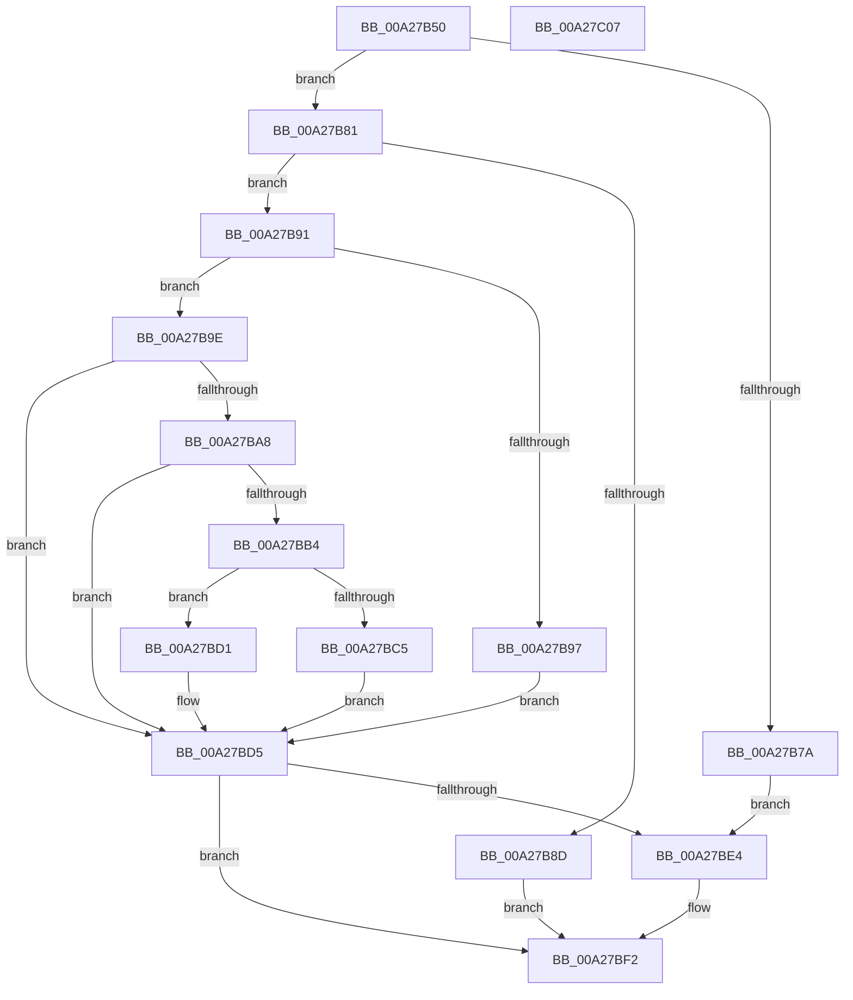

# PiDmaGuardProcessPreAddDevice

- RVA: `0x00A27B50`–`0x00A27C08` (길이 `184` bytes)
- VA: `0x0000000140A27B50`
- 실행 섹션: `PAGE`
- PDB 이름 있음: `예`; PDB Function 태그: `아니요`
- unwind 정보 RVA: `0x0006C8E8`
- 디코드: `55`개 명령, `184/184` bytes 표시
- 미해석 바이트: `0` (있으면 어셈블리에 `.byte`로 보존)

> 이 문서는 커널 이미지의 기계어와 PDB 기호를 분석해 생성했습니다. 4번과 5번은 함수 원형과 자료형을 바이너리 사용 방식에서 추정한 C 해석이며 원본 소스 복구 결과는 아닙니다.

## 1. Dependencies

- 직접 호출 지점: **5**; 고유 호출 대상: **5**
- 직접 호출자로 확인된 함수: **1**
- RIP 상대 이미지 참조: **0**

### Outgoing calls
- `0x00A27B71` → [HalCvmDmaEnabled](../../text/4F/HalCvmDmaEnabled_function_004FD368.md) (function, `0x004FD368`)
- `0x00A27BBC` → [PipDmgGetDeviceDmarPolicy](../73/PipDmgGetDeviceDmarPolicy_function_00730760.md) (function, `0x00730760`)
- `0x00A27BC8` → [PipDmgGetDriversDmarPolicy](../73/PipDmgGetDriversDmarPolicy_function_007308EC.md) (function, `0x007308EC`)
- `0x00A27BDB` → [PiIommuSaveDeviceAtsSettings](../74/PiIommuSaveDeviceAtsSettings_function_00740290.md) (function, `0x00740290`)
- `0x00A27BED` → [PipDmgSaveDeviceDmarPolicy](../73/PipDmgSaveDeviceDmarPolicy_function_0073C630.md) (function, `0x0073C630`)

### Direct callers
- [PipCallDriverAddDevice](PipCallDriverAddDevice_function_00A272E0.md) at `0x00A2763A`

### Static image references
- 디코드된 RIP-relative 메모리 참조가 없습니다.

## 2. Other-region calls and transfers

- 다른 실행 섹션으로 향하는 call: **1**
  - `0x00A27B71` → [HalCvmDmaEnabled](../../text/4F/HalCvmDmaEnabled_function_004FD368.md) (`PAGE` → `.text`)
- 별도 외부 분기/꼬리 이동을 확인하지 못했습니다.

## 3. Assembly (complete function range)

```asm
00A27B50  48 8B C4                        mov rax, rsp
00A27B53  48 89 58 10                     mov qword ptr [rax + 0x10], rbx
00A27B57  48 89 68 18                     mov qword ptr [rax + 0x18], rbp
00A27B5B  48 89 70 20                     mov qword ptr [rax + 0x20], rsi
00A27B5F  57                              push rdi
00A27B60  48 83 EC 20                     sub rsp, 0x20
00A27B64  83 60 08 00                     and dword ptr [rax + 8], 0
00A27B68  48 8B EA                        mov rbp, rdx
00A27B6B  48 8B 39                        mov rdi, qword ptr [rcx]
00A27B6E  48 8B F1                        mov rsi, rcx
00A27B71  E8 F2 57 AD FF                  call 0x1404fd368
00A27B76  84 C0                           test al, al
00A27B78  74 07                           je 0x140a27b81
00A27B7A  BB 02 00 00 00                  mov ebx, 2
00A27B7F  EB 63                           jmp 0x140a27be4
00A27B81  48 8B 8F D0 02 00 00            mov rcx, qword ptr [rdi + 0x2d0]
00A27B88  48 85 C9                        test rcx, rcx
00A27B8B  75 04                           jne 0x140a27b91
00A27B8D  33 C0                           xor eax, eax
00A27B8F  EB 61                           jmp 0x140a27bf2
00A27B91  F6 41 10 10                     test byte ptr [rcx + 0x10], 0x10
00A27B95  74 07                           je 0x140a27b9e
00A27B97  BB 01 00 00 00                  mov ebx, 1
00A27B9C  EB 37                           jmp 0x140a27bd5
00A27B9E  BB 02 00 00 00                  mov ebx, 2
00A27BA3  84 59 11                        test byte ptr [rcx + 0x11], bl
00A27BA6  75 2D                           jne 0x140a27bd5
00A27BA8  F7 87 30 02 00 00 00 00 10 00   test dword ptr [rdi + 0x230], 0x100000
00A27BB2  75 21                           jne 0x140a27bd5
00A27BB4  48 8D 54 24 30                  lea rdx, [rsp + 0x30]
00A27BB9  48 8B CE                        mov rcx, rsi
00A27BBC  E8 9F 8B D0 FF                  call 0x140730760
00A27BC1  85 C0                           test eax, eax
00A27BC3  79 0C                           jns 0x140a27bd1
00A27BC5  48 8B CE                        mov rcx, rsi
00A27BC8  E8 1F 8D D0 FF                  call 0x1407308ec
00A27BCD  8B D8                           mov ebx, eax
00A27BCF  EB 04                           jmp 0x140a27bd5
00A27BD1  8B 5C 24 30                     mov ebx, dword ptr [rsp + 0x30]
00A27BD5  48 8B D5                        mov rdx, rbp
00A27BD8  48 8B CF                        mov rcx, rdi
00A27BDB  E8 B0 86 D1 FF                  call 0x140740290
00A27BE0  85 C0                           test eax, eax
00A27BE2  78 0E                           js 0x140a27bf2
00A27BE4  44 8B C3                        mov r8d, ebx
00A27BE7  48 8B D5                        mov rdx, rbp
00A27BEA  48 8B CF                        mov rcx, rdi
00A27BED  E8 3E 4A D1 FF                  call 0x14073c630
00A27BF2  48 8B 5C 24 38                  mov rbx, qword ptr [rsp + 0x38]
00A27BF7  48 8B 6C 24 40                  mov rbp, qword ptr [rsp + 0x40]
00A27BFC  48 8B 74 24 48                  mov rsi, qword ptr [rsp + 0x48]
00A27C01  48 83 C4 20                     add rsp, 0x20
00A27C05  5F                              pop rdi
00A27C06  C3                              ret
00A27C07  CC                              int3
```

## 4. C-style interpretation (structured pseudocode)

```c
__int64 __fastcall PiDmaGuardProcessPreAddDevice(__int64 a1, __int64 a2)
{
    __int64 result;
    __int64 v_rsp;
    unsigned __int64 v_stack_p10;
    unsigned __int64 v_stack_p18;
    unsigned __int64 v_stack_p20;
    unsigned __int64 v_stack_p8;

    *(unsigned __int64 *)(v_rsp + 16) = v_rbx;
    *(unsigned __int64 *)(v_rsp + 24) = v_rbp;
    *(unsigned __int64 *)(v_rsp + 32) = v_rsi;
    v_rsp = (v_rsp) - (32);
    result = HalCvmDmaEnabled(a1, a2, a3, a4);
    if ((unsigned __int8)(result) == 0) goto loc_00A27B81;
    goto loc_00A27BE4;
loc_00A27B81:
    if (*(unsigned __int64 *)(*(unsigned __int64 *)(a1) + 720) != 0) goto loc_00A27B91;
    result = 0;
    goto loc_00A27BF2;
loc_00A27B91:
    if (((*(unsigned __int8 *)(*(unsigned __int64 *)(*(unsigned __int64 *)(a1) + 720) + 16)) & (16)) == 0) goto loc_00A27B9E;
    goto loc_00A27BD5;
loc_00A27B9E:
    if (((*(unsigned __int8 *)(*(unsigned __int64 *)(*(unsigned __int64 *)(a1) + 720) + 17)) & (2)) != 0) goto loc_00A27BD5;
    if (((*(unsigned int *)(*(unsigned __int64 *)(a1) + 560)) & (0x100000ULL)) != 0) goto loc_00A27BD5;
    result = PipDmgGetDeviceDmarPolicy(a1, v_stack_p8, a3, a4);
    if (!sign_flag) goto loc_00A27BD1;
    result = PipDmgGetDriversDmarPolicy(a1, v_stack_p8, a3, a4);
    goto loc_00A27BD5;
loc_00A27BD1:
loc_00A27BD5:
    result = PiIommuSaveDeviceAtsSettings(*(unsigned __int64 *)(a1), a2, a3, a4);
    if (!(sign_flag)) {
        a3 = (unsigned int)((unsigned int)(v_stack_p8));
        a2 = a2;
        a1 = *(unsigned __int64 *)(a1);
        result = PipDmgSaveDeviceDmarPolicy(a1, a2, a3, a4);
    }
    v_rsp = (v_rsp) + (32);
    return result;
}
```

## 5. (Beta) C Style

```c
int64_t PiDmaGuardProcessPreAddDevice(void *Arg1, int64_t Arg2)
{
    uint8_t *arg1 = (uint8_t *)Arg1;

    int64_t result;
    int64_t local_rsp;
    uint64_t v_stack_p10;
    uint64_t v_stack_p18;
    uint64_t v_stack_p20;
    uint64_t v_stack_p8;

    *(uint64_t *)(local_rsp + 0x10) = local_rbx;
    *(uint64_t *)(local_rsp + 0x18) = local_rbp;
    *(uint64_t *)(local_rsp + 0x20) = local_rsi;
    local_rsp = (local_rsp) - (32);
    result = HalCvmDmaEnabled(Arg1, Arg2, a3, a4);
    if ((uint8_t)(result) == 0) goto loc_00A27B81;
    goto loc_00A27BE4;
loc_00A27B81:
    if (*(uint64_t *)(*(uint64_t *)(arg1) + 0x2D0) != 0) goto loc_00A27B91;
    result = 0;
    goto loc_00A27BF2;
loc_00A27B91:
    if (((*(uint8_t *)(*(uint64_t *)(*(uint64_t *)(arg1) + 0x2D0) + 0x10)) & (16)) == 0) goto loc_00A27B9E;
    goto loc_00A27BD5;
loc_00A27B9E:
    if (((*(uint8_t *)(*(uint64_t *)(*(uint64_t *)(arg1) + 0x2D0) + 0x11)) & (2)) != 0) goto loc_00A27BD5;
    if (((*(uint32_t *)(*(uint64_t *)(arg1) + 0x230)) & (0x100000ULL)) != 0) goto loc_00A27BD5;
    result = PipDmgGetDeviceDmarPolicy(Arg1, v_stack_p8, a3, a4);
    if (!sign_flag) goto loc_00A27BD1;
    result = PipDmgGetDriversDmarPolicy(Arg1, v_stack_p8, a3, a4);
    goto loc_00A27BD5;
loc_00A27BD1:
loc_00A27BD5:
    result = PiIommuSaveDeviceAtsSettings(*(uint64_t *)(arg1), Arg2, a3, a4);
    if (!(sign_flag)) {
        a3 = (uint32_t)((uint32_t)(v_stack_p8));
        Arg2 = Arg2;
        Arg1 = *(uint64_t *)(arg1);
        result = PipDmgSaveDeviceDmarPolicy(Arg1, Arg2, a3, a4);
    }
    local_rsp = (local_rsp) + (32);
    return result;
}
```

### 관측된 메모리 오프셋

구조체 형식이 확인되지 않은 접근은 인자 기준의 오프셋으로만 기록했습니다.

| 기준 인자 | 오프셋 표현 | 폭 (bit) | 접근 |
|---|---:|---:|---|
| `Arg1` | `+ 0x0` | `64` | `R` |

## 6. Execution-region graph

[열기: 2D/3D 그래프와 함수 탐색 컨트롤 패널](../../../control-panel.html?section=page&rva=0x00A27B50&view=graph)

- 2D 그래프는 위에서 아래로 흐르고, 3D 그래프는 빈 공간을 드래그해 회전합니다. Shift+드래그는 이동, 휠은 확대·축소, 함수 노드 선택은 대상 보고서 이동입니다.

### Static fallback


