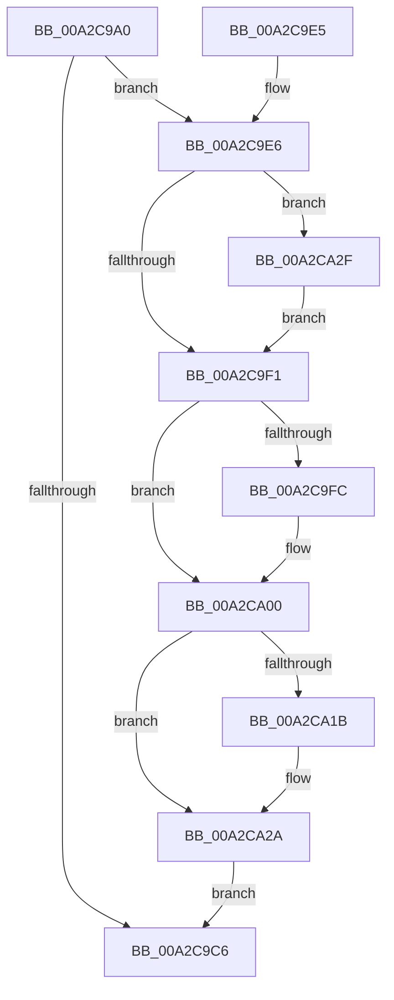

# PiDqSerializationAlloc

- RVA: `0x00A2C9A0`–`0x00A2CA3B` (길이 `155` bytes)
- VA: `0x0000000140A2C9A0`
- 실행 섹션: `PAGE`
- PDB 이름 있음: `예`; PDB Function 태그: `아니요`
- unwind 정보 RVA: `0x000AC5E8`
- 디코드: `48`개 명령, `155/155` bytes 표시
- 미해석 바이트: `0` (있으면 어셈블리에 `.byte`로 보존)

> 이 문서는 커널 이미지의 기계어와 PDB 기호를 분석해 생성했습니다. 4번과 5번은 함수 원형과 자료형을 바이너리 사용 방식에서 추정한 C 해석이며 원본 소스 복구 결과는 아닙니다.

## 1. Dependencies

- 직접 호출 지점: **3**; 고유 호출 대상: **3**
- 직접 호출자로 확인된 함수: **0**
- RIP 상대 이미지 참조: **0**

### Outgoing calls
- `0x00A2CA0D` → [ExAllocatePool2](../../poolcode/B8/ExAllocatePool2_function_00B820F0.md) (function, `0x00B820F0`)
- `0x00A2CA23` → [memset](../../text/6C/memset_function_006C6C40.md) (function, `0x006C6C40`)
- `0x00A2CA34` → [ExFreePoolWithTag](../../poolcode/B8/ExFreePoolWithTag_function_00B82870.md) (function, `0x00B82870`)

### Direct callers
- 이 함수 시작 RVA로 연결되는 직접 call은 확인되지 않았습니다. 간접 호출은 완전히 역산할 수 없습니다.

### Static image references
- 디코드된 RIP-relative 메모리 참조가 없습니다.

## 2. Other-region calls and transfers

- 다른 실행 섹션으로 향하는 call: **3**
  - `0x00A2CA0D` → [ExAllocatePool2](../../poolcode/B8/ExAllocatePool2_function_00B820F0.md) (`PAGE` → `POOLCODE`)
  - `0x00A2CA23` → [memset](../../text/6C/memset_function_006C6C40.md) (`PAGE` → `.text`)
  - `0x00A2CA34` → [ExFreePoolWithTag](../../poolcode/B8/ExFreePoolWithTag_function_00B82870.md) (`PAGE` → `POOLCODE`)
- 별도 외부 분기/꼬리 이동을 확인하지 못했습니다.

## 3. Assembly (complete function range)

```asm
00A2C9A0  48 89 5C 24 08                  mov qword ptr [rsp + 8], rbx
00A2C9A5  48 89 74 24 10                  mov qword ptr [rsp + 0x10], rsi
00A2C9AA  48 89 7C 24 18                  mov qword ptr [rsp + 0x18], rdi
00A2C9AF  41 56                           push r14
00A2C9B1  48 83 EC 20                     sub rsp, 0x20
00A2C9B5  8B 59 18                        mov ebx, dword ptr [rcx + 0x18]
00A2C9B8  49 8B F0                        mov rsi, r8
00A2C9BB  4C 8B F2                        mov r14, rdx
00A2C9BE  48 8B F9                        mov rdi, rcx
00A2C9C1  41 39 18                        cmp dword ptr [r8], ebx
00A2C9C4  77 20                           ja 0x140a2c9e6
00A2C9C6  89 1E                           mov dword ptr [rsi], ebx
00A2C9C8  48 8B 47 10                     mov rax, qword ptr [rdi + 0x10]
00A2C9CC  48 8B 5C 24 30                  mov rbx, qword ptr [rsp + 0x30]
00A2C9D1  48 8B 74 24 38                  mov rsi, qword ptr [rsp + 0x38]
00A2C9D6  48 8B 7C 24 40                  mov rdi, qword ptr [rsp + 0x40]
00A2C9DB  49 89 06                        mov qword ptr [r14], rax
00A2C9DE  48 83 C4 20                     add rsp, 0x20
00A2C9E2  41 5E                           pop r14
00A2C9E4  C3                              ret
00A2C9E5  CC                              int3
00A2C9E6  48 8B 49 10                     mov rcx, qword ptr [rcx + 0x10]
00A2C9EA  33 DB                           xor ebx, ebx
00A2C9EC  48 85 C9                        test rcx, rcx
00A2C9EF  75 3E                           jne 0x140a2ca2f
00A2C9F1  8B 06                           mov eax, dword ptr [rsi]
00A2C9F3  B9 00 10 00 00                  mov ecx, 0x1000
00A2C9F8  3B C1                           cmp eax, ecx
00A2C9FA  73 04                           jae 0x140a2ca00
00A2C9FC  89 0E                           mov dword ptr [rsi], ecx
00A2C9FE  8B C1                           mov eax, ecx
00A2CA00  8B D0                           mov edx, eax
00A2CA02  B9 00 01 00 00                  mov ecx, 0x100
00A2CA07  41 B8 50 6E 70 58               mov r8d, 0x58706e50
00A2CA0D  E8 DE 56 15 00                  call 0x140b820f0
00A2CA12  48 89 47 10                     mov qword ptr [rdi + 0x10], rax
00A2CA16  48 85 C0                        test rax, rax
00A2CA19  74 0F                           je 0x140a2ca2a
00A2CA1B  44 8B 06                        mov r8d, dword ptr [rsi]
00A2CA1E  33 D2                           xor edx, edx
00A2CA20  48 8B C8                        mov rcx, rax
00A2CA23  E8 18 A2 C9 FF                  call 0x1406c6c40
00A2CA28  8B 1E                           mov ebx, dword ptr [rsi]
00A2CA2A  89 5F 18                        mov dword ptr [rdi + 0x18], ebx
00A2CA2D  EB 97                           jmp 0x140a2c9c6
00A2CA2F  BA 50 6E 70 58                  mov edx, 0x58706e50
00A2CA34  E8 37 5E 15 00                  call 0x140b82870
00A2CA39  EB B6                           jmp 0x140a2c9f1
```

## 4. C-style interpretation (structured pseudocode)

```c
__int64 __fastcall PiDqSerializationAlloc(__int64 a1, __int64 a2, __int64 a3)
{
    __int64 result;
    __int64 v_rbx;
    __int64 v_rsp;
    unsigned __int64 v_stack_p10;
    unsigned __int64 v_stack_p18;
    unsigned __int64 v_stack_p8;

    v_stack_p8 = v_rbx;
    v_stack_p10 = v_rsi;
    v_stack_p18 = v_rdi;
    v_rsp = (v_rsp) - (32);
    if ((*(unsigned int *)(a3)) > ((unsigned int)((unsigned int)(*(unsigned int *)(a1 + 24))))) goto loc_00A2C9E6;
loc_00A2C9C6:
    *(unsigned int *)(a3) = (unsigned int)((unsigned int)(*(unsigned int *)(a1 + 24)));
    *(unsigned __int64 *)(a2) = *(unsigned __int64 *)(a1 + 16);
    v_rsp = (v_rsp) + (32);
    return *(unsigned __int64 *)(a1 + 16);
loc_00A2C9E6:
    v_rbx = 0;
    if (*(unsigned __int64 *)(a1 + 16) != 0) goto loc_00A2CA2F;
loc_00A2C9F1:
    result = (unsigned int)(*(unsigned int *)(v_stack_p10));
    if (((unsigned int)((unsigned int)(*(unsigned int *)(v_stack_p10)))) < ((unsigned int)((unsigned int)(0x1000ULL)))) {
        *(unsigned int *)(v_stack_p10) = (unsigned int)((unsigned int)(0x1000ULL));
        result = (unsigned int)((unsigned int)(0x1000ULL));
    }
    result = ExAllocatePool2(256, (unsigned int)((unsigned int)(result)), (unsigned int)(0x58706E50ULL), a4);
    *(unsigned __int64 *)(v_stack_p18 + 16) = result;
    if (result != 0) {
        a3 = *(unsigned int *)(v_stack_p10);
        a2 = 0;
        a1 = result;
        result = memset(a1, a2, a3, a4);
        v_rbx = *(unsigned int *)(v_stack_p10);
    }
    *(unsigned int *)(v_stack_p18 + 24) = (unsigned int)(v_rbx);
    goto loc_00A2C9C6;
loc_00A2CA2F:
    result = ExFreePoolWithTag(a1, (unsigned int)(0x58706E50ULL), a3, a4);
    goto loc_00A2C9F1;
}
```

## 5. (Beta) C Style

```c
int64_t PiDqSerializationAlloc(void *Arg1, void *Arg2, void *Arg3)
{
    uint8_t *arg1 = (uint8_t *)Arg1;
    uint8_t *arg2 = (uint8_t *)Arg2;
    uint8_t *arg3 = (uint8_t *)Arg3;

    int64_t result;
    int64_t local_rbx;
    int64_t local_rsp;
    uint64_t v_stack_p10;
    uint64_t v_stack_p18;
    uint64_t v_stack_p8;

    v_stack_p8 = local_rbx;
    v_stack_p10 = local_rsi;
    v_stack_p18 = local_rdi;
    local_rsp = (local_rsp) - (32);
    if ((*(uint32_t *)(arg3)) > ((uint32_t)((uint32_t)(*(uint32_t *)(arg1 + 0x18))))) goto loc_00A2C9E6;
loc_00A2C9C6:
    *(uint32_t *)(arg3) = (uint32_t)((uint32_t)(*(uint32_t *)(arg1 + 0x18)));
    *(uint64_t *)(arg2) = *(uint64_t *)(arg1 + 0x10);
    local_rsp = (local_rsp) + (32);
    return *(uint64_t *)(arg1 + 0x10);
loc_00A2C9E6:
    local_rbx = 0;
    if (*(uint64_t *)(arg1 + 0x10) != 0) goto loc_00A2CA2F;
loc_00A2C9F1:
    result = (uint32_t)(*(uint32_t *)(v_stack_p10));
    if (((uint32_t)((uint32_t)(*(uint32_t *)(v_stack_p10)))) < ((uint32_t)((uint32_t)(0x1000ULL)))) {
        *(uint32_t *)(v_stack_p10) = (uint32_t)((uint32_t)(0x1000ULL));
        result = (uint32_t)((uint32_t)(0x1000ULL));
    }
    result = ExAllocatePool2(256, (uint32_t)((uint32_t)(result)), (uint32_t)(0x58706E50ULL), a4);
    *(uint64_t *)(v_stack_p18 + 0x10) = result;
    if (result != 0) {
        Arg3 = *(uint32_t *)(v_stack_p10);
        Arg2 = 0;
        Arg1 = result;
        result = memset(Arg1, Arg2, Arg3, a4);
        local_rbx = *(uint32_t *)(v_stack_p10);
    }
    *(uint32_t *)(v_stack_p18 + 0x18) = (uint32_t)(local_rbx);
    goto loc_00A2C9C6;
loc_00A2CA2F:
    result = ExFreePoolWithTag(Arg1, (uint32_t)(0x58706E50ULL), Arg3, a4);
    goto loc_00A2C9F1;
}
```

### 관측된 메모리 오프셋

구조체 형식이 확인되지 않은 접근은 인자 기준의 오프셋으로만 기록했습니다.

| 기준 인자 | 오프셋 표현 | 폭 (bit) | 접근 |
|---|---:|---:|---|
| `Arg1` | `+ 0x10` | `64` | `R` |
| `Arg1` | `+ 0x10` | `64` | `W` |
| `Arg1` | `+ 0x18` | `32` | `R` |
| `Arg1` | `+ 0x18` | `32` | `W` |
| `Arg2` | `+ 0x0` | `64` | `W` |
| `Arg3` | `+ 0x0` | `32` | `R` |
| `Arg3` | `+ 0x0` | `32` | `W` |

## 6. Execution-region graph

[열기: 2D/3D 그래프와 함수 탐색 컨트롤 패널](../../../control-panel.html?section=page&rva=0x00A2C9A0&view=graph)

- 2D 그래프는 위에서 아래로 흐르고, 3D 그래프는 빈 공간을 드래그해 회전합니다. Shift+드래그는 이동, 휠은 확대·축소, 함수 노드 선택은 대상 보고서 이동입니다.

### Static fallback


