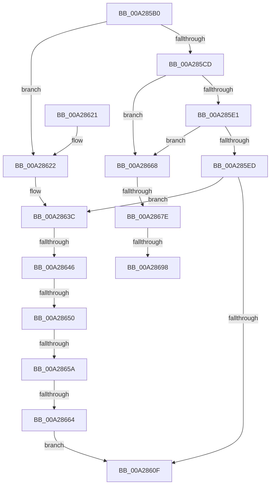

# PiIommuGetInterface

- RVA: `0x00A285B0`–`0x00A286B9` (길이 `265` bytes)
- VA: `0x0000000140A285B0`
- 실행 섹션: `PAGE`
- PDB 이름 있음: `예`; PDB Function 태그: `예`
- unwind 정보 RVA: `0x000AC090`
- 디코드: `68`개 명령, `265/265` bytes 표시
- 미해석 바이트: `0` (있으면 어셈블리에 `.byte`로 보존)

> 이 문서는 커널 이미지의 기계어와 PDB 기호를 분석해 생성했습니다. 4번과 5번은 함수 원형과 자료형을 바이너리 사용 방식에서 추정한 C 해석이며 원본 소스 복구 결과는 아닙니다.

## 1. Dependencies

- 직접 호출 지점: **6**; 고유 호출 대상: **3**
- 직접 호출자로 확인된 함수: **1**
- RIP 상대 이미지 참조: **1**

### Outgoing calls
- `0x00A28604` → [PnpQueryInterface](PnpQueryInterface_function_00A28D38.md) (function, `0x00A28D38`)
- `0x00A28636` → [KeBugCheckEx](../../text/4F/KeBugCheckEx_function_004FD660.md) (function, `0x004FD660`)
- `0x00A2866C` → [IoAddTriageDumpDataBlock](../../text/42/IoAddTriageDumpDataBlock_function_00428374.md) (function, `0x00428374`)
- `0x00A28682` → [IoAddTriageDumpDataBlock](../../text/42/IoAddTriageDumpDataBlock_function_00428374.md) (function, `0x00428374`)
- `0x00A2869D` → [IoAddTriageDumpDataBlock](../../text/42/IoAddTriageDumpDataBlock_function_00428374.md) (function, `0x00428374`)
- `0x00A286AE` → [IoAddTriageDumpDataBlock](../../text/42/IoAddTriageDumpDataBlock_function_00428374.md) (function, `0x00428374`)

### Direct callers
- [PiProcessNewDeviceNode](PiProcessNewDeviceNode_function_00A28F20.md) at `0x00A2A156`

### Static image references
- `0x00A285F5` → RVA `0x00019F50` (`.rdata`; read)

## 2. Other-region calls and transfers

- 다른 실행 섹션으로 향하는 call: **5**
  - `0x00A28636` → [KeBugCheckEx](../../text/4F/KeBugCheckEx_function_004FD660.md) (`PAGE` → `.text`)
  - `0x00A2866C` → [IoAddTriageDumpDataBlock](../../text/42/IoAddTriageDumpDataBlock_function_00428374.md) (`PAGE` → `.text`)
  - `0x00A28682` → [IoAddTriageDumpDataBlock](../../text/42/IoAddTriageDumpDataBlock_function_00428374.md) (`PAGE` → `.text`)
  - `0x00A2869D` → [IoAddTriageDumpDataBlock](../../text/42/IoAddTriageDumpDataBlock_function_00428374.md) (`PAGE` → `.text`)
  - `0x00A286AE` → [IoAddTriageDumpDataBlock](../../text/42/IoAddTriageDumpDataBlock_function_00428374.md) (`PAGE` → `.text`)
- call이 아닌 외부 분기/꼬리 이동: **7**
  - `0x00A28640` → [sub_00B3877E](../B3/Unknown_function_00B3877E.md) (`tail-transfer`)
  - `0x00A2864A` → [sub_00B3877E](../B3/Unknown_function_00B3877E.md) (`tail-transfer`)
  - `0x00A28654` → [sub_00B3877E](../B3/Unknown_function_00B3877E.md) (`tail-transfer`)
  - `0x00A2865E` → [sub_00B3877E](../B3/Unknown_function_00B3877E.md) (`tail-transfer`)
  - `0x00A28678` → [sub_00B3877E + 0x13](../B3/Unknown_function_00B3877E.md) (`tail-transfer`)
  - `0x00A28692` → [sub_00B3877E + 0x13](../B3/Unknown_function_00B3877E.md) (`tail-transfer`)
  - `0x00A286B4` → [sub_00B3877E + 0x13](../B3/Unknown_function_00B3877E.md) (`tail-transfer`)

## 3. Assembly (complete function range)

```asm
00A285B0  4C 8B DC                        mov r11, rsp
00A285B3  49 89 5B 08                     mov qword ptr [r11 + 8], rbx
00A285B7  49 89 6B 10                     mov qword ptr [r11 + 0x10], rbp
00A285BB  57                              push rdi
00A285BC  48 83 EC 30                     sub rsp, 0x30
00A285C0  33 ED                           xor ebp, ebp
00A285C2  48 8B FA                        mov rdi, rdx
00A285C5  48 8B D9                        mov rbx, rcx
00A285C8  48 85 C9                        test rcx, rcx
00A285CB  74 55                           je 0x140a28622
00A285CD  48 8B 81 38 01 00 00            mov rax, qword ptr [rcx + 0x138]
00A285D4  48 8B 40 28                     mov rax, qword ptr [rax + 0x28]
00A285D8  48 85 C0                        test rax, rax
00A285DB  0F 84 87 00 00 00               je 0x140a28668
00A285E1  F7 80 8C 01 00 00 00 00 02 00   test dword ptr [rax + 0x18c], 0x20000
00A285EB  75 7B                           jne 0x140a28668
00A285ED  49 89 53 F0                     mov qword ptr [r11 - 0x10], rdx
00A285F1  44 8D 4D 50                     lea r9d, [rbp + 0x50]
00A285F5  48 8D 15 54 19 5F FF            lea rdx, [rip - 0xa0e6ac]
00A285FC  49 89 4B E8                     mov qword ptr [r11 - 0x18], rcx
00A28600  44 8D 45 02                     lea r8d, [rbp + 2]
00A28604  E8 2F 07 00 00                  call 0x140a28d38
00A28609  8B D8                           mov ebx, eax
00A2860B  85 C0                           test eax, eax
00A2860D  79 2D                           jns 0x140a2863c
00A2860F  48 8B 6C 24 48                  mov rbp, qword ptr [rsp + 0x48]
00A28614  8B C3                           mov eax, ebx
00A28616  48 8B 5C 24 40                  mov rbx, qword ptr [rsp + 0x40]
00A2861B  48 83 C4 30                     add rsp, 0x30
00A2861F  5F                              pop rdi
00A28620  C3                              ret
00A28621  CC                              int3
00A28622  45 33 C9                        xor r9d, r9d
00A28625  48 89 6C 24 20                  mov qword ptr [rsp + 0x20], rbp
00A2862A  4C 8B C3                        mov r8, rbx
00A2862D  B9 CA 00 00 00                  mov ecx, 0xca
00A28632  41 8D 51 02                     lea edx, [r9 + 2]
00A28636  E8 25 50 AD FF                  call 0x1404fd660
00A2863B  CC                              int3
00A2863C  48 39 6F 10                     cmp qword ptr [rdi + 0x10], rbp
00A28640  0F 84 38 01 11 00               je 0x140b3877e
00A28646  48 39 6F 18                     cmp qword ptr [rdi + 0x18], rbp
00A2864A  0F 84 2E 01 11 00               je 0x140b3877e
00A28650  48 39 6F 40                     cmp qword ptr [rdi + 0x40], rbp
00A28654  0F 84 24 01 11 00               je 0x140b3877e
00A2865A  48 39 6F 38                     cmp qword ptr [rdi + 0x38], rbp
00A2865E  0F 84 1A 01 11 00               je 0x140b3877e
00A28664  8B DD                           mov ebx, ebp
00A28666  EB A7                           jmp 0x140a2860f
00A28668  0F B7 51 02                     movzx edx, word ptr [rcx + 2]
00A2866C  E8 03 FD 9F FF                  call 0x140428374
00A28671  48 8B 4B 08                     mov rcx, qword ptr [rbx + 8]
00A28675  48 85 C9                        test rcx, rcx
00A28678  0F 84 13 01 11 00               je 0x140b38791
00A2867E  0F BF 51 02                     movsx edx, word ptr [rcx + 2]
00A28682  E8 ED FC 9F FF                  call 0x140428374
00A28687  48 8B 4B 08                     mov rcx, qword ptr [rbx + 8]
00A2868B  48 83 C1 38                     add rcx, 0x38
00A2868F  66 39 29                        cmp word ptr [rcx], bp
00A28692  0F 84 F9 00 11 00               je 0x140b38791
00A28698  BA 02 00 00 00                  mov edx, 2
00A2869D  E8 D2 FC 9F FF                  call 0x140428374
00A286A2  48 8B 4B 08                     mov rcx, qword ptr [rbx + 8]
00A286A6  0F B7 51 38                     movzx edx, word ptr [rcx + 0x38]
00A286AA  48 8B 49 40                     mov rcx, qword ptr [rcx + 0x40]
00A286AE  E8 C1 FC 9F FF                  call 0x140428374
00A286B3  90                              nop
00A286B4  E9 D8 00 11 00                  jmp 0x140b38791
```

## 4. C-style interpretation (structured pseudocode)

```c
__int64 __fastcall PiIommuGetInterface(__int64 a1, __int64 a2)
{
    __int64 result;
    __int64 v_rbp;
    __int64 v_rsp;
    unsigned __int64 v_stack_p10;
    unsigned __int64 v_stack_p20;
    unsigned __int64 v_stack_p8;

    *(unsigned __int64 *)(v_rsp + 8) = v_rbx;
    *(unsigned __int64 *)(v_rsp + 16) = v_rbp;
    v_rsp = (v_rsp) - (48);
    v_rbp = 0;
    if (a1 == 0) goto loc_00A28622;
    if (*(unsigned __int64 *)(*(unsigned __int64 *)(a1 + 312) + 40) == 0) goto loc_00A28668;
    if (((*(unsigned int *)(*(unsigned __int64 *)(*(unsigned __int64 *)(a1 + 312) + 40) + 396)) & (0x20000ULL)) != 0) goto loc_00A28668;
    *(unsigned __int64 *)(v_rsp - 16) = a2;
    *(unsigned __int64 *)(v_rsp - 24) = a1;
    result = PnpQueryInterface(a1, v_rip - 10544812, v_rbp + 2, v_rbp + 80);
    if (!sign_flag) goto loc_00A2863C;
loc_00A2860F:
    v_rsp = (v_rsp) + (48);
    return (unsigned int)((unsigned int)((unsigned int)((unsigned int)(result))));
loc_00A28622:
    a4 = 0;
    v_stack_p20 = v_stack_p10;
    result = KeBugCheckEx(202, a4 + 2, v_stack_p8, a4);
loc_00A2863C:
    goto loc_00A2860F;
loc_00A28668:
    result = IoAddTriageDumpDataBlock(202, *(unsigned __int16 *)(202 + 2), v_stack_p8, a4);
    result = IoAddTriageDumpDataBlock(*(unsigned __int64 *)((unsigned int)((unsigned int)(v_stack_p10)) + 8), (__int16)(*(unsigned __int16 *)(*(unsigned __int64 *)((unsigned int)((unsigned int)(v_stack_p10)) + 8) + 2)), v_stack_p8, a4);
    a1 = (*(unsigned __int64 *)((unsigned int)((unsigned int)(v_stack_p10)) + 8)) + (56);
    result = IoAddTriageDumpDataBlock(a1, 2, v_stack_p8, a4);
    result = IoAddTriageDumpDataBlock(*(unsigned __int64 *)(*(unsigned __int64 *)((unsigned int)((unsigned int)(v_stack_p10)) + 8) + 64), *(unsigned __int16 *)(*(unsigned __int64 *)((unsigned int)((unsigned int)(v_stack_p10)) + 8) + 56), v_stack_p8, a4);
}
```

## 5. (Beta) C Style

```c
int64_t PiIommuGetInterface(void *Arg1, void *Arg2)
{
    uint8_t *arg1 = (uint8_t *)Arg1;
    uint8_t *arg2 = (uint8_t *)Arg2;

    int64_t result;
    int64_t local_rbp;
    int64_t local_rsp;
    uint64_t v_stack_p10;
    uint64_t v_stack_p20;
    uint64_t v_stack_p8;

    *(uint64_t *)(local_rsp + 0x8) = local_rbx;
    *(uint64_t *)(local_rsp + 0x10) = local_rbp;
    local_rsp = (local_rsp) - (48);
    local_rbp = 0;
    if (Arg1 == NULL) goto loc_00A28622;
    if (*(uint64_t *)(*(uint64_t *)(arg1 + 0x138) + 0x28) == 0) goto loc_00A28668;
    if (((*(uint32_t *)(*(uint64_t *)(*(uint64_t *)(arg1 + 0x138) + 0x28) + 0x18C)) & (0x20000ULL)) != 0) goto loc_00A28668;
    *(void **)(local_rsp - 0x10) = Arg2;
    *(void **)(local_rsp - 0x18) = Arg1;
    result = PnpQueryInterface(Arg1, v_rip - 10544812, local_rbp + 2, local_rbp + 80);
    if (!sign_flag) goto loc_00A2863C;
loc_00A2860F:
    local_rsp = (local_rsp) + (48);
    return (uint32_t)((uint32_t)((uint32_t)((uint32_t)(result))));
loc_00A28622:
    a4 = 0;
    v_stack_p20 = v_stack_p10;
    result = KeBugCheckEx(202, a4 + 2, v_stack_p8, a4);
loc_00A2863C:
    goto loc_00A2860F;
loc_00A28668:
    result = IoAddTriageDumpDataBlock(202, *(uint16_t *)(202 + 0x2), v_stack_p8, a4);
    result = IoAddTriageDumpDataBlock(*(uint64_t *)((uint32_t)((uint32_t)(v_stack_p10)) + 0x8), (int16_t)(*(uint16_t *)(*(uint64_t *)((uint32_t)((uint32_t)(v_stack_p10)) + 0x8) + 0x2)), v_stack_p8, a4);
    Arg1 = (*(uint64_t *)((uint32_t)((uint32_t)(v_stack_p10)) + 0x8)) + (56);
    result = IoAddTriageDumpDataBlock(Arg1, 2, v_stack_p8, a4);
    result = IoAddTriageDumpDataBlock(*(uint64_t *)(*(uint64_t *)((uint32_t)((uint32_t)(v_stack_p10)) + 0x8) + 0x40), *(uint16_t *)(*(uint64_t *)((uint32_t)((uint32_t)(v_stack_p10)) + 0x8) + 0x38), v_stack_p8, a4);
}
```

### 관측된 메모리 오프셋

구조체 형식이 확인되지 않은 접근은 인자 기준의 오프셋으로만 기록했습니다.

| 기준 인자 | 오프셋 표현 | 폭 (bit) | 접근 |
|---|---:|---:|---|
| `Arg1` | `+ 0x8` | `64` | `R` |
| `Arg2` | `+ 0x10` | `64` | `R` |
| `Arg2` | `+ 0x18` | `64` | `R` |
| `Arg2` | `+ 0x38` | `64` | `R` |
| `Arg2` | `+ 0x40` | `64` | `R` |

## 6. Execution-region graph

[열기: 2D/3D 그래프와 함수 탐색 컨트롤 패널](../../../control-panel.html?section=page&rva=0x00A285B0&view=graph)

- 2D 그래프는 위에서 아래로 흐르고, 3D 그래프는 빈 공간을 드래그해 회전합니다. Shift+드래그는 이동, 휠은 확대·축소, 함수 노드 선택은 대상 보고서 이동입니다.

### Static fallback


