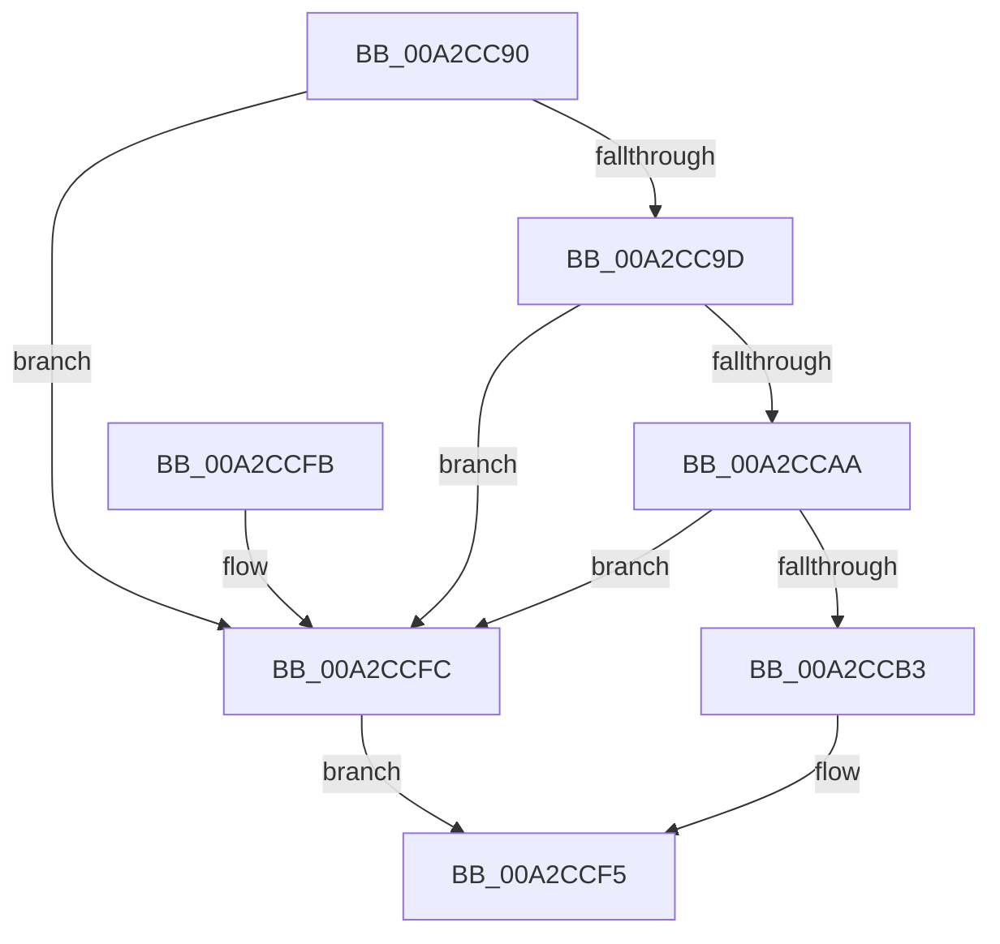

# PiPnpRtlGetDeviceRelatedDeviceRoutine

- RVA: `0x00A2CC90`–`0x00A2CD03` (길이 `115` bytes)
- VA: `0x0000000140A2CC90`
- 실행 섹션: `PAGE`
- PDB 이름 있음: `예`; PDB Function 태그: `아니요`
- unwind 정보 RVA: `0x0008EB20`
- 디코드: `31`개 명령, `115/115` bytes 표시
- 미해석 바이트: `0` (있으면 어셈블리에 `.byte`로 보존)

> 이 문서는 커널 이미지의 기계어와 PDB 기호를 분석해 생성했습니다. 4번과 5번은 함수 원형과 자료형을 바이너리 사용 방식에서 추정한 C 해석이며 원본 소스 복구 결과는 아닙니다.

## 1. Dependencies

- 직접 호출 지점: **1**; 고유 호출 대상: **1**
- 직접 호출자로 확인된 함수: **0**
- RIP 상대 이미지 참조: **0**

### Outgoing calls
- `0x00A2CCE8` → [ZwPlugPlayControl](../../text/6A/ZwPlugPlayControl_function_006AF890.md) (function, `0x006AF890`)

### Direct callers
- 이 함수 시작 RVA로 연결되는 직접 call은 확인되지 않았습니다. 간접 호출은 완전히 역산할 수 없습니다.

### Static image references
- 디코드된 RIP-relative 메모리 참조가 없습니다.

## 2. Other-region calls and transfers

- 다른 실행 섹션으로 향하는 call: **1**
  - `0x00A2CCE8` → [ZwPlugPlayControl](../../text/6A/ZwPlugPlayControl_function_006AF890.md) (`PAGE` → `.text`)
- 별도 외부 분기/꼬리 이동을 확인하지 못했습니다.

## 3. Assembly (complete function range)

```asm
00A2CC90  40 53                           push rbx
00A2CC92  48 83 EC 50                     sub rsp, 0x50
00A2CC96  33 C0                           xor eax, eax
00A2CC98  48 85 D2                        test rdx, rdx
00A2CC9B  74 5F                           je 0x140a2ccfc
00A2CC9D  48 8B 9C 24 88 00 00 00         mov rbx, qword ptr [rsp + 0x88]
00A2CCA5  48 85 DB                        test rbx, rbx
00A2CCA8  74 52                           je 0x140a2ccfc
00A2CCAA  39 84 24 90 00 00 00            cmp dword ptr [rsp + 0x90], eax
00A2CCB1  75 49                           jne 0x140a2ccfc
00A2CCB3  0F 10 02                        movups xmm0, xmmword ptr [rdx]
00A2CCB6  44 89 44 24 30                  mov dword ptr [rsp + 0x30], r8d
00A2CCBB  48 8D 54 24 20                  lea rdx, [rsp + 0x20]
00A2CCC0  41 B8 28 00 00 00               mov r8d, 0x28
00A2CCC6  89 44 24 34                     mov dword ptr [rsp + 0x34], eax
00A2CCCA  89 44 24 44                     mov dword ptr [rsp + 0x44], eax
00A2CCCE  8B 84 24 80 00 00 00            mov eax, dword ptr [rsp + 0x80]
00A2CCD5  F3 0F 7F 44 24 20               movdqu xmmword ptr [rsp + 0x20], xmm0
00A2CCDB  41 8D 48 E4                     lea ecx, [r8 - 0x1c]
00A2CCDF  4C 89 4C 24 38                  mov qword ptr [rsp + 0x38], r9
00A2CCE4  89 44 24 40                     mov dword ptr [rsp + 0x40], eax
00A2CCE8  E8 A3 2B C8 FF                  call 0x1406af890
00A2CCED  8B 4C 24 40                     mov ecx, dword ptr [rsp + 0x40]
00A2CCF1  FF C1                           inc ecx
00A2CCF3  89 0B                           mov dword ptr [rbx], ecx
00A2CCF5  48 83 C4 50                     add rsp, 0x50
00A2CCF9  5B                              pop rbx
00A2CCFA  C3                              ret
00A2CCFB  CC                              int3
00A2CCFC  B8 0D 00 00 C0                  mov eax, 0xc000000d
00A2CD01  EB F2                           jmp 0x140a2ccf5
```

## 4. C-style interpretation (structured pseudocode)

```c
__int64 __fastcall PiPnpRtlGetDeviceRelatedDeviceRoutine(__int64 a1, __int64 a2, int a3, __int64 a4, unsigned int a5, __int64 a6, unsigned int a7)
{
    __int64 result;
    __int64 v_rsp;
    unsigned int v_stack_m14;
    unsigned int v_stack_m18;
    unsigned __int64 v_stack_m20;
    unsigned int v_stack_m24;
    unsigned int v_stack_m28;
    unsigned __int64 v_stack_m38;

    v_rsp = (v_rsp) - (80);
    result = 0;
    if (a2 == 0) goto loc_00A2CCFC;
    if (a6 == 0) goto loc_00A2CCFC;
    if (a7 != 0) goto loc_00A2CCFC;
    v_stack_m28 = a3;
    v_stack_m24 = 0;
    v_stack_m14 = 0;
    v_stack_m38 = v_xmm0;
    v_stack_m20 = a4;
    v_stack_m18 = (unsigned int)((unsigned int)(a5));
    result = ZwPlugPlayControl(40 - 28, v_stack_m38, 40, a4);
    a1 = (unsigned int)(((unsigned int)(v_stack_m18)) + 1);
    *(unsigned int *)(a6) = (unsigned int)(a1);
loc_00A2CCF5:
    v_rsp = (v_rsp) + (80);
    return result;
loc_00A2CCFC:
    goto loc_00A2CCF5;
}
```

## 5. (Beta) C Style

```c
int64_t PiPnpRtlGetDeviceRelatedDeviceRoutine(int64_t Arg1, int64_t Arg2, int32_t Arg3, int64_t Arg4, uint32_t Arg5, int64_t Arg6, uint32_t Arg7)
{
    int64_t result;
    int64_t local_rsp;
    uint32_t v_stack_m14;
    uint32_t v_stack_m18;
    uint64_t v_stack_m20;
    uint32_t v_stack_m24;
    uint32_t v_stack_m28;
    uint64_t v_stack_m38;

    local_rsp = (local_rsp) - (80);
    result = 0;
    if (Arg2 == 0) goto loc_00A2CCFC;
    if (Arg6 == 0) goto loc_00A2CCFC;
    if (Arg7 != 0) goto loc_00A2CCFC;
    v_stack_m28 = Arg3;
    v_stack_m24 = 0;
    v_stack_m14 = 0;
    v_stack_m38 = v_xmm0;
    v_stack_m20 = Arg4;
    v_stack_m18 = (uint32_t)((uint32_t)(Arg5));
    result = ZwPlugPlayControl(40 - 28, v_stack_m38, 40, Arg4);
    Arg1 = (uint32_t)(((uint32_t)(v_stack_m18)) + 1);
    *(uint32_t *)(Arg6) = (uint32_t)(Arg1);
loc_00A2CCF5:
    local_rsp = (local_rsp) + (80);
    return result;
loc_00A2CCFC:
    goto loc_00A2CCF5;
}
```

## 6. Execution-region graph

[열기: 2D/3D 그래프와 함수 탐색 컨트롤 패널](../../../control-panel.html?section=page&rva=0x00A2CC90&view=graph)

- 2D 그래프는 위에서 아래로 흐르고, 3D 그래프는 빈 공간을 드래그해 회전합니다. Shift+드래그는 이동, 휠은 확대·축소, 함수 노드 선택은 대상 보고서 이동입니다.

### Static fallback


