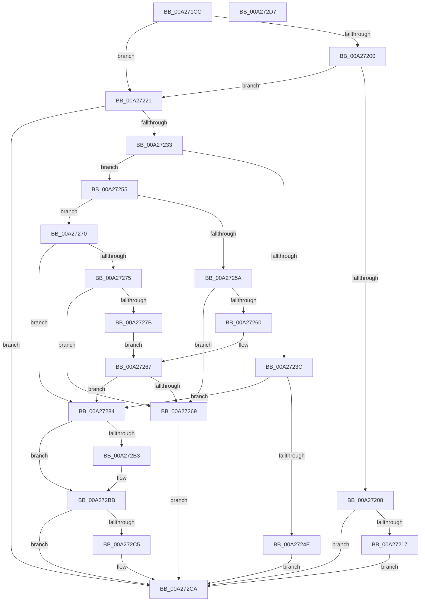

# PiProcessClearDeviceProblem

- RVA: `0x00A271CC`–`0x00A272D8` (길이 `268` bytes)
- VA: `0x0000000140A271CC`
- 실행 섹션: `PAGE`
- PDB 이름 있음: `예`; PDB Function 태그: `아니요`
- unwind 정보 RVA: `0x00068D5C`
- 디코드: `70`개 명령, `268/268` bytes 표시
- 미해석 바이트: `0` (있으면 어셈블리에 `.byte`로 보존)

> 이 문서는 커널 이미지의 기계어와 PDB 기호를 분석해 생성했습니다. 4번과 5번은 함수 원형과 자료형을 바이너리 사용 방식에서 추정한 C 해석이며 원본 소스 복구 결과는 아닙니다.

## 1. Dependencies

- 직접 호출 지점: **6**; 고유 호출 대상: **6**
- 직접 호출자로 확인된 함수: **1**
- RIP 상대 이미지 참조: **0**

### Outgoing calls
- `0x00A27245` → [PipIsProblemReadonly](../72/PipIsProblemReadonly_function_0072DA44.md) (function, `0x0072DA44`)
- `0x00A27289` → [PiPnpRtlBeginOperation](../8E/PiPnpRtlBeginOperation_function_008E033C.md) (function, `0x008E033C`)
- `0x00A27296` → [PipClearDevNodeFlags](../8F/PipClearDevNodeFlags_function_008F9F54.md) (function, `0x008F9F54`)
- `0x00A2729E` → [PipClearDevNodeProblem](PipClearDevNodeProblem_function_00A27C8C.md) (function, `0x00A27C8C`)
- `0x00A272B6` → [PnpRestartDeviceNode](../72/PnpRestartDeviceNode_function_0072CD60.md) (function, `0x0072CD60`)
- `0x00A272C5` → [PiPnpRtlEndOperation](../8E/PiPnpRtlEndOperation_function_008E0518.md) (function, `0x008E0518`)

### Direct callers
- [PnpDeviceActionWorker](../../text/47/PnpDeviceActionWorker_function_00478400.md) at `0x00478AA2`

### Static image references
- 디코드된 RIP-relative 메모리 참조가 없습니다.

## 2. Other-region calls and transfers

- 다른 실행 섹션으로 향하는 call: **0**
- 별도 외부 분기/꼬리 이동을 확인하지 못했습니다.

## 3. Assembly (complete function range)

```asm
00A271CC  48 89 5C 24 10                  mov qword ptr [rsp + 0x10], rbx
00A271D1  57                              push rdi
00A271D2  48 83 EC 20                     sub rsp, 0x20
00A271D6  48 8B 41 10                     mov rax, qword ptr [rcx + 0x10]
00A271DA  33 DB                           xor ebx, ebx
00A271DC  4C 8B C1                        mov r8, rcx
00A271DF  48 89 5C 24 30                  mov qword ptr [rsp + 0x30], rbx
00A271E4  48 8B 90 38 01 00 00            mov rdx, qword ptr [rax + 0x138]
00A271EB  48 8B 7A 28                     mov rdi, qword ptr [rdx + 0x28]
00A271EF  8B 97 2C 01 00 00               mov edx, dword ptr [rdi + 0x12c]
00A271F5  8D 82 FF FC FF FF               lea eax, [rdx - 0x301]
00A271FB  83 F8 03                        cmp eax, 3
00A271FE  76 21                           jbe 0x140a27221
00A27200  81 FA 14 03 00 00               cmp edx, 0x314
00A27206  74 19                           je 0x140a27221
00A27208  8D 82 EB FC FF FF               lea eax, [rdx - 0x315]
00A2720E  83 F8 01                        cmp eax, 1
00A27211  0F 87 B3 00 00 00               ja 0x140a272ca
00A27217  BB 56 00 00 C0                  mov ebx, 0xc0000056
00A2721C  E9 A9 00 00 00                  jmp 0x140a272ca
00A27221  8B 8F 8C 01 00 00               mov ecx, dword ptr [rdi + 0x18c]
00A27227  F7 C1 00 60 00 00               test ecx, 0x6000
00A2722D  0F 84 97 00 00 00               je 0x140a272ca
00A27233  41 8B 40 18                     mov eax, dword ptr [r8 + 0x18]
00A27237  83 F8 01                        cmp eax, 1
00A2723A  75 19                           jne 0x140a27255
00A2723C  8B 97 94 01 00 00               mov edx, dword ptr [rdi + 0x194]
00A27242  48 8B CF                        mov rcx, rdi
00A27245  E8 FA 67 D0 FF                  call 0x14072da44
00A2724A  85 C0                           test eax, eax
00A2724C  74 36                           je 0x140a27284
00A2724E  BB F0 00 00 C0                  mov ebx, 0xc00000f0
00A27253  EB 75                           jmp 0x140a272ca
00A27255  83 F8 03                        cmp eax, 3
00A27258  75 16                           jne 0x140a27270
00A2725A  0F BA E1 0D                     bt ecx, 0xd
00A2725E  73 09                           jae 0x140a27269
00A27260  83 BF 94 01 00 00 2F            cmp dword ptr [rdi + 0x194], 0x2f
00A27267  74 1B                           je 0x140a27284
00A27269  BB 10 00 00 C0                  mov ebx, 0xc0000010
00A2726E  EB 5A                           jmp 0x140a272ca
00A27270  83 F8 19                        cmp eax, 0x19
00A27273  75 0F                           jne 0x140a27284
00A27275  0F BA E1 0D                     bt ecx, 0xd
00A27279  73 EE                           jae 0x140a27269
00A2727B  83 BF 94 01 00 00 37            cmp dword ptr [rdi + 0x194], 0x37
00A27282  EB E3                           jmp 0x140a27267
00A27284  48 8D 4C 24 30                  lea rcx, [rsp + 0x30]
00A27289  E8 AE 90 EB FF                  call 0x1408e033c
00A2728E  BA 00 40 00 00                  mov edx, 0x4000
00A27293  48 8B CF                        mov rcx, rdi
00A27296  E8 B9 2C ED FF                  call 0x1408f9f54
00A2729B  48 8B CF                        mov rcx, rdi
00A2729E  E8 E9 09 00 00                  call 0x140a27c8c
00A272A3  8B 87 2C 01 00 00               mov eax, dword ptr [rdi + 0x12c]
00A272A9  2D 01 03 00 00                  sub eax, 0x301
00A272AE  83 F8 01                        cmp eax, 1
00A272B1  76 08                           jbe 0x140a272bb
00A272B3  48 8B CF                        mov rcx, rdi
00A272B6  E8 A5 5A D0 FF                  call 0x14072cd60
00A272BB  48 8B 4C 24 30                  mov rcx, qword ptr [rsp + 0x30]
00A272C0  48 85 C9                        test rcx, rcx
00A272C3  74 05                           je 0x140a272ca
00A272C5  E8 4E 92 EB FF                  call 0x1408e0518
00A272CA  8B C3                           mov eax, ebx
00A272CC  48 8B 5C 24 38                  mov rbx, qword ptr [rsp + 0x38]
00A272D1  48 83 C4 20                     add rsp, 0x20
00A272D5  5F                              pop rdi
00A272D6  C3                              ret
00A272D7  CC                              int3
```

## 4. C-style interpretation (structured pseudocode)

```c
__int64 __fastcall PiProcessClearDeviceProblem(__int64 a1)
{
    __int64 result;
    __int64 v_rbx;
    __int64 v_rsp;
    unsigned __int64 v_stack_p10;
    unsigned __int64 v_stack_p8;

    v_stack_p10 = v_rbx;
    v_rsp = (v_rsp) - (32);
    v_rbx = 0;
    v_stack_p8 = 0;
    if (((unsigned int)((unsigned int)(*(unsigned int *)(*(unsigned __int64 *)(*(unsigned __int64 *)(*(unsigned __int64 *)(a1 + 16) + 312) + 40) + 300)) - 769)) <= 3) goto loc_00A27221;
    if (((unsigned int)((unsigned int)(*(unsigned int *)(*(unsigned __int64 *)(*(unsigned __int64 *)(*(unsigned __int64 *)(a1 + 16) + 312) + 40) + 300)))) == 788) goto loc_00A27221;
    if (((unsigned int)((unsigned int)(*(unsigned int *)(*(unsigned __int64 *)(*(unsigned __int64 *)(*(unsigned __int64 *)(a1 + 16) + 312) + 40) + 300)) - 789)) > 1) goto loc_00A272CA;
    goto loc_00A272CA;
loc_00A27221:
    if ((((unsigned int)((unsigned int)(*(unsigned int *)(*(unsigned __int64 *)(*(unsigned __int64 *)(*(unsigned __int64 *)(a1 + 16) + 312) + 40) + 396)))) & (0x6000ULL)) == 0) goto loc_00A272CA;
    if (((unsigned int)((unsigned int)(*(unsigned int *)(a1 + 24)))) != 1) goto loc_00A27255;
    result = PipIsProblemReadonly(*(unsigned __int64 *)(*(unsigned __int64 *)(*(unsigned __int64 *)(a1 + 16) + 312) + 40), (unsigned int)(*(unsigned int *)(*(unsigned __int64 *)(*(unsigned __int64 *)(*(unsigned __int64 *)(a1 + 16) + 312) + 40) + 404)), a1, a4);
    if ((unsigned int)(result) == 0) goto loc_00A27284;
    goto loc_00A272CA;
loc_00A27255:
    if (((unsigned int)(result)) != 3) goto loc_00A27270;
    if (((unsigned int)(result)) >= 3) goto loc_00A27269;
loc_00A27267:
    if ((*(unsigned int *)(*(unsigned __int64 *)(*(unsigned __int64 *)(*(unsigned __int64 *)(a1 + 16) + 312) + 40) + 404)) == 47) goto loc_00A27284;
loc_00A27269:
    goto loc_00A272CA;
loc_00A27270:
    if (((unsigned int)(result)) != 25) goto loc_00A27284;
    if (((unsigned int)(result)) >= 25) goto loc_00A27269;
    goto loc_00A27267;
loc_00A27284:
    result = PiPnpRtlBeginOperation(v_stack_p8, (unsigned int)(*(unsigned int *)(*(unsigned __int64 *)(*(unsigned __int64 *)(*(unsigned __int64 *)(a1 + 16) + 312) + 40) + 404)), a1, a4);
    result = PipClearDevNodeFlags(*(unsigned __int64 *)(*(unsigned __int64 *)(*(unsigned __int64 *)(a1 + 16) + 312) + 40), (unsigned int)(0x4000ULL), a1, a4);
    result = PipClearDevNodeProblem(*(unsigned __int64 *)(*(unsigned __int64 *)(*(unsigned __int64 *)(a1 + 16) + 312) + 40), (unsigned int)(0x4000ULL), a1, a4);
    result = (unsigned int)(((unsigned int)(*(unsigned int *)(*(unsigned __int64 *)(*(unsigned __int64 *)(*(unsigned __int64 *)(a1 + 16) + 312) + 40) + 300))) - (769));
    if (((unsigned int)(result)) >= = 1) {
        a1 = *(unsigned __int64 *)(*(unsigned __int64 *)(*(unsigned __int64 *)(a1 + 16) + 312) + 40);
        result = PnpRestartDeviceNode(a1, (unsigned int)(0x4000ULL), a1, a4);
    }
    if (v_stack_p8 != 0) {
        result = PiPnpRtlEndOperation(v_stack_p8, (unsigned int)(0x4000ULL), a1, a4);
    }
    v_rsp = (v_rsp) + (32);
    return (unsigned int)((unsigned int)((unsigned int)(0xC0000010ULL)));
}
```

## 5. (Beta) C Style

```c
int64_t PiProcessClearDeviceProblem(void *Arg1)
{
    uint8_t *arg1 = (uint8_t *)Arg1;

    int64_t result;
    int64_t local_rbx;
    int64_t local_rsp;
    uint64_t v_stack_p10;
    uint64_t v_stack_p8;

    v_stack_p10 = local_rbx;
    local_rsp = (local_rsp) - (32);
    local_rbx = 0;
    v_stack_p8 = 0;
    if (((uint32_t)((uint32_t)(*(uint32_t *)(*(uint64_t *)(*(uint64_t *)(*(uint64_t *)(arg1 + 0x10) + 0x138) + 0x28) + 0x12C)) - 769)) <= 3) goto loc_00A27221;
    if (((uint32_t)((uint32_t)(*(uint32_t *)(*(uint64_t *)(*(uint64_t *)(*(uint64_t *)(arg1 + 0x10) + 0x138) + 0x28) + 0x12C)))) == 788) goto loc_00A27221;
    if (((uint32_t)((uint32_t)(*(uint32_t *)(*(uint64_t *)(*(uint64_t *)(*(uint64_t *)(arg1 + 0x10) + 0x138) + 0x28) + 0x12C)) - 789)) > 1) goto loc_00A272CA;
    goto loc_00A272CA;
loc_00A27221:
    if ((((uint32_t)((uint32_t)(*(uint32_t *)(*(uint64_t *)(*(uint64_t *)(*(uint64_t *)(arg1 + 0x10) + 0x138) + 0x28) + 0x18C)))) & (0x6000ULL)) == 0) goto loc_00A272CA;
    if (((uint32_t)((uint32_t)(*(uint32_t *)(arg1 + 0x18)))) != 1) goto loc_00A27255;
    result = PipIsProblemReadonly(*(uint64_t *)(*(uint64_t *)(*(uint64_t *)(arg1 + 0x10) + 0x138) + 0x28), (uint32_t)(*(uint32_t *)(*(uint64_t *)(*(uint64_t *)(*(uint64_t *)(arg1 + 0x10) + 0x138) + 0x28) + 0x194)), Arg1, a4);
    if ((uint32_t)(result) == 0) goto loc_00A27284;
    goto loc_00A272CA;
loc_00A27255:
    if (((uint32_t)(result)) != 3) goto loc_00A27270;
    if (((uint32_t)(result)) >= 3) goto loc_00A27269;
loc_00A27267:
    if ((*(uint32_t *)(*(uint64_t *)(*(uint64_t *)(*(uint64_t *)(arg1 + 0x10) + 0x138) + 0x28) + 0x194)) == 47) goto loc_00A27284;
loc_00A27269:
    goto loc_00A272CA;
loc_00A27270:
    if (((uint32_t)(result)) != 25) goto loc_00A27284;
    if (((uint32_t)(result)) >= 25) goto loc_00A27269;
    goto loc_00A27267;
loc_00A27284:
    result = PiPnpRtlBeginOperation(v_stack_p8, (uint32_t)(*(uint32_t *)(*(uint64_t *)(*(uint64_t *)(*(uint64_t *)(arg1 + 0x10) + 0x138) + 0x28) + 0x194)), Arg1, a4);
    result = PipClearDevNodeFlags(*(uint64_t *)(*(uint64_t *)(*(uint64_t *)(arg1 + 0x10) + 0x138) + 0x28), (uint32_t)(0x4000ULL), Arg1, a4);
    result = PipClearDevNodeProblem(*(uint64_t *)(*(uint64_t *)(*(uint64_t *)(arg1 + 0x10) + 0x138) + 0x28), (uint32_t)(0x4000ULL), Arg1, a4);
    result = (uint32_t)(((uint32_t)(*(uint32_t *)(*(uint64_t *)(*(uint64_t *)(*(uint64_t *)(arg1 + 0x10) + 0x138) + 0x28) + 0x12C))) - (769));
    if (((uint32_t)(result)) >= = 1) {
        Arg1 = *(uint64_t *)(*(uint64_t *)(*(uint64_t *)(arg1 + 0x10) + 0x138) + 0x28);
        result = PnpRestartDeviceNode(Arg1, (uint32_t)(0x4000ULL), Arg1, a4);
    }
    if (v_stack_p8 != 0) {
        result = PiPnpRtlEndOperation(v_stack_p8, (uint32_t)(0x4000ULL), Arg1, a4);
    }
    local_rsp = (local_rsp) + (32);
    return (uint32_t)((uint32_t)((uint32_t)(0xC0000010ULL)));
}
```

### 관측된 메모리 오프셋

구조체 형식이 확인되지 않은 접근은 인자 기준의 오프셋으로만 기록했습니다.

| 기준 인자 | 오프셋 표현 | 폭 (bit) | 접근 |
|---|---:|---:|---|
| `Arg1` | `+ 0x10` | `64` | `R` |
| `Arg1` | `+ 0x18` | `32` | `R` |

## 6. Execution-region graph

[열기: 2D/3D 그래프와 함수 탐색 컨트롤 패널](../../../control-panel.html?section=page&rva=0x00A271CC&view=graph)

- 2D 그래프는 위에서 아래로 흐르고, 3D 그래프는 빈 공간을 드래그해 회전합니다. Shift+드래그는 이동, 휠은 확대·축소, 함수 노드 선택은 대상 보고서 이동입니다.

### Static fallback


