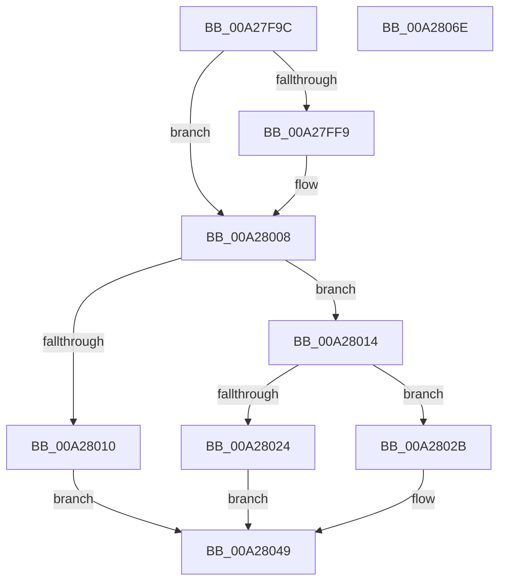

# PiProcessDriversLoadedOnSecureDevice

- RVA: `0x00A27F9C`–`0x00A2806F` (길이 `211` bytes)
- VA: `0x0000000140A27F9C`
- 실행 섹션: `PAGE`
- PDB 이름 있음: `예`; PDB Function 태그: `아니요`
- unwind 정보 RVA: `0x000A8970`
- 디코드: `62`개 명령, `211/211` bytes 표시
- 미해석 바이트: `0` (있으면 어셈블리에 `.byte`로 보존)

> 이 문서는 커널 이미지의 기계어와 PDB 기호를 분석해 생성했습니다. 4번과 5번은 함수 원형과 자료형을 바이너리 사용 방식에서 추정한 C 해석이며 원본 소스 복구 결과는 아닙니다.

## 1. Dependencies

- 직접 호출 지점: **5**; 고유 호출 대상: **5**
- 직접 호출자로 확인된 함수: **1**
- RIP 상대 이미지 참조: **1**

### Outgoing calls
- `0x00A27FEE` → [PnpQueryInterface](PnpQueryInterface_function_00A28D38.md) (function, `0x00A28D38`)
- `0x00A28003` → [guard_dispatch_icall](../../text/6B/guard_dispatch_icall_function_006BAAD0.md) (function, `0x006BAAD0`)
- `0x00A28017` → [PipUnprotectDevice](../74/PipUnprotectDevice_function_007409BC.md) (function, `0x007409BC`)
- `0x00A2803A` → [PnpRequestDeviceRemoval](../8F/PnpRequestDeviceRemoval_function_008FC294.md) (function, `0x008FC294`)
- `0x00A28051` → [PnpTraceSecureDeviceEnumeration](PnpTraceSecureDeviceEnumeration_function_00A282CC.md) (function, `0x00A282CC`)

### Direct callers
- [PipCallDriverAddDevice](PipCallDriverAddDevice_function_00A272E0.md) at `0x00A2778A`

### Static image references
- `0x00A27FB3` → RVA `0x00019F40` (`.rdata`; read)

## 2. Other-region calls and transfers

- 다른 실행 섹션으로 향하는 call: **1**
  - `0x00A28003` → [guard_dispatch_icall](../../text/6B/guard_dispatch_icall_function_006BAAD0.md) (`PAGE` → `.text`)
- 별도 외부 분기/꼬리 이동을 확인하지 못했습니다.

## 3. Assembly (complete function range)

```asm
00A27F9C  4C 8B DC                        mov r11, rsp
00A27F9F  49 89 5B 08                     mov qword ptr [r11 + 8], rbx
00A27FA3  49 89 6B 10                     mov qword ptr [r11 + 0x10], rbp
00A27FA7  49 89 73 18                     mov qword ptr [r11 + 0x18], rsi
00A27FAB  57                              push rdi
00A27FAC  48 83 EC 70                     sub rsp, 0x70
00A27FB0  0F 57 C0                        xorps xmm0, xmm0
00A27FB3  48 8D 15 86 1F 5F FF            lea rdx, [rip - 0xa0e07a]
00A27FBA  33 ED                           xor ebp, ebp
00A27FBC  33 C0                           xor eax, eax
00A27FBE  0F 11 44 24 30                  movups xmmword ptr [rsp + 0x30], xmm0
00A27FC3  48 8B F1                        mov rsi, rcx
00A27FC6  48 8B 49 20                     mov rcx, qword ptr [rcx + 0x20]
00A27FCA  0F 11 44 24 40                  movups xmmword ptr [rsp + 0x40], xmm0
00A27FCF  8D 7D 01                        lea edi, [rbp + 1]
00A27FD2  0F 11 44 24 50                  movups xmmword ptr [rsp + 0x50], xmm0
00A27FD7  49 89 43 E8                     mov qword ptr [r11 - 0x18], rax
00A27FDB  44 8D 4D 38                     lea r9d, [rbp + 0x38]
00A27FDF  49 8D 43 B8                     lea rax, [r11 - 0x48]
00A27FE3  44 8B C7                        mov r8d, edi
00A27FE6  49 89 43 B0                     mov qword ptr [r11 - 0x50], rax
00A27FEA  49 21 6B A8                     and qword ptr [r11 - 0x58], rbp
00A27FEE  E8 45 0D 00 00                  call 0x140a28d38
00A27FF3  8B D8                           mov ebx, eax
00A27FF5  85 C0                           test eax, eax
00A27FF7  78 0F                           js 0x140a28008
00A27FF9  48 8B 4C 24 38                  mov rcx, qword ptr [rsp + 0x38]
00A27FFE  48 8B 44 24 48                  mov rax, qword ptr [rsp + 0x48]
00A28003  E8 C8 2A C9 FF                  call 0x1406baad0
00A28008  C1 EB 1F                        shr ebx, 0x1f
00A2800B  40 32 DF                        xor bl, dil
00A2800E  74 04                           je 0x140a28014
00A28010  33 DB                           xor ebx, ebx
00A28012  EB 35                           jmp 0x140a28049
00A28014  48 8B CE                        mov rcx, rsi
00A28017  E8 A0 89 D1 FF                  call 0x1407409bc
00A2801C  8B D8                           mov ebx, eax
00A2801E  8B E8                           mov ebp, eax
00A28020  85 C0                           test eax, eax
00A28022  78 07                           js 0x140a2802b
00A28024  BF 02 00 00 00                  mov edi, 2
00A28029  EB 1E                           jmp 0x140a28049
00A2802B  33 D2                           xor edx, edx
00A2802D  41 B9 22 00 00 C0               mov r9d, 0xc0000022
00A28033  48 8B CE                        mov rcx, rsi
00A28036  44 8D 42 30                     lea r8d, [rdx + 0x30]
00A2803A  E8 55 42 ED FF                  call 0x1408fc294
00A2803F  BB CE 02 00 C0                  mov ebx, 0xc00002ce
00A28044  BF 03 00 00 00                  mov edi, 3
00A28049  44 8B C5                        mov r8d, ebp
00A2804C  8B D7                           mov edx, edi
00A2804E  48 8B CE                        mov rcx, rsi
00A28051  E8 76 02 00 00                  call 0x140a282cc
00A28056  4C 8D 5C 24 70                  lea r11, [rsp + 0x70]
00A2805B  8B C3                           mov eax, ebx
00A2805D  49 8B 5B 10                     mov rbx, qword ptr [r11 + 0x10]
00A28061  49 8B 6B 18                     mov rbp, qword ptr [r11 + 0x18]
00A28065  49 8B 73 20                     mov rsi, qword ptr [r11 + 0x20]
00A28069  49 8B E3                        mov rsp, r11
00A2806C  5F                              pop rdi
00A2806D  C3                              ret
00A2806E  CC                              int3
```

## 4. C-style interpretation (structured pseudocode)

```c
__int64 __fastcall PiProcessDriversLoadedOnSecureDevice(__int64 a1)
{
    __int64 result;
    __int64 v_rbp;
    __int64 v_rbx;
    __int64 v_rsp;
    unsigned __int64 v_stack_m28;
    unsigned __int64 v_stack_m30;
    unsigned __int64 v_stack_m38;
    unsigned __int64 v_stack_m40;
    unsigned __int64 v_stack_m48;
    unsigned __int64 v_stack_m8;

    *(unsigned __int64 *)(v_rsp + 8) = v_rbx;
    *(unsigned __int64 *)(v_rsp + 16) = v_rbp;
    *(unsigned __int64 *)(v_rsp + 24) = v_rsi;
    v_rsp = (v_rsp) - (112);
    v_rbp = 0;
    result = 0;
    v_stack_m48 = v_xmm0;
    v_stack_m38 = v_xmm0;
    v_stack_m28 = v_xmm0;
    *(unsigned __int64 *)(v_rsp - 24) = 0;
    *(unsigned __int64 *)(v_rsp - 80) = v_rsp - 72;
    result = PnpQueryInterface(*(unsigned __int64 *)(a1 + 32), v_rip - 10543226, (unsigned int)((unsigned int)(v_rbp + 1)), v_rbp + 56);
    if (!(sign_flag)) {
        a1 = v_stack_m40;
        result = v_stack_m30;
        result = guard_dispatch_icall(a1, v_rip - 10543226, (unsigned int)((unsigned int)(v_rbp + 1)), v_rbp + 56);
    }
    v_rbx = (unsigned int)(((unsigned int)((unsigned int)(result))) >> (31));
    v_rbx = (unsigned __int8)((v_rbx) ^ ((unsigned __int8)(v_rbp + 1)));
    if (condition_is_equal) goto loc_00A28014;
    v_rbx = 0;
    goto loc_00A28049;
loc_00A28014:
    result = PipUnprotectDevice(a1, v_rip - 10543226, (unsigned int)((unsigned int)(v_rbp + 1)), v_rbp + 56);
    if (sign_flag) goto loc_00A2802B;
    goto loc_00A28049;
loc_00A2802B:
    a2 = 0;
    result = PnpRequestDeviceRemoval(a1, a2, a2 + 48, (unsigned int)(0xC0000022ULL));
loc_00A28049:
    result = PnpTraceSecureDeviceEnumeration(a1, 3, (unsigned int)((unsigned int)((unsigned int)((unsigned int)(result)))), (unsigned int)(0xC0000022ULL));
    return (unsigned int)((unsigned int)((unsigned int)(0xC00002CEULL)));
}
```

## 5. (Beta) C Style

```c
int64_t PiProcessDriversLoadedOnSecureDevice(void *Arg1)
{
    uint8_t *arg1 = (uint8_t *)Arg1;

    int64_t result;
    int64_t local_rbp;
    int64_t local_rbx;
    int64_t local_rsp;
    uint64_t v_stack_m28;
    uint64_t v_stack_m30;
    uint64_t v_stack_m38;
    uint64_t v_stack_m40;
    uint64_t v_stack_m48;
    uint64_t v_stack_m8;

    *(uint64_t *)(local_rsp + 0x8) = local_rbx;
    *(uint64_t *)(local_rsp + 0x10) = local_rbp;
    *(uint64_t *)(local_rsp + 0x18) = local_rsi;
    local_rsp = (local_rsp) - (112);
    local_rbp = 0;
    result = 0;
    v_stack_m48 = v_xmm0;
    v_stack_m38 = v_xmm0;
    v_stack_m28 = v_xmm0;
    *(uint64_t *)(local_rsp - 0x18) = 0;
    *(uint64_t *)(local_rsp - 0x50) = local_rsp - 72;
    result = PnpQueryInterface(*(uint64_t *)(arg1 + 0x20), v_rip - 10543226, (uint32_t)((uint32_t)(local_rbp + 1)), local_rbp + 56);
    if (!(sign_flag)) {
        Arg1 = v_stack_m40;
        result = v_stack_m30;
        result = guard_dispatch_icall(Arg1, v_rip - 10543226, (uint32_t)((uint32_t)(local_rbp + 1)), local_rbp + 56);
    }
    local_rbx = (uint32_t)(((uint32_t)((uint32_t)(result))) >> (31));
    local_rbx = (uint8_t)((local_rbx) ^ ((uint8_t)(local_rbp + 1)));
    if (condition_is_equal) goto loc_00A28014;
    local_rbx = 0;
    goto loc_00A28049;
loc_00A28014:
    result = PipUnprotectDevice(Arg1, v_rip - 10543226, (uint32_t)((uint32_t)(local_rbp + 1)), local_rbp + 56);
    if (sign_flag) goto loc_00A2802B;
    goto loc_00A28049;
loc_00A2802B:
    a2 = 0;
    result = PnpRequestDeviceRemoval(Arg1, a2, a2 + 48, (uint32_t)(0xC0000022ULL));
loc_00A28049:
    result = PnpTraceSecureDeviceEnumeration(Arg1, 3, (uint32_t)((uint32_t)((uint32_t)((uint32_t)(result)))), (uint32_t)(0xC0000022ULL));
    return (uint32_t)((uint32_t)((uint32_t)(0xC00002CEULL)));
}
```

### 관측된 메모리 오프셋

구조체 형식이 확인되지 않은 접근은 인자 기준의 오프셋으로만 기록했습니다.

| 기준 인자 | 오프셋 표현 | 폭 (bit) | 접근 |
|---|---:|---:|---|
| `Arg1` | `+ 0x20` | `64` | `R` |

## 6. Execution-region graph

[열기: 2D/3D 그래프와 함수 탐색 컨트롤 패널](../../../control-panel.html?section=page&rva=0x00A27F9C&view=graph)

- 2D 그래프는 위에서 아래로 흐르고, 3D 그래프는 빈 공간을 드래그해 회전합니다. Shift+드래그는 이동, 휠은 확대·축소, 함수 노드 선택은 대상 보고서 이동입니다.

### Static fallback


