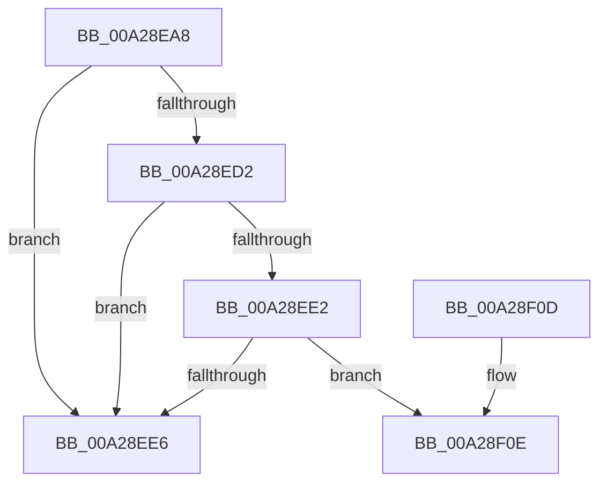

# PiProcessNewDeviceNodeAsync

- RVA: `0x00A28EA8`–`0x00A28F17` (길이 `111` bytes)
- VA: `0x0000000140A28EA8`
- 실행 섹션: `PAGE`
- PDB 이름 있음: `예`; PDB Function 태그: `예`
- unwind 정보 RVA: `0x0008E26C`
- 디코드: `32`개 명령, `111/111` bytes 표시
- 미해석 바이트: `0` (있으면 어셈블리에 `.byte`로 보존)

> 이 문서는 커널 이미지의 기계어와 PDB 기호를 분석해 생성했습니다. 4번과 5번은 함수 원형과 자료형을 바이너리 사용 방식에서 추정한 C 해석이며 원본 소스 복구 결과는 아닙니다.

## 1. Dependencies

- 직접 호출 지점: **1**; 고유 호출 대상: **1**
- 직접 호출자로 확인된 함수: **1**
- RIP 상대 이미지 참조: **2**

### Outgoing calls
- `0x00A28EE9` → [PiProcessNewDeviceNode](PiProcessNewDeviceNode_function_00A28F20.md) (function, `0x00A28F20`)

### Direct callers
- [PipProcessDevNodeTree](../8F/PipProcessDevNodeTree_function_008F9068.md) at `0x008F9666`

### Static image references
- `0x00A28EC1` → RVA `0x00FC41C4` (`.data`; read)
- `0x00A28ED2` → RVA `0x00E0AA18` (`.data`; read)

## 2. Other-region calls and transfers

- 다른 실행 섹션으로 향하는 call: **0**
- call이 아닌 외부 분기/꼬리 이동: **1**
  - `0x00A28F12` → [sub_00B38858](../B3/Unknown_function_00B38858.md) (`tail-transfer`)

## 3. Assembly (complete function range)

```asm
00A28EA8  48 8B C4                        mov rax, rsp
00A28EAB  48 89 58 08                     mov qword ptr [rax + 8], rbx
00A28EAF  48 89 68 10                     mov qword ptr [rax + 0x10], rbp
00A28EB3  48 89 70 18                     mov qword ptr [rax + 0x18], rsi
00A28EB7  48 89 78 20                     mov qword ptr [rax + 0x20], rdi
00A28EBB  41 56                           push r14
00A28EBD  48 83 EC 20                     sub rsp, 0x20
00A28EC1  83 3D FC B2 59 00 00            cmp dword ptr [rip + 0x59b2fc], 0
00A28EC8  48 8B F9                        mov rdi, rcx
00A28ECB  BE 03 01 00 00                  mov esi, 0x103
00A28ED0  75 14                           jne 0x140a28ee6
00A28ED2  8B 05 40 1B 3E 00               mov eax, dword ptr [rip + 0x3e1b40]
00A28ED8  85 D2                           test edx, edx
00A28EDA  40 0F 94 C5                     sete bpl
00A28EDE  A8 04                           test al, 4
00A28EE0  74 04                           je 0x140a28ee6
00A28EE2  85 D2                           test edx, edx
00A28EE4  74 28                           je 0x140a28f0e
00A28EE6  48 8B CF                        mov rcx, rdi
00A28EE9  E8 32 00 00 00                  call 0x140a28f20
00A28EEE  8B F0                           mov esi, eax
00A28EF0  48 8B 5C 24 30                  mov rbx, qword ptr [rsp + 0x30]
00A28EF5  8B C6                           mov eax, esi
00A28EF7  48 8B 74 24 40                  mov rsi, qword ptr [rsp + 0x40]
00A28EFC  48 8B 6C 24 38                  mov rbp, qword ptr [rsp + 0x38]
00A28F01  48 8B 7C 24 48                  mov rdi, qword ptr [rsp + 0x48]
00A28F06  48 83 C4 20                     add rsp, 0x20
00A28F0A  41 5E                           pop r14
00A28F0C  C3                              ret
00A28F0D  CC                              int3
00A28F0E  48 8B 51 20                     mov rdx, qword ptr [rcx + 0x20]
00A28F12  E9 41 F9 10 00                  jmp 0x140b38858
```

## 4. C-style interpretation (structured pseudocode)

```c
__int64 __fastcall PiProcessNewDeviceNodeAsync(__int64 a1, int a2)
{
    __int64 result;
    __int64 v_rbp;
    __int64 v_rsp;
    unsigned __int64 v_stack_p10;
    unsigned __int64 v_stack_p18;
    unsigned __int64 v_stack_p20;
    unsigned __int64 v_stack_p8;

    *(unsigned __int64 *)(v_rsp + 8) = v_rbx;
    *(unsigned __int64 *)(v_rsp + 16) = v_rbp;
    *(unsigned __int64 *)(v_rsp + 24) = v_rsi;
    *(unsigned __int64 *)(v_rsp + 32) = v_rdi;
    v_rsp = (v_rsp) - (32);
    if ((*(unsigned int *)(v_rip + 5878524)) != 0) goto loc_00A28EE6;
    v_rbp = (a2 == 0) ? 1 : 0;
    if ((((unsigned __int8)((unsigned int)(*(unsigned int *)(v_rip + 4070208)))) & (4)) == 0) goto loc_00A28EE6;
    if (a2 == 0) goto loc_00A28F0E;
loc_00A28EE6:
    result = PiProcessNewDeviceNode(a1, a2, a3, a4);
    v_rsp = (v_rsp) + (32);
    return (unsigned int)((unsigned int)((unsigned int)((unsigned int)(result))));
loc_00A28F0E:
}
```

## 5. (Beta) C Style

```c
int64_t PiProcessNewDeviceNodeAsync(void *Arg1, int32_t Arg2)
{
    uint8_t *arg1 = (uint8_t *)Arg1;

    int64_t result;
    int64_t local_rbp;
    int64_t local_rsp;
    uint64_t v_stack_p10;
    uint64_t v_stack_p18;
    uint64_t v_stack_p20;
    uint64_t v_stack_p8;

    *(uint64_t *)(local_rsp + 0x8) = local_rbx;
    *(uint64_t *)(local_rsp + 0x10) = local_rbp;
    *(uint64_t *)(local_rsp + 0x18) = local_rsi;
    *(uint64_t *)(local_rsp + 0x20) = local_rdi;
    local_rsp = (local_rsp) - (32);
    if ((*(uint32_t *)(v_rip + 0x59B2FC)) != 0) goto loc_00A28EE6;
    local_rbp = (Arg2 == 0) ? 1 : 0;
    if ((((uint8_t)((uint32_t)(*(uint32_t *)(v_rip + 0x3E1B40)))) & (4)) == 0) goto loc_00A28EE6;
    if (Arg2 == 0) goto loc_00A28F0E;
loc_00A28EE6:
    result = PiProcessNewDeviceNode(Arg1, Arg2, a3, a4);
    local_rsp = (local_rsp) + (32);
    return (uint32_t)((uint32_t)((uint32_t)((uint32_t)(result))));
loc_00A28F0E:
}
```

### 관측된 메모리 오프셋

구조체 형식이 확인되지 않은 접근은 인자 기준의 오프셋으로만 기록했습니다.

| 기준 인자 | 오프셋 표현 | 폭 (bit) | 접근 |
|---|---:|---:|---|
| `Arg1` | `+ 0x20` | `64` | `R` |

## 6. Execution-region graph

[열기: 2D/3D 그래프와 함수 탐색 컨트롤 패널](../../../control-panel.html?section=page&rva=0x00A28EA8&view=graph)

- 2D 그래프는 위에서 아래로 흐르고, 3D 그래프는 빈 공간을 드래그해 회전합니다. Shift+드래그는 이동, 휠은 확대·축소, 함수 노드 선택은 대상 보고서 이동입니다.

### Static fallback


