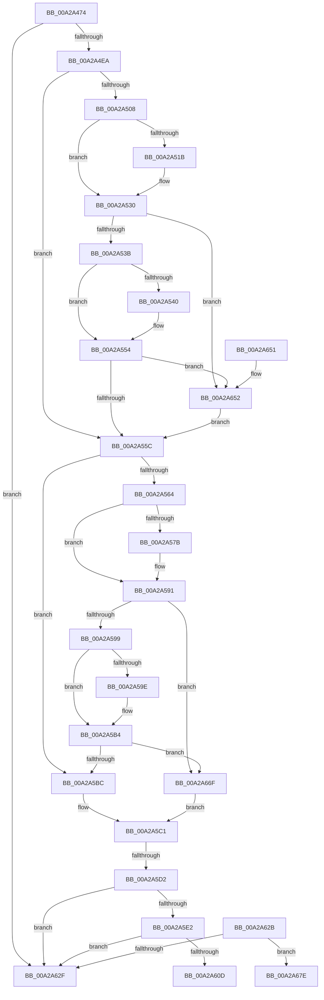

# PiQueryRemovableDeviceOverride

- RVA: `0x00A2A474`–`0x00A2A68B` (길이 `535` bytes)
- VA: `0x0000000140A2A474`
- 실행 섹션: `PAGE`
- PDB 이름 있음: `예`; PDB Function 태그: `예`
- unwind 정보 RVA: `0x000AC128`
- 디코드: `146`개 명령, `535/535` bytes 표시
- 미해석 바이트: `0` (있으면 어셈블리에 `.byte`로 보존)

> 이 문서는 커널 이미지의 기계어와 PDB 기호를 분석해 생성했습니다. 4번과 5번은 함수 원형과 자료형을 바이너리 사용 방식에서 추정한 C 해석이며 원본 소스 복구 결과는 아닙니다.

## 1. Dependencies

- 직접 호출 지점: **7**; 고유 호출 대상: **4**
- 직접 호출자로 확인된 함수: **1**
- RIP 상대 이미지 참조: **4**

### Outgoing calls
- `0x00A2A522` → [PipFindDeviceOverrideEntry](PipFindDeviceOverrideEntry_function_00A2A694.md) (function, `0x00A2A694`)
- `0x00A2A547` → [PipFindDeviceOverrideEntry](PipFindDeviceOverrideEntry_function_00A2A694.md) (function, `0x00A2A694`)
- `0x00A2A582` → [PipFindDeviceOverrideEntry](PipFindDeviceOverrideEntry_function_00A2A694.md) (function, `0x00A2A694`)
- `0x00A2A5A5` → [PipFindDeviceOverrideEntry](PipFindDeviceOverrideEntry_function_00A2A694.md) (function, `0x00A2A694`)
- `0x00A2A602` → [PnpDeviceObjectToDeviceInstance](../8F/PnpDeviceObjectToDeviceInstance_function_008FD630.md) (function, `0x008FD630`)
- `0x00A2A638` → [_security_check_cookie](../../text/6A/_security_check_cookie_function_006AC640.md) (function, `0x006AC640`)
- `0x00A2A656` → [ZwClose](../../text/6A/ZwClose_function_006AD2B0.md) (function, `0x006AD2B0`)

### Direct callers
- [PiProcessNewDeviceNode](PiProcessNewDeviceNode_function_00A28F20.md) at `0x00A29D16`

### Static image references
- `0x00A2A48D` → RVA `0x00E0A740` (`.data`; read)
- `0x00A2A4C8` → RVA `0x00E66238` (`.data`; read)
- `0x00A2A4F0` → RVA `0x00AFD320` (` ?? ::NNGAKEGL::`string'`; read)
- `0x00A2A56B` → RVA `0x00AFD240` (` ?? ::NNGAKEGL::`string'`; read)

## 2. Other-region calls and transfers

- 다른 실행 섹션으로 향하는 call: **2**
  - `0x00A2A638` → [_security_check_cookie](../../text/6A/_security_check_cookie_function_006AC640.md) (`PAGE` → `.text`)
  - `0x00A2A656` → [ZwClose](../../text/6A/ZwClose_function_006AD2B0.md) (`PAGE` → `.text`)
- call이 아닌 외부 분기/꼬리 이동: **3**
  - `0x00A2A5CC` → [sub_00B38904 + 0x138](../B3/Unknown_function_00B38904.md) (`tail-transfer`)
  - `0x00A2A626` → [sub_00B38904](../B3/Unknown_function_00B38904.md) (`tail-transfer`)
  - `0x00A2A686` → [sub_00B38904 + 0x138](../B3/Unknown_function_00B38904.md) (`tail-transfer`)

## 3. Assembly (complete function range)

```asm
00A2A474  40 55                           push rbp
00A2A476  53                              push rbx
00A2A477  56                              push rsi
00A2A478  57                              push rdi
00A2A479  41 54                           push r12
00A2A47B  41 55                           push r13
00A2A47D  41 56                           push r14
00A2A47F  41 57                           push r15
00A2A481  48 8D 6C 24 E1                  lea rbp, [rsp - 0x1f]
00A2A486  48 81 EC E8 00 00 00            sub rsp, 0xe8
00A2A48D  48 8B 05 AC 02 3E 00            mov rax, qword ptr [rip + 0x3e02ac]
00A2A494  48 33 C4                        xor rax, rsp
00A2A497  48 89 45 07                     mov qword ptr [rbp + 7], rax
00A2A49B  48 83 65 CF 00                  and qword ptr [rbp - 0x31], 0
00A2A4A0  45 33 E4                        xor r12d, r12d
00A2A4A3  83 65 C7 00                     and dword ptr [rbp - 0x39], 0
00A2A4A7  45 33 F6                        xor r14d, r14d
00A2A4AA  48 83 65 D7 00                  and qword ptr [rbp - 0x29], 0
00A2A4AF  0F 57 C0                        xorps xmm0, xmm0
00A2A4B2  83 65 C3 00                     and dword ptr [rbp - 0x3d], 0
00A2A4B6  4D 8B E9                        mov r13, r9
00A2A4B9  83 64 24 40 00                  and dword ptr [rsp + 0x40], 0
00A2A4BE  4D 8B F8                        mov r15, r8
00A2A4C1  83 65 8F 00                     and dword ptr [rbp - 0x71], 0
00A2A4C5  48 8B FA                        mov rdi, rdx
00A2A4C8  4C 39 25 69 BD 43 00            cmp qword ptr [rip + 0x43bd69], r12
00A2A4CF  48 8B F1                        mov rsi, rcx
00A2A4D2  4C 89 4D E7                     mov qword ptr [rbp - 0x19], r9
00A2A4D6  BB 34 00 00 C0                  mov ebx, 0xc0000034
00A2A4DB  44 89 65 BF                     mov dword ptr [rbp - 0x41], r12d
00A2A4DF  0F 11 44 24 48                  movups xmmword ptr [rsp + 0x48], xmm0
00A2A4E4  0F 84 45 01 00 00               je 0x140a2a62f
00A2A4EA  8A 89 A8 02 00 00               mov cl, byte ptr [rcx + 0x2a8]
00A2A4F0  4C 8D 05 29 2E 0D 00            lea r8, [rip + 0xd2e29]
00A2A4F7  8B C3                           mov eax, ebx
00A2A4F9  8A D1                           mov dl, cl
00A2A4FB  0F 11 45 9F                     movups xmmword ptr [rbp - 0x61], xmm0
00A2A4FF  0F 11 45 AF                     movups xmmword ptr [rbp - 0x51], xmm0
00A2A503  F6 C1 01                        test cl, 1
00A2A506  75 54                           jne 0x140a2a55c
00A2A508  4C 89 45 A7                     mov qword ptr [rbp - 0x59], r8
00A2A50C  44 8A C1                        mov r8b, cl
00A2A50F  C7 45 9F 24 00 26 00            mov dword ptr [rbp - 0x61], 0x260024
00A2A516  48 85 FF                        test rdi, rdi
00A2A519  74 15                           je 0x140a2a530
00A2A51B  4C 8D 45 9F                     lea r8, [rbp - 0x61]
00A2A51F  48 8B CF                        mov rcx, rdi
00A2A522  E8 6D 01 00 00                  call 0x140a2a694
00A2A527  8A 96 A8 02 00 00               mov dl, byte ptr [rsi + 0x2a8]
00A2A52D  44 8A C2                        mov r8b, dl
00A2A530  41 8A C8                        mov cl, r8b
00A2A533  85 C0                           test eax, eax
00A2A535  0F 89 17 01 00 00               jns 0x140a2a652
00A2A53B  4D 85 FF                        test r15, r15
00A2A53E  74 14                           je 0x140a2a554
00A2A540  4C 8D 45 9F                     lea r8, [rbp - 0x61]
00A2A544  49 8B CF                        mov rcx, r15
00A2A547  E8 48 01 00 00                  call 0x140a2a694
00A2A54C  8A 8E A8 02 00 00               mov cl, byte ptr [rsi + 0x2a8]
00A2A552  8A D1                           mov dl, cl
00A2A554  85 C0                           test eax, eax
00A2A556  0F 89 F6 00 00 00               jns 0x140a2a652
00A2A55C  8A C1                           mov al, cl
00A2A55E  24 03                           and al, 3
00A2A560  3C 01                           cmp al, 1
00A2A562  74 58                           je 0x140a2a5bc
00A2A564  C7 45 9F 1A 00 1C 00            mov dword ptr [rbp - 0x61], 0x1c001a
00A2A56B  48 8D 05 CE 2C 0D 00            lea rax, [rip + 0xd2cce]
00A2A572  48 89 45 A7                     mov qword ptr [rbp - 0x59], rax
00A2A576  48 85 FF                        test rdi, rdi
00A2A579  74 16                           je 0x140a2a591
00A2A57B  4C 8D 45 9F                     lea r8, [rbp - 0x61]
00A2A57F  48 8B CF                        mov rcx, rdi
00A2A582  E8 0D 01 00 00                  call 0x140a2a694
00A2A587  8A 8E A8 02 00 00               mov cl, byte ptr [rsi + 0x2a8]
00A2A58D  8B D8                           mov ebx, eax
00A2A58F  8A D1                           mov dl, cl
00A2A591  85 DB                           test ebx, ebx
00A2A593  0F 89 D6 00 00 00               jns 0x140a2a66f
00A2A599  4D 85 FF                        test r15, r15
00A2A59C  74 16                           je 0x140a2a5b4
00A2A59E  4C 8D 45 9F                     lea r8, [rbp - 0x61]
00A2A5A2  49 8B CF                        mov rcx, r15
00A2A5A5  E8 EA 00 00 00                  call 0x140a2a694
00A2A5AA  8A 8E A8 02 00 00               mov cl, byte ptr [rsi + 0x2a8]
00A2A5B0  8B D8                           mov ebx, eax
00A2A5B2  8A D1                           mov dl, cl
00A2A5B4  85 DB                           test ebx, ebx
00A2A5B6  0F 89 B3 00 00 00               jns 0x140a2a66f
00A2A5BC  BF 02 00 00 00                  mov edi, 2
00A2A5C1  80 C9 01                        or cl, 1
00A2A5C4  88 8E A8 02 00 00               mov byte ptr [rsi + 0x2a8], cl
00A2A5CA  85 DB                           test ebx, ebx
00A2A5CC  0F 89 6A E4 10 00               jns 0x140b38a3c
00A2A5D2  48 8B 4E 10                     mov rcx, qword ptr [rsi + 0x10]
00A2A5D6  8A 81 A8 02 00 00               mov al, byte ptr [rcx + 0x2a8]
00A2A5DC  24 05                           and al, 5
00A2A5DE  3C 01                           cmp al, 1
00A2A5E0  74 4D                           je 0x140a2a62f
00A2A5E2  48 8D 05 37 2D 0D 00            lea rax, [rip + 0xd2d37]
00A2A5E9  C7 45 9F 24 00 26 00            mov dword ptr [rbp - 0x61], 0x260024
00A2A5F0  48 89 45 A7                     mov qword ptr [rbp - 0x59], rax
00A2A5F4  48 8D 55 CF                     lea rdx, [rbp - 0x31]
00A2A5F8  48 8B 49 20                     mov rcx, qword ptr [rcx + 0x20]
00A2A5FC  41 B8 19 00 02 00               mov r8d, 0x20019
00A2A602  E8 29 30 ED FF                  call 0x1408fd630
00A2A607  8B D8                           mov ebx, eax
00A2A609  85 C0                           test eax, eax
00A2A60B  78 22                           js 0x140a2a62f
00A2A60D  89 7D DF                        mov dword ptr [rbp - 0x21], edi
00A2A610  4C 8D 6D DF                     lea r13, [rbp - 0x21]
00A2A614  BF 00 01 00 00                  mov edi, 0x100
00A2A619  C7 45 E3 03 00 00 00            mov dword ptr [rbp - 0x1d], 3
00A2A620  89 7C 24 40                     mov dword ptr [rsp + 0x40], edi
00A2A624  8B C7                           mov eax, edi
00A2A626  E9 D9 E2 10 00                  jmp 0x140b38904
00A2A62B  85 DB                           test ebx, ebx
00A2A62D  79 4F                           jns 0x140a2a67e
00A2A62F  8B C3                           mov eax, ebx
00A2A631  48 8B 4D 07                     mov rcx, qword ptr [rbp + 7]
00A2A635  48 33 CC                        xor rcx, rsp
00A2A638  E8 03 20 C8 FF                  call 0x1406ac640
00A2A63D  48 81 C4 E8 00 00 00            add rsp, 0xe8
00A2A644  41 5F                           pop r15
00A2A646  41 5E                           pop r14
00A2A648  41 5D                           pop r13
00A2A64A  41 5C                           pop r12
00A2A64C  5F                              pop rdi
00A2A64D  5E                              pop rsi
00A2A64E  5B                              pop rbx
00A2A64F  5D                              pop rbp
00A2A650  C3                              ret
00A2A651  CC                              int3
00A2A652  48 8B 4D AF                     mov rcx, qword ptr [rbp - 0x51]
00A2A656  E8 55 2C C8 FF                  call 0x1406ad2b0
00A2A65B  80 8E A8 02 00 00 04            or byte ptr [rsi + 0x2a8], 4
00A2A662  8A 8E A8 02 00 00               mov cl, byte ptr [rsi + 0x2a8]
00A2A668  8A D1                           mov dl, cl
00A2A66A  E9 ED FE FF FF                  jmp 0x140a2a55c
00A2A66F  8A CA                           mov cl, dl
00A2A671  BF 02 00 00 00                  mov edi, 2
00A2A676  40 0A CF                        or cl, dil
00A2A679  E9 43 FF FF FF                  jmp 0x140a2a5c1
00A2A67E  44 8B 65 BF                     mov r12d, dword ptr [rbp - 0x41]
00A2A682  4C 8B 6D E7                     mov r13, qword ptr [rbp - 0x19]
00A2A686  E9 B1 E3 10 00                  jmp 0x140b38a3c
```

## 4. C-style interpretation (structured pseudocode)

```c
__int64 __fastcall PiQueryRemovableDeviceOverride(__int64 a1, __int64 a2, __int64 a3, __int64 a4)
{
    __int64 result;
    __int64 v_r12;
    __int64 v_r14;
    __int64 v_rbx;
    __int64 v_rsp;
    unsigned __int64 v_stack_m58;
    unsigned __int64 v_stack_m5F;
    unsigned __int64 v_stack_m78;
    unsigned int v_stack_m7C;
    unsigned int v_stack_m80;
    unsigned __int64 v_stack_m88;
    unsigned __int64 v_stack_m90;
    unsigned int v_stack_m98;
    unsigned int v_stack_m9C;
    unsigned int v_stack_mA0;
    unsigned __int64 v_stack_mB0;
    unsigned __int64 v_stack_mB8;
    unsigned __int64 v_stack_mC0;
    unsigned int v_stack_mD0;
    unsigned __int64 v_stack_mE0;
    unsigned int v_stack_mE8;

    v_rsp = (v_rsp) - (232);
    result = (*(unsigned __int64 *)(v_rip + 4063916)) ^ (v_rsp);
    v_stack_m58 = result;
    v_r12 = 0;
    v_r14 = 0;
    v_stack_m78 = a4;
    v_stack_mA0 = 0;
    v_stack_mE0 = v_xmm0;
    if ((*(unsigned __int64 *)(v_rip + 4439401)) == 0) goto loc_00A2A62F;
    v_stack_mC0 = v_xmm0;
    v_stack_mB0 = v_xmm0;
    if ((((unsigned __int8)(*(unsigned __int8 *)(a1 + 680))) & (1)) != 0) goto loc_00A2A55C;
    v_stack_mB8 = v_rip + 863785;
    v_stack_mC0 = 0x260024ULL;
    result = (unsigned int)((unsigned int)((unsigned int)(0xC0000034ULL)));
    if (a2 != 0) {
        a3 = v_stack_mC0;
        a1 = a2;
        result = PipFindDeviceOverrideEntry(a1, (unsigned __int8)(*(unsigned __int8 *)(a1 + 680)), a3, a4);
        a2 = *(unsigned __int8 *)(a1 + 680);
        a3 = (unsigned __int8)(a2);
    }
    if (!sign_flag) goto loc_00A2A652;
    if (a3 != 0) {
        a3 = v_stack_mC0;
        a1 = a3;
        result = PipFindDeviceOverrideEntry(a1, a2, a3, a4);
        a1 = *(unsigned __int8 *)(a1 + 680);
        a2 = (unsigned __int8)(a1);
    }
    if (!sign_flag) goto loc_00A2A652;
loc_00A2A55C:
    result = (unsigned __int8)(((unsigned __int8)(a1)) & (3));
    if (((unsigned __int8)(result)) == 1) goto loc_00A2A5BC;
    v_stack_mC0 = 0x1C001AULL;
    v_stack_mB8 = v_rip + 863438;
    result = v_rip + 863438;
    v_rbx = (unsigned int)(0xC0000034ULL);
    if (a2 != 0) {
        a3 = v_stack_mC0;
        a1 = a2;
        result = PipFindDeviceOverrideEntry(a1, a2, a3, a4);
        a1 = *(unsigned __int8 *)(a1 + 680);
        v_rbx = (unsigned int)(result);
        a2 = (unsigned __int8)(a1);
    }
    if (!sign_flag) goto loc_00A2A66F;
    if (a3 != 0) {
        a3 = v_stack_mC0;
        a1 = a3;
        result = PipFindDeviceOverrideEntry(a1, a2, a3, a4);
        a1 = *(unsigned __int8 *)(a1 + 680);
        v_rbx = (unsigned int)(result);
        a2 = (unsigned __int8)(a1);
    }
    if (!sign_flag) goto loc_00A2A66F;
loc_00A2A5BC:
loc_00A2A5C1:
    a1 = (unsigned __int8)((a1) | (1));
    *(unsigned __int8 *)(a1 + 680) = (unsigned __int8)(a1);
    result = (unsigned __int8)((*(unsigned __int8 *)(*(unsigned __int64 *)(a1 + 16) + 680)) & (5));
    if (((unsigned __int8)(result)) == 1) goto loc_00A2A62F;
    v_stack_mC0 = 0x260024ULL;
    v_stack_mB8 = v_rip + 863543;
    result = PnpDeviceObjectToDeviceInstance(*(unsigned __int64 *)(*(unsigned __int64 *)(a1 + 16) + 32), v_stack_m90, (unsigned int)(0x20019ULL), a4);
    if (sign_flag) goto loc_00A2A62F;
    v_stack_m80 = 2;
    v_stack_m7C = 3;
    v_stack_mE8 = 256;
loc_00A2A62F:
    a1 = (v_stack_m58) ^ (v_rsp);
    result = _security_check_cookie(a1, v_stack_m90, (unsigned int)(0x20019ULL), a4);
    v_rsp = (v_rsp) + (232);
    return result;
loc_00A2A652:
    result = ZwClose(v_stack_mB0, v_stack_m90, (unsigned int)(0x20019ULL), a4);
    goto loc_00A2A55C;
loc_00A2A66F:
    a1 = (unsigned __int8)(((unsigned __int8)((unsigned __int8)(*(unsigned __int8 *)(a1 + 680)))) | (2));
    goto loc_00A2A5C1;
}
```

## 5. (Beta) C Style

```c
int64_t PiQueryRemovableDeviceOverride(void *Arg1, int64_t Arg2, int64_t Arg3, int64_t Arg4)
{
    uint8_t *arg1 = (uint8_t *)Arg1;

    int64_t result;
    int64_t local_r12;
    int64_t local_r14;
    int64_t local_rbx;
    int64_t local_rsp;
    uint64_t v_stack_m58;
    uint64_t v_stack_m5F;
    uint64_t v_stack_m78;
    uint32_t v_stack_m7C;
    uint32_t v_stack_m80;
    uint64_t v_stack_m88;
    uint64_t v_stack_m90;
    uint32_t v_stack_m98;
    uint32_t v_stack_m9C;
    uint32_t v_stack_mA0;
    uint64_t v_stack_mB0;
    uint64_t v_stack_mB8;
    uint64_t v_stack_mC0;
    uint32_t v_stack_mD0;
    uint64_t v_stack_mE0;
    uint32_t v_stack_mE8;

    local_rsp = (local_rsp) - (232);
    result = (*(uint64_t *)(v_rip + 0x3E02AC)) ^ (local_rsp);
    v_stack_m58 = result;
    local_r12 = 0;
    local_r14 = 0;
    v_stack_m78 = Arg4;
    v_stack_mA0 = 0;
    v_stack_mE0 = v_xmm0;
    if ((*(uint64_t *)(v_rip + 0x43BD69)) == 0) goto loc_00A2A62F;
    v_stack_mC0 = v_xmm0;
    v_stack_mB0 = v_xmm0;
    if ((((uint8_t)(*(uint8_t *)(arg1 + 0x2A8))) & (1)) != 0) goto loc_00A2A55C;
    v_stack_mB8 = v_rip + 863785;
    v_stack_mC0 = 0x260024ULL;
    result = (uint32_t)((uint32_t)((uint32_t)(0xC0000034ULL)));
    if (Arg2 != 0) {
        Arg3 = v_stack_mC0;
        Arg1 = Arg2;
        result = PipFindDeviceOverrideEntry(Arg1, (uint8_t)(*(uint8_t *)(arg1 + 0x2A8)), Arg3, Arg4);
        Arg2 = *(uint8_t *)(arg1 + 0x2A8);
        Arg3 = (uint8_t)(Arg2);
    }
    if (!sign_flag) goto loc_00A2A652;
    if (Arg3 != 0) {
        Arg3 = v_stack_mC0;
        Arg1 = Arg3;
        result = PipFindDeviceOverrideEntry(Arg1, Arg2, Arg3, Arg4);
        Arg1 = *(uint8_t *)(arg1 + 0x2A8);
        Arg2 = (uint8_t)(Arg1);
    }
    if (!sign_flag) goto loc_00A2A652;
loc_00A2A55C:
    result = (uint8_t)(((uint8_t)(Arg1)) & (3));
    if (((uint8_t)(result)) == 1) goto loc_00A2A5BC;
    v_stack_mC0 = 0x1C001AULL;
    v_stack_mB8 = v_rip + 863438;
    result = v_rip + 863438;
    local_rbx = (uint32_t)(0xC0000034ULL);
    if (Arg2 != 0) {
        Arg3 = v_stack_mC0;
        Arg1 = Arg2;
        result = PipFindDeviceOverrideEntry(Arg1, Arg2, Arg3, Arg4);
        Arg1 = *(uint8_t *)(arg1 + 0x2A8);
        local_rbx = (uint32_t)(result);
        Arg2 = (uint8_t)(Arg1);
    }
    if (!sign_flag) goto loc_00A2A66F;
    if (Arg3 != 0) {
        Arg3 = v_stack_mC0;
        Arg1 = Arg3;
        result = PipFindDeviceOverrideEntry(Arg1, Arg2, Arg3, Arg4);
        Arg1 = *(uint8_t *)(arg1 + 0x2A8);
        local_rbx = (uint32_t)(result);
        Arg2 = (uint8_t)(Arg1);
    }
    if (!sign_flag) goto loc_00A2A66F;
loc_00A2A5BC:
loc_00A2A5C1:
    Arg1 = (uint8_t)((Arg1) | (1));
    *(uint8_t *)(arg1 + 0x2A8) = (uint8_t)(Arg1);
    result = (uint8_t)((*(uint8_t *)(*(uint64_t *)(arg1 + 0x10) + 0x2A8)) & (5));
    if (((uint8_t)(result)) == 1) goto loc_00A2A62F;
    v_stack_mC0 = 0x260024ULL;
    v_stack_mB8 = v_rip + 863543;
    result = PnpDeviceObjectToDeviceInstance(*(uint64_t *)(*(uint64_t *)(arg1 + 0x10) + 0x20), v_stack_m90, (uint32_t)(0x20019ULL), Arg4);
    if (sign_flag) goto loc_00A2A62F;
    v_stack_m80 = 2;
    v_stack_m7C = 3;
    v_stack_mE8 = 256;
loc_00A2A62F:
    Arg1 = (v_stack_m58) ^ (local_rsp);
    result = _security_check_cookie(Arg1, v_stack_m90, (uint32_t)(0x20019ULL), Arg4);
    local_rsp = (local_rsp) + (232);
    return result;
loc_00A2A652:
    result = ZwClose(v_stack_mB0, v_stack_m90, (uint32_t)(0x20019ULL), Arg4);
    goto loc_00A2A55C;
loc_00A2A66F:
    Arg1 = (uint8_t)(((uint8_t)((uint8_t)(*(uint8_t *)(arg1 + 0x2A8)))) | (2));
    goto loc_00A2A5C1;
}
```

### 관측된 메모리 오프셋

구조체 형식이 확인되지 않은 접근은 인자 기준의 오프셋으로만 기록했습니다.

| 기준 인자 | 오프셋 표현 | 폭 (bit) | 접근 |
|---|---:|---:|---|
| `Arg1` | `+ 0x10` | `64` | `R` |
| `Arg1` | `+ 0x2A8` | `8` | `R` |
| `Arg1` | `+ 0x2A8` | `8` | `R/W` |
| `Arg1` | `+ 0x2A8` | `8` | `W` |

## 6. Execution-region graph

[열기: 2D/3D 그래프와 함수 탐색 컨트롤 패널](../../../control-panel.html?section=page&rva=0x00A2A474&view=graph)

- 2D 그래프는 위에서 아래로 흐르고, 3D 그래프는 빈 공간을 드래그해 회전합니다. Shift+드래그는 이동, 휠은 확대·축소, 함수 노드 선택은 대상 보고서 이동입니다.

### Static fallback


