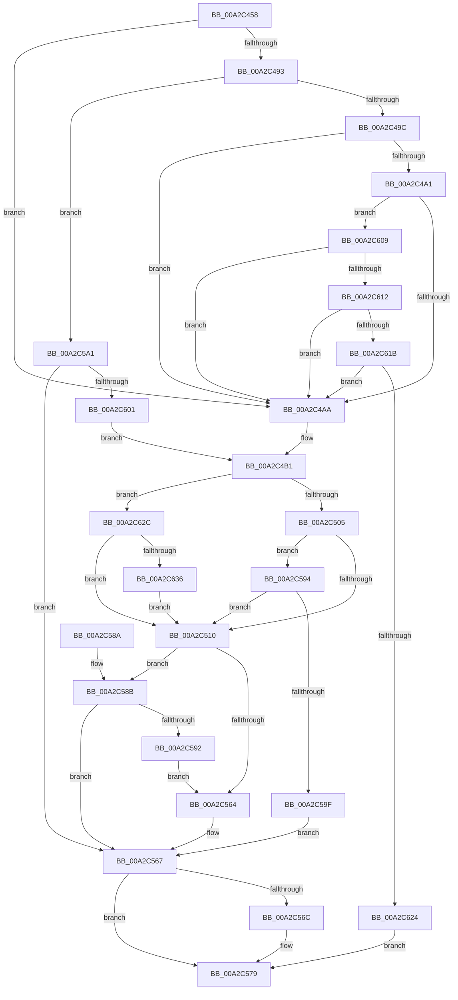

# PiUEventCacheObjectProperties

- RVA: `0x00A2C458`–`0x00A2C64B` (길이 `499` bytes)
- VA: `0x0000000140A2C458`
- 실행 섹션: `PAGE`
- PDB 이름 있음: `예`; PDB Function 태그: `아니요`
- unwind 정보 RVA: `0x000AC440`
- 디코드: `126`개 명령, `499/499` bytes 표시
- 미해석 바이트: `0` (있으면 어셈블리에 `.byte`로 보존)

> 이 문서는 커널 이미지의 기계어와 PDB 기호를 분석해 생성했습니다. 4번과 5번은 함수 원형과 자료형을 바이너리 사용 방식에서 추정한 C 해석이며 원본 소스 복구 결과는 아닙니다.

## 1. Dependencies

- 직접 호출 지점: **5**; 고유 호출 대상: **3**
- 직접 호출자로 확인된 함수: **1**
- RIP 상대 이미지 참조: **4**

### Outgoing calls
- `0x00A2C4F6` → [PnpGetObjectProperty](../8E/PnpGetObjectProperty_function_008E1110.md) (function, `0x008E1110`)
- `0x00A2C556` → [PnpGetObjectProperty](../8E/PnpGetObjectProperty_function_008E2180.md) (function, `0x008E2180`)
- `0x00A2C574` → [ExFreePoolWithTag](../../poolcode/B8/ExFreePoolWithTag_function_00B82870.md) (function, `0x00B82870`)
- `0x00A2C5EE` → [PnpGetObjectProperty](../8E/PnpGetObjectProperty_function_008E1110.md) (function, `0x008E1110`)
- `0x00A2C63E` → [ExFreePoolWithTag](../../poolcode/B8/ExFreePoolWithTag_function_00B82870.md) (function, `0x00B82870`)

### Direct callers
- [PiUEventNotifyUserMode](../95/PiUEventNotifyUserMode_function_00954CB4.md) at `0x00954F5C`

### Static image references
- `0x00A2C4D6` → RVA `0x00011478` (`.rdata`; read)
- `0x00A2C510` → RVA `0x00E66398` (`.data`; read)
- `0x00A2C545` → RVA `0x00011460` (`.rdata`; read)
- `0x00A2C5D8` → RVA `0x00011490` (`.rdata`; read)

## 2. Other-region calls and transfers

- 다른 실행 섹션으로 향하는 call: **2**
  - `0x00A2C574` → [ExFreePoolWithTag](../../poolcode/B8/ExFreePoolWithTag_function_00B82870.md) (`PAGE` → `POOLCODE`)
  - `0x00A2C63E` → [ExFreePoolWithTag](../../poolcode/B8/ExFreePoolWithTag_function_00B82870.md) (`PAGE` → `POOLCODE`)
- 별도 외부 분기/꼬리 이동을 확인하지 못했습니다.

## 3. Assembly (complete function range)

```asm
00A2C458  40 55                           push rbp
00A2C45A  53                              push rbx
00A2C45B  56                              push rsi
00A2C45C  57                              push rdi
00A2C45D  41 54                           push r12
00A2C45F  41 56                           push r14
00A2C461  41 57                           push r15
00A2C463  48 8B EC                        mov rbp, rsp
00A2C466  48 83 EC 60                     sub rsp, 0x60
00A2C46A  8B 51 60                        mov edx, dword ptr [rcx + 0x60]
00A2C46D  4C 8D 79 3C                     lea r15, [rcx + 0x3c]
00A2C471  41 83 0F FF                     or dword ptr [r15], 0xffffffff
00A2C475  4C 8D 71 30                     lea r14, [rcx + 0x30]
00A2C479  45 33 E4                        xor r12d, r12d
00A2C47C  44 89 65 40                     mov dword ptr [rbp + 0x40], r12d
00A2C480  41 8B F4                        mov esi, r12d
00A2C483  44 89 65 48                     mov dword ptr [rbp + 0x48], r12d
00A2C487  4C 89 65 50                     mov qword ptr [rbp + 0x50], r12
00A2C48B  4D 89 26                        mov qword ptr [r14], r12
00A2C48E  83 EA 01                        sub edx, 1
00A2C491  74 17                           je 0x140a2c4aa
00A2C493  83 EA 01                        sub edx, 1
00A2C496  0F 84 05 01 00 00               je 0x140a2c5a1
00A2C49C  83 EA 01                        sub edx, 1
00A2C49F  74 09                           je 0x140a2c4aa
00A2C4A1  83 EA 01                        sub edx, 1
00A2C4A4  0F 85 5F 01 00 00               jne 0x140a2c609
00A2C4AA  48 8D B9 80 00 00 00            lea rdi, [rcx + 0x80]
00A2C4B1  44 89 64 24 50                  mov dword ptr [rsp + 0x50], r12d
00A2C4B6  48 8D 45 48                     lea rax, [rbp + 0x48]
00A2C4BA  48 89 44 24 48                  mov qword ptr [rsp + 0x48], rax
00A2C4BF  41 B9 01 00 00 00               mov r9d, 1
00A2C4C5  4C 89 74 24 40                  mov qword ptr [rsp + 0x40], r14
00A2C4CA  48 8D 45 40                     lea rax, [rbp + 0x40]
00A2C4CE  48 89 44 24 38                  mov qword ptr [rsp + 0x38], rax
00A2C4D3  4C 8B C7                        mov r8, rdi
00A2C4D6  48 8D 05 9B 4F 5E FF            lea rax, [rip - 0xa1b065]
00A2C4DD  BA 00 02 00 00                  mov edx, 0x200
00A2C4E2  48 89 44 24 30                  mov qword ptr [rsp + 0x30], rax
00A2C4E7  B9 50 6E 70 59                  mov ecx, 0x59706e50
00A2C4EC  4C 89 64 24 28                  mov qword ptr [rsp + 0x28], r12
00A2C4F1  4C 89 64 24 20                  mov qword ptr [rsp + 0x20], r12
00A2C4F6  E8 15 4C EB FF                  call 0x1408e1110
00A2C4FB  8B D8                           mov ebx, eax
00A2C4FD  85 C0                           test eax, eax
00A2C4FF  0F 89 27 01 00 00               jns 0x140a2c62c
00A2C505  3D 25 02 00 C0                  cmp eax, 0xc0000225
00A2C50A  0F 85 84 00 00 00               jne 0x140a2c594
00A2C510  48 8B 0D 81 9E 43 00            mov rcx, qword ptr [rip + 0x439e81]
00A2C517  48 8D 45 48                     lea rax, [rbp + 0x48]
00A2C51B  44 89 64 24 50                  mov dword ptr [rsp + 0x50], r12d
00A2C520  45 33 C9                        xor r9d, r9d
00A2C523  48 89 44 24 48                  mov qword ptr [rsp + 0x48], rax
00A2C528  48 8B D7                        mov rdx, rdi
00A2C52B  C7 44 24 40 04 00 00 00         mov dword ptr [rsp + 0x40], 4
00A2C533  48 8D 45 40                     lea rax, [rbp + 0x40]
00A2C537  4C 89 7C 24 38                  mov qword ptr [rsp + 0x38], r15
00A2C53C  48 89 44 24 30                  mov qword ptr [rsp + 0x30], rax
00A2C541  45 8D 41 01                     lea r8d, [r9 + 1]
00A2C545  48 8D 05 14 4F 5E FF            lea rax, [rip - 0xa1b0ec]
00A2C54C  48 89 44 24 28                  mov qword ptr [rsp + 0x28], rax
00A2C551  4C 89 64 24 20                  mov qword ptr [rsp + 0x20], r12
00A2C556  E8 25 5C EB FF                  call 0x1408e2180
00A2C55B  8B D8                           mov ebx, eax
00A2C55D  3D 25 02 00 C0                  cmp eax, 0xc0000225
00A2C562  75 27                           jne 0x140a2c58b
00A2C564  41 8B DC                        mov ebx, r12d
00A2C567  48 85 F6                        test rsi, rsi
00A2C56A  74 0D                           je 0x140a2c579
00A2C56C  BA 50 6E 70 59                  mov edx, 0x59706e50
00A2C571  48 8B CE                        mov rcx, rsi
00A2C574  E8 F7 62 15 00                  call 0x140b82870
00A2C579  8B C3                           mov eax, ebx
00A2C57B  48 83 C4 60                     add rsp, 0x60
00A2C57F  41 5F                           pop r15
00A2C581  41 5E                           pop r14
00A2C583  41 5C                           pop r12
00A2C585  5F                              pop rdi
00A2C586  5E                              pop rsi
00A2C587  5B                              pop rbx
00A2C588  5D                              pop rbp
00A2C589  C3                              ret
00A2C58A  CC                              int3
00A2C58B  3D 34 00 00 C0                  cmp eax, 0xc0000034
00A2C590  75 D5                           jne 0x140a2c567
00A2C592  EB D0                           jmp 0x140a2c564
00A2C594  3D 34 00 00 C0                  cmp eax, 0xc0000034
00A2C599  0F 84 71 FF FF FF               je 0x140a2c510
00A2C59F  EB C6                           jmp 0x140a2c567
00A2C5A1  44 89 64 24 50                  mov dword ptr [rsp + 0x50], r12d
00A2C5A6  48 8D 45 48                     lea rax, [rbp + 0x48]
00A2C5AA  48 89 44 24 48                  mov qword ptr [rsp + 0x48], rax
00A2C5AF  4C 8D 81 90 00 00 00            lea r8, [rcx + 0x90]
00A2C5B6  48 8D 45 50                     lea rax, [rbp + 0x50]
00A2C5BA  BA C8 00 00 00                  mov edx, 0xc8
00A2C5BF  48 89 44 24 40                  mov qword ptr [rsp + 0x40], rax
00A2C5C4  B9 50 6E 70 59                  mov ecx, 0x59706e50
00A2C5C9  48 8D 45 40                     lea rax, [rbp + 0x40]
00A2C5CD  41 B9 03 00 00 00               mov r9d, 3
00A2C5D3  48 89 44 24 38                  mov qword ptr [rsp + 0x38], rax
00A2C5D8  48 8D 05 B1 4E 5E FF            lea rax, [rip - 0xa1b14f]
00A2C5DF  48 89 44 24 30                  mov qword ptr [rsp + 0x30], rax
00A2C5E4  4C 89 64 24 28                  mov qword ptr [rsp + 0x28], r12
00A2C5E9  4C 89 64 24 20                  mov qword ptr [rsp + 0x20], r12
00A2C5EE  E8 1D 4B EB FF                  call 0x1408e1110
00A2C5F3  48 8B 75 50                     mov rsi, qword ptr [rbp + 0x50]
00A2C5F7  8B D8                           mov ebx, eax
00A2C5F9  85 C0                           test eax, eax
00A2C5FB  0F 88 66 FF FF FF               js 0x140a2c567
00A2C601  48 8B FE                        mov rdi, rsi
00A2C604  E9 A8 FE FF FF                  jmp 0x140a2c4b1
00A2C609  83 EA 05                        sub edx, 5
00A2C60C  0F 84 98 FE FF FF               je 0x140a2c4aa
00A2C612  83 EA 01                        sub edx, 1
00A2C615  0F 84 8F FE FF FF               je 0x140a2c4aa
00A2C61B  83 FA 01                        cmp edx, 1
00A2C61E  0F 84 86 FE FF FF               je 0x140a2c4aa
00A2C624  41 8B DC                        mov ebx, r12d
00A2C627  E9 4D FF FF FF                  jmp 0x140a2c579
00A2C62C  83 7D 40 13                     cmp dword ptr [rbp + 0x40], 0x13
00A2C630  0F 84 DA FE FF FF               je 0x140a2c510
00A2C636  49 8B 0E                        mov rcx, qword ptr [r14]
00A2C639  BA 50 6E 70 59                  mov edx, 0x59706e50
00A2C63E  E8 2D 62 15 00                  call 0x140b82870
00A2C643  4D 89 26                        mov qword ptr [r14], r12
00A2C646  E9 C5 FE FF FF                  jmp 0x140a2c510
```

## 4. C-style interpretation (structured pseudocode)

```c
__int64 __fastcall PiUEventCacheObjectProperties(__int64 a1)
{
    __int64 result;
    __int64 v_r12;
    __int64 v_rsp;
    unsigned int v_stack_m48;
    unsigned __int64 v_stack_m50;
    unsigned __int64 v_stack_m58;
    unsigned __int64 v_stack_m60;
    unsigned __int64 v_stack_m68;
    unsigned __int64 v_stack_m70;
    unsigned __int64 v_stack_m78;
    unsigned int v_stack_p10;
    unsigned __int64 v_stack_p18;
    unsigned __int64 v_stack_p20;
    unsigned __int64 v_stack_p28;
    unsigned __int64 v_stack_p30;
    unsigned __int64 v_stack_p38;
    unsigned __int64 v_stack_p40;
    unsigned __int64 v_stack_p48;
    unsigned int v_stack_p50;
    unsigned int v_stack_p8;

    v_rsp = (v_rsp) - (96);
    v_r12 = 0;
    v_stack_p8 = 0;
    v_stack_p10 = 0;
    v_stack_p18 = 0;
    *(unsigned __int64 *)(a1 + 48) = 0;
    a2 = (unsigned int)(((unsigned int)(*(unsigned int *)(a1 + 96))) - (1));
    if (condition_is_equal) goto loc_00A2C4AA;
    a2 = (unsigned int)((a2) - (1));
    if (condition_is_equal) goto loc_00A2C5A1;
    a2 = (unsigned int)((a2) - (1));
    if (condition_is_equal) goto loc_00A2C4AA;
    a2 = (unsigned int)((a2) - (1));
    if (condition_is_not_equal) goto loc_00A2C609;
loc_00A2C4AA:
loc_00A2C4B1:
    v_stack_m48 = 0;
    v_stack_m50 = v_stack_p10;
    v_stack_m58 = a1 + 48;
    v_stack_m60 = v_stack_p8;
    v_stack_m68 = v_rip - 10596453;
    v_stack_m70 = 0;
    v_stack_m78 = 0;
    result = PnpGetObjectProperty((unsigned int)(0x59706E50ULL), 512, a1 + 128, 1);
    if (!sign_flag) goto loc_00A2C62C;
    if (((unsigned int)(result)) != 0xC0000225ULL) goto loc_00A2C594;
loc_00A2C510:
    v_stack_m48 = 0;
    a4 = 0;
    v_stack_m50 = v_stack_p10;
    v_stack_m58 = 4;
    v_stack_m60 = a1 + 60;
    v_stack_m68 = v_stack_p8;
    v_stack_m70 = v_rip - 10596588;
    v_stack_m78 = 0;
    result = PnpGetObjectProperty(*(unsigned __int64 *)(v_rip + 4431489), a1 + 128, a4 + 1, a4);
    if (((unsigned int)(result)) != 0xC0000225ULL) goto loc_00A2C58B;
loc_00A2C564:
loc_00A2C567:
    if (0 != 0) {
        a2 = 0x59706E50ULL;
        a1 = 0;
        result = ExFreePoolWithTag(a1, a2, a4 + 1, a4);
    }
    v_rsp = (v_rsp) + (96);
    return 0;
loc_00A2C58B:
    if (0 != 0xC0000034ULL) goto loc_00A2C567;
    goto loc_00A2C564;
loc_00A2C594:
    if (0 == 0xC0000034ULL) goto loc_00A2C510;
    goto loc_00A2C567;
loc_00A2C5A1:
    v_stack_p50 = 0;
    v_stack_p48 = v_stack_p10;
    v_stack_p40 = v_stack_p18;
    v_stack_p38 = v_stack_p8;
    v_stack_p30 = v_rip - 10596687;
    v_stack_p28 = 0;
    v_stack_p20 = 0;
    result = PnpGetObjectProperty((unsigned int)(0x59706E50ULL), 200, a1 + 144, 3);
    if (sign_flag) goto loc_00A2C567;
    goto loc_00A2C4B1;
loc_00A2C609:
    a2 = (unsigned int)((200) - (5));
    if (condition_is_equal) goto loc_00A2C4AA;
    a2 = (unsigned int)((a2) - (1));
    if (condition_is_equal) goto loc_00A2C4AA;
    if (((unsigned int)(a2)) == 1) goto loc_00A2C4AA;
    goto loc_00A2C579;
loc_00A2C62C:
    if (v_stack_p8 == 19) goto loc_00A2C510;
    result = ExFreePoolWithTag(*(unsigned __int64 *)(a1 + 48), (unsigned int)(0x59706E50ULL), a1 + 144, 3);
    *(unsigned __int64 *)(a1 + 48) = 0;
    goto loc_00A2C510;
}
```

## 5. (Beta) C Style

```c
int64_t PiUEventCacheObjectProperties(void *Arg1)
{
    uint8_t *arg1 = (uint8_t *)Arg1;

    int64_t result;
    int64_t local_r12;
    int64_t local_rsp;
    uint32_t v_stack_m48;
    uint64_t v_stack_m50;
    uint64_t v_stack_m58;
    uint64_t v_stack_m60;
    uint64_t v_stack_m68;
    uint64_t v_stack_m70;
    uint64_t v_stack_m78;
    uint32_t v_stack_p10;
    uint64_t v_stack_p18;
    uint64_t v_stack_p20;
    uint64_t v_stack_p28;
    uint64_t v_stack_p30;
    uint64_t v_stack_p38;
    uint64_t v_stack_p40;
    uint64_t v_stack_p48;
    uint32_t v_stack_p50;
    uint32_t v_stack_p8;

    local_rsp = (local_rsp) - (96);
    local_r12 = 0;
    v_stack_p8 = 0;
    v_stack_p10 = 0;
    v_stack_p18 = 0;
    *(uint64_t *)(arg1 + 0x30) = 0;
    a2 = (uint32_t)(((uint32_t)(*(uint32_t *)(arg1 + 0x60))) - (1));
    if (condition_is_equal) goto loc_00A2C4AA;
    a2 = (uint32_t)((a2) - (1));
    if (condition_is_equal) goto loc_00A2C5A1;
    a2 = (uint32_t)((a2) - (1));
    if (condition_is_equal) goto loc_00A2C4AA;
    a2 = (uint32_t)((a2) - (1));
    if (condition_is_not_equal) goto loc_00A2C609;
loc_00A2C4AA:
loc_00A2C4B1:
    v_stack_m48 = 0;
    v_stack_m50 = v_stack_p10;
    v_stack_m58 = Arg1 + 48;
    v_stack_m60 = v_stack_p8;
    v_stack_m68 = v_rip - 10596453;
    v_stack_m70 = 0;
    v_stack_m78 = 0;
    result = PnpGetObjectProperty((uint32_t)(0x59706E50ULL), 512, Arg1 + 128, 1);
    if (!sign_flag) goto loc_00A2C62C;
    if (((uint32_t)(result)) != 0xC0000225ULL) goto loc_00A2C594;
loc_00A2C510:
    v_stack_m48 = 0;
    a4 = 0;
    v_stack_m50 = v_stack_p10;
    v_stack_m58 = 4;
    v_stack_m60 = Arg1 + 60;
    v_stack_m68 = v_stack_p8;
    v_stack_m70 = v_rip - 10596588;
    v_stack_m78 = 0;
    result = PnpGetObjectProperty(*(uint64_t *)(v_rip + 0x439E81), Arg1 + 128, a4 + 1, a4);
    if (((uint32_t)(result)) != 0xC0000225ULL) goto loc_00A2C58B;
loc_00A2C564:
loc_00A2C567:
    if (0 != 0) {
        a2 = 0x59706E50ULL;
        Arg1 = 0;
        result = ExFreePoolWithTag(Arg1, a2, a4 + 1, a4);
    }
    local_rsp = (local_rsp) + (96);
    return 0;
loc_00A2C58B:
    if (0 != 0xC0000034ULL) goto loc_00A2C567;
    goto loc_00A2C564;
loc_00A2C594:
    if (0 == 0xC0000034ULL) goto loc_00A2C510;
    goto loc_00A2C567;
loc_00A2C5A1:
    v_stack_p50 = 0;
    v_stack_p48 = v_stack_p10;
    v_stack_p40 = v_stack_p18;
    v_stack_p38 = v_stack_p8;
    v_stack_p30 = v_rip - 10596687;
    v_stack_p28 = 0;
    v_stack_p20 = 0;
    result = PnpGetObjectProperty((uint32_t)(0x59706E50ULL), 200, Arg1 + 144, 3);
    if (sign_flag) goto loc_00A2C567;
    goto loc_00A2C4B1;
loc_00A2C609:
    a2 = (uint32_t)((200) - (5));
    if (condition_is_equal) goto loc_00A2C4AA;
    a2 = (uint32_t)((a2) - (1));
    if (condition_is_equal) goto loc_00A2C4AA;
    if (((uint32_t)(a2)) == 1) goto loc_00A2C4AA;
    goto loc_00A2C579;
loc_00A2C62C:
    if (v_stack_p8 == 19) goto loc_00A2C510;
    result = ExFreePoolWithTag(*(uint64_t *)(arg1 + 0x30), (uint32_t)(0x59706E50ULL), Arg1 + 144, 3);
    *(uint64_t *)(arg1 + 0x30) = 0;
    goto loc_00A2C510;
}
```

### 관측된 메모리 오프셋

구조체 형식이 확인되지 않은 접근은 인자 기준의 오프셋으로만 기록했습니다.

| 기준 인자 | 오프셋 표현 | 폭 (bit) | 접근 |
|---|---:|---:|---|
| `Arg1` | `+ 0x0` | `32` | `R/W` |
| `Arg1` | `+ 0x0` | `64` | `R` |
| `Arg1` | `+ 0x0` | `64` | `W` |
| `Arg1` | `+ 0x30` | `64` | `R` |
| `Arg1` | `+ 0x3C` | `64` | `R` |
| `Arg1` | `+ 0x60` | `32` | `R` |
| `Arg1` | `+ 0x80` | `64` | `R` |
| `Arg1` | `+ 0x90` | `64` | `R` |

## 6. Execution-region graph

[열기: 2D/3D 그래프와 함수 탐색 컨트롤 패널](../../../control-panel.html?section=page&rva=0x00A2C458&view=graph)

- 2D 그래프는 위에서 아래로 흐르고, 3D 그래프는 빈 공간을 드래그해 회전합니다. Shift+드래그는 이동, 휠은 확대·축소, 함수 노드 선택은 대상 보고서 이동입니다.

### Static fallback


