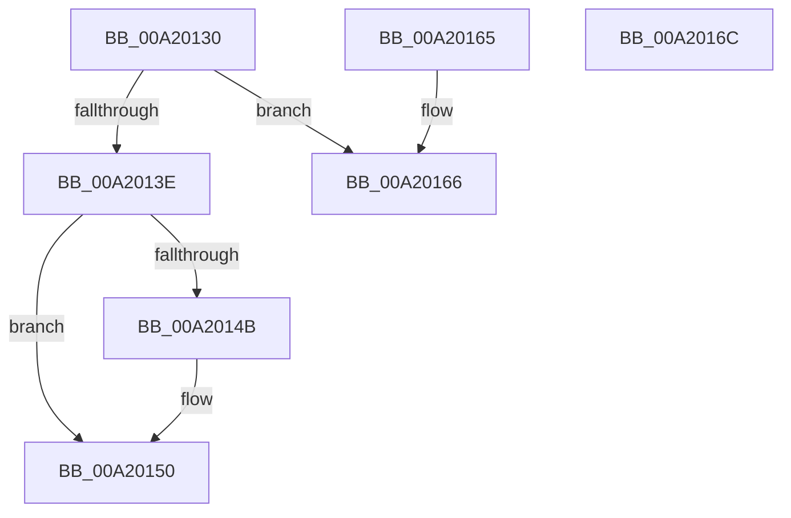

# PiUEventQueuePendingEvent

- RVA: `0x00A20130`–`0x00A2016D` (길이 `61` bytes)
- VA: `0x0000000140A20130`
- 실행 섹션: `PAGE`
- PDB 이름 있음: `예`; PDB Function 태그: `아니요`
- unwind 정보 RVA: `0x000DB714`
- 디코드: `19`개 명령, `61/61` bytes 표시
- 미해석 바이트: `0` (있으면 어셈블리에 `.byte`로 보존)

> 이 문서는 커널 이미지의 기계어와 PDB 기호를 분석해 생성했습니다. 4번과 5번은 함수 원형과 자료형을 바이너리 사용 방식에서 추정한 C 해석이며 원본 소스 복구 결과는 아닙니다.

## 1. Dependencies

- 직접 호출 지점: **0**; 고유 호출 대상: **0**
- 직접 호출자로 확인된 함수: **1**
- RIP 상대 이미지 참조: **0**

### Outgoing calls
- 직접 디코드된 call 명령이 없습니다.

### Direct callers
- [PiUEventNotifyClient](../8E/PiUEventNotifyClient_function_008E6BEC.md) at `0x008E6C7D`
- [PiUEventNotifyClient](../8E/PiUEventNotifyClient_function_008E6BEC.md) at `0x008E6D21`

### Static image references
- 디코드된 RIP-relative 메모리 참조가 없습니다.

## 2. Other-region calls and transfers

- 다른 실행 섹션으로 향하는 call: **0**
- 별도 외부 분기/꼬리 이동을 확인하지 못했습니다.

## 3. Assembly (complete function range)

```asm
00A20130  33 C0                           xor eax, eax
00A20132  81 B9 80 00 00 00 00 00 01 00   cmp dword ptr [rcx + 0x80], 0x10000
00A2013C  73 28                           jae 0x140a20166
00A2013E  4C 8D 41 70                     lea r8, [rcx + 0x70]
00A20142  4D 8B 48 08                     mov r9, qword ptr [r8 + 8]
00A20146  4D 39 01                        cmp qword ptr [r9], r8
00A20149  74 05                           je 0x140a20150
00A2014B  8D 48 03                        lea ecx, [rax + 3]
00A2014E  CD 29                           int 0x29
00A20150  4C 89 02                        mov qword ptr [rdx], r8
00A20153  4C 89 4A 08                     mov qword ptr [rdx + 8], r9
00A20157  49 89 11                        mov qword ptr [r9], rdx
00A2015A  49 89 50 08                     mov qword ptr [r8 + 8], rdx
00A2015E  FF 81 80 00 00 00               inc dword ptr [rcx + 0x80]
00A20164  C3                              ret
00A20165  CC                              int3
00A20166  B8 01 00 00 C0                  mov eax, 0xc0000001
00A2016B  C3                              ret
00A2016C  CC                              int3
```

## 4. C-style interpretation (structured pseudocode)

```c
__int64 __fastcall PiUEventQueuePendingEvent(__int64 a1, __int64 a2)
{
    __int64 result;

    result = 0;
    if ((*(unsigned int *)(a1 + 128)) >= 0x10000ULL) goto loc_00A20166;
    if ((*(unsigned __int64 *)(*(unsigned __int64 *)(a1 + 112 + 8))) != (a1 + 112)) {
        a1 = result + 3;
    }
    *(unsigned __int64 *)(a2) = a1 + 112;
    *(unsigned __int64 *)(a2 + 8) = *(unsigned __int64 *)(a1 + 112 + 8);
    *(unsigned __int64 *)(*(unsigned __int64 *)(a1 + 112 + 8)) = a2;
    *(unsigned __int64 *)(a1 + 112 + 8) = a2;
    return result;
loc_00A20166:
    return (unsigned int)(0xC0000001ULL);
}
```

## 5. (Beta) C Style

```c
int64_t PiUEventQueuePendingEvent(void *Arg1, void *Arg2)
{
    uint8_t *arg1 = (uint8_t *)Arg1;
    uint8_t *arg2 = (uint8_t *)Arg2;

    int64_t result;

    result = 0;
    if ((*(uint32_t *)(arg1 + 0x80)) >= 0x10000ULL) goto loc_00A20166;
    if ((*(uint64_t *)(*(uint64_t *)(arg1 + 0x70 + 0x8))) != (Arg1 + 112)) {
        Arg1 = result + 3;
    }
    *(void **)(arg2) = Arg1 + 112;
    *(uint64_t *)(arg2 + 0x8) = *(uint64_t *)(arg1 + 0x70 + 0x8);
    *(void **)(*(uint64_t *)(arg1 + 0x70 + 0x8)) = Arg2;
    *(void **)(arg1 + 0x70 + 0x8) = Arg2;
    return result;
loc_00A20166:
    return (uint32_t)(0xC0000001ULL);
}
```

### 관측된 메모리 오프셋

구조체 형식이 확인되지 않은 접근은 인자 기준의 오프셋으로만 기록했습니다.

| 기준 인자 | 오프셋 표현 | 폭 (bit) | 접근 |
|---|---:|---:|---|
| `Arg1` | `+ 0x8` | `64` | `R` |
| `Arg1` | `+ 0x8` | `64` | `W` |
| `Arg1` | `+ 0x70` | `64` | `R` |
| `Arg1` | `+ 0x80` | `32` | `R` |
| `Arg2` | `+ 0x0` | `64` | `W` |
| `Arg2` | `+ 0x8` | `64` | `W` |

## 6. Execution-region graph

[열기: 2D/3D 그래프와 함수 탐색 컨트롤 패널](../../../control-panel.html?section=page&rva=0x00A20130&view=graph)

- 2D 그래프는 위에서 아래로 흐르고, 3D 그래프는 빈 공간을 드래그해 회전합니다. Shift+드래그는 이동, 휠은 확대·축소, 함수 노드 선택은 대상 보고서 이동입니다.

### Static fallback


