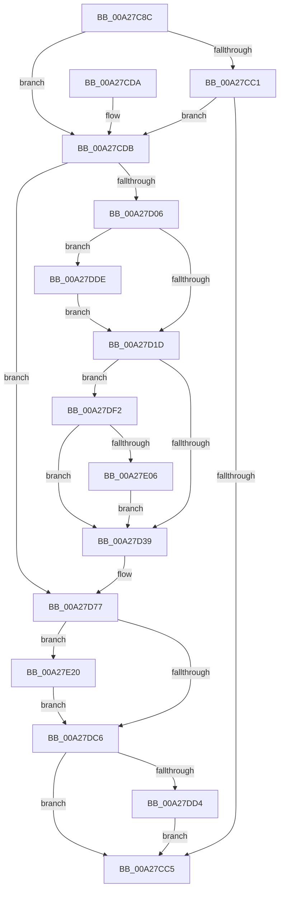

# PipClearDevNodeProblem

- RVA: `0x00A27C8C`–`0x00A27E51` (길이 `453` bytes)
- VA: `0x0000000140A27C8C`
- 실행 섹션: `PAGE`
- PDB 이름 있음: `예`; PDB Function 태그: `아니요`
- unwind 정보 RVA: `0x000ABFD8`
- 디코드: `98`개 명령, `453/453` bytes 표시
- 미해석 바이트: `0` (있으면 어셈블리에 `.byte`로 보존)

> 이 문서는 커널 이미지의 기계어와 PDB 기호를 분석해 생성했습니다. 4번과 5번은 함수 원형과 자료형을 바이너리 사용 방식에서 추정한 C 해석이며 원본 소스 복구 결과는 아닙니다.

## 1. Dependencies

- 직접 호출 지점: **10**; 고유 호출 대상: **9**
- 직접 호출자로 확인된 함수: **16**
- RIP 상대 이미지 참조: **3**

### Outgoing calls
- `0x00A27CE0` → [PiPnpRtlBeginOperation](../8E/PiPnpRtlBeginOperation_function_008E033C.md) (function, `0x008E033C`)
- `0x00A27CEA` → [PipClearDevNodeFlags](../8F/PipClearDevNodeFlags_function_008F9F54.md) (function, `0x008F9F54`)
- `0x00A27D0C` → [PnpRaiseNtPlugPlayDevicePropertyChangeEvent](../8F/PnpRaiseNtPlugPlayDevicePropertyChangeEvent_function_008F7D80.md) (function, `0x008F7D80`)
- `0x00A27D2B` → [PnpTraceClearDevNodeProblem](PnpTraceClearDevNodeProblem_function_00A27E58.md) (function, `0x00A27E58`)
- `0x00A27D72` → [PnpSetObjectProperty](../8F/PnpSetObjectProperty_function_008F66E8.md) (function, `0x008F66E8`)
- `0x00A27DD4` → [PiPnpRtlEndOperation](../8E/PiPnpRtlEndOperation_function_008E0518.md) (function, `0x008E0518`)
- `0x00A27DE8` → [PnpRaiseNtPlugPlayDevicePropertyChangeEvent](../8F/PnpRaiseNtPlugPlayDevicePropertyChangeEvent_function_008F7D80.md) (function, `0x008F7D80`)
- `0x00A27DF9` → [SeAuditingWithTokenForSubcategory](../90/SeAuditingWithTokenForSubcategory_function_009047D0.md) (function, `0x009047D0`)
- `0x00A27E16` → [PiAuditDeviceEnableDisableAction](../74/PiAuditDeviceEnableDisableAction_function_00740A84.md) (function, `0x00740A84`)
- `0x00A27E47` → [McTemplateK0pzzqdqd_EtwWriteTransfer](../../text/5A/McTemplateK0pzzqdqd_EtwWriteTransfer_function_005A6FD8.md) (function, `0x005A6FD8`)

### Direct callers
- [PnpRemoveLockedDeviceNode](../../text/47/PnpRemoveLockedDeviceNode_function_004702AC.md) at `0x0047047E`
- [IoReportDetectedDevice](../72/IoReportDetectedDevice_function_00725CD0.md) at `0x007264EE`
- [PipAttemptDependentStart](../72/PipAttemptDependentStart_function_007279F0.md) at `0x00727A3B`
- [PnpDisableDevice](../72/PnpDisableDevice_function_0072C6FC.md) at `0x0072C786`
- [PiProcessResourceRequirementsChanged](../72/PiProcessResourceRequirementsChanged_function_0072D504.md) at `0x0072D588`
- [PiProfileUpdateDeviceTreeCallback](../73/PiProfileUpdateDeviceTreeCallback_function_00737630.md) at `0x00737699`
- [PnpRebalance](../73/PnpRebalance_function_0073F508.md) at `0x0073F7E2`
- [PiProcessQueryRemoveNoFdo](../74/PiProcessQueryRemoveNoFdo_function_007442B4.md) at `0x00744309`
- [PiProcessClearDeviceProblem](PiProcessClearDeviceProblem_function_00A271CC.md) at `0x00A2729E`
- [PipCallDriverAddDevice](PipCallDriverAddDevice_function_00A272E0.md) at `0x00A27904`
- [PiProcessNewDeviceNode](PiProcessNewDeviceNode_function_00A28F20.md) at `0x00A296DF`
- [PiRestartRemovalRelations](../AB/PiRestartRemovalRelations_function_00AB06B8.md) at `0x00AB074E`
- [sub_00B29934](../B2/Unknown_function_00B29934.md) at `0x00B29B06`
- [sub_00B29934](../B2/Unknown_function_00B29934.md) at `0x00B29BA7`
- [sub_00B33FE8](../B3/Unknown_function_00B33FE8.md) at `0x00B342B9`
- [sub_00B38C28](../B3/Unknown_function_00B38C28.md) at `0x00B38C2B`
- [sub_00B420B0](../B4/Unknown_function_00B420B0.md) at `0x00B422D7`
- [sub_00B420B0](../B4/Unknown_function_00B420B0.md) at `0x00B42382`

### Static image references
- `0x00A27D3E` → RVA `0x00011630` (`.rdata`; read)
- `0x00A27D5C` → RVA `0x00E66398` (`.data`; read)
- `0x00A27DBD` → RVA `0x00EF012B` (`.data`; read)

## 2. Other-region calls and transfers

- 다른 실행 섹션으로 향하는 call: **1**
  - `0x00A27E47` → [McTemplateK0pzzqdqd_EtwWriteTransfer](../../text/5A/McTemplateK0pzzqdqd_EtwWriteTransfer_function_005A6FD8.md) (`PAGE` → `.text`)
- 별도 외부 분기/꼬리 이동을 확인하지 못했습니다.

## 3. Assembly (complete function range)

```asm
00A27C8C  48 8B C4                        mov rax, rsp
00A27C8F  48 89 58 10                     mov qword ptr [rax + 0x10], rbx
00A27C93  48 89 68 18                     mov qword ptr [rax + 0x18], rbp
00A27C97  48 89 70 20                     mov qword ptr [rax + 0x20], rsi
00A27C9B  57                              push rdi
00A27C9C  48 83 EC 50                     sub rsp, 0x50
00A27CA0  48 83 60 08 00                  and qword ptr [rax + 8], 0
00A27CA5  BD 00 20 00 00                  mov ebp, 0x2000
00A27CAA  48 8B D9                        mov rbx, rcx
00A27CAD  8B B9 94 01 00 00               mov edi, dword ptr [rcx + 0x194]
00A27CB3  8B B1 98 01 00 00               mov esi, dword ptr [rcx + 0x198]
00A27CB9  85 A9 8C 01 00 00               test dword ptr [rcx + 0x18c], ebp
00A27CBF  75 1A                           jne 0x140a27cdb
00A27CC1  85 FF                           test edi, edi
00A27CC3  75 16                           jne 0x140a27cdb
00A27CC5  48 8B 5C 24 68                  mov rbx, qword ptr [rsp + 0x68]
00A27CCA  48 8B 6C 24 70                  mov rbp, qword ptr [rsp + 0x70]
00A27CCF  48 8B 74 24 78                  mov rsi, qword ptr [rsp + 0x78]
00A27CD4  48 83 C4 50                     add rsp, 0x50
00A27CD8  5F                              pop rdi
00A27CD9  C3                              ret
00A27CDA  CC                              int3
00A27CDB  48 8D 4C 24 60                  lea rcx, [rsp + 0x60]
00A27CE0  E8 57 86 EB FF                  call 0x1408e033c
00A27CE5  8B D5                           mov edx, ebp
00A27CE7  48 8B CB                        mov rcx, rbx
00A27CEA  E8 65 22 ED FF                  call 0x1408f9f54
00A27CEF  48 8B 53 30                     mov rdx, qword ptr [rbx + 0x30]
00A27CF3  83 A3 94 01 00 00 00            and dword ptr [rbx + 0x194], 0
00A27CFA  83 A3 98 01 00 00 00            and dword ptr [rbx + 0x198], 0
00A27D01  48 85 D2                        test rdx, rdx
00A27D04  74 71                           je 0x140a27d77
00A27D06  41 B8 0C 00 00 00               mov r8d, 0xc
00A27D0C  E8 6F 00 ED FF                  call 0x1408f7d80
00A27D11  39 B3 98 01 00 00               cmp dword ptr [rbx + 0x198], esi
00A27D17  0F 85 C1 00 00 00               jne 0x140a27dde
00A27D1D  48 8D 53 38                     lea rdx, [rbx + 0x38]
00A27D21  44 8B CE                        mov r9d, esi
00A27D24  44 8B C7                        mov r8d, edi
00A27D27  48 8D 4B 28                     lea rcx, [rbx + 0x28]
00A27D2B  E8 28 01 00 00                  call 0x140a27e58
00A27D30  83 FF 16                        cmp edi, 0x16
00A27D33  0F 84 B9 00 00 00               je 0x140a27df2
00A27D39  83 64 24 48 00                  and dword ptr [rsp + 0x48], 0
00A27D3E  48 8D 05 EB 98 5E FF            lea rax, [rip - 0xa16715]
00A27D45  83 64 24 40 00                  and dword ptr [rsp + 0x40], 0
00A27D4A  45 33 C9                        xor r9d, r9d
00A27D4D  48 83 64 24 38 00               and qword ptr [rsp + 0x38], 0
00A27D53  83 64 24 30 00                  and dword ptr [rsp + 0x30], 0
00A27D58  48 8B 53 30                     mov rdx, qword ptr [rbx + 0x30]
00A27D5C  48 8B 0D 35 E6 43 00            mov rcx, qword ptr [rip + 0x43e635]
00A27D63  45 8D 41 01                     lea r8d, [r9 + 1]
00A27D67  48 89 44 24 28                  mov qword ptr [rsp + 0x28], rax
00A27D6C  48 83 64 24 20 00               and qword ptr [rsp + 0x20], 0
00A27D72  E8 71 E9 EC FF                  call 0x1408f66e8
00A27D77  8B 83 70 03 00 00               mov eax, dword ptr [rbx + 0x370]
00A27D7D  48 8D 0C 40                     lea rcx, [rax + rax*2]
00A27D81  48 A1 14 00 00 00 80 F7 FF FF   movabs rax, qword ptr [0xfffff78000000014]
00A27D8B  48 89 84 CB 10 03 00 00         mov qword ptr [rbx + rcx*8 + 0x310], rax
00A27D93  C7 84 CB 18 03 00 00 02 00 00 00  mov dword ptr [rbx + rcx*8 + 0x318], 2
00A27D9E  89 BC CB 1C 03 00 00            mov dword ptr [rbx + rcx*8 + 0x31c], edi
00A27DA5  89 B4 CB 20 03 00 00            mov dword ptr [rbx + rcx*8 + 0x320], esi
00A27DAC  8B 83 70 03 00 00               mov eax, dword ptr [rbx + 0x370]
00A27DB2  FF C0                           inc eax
00A27DB4  83 E0 03                        and eax, 3
00A27DB7  89 83 70 03 00 00               mov dword ptr [rbx + 0x370], eax
00A27DBD  F6 05 67 83 4C 00 20            test byte ptr [rip + 0x4c8367], 0x20
00A27DC4  75 5A                           jne 0x140a27e20
00A27DC6  48 8B 4C 24 60                  mov rcx, qword ptr [rsp + 0x60]
00A27DCB  48 85 C9                        test rcx, rcx
00A27DCE  0F 84 F1 FE FF FF               je 0x140a27cc5
00A27DD4  E8 3F 87 EB FF                  call 0x1408e0518
00A27DD9  E9 E7 FE FF FF                  jmp 0x140a27cc5
00A27DDE  48 8B 53 30                     mov rdx, qword ptr [rbx + 0x30]
00A27DE2  41 B8 0D 00 00 00               mov r8d, 0xd
00A27DE8  E8 93 FF EC FF                  call 0x1408f7d80
00A27DED  E9 2B FF FF FF                  jmp 0x140a27d1d
00A27DF2  33 D2                           xor edx, edx
00A27DF4  B9 8A 00 00 00                  mov ecx, 0x8a
00A27DF9  E8 D2 C9 ED FF                  call 0x1409047d0
00A27DFE  84 C0                           test al, al
00A27E00  0F 84 33 FF FF FF               je 0x140a27d39
00A27E06  44 8B 83 94 01 00 00            mov r8d, dword ptr [rbx + 0x194]
00A27E0D  48 8D 4B 28                     lea rcx, [rbx + 0x28]
00A27E11  BA 16 00 00 00                  mov edx, 0x16
00A27E16  E8 69 8C D1 FF                  call 0x140740a84
00A27E1B  E9 19 FF FF FF                  jmp 0x140a27d39
00A27E20  48 8B 43 40                     mov rax, qword ptr [rbx + 0x40]
00A27E24  4C 8B CB                        mov r9, rbx
00A27E27  89 74 24 48                     mov dword ptr [rsp + 0x48], esi
00A27E2B  89 7C 24 40                     mov dword ptr [rsp + 0x40], edi
00A27E2F  83 64 24 38 00                  and dword ptr [rsp + 0x38], 0
00A27E34  83 64 24 30 00                  and dword ptr [rsp + 0x30], 0
00A27E39  48 89 44 24 28                  mov qword ptr [rsp + 0x28], rax
00A27E3E  48 8B 43 30                     mov rax, qword ptr [rbx + 0x30]
00A27E42  48 89 44 24 20                  mov qword ptr [rsp + 0x20], rax
00A27E47  E8 8C F1 B7 FF                  call 0x1405a6fd8
00A27E4C  E9 75 FF FF FF                  jmp 0x140a27dc6
```

## 4. C-style interpretation (structured pseudocode)

```c
__int64 __fastcall PipClearDevNodeProblem(__int64 a1)
{
    __int64 result;
    __int64 v_rsp;
    unsigned __int64 v_stack_p10;
    unsigned __int64 v_stack_p18;
    unsigned __int64 v_stack_p20;
    unsigned __int64 v_stack_p28;
    unsigned int v_stack_p30;
    unsigned __int64 v_stack_p38;
    unsigned int v_stack_p40;
    unsigned int v_stack_p48;
    unsigned __int64 v_stack_p60;

    *(unsigned __int64 *)(v_rsp + 16) = v_rbx;
    *(unsigned __int64 *)(v_rsp + 24) = v_rbp;
    *(unsigned __int64 *)(v_rsp + 32) = v_rsi;
    v_rsp = (v_rsp) - (80);
    if (((*(unsigned int *)(a1 + 396)) & ((unsigned int)((unsigned int)(0x2000ULL)))) != 0) goto loc_00A27CDB;
    if ((unsigned int)((unsigned int)(*(unsigned int *)(a1 + 404))) != 0) goto loc_00A27CDB;
loc_00A27CC5:
    v_rsp = (v_rsp) + (80);
    return v_rsp;
loc_00A27CDB:
    result = PiPnpRtlBeginOperation(v_stack_p60, a2, a3, a4);
    result = PipClearDevNodeFlags(v_stack_p10, (unsigned int)((unsigned int)(v_stack_p18)), a3, a4);
    if (*(unsigned __int64 *)(v_stack_p10 + 48) == 0) goto loc_00A27D77;
    result = PnpRaiseNtPlugPlayDevicePropertyChangeEvent(v_stack_p10, *(unsigned __int64 *)(v_stack_p10 + 48), 12, a4);
    if ((*(unsigned int *)(v_stack_p10 + 408)) != ((unsigned int)(v_stack_p20))) goto loc_00A27DDE;
loc_00A27D1D:
    result = PnpTraceClearDevNodeProblem(v_stack_p10 + 40, v_stack_p10 + 56, (unsigned int)((unsigned int)((unsigned int)(*(unsigned int *)(a1 + 404)))), (unsigned int)((unsigned int)(v_stack_p20)));
    if (((unsigned int)((unsigned int)(*(unsigned int *)(a1 + 404)))) == 22) goto loc_00A27DF2;
loc_00A27D39:
    a4 = 0;
    v_stack_p28 = v_rip - 10577685;
    result = PnpSetObjectProperty(*(unsigned __int64 *)(v_rip + 4449845), *(unsigned __int64 *)(v_stack_p10 + 48), a4 + 1, a4);
loc_00A27D77:
    *(unsigned __int64 *)(v_stack_p10 + (unsigned int)(*(unsigned int *)(v_stack_p10 + 880)) + (unsigned int)(*(unsigned int *)(v_stack_p10 + 880)) * 2 * 8 + 784) = (unsigned int)(*(unsigned int *)(v_stack_p10 + 880));
    *(unsigned int *)(v_stack_p10 + (unsigned int)(*(unsigned int *)(v_stack_p10 + 880)) + (unsigned int)(*(unsigned int *)(v_stack_p10 + 880)) * 2 * 8 + 792) = 2;
    *(unsigned int *)(v_stack_p10 + (unsigned int)(*(unsigned int *)(v_stack_p10 + 880)) + (unsigned int)(*(unsigned int *)(v_stack_p10 + 880)) * 2 * 8 + 796) = (unsigned int)((unsigned int)(*(unsigned int *)(a1 + 404)));
    *(unsigned int *)(v_stack_p10 + (unsigned int)(*(unsigned int *)(v_stack_p10 + 880)) + (unsigned int)(*(unsigned int *)(v_stack_p10 + 880)) * 2 * 8 + 800) = (unsigned int)(v_stack_p20);
    result = (unsigned int)(((unsigned int)(*(unsigned int *)(v_stack_p10 + 880))) + 1);
    result = (unsigned int)((result) & (3));
    *(unsigned int *)(v_stack_p10 + 880) = (unsigned int)(result);
    if (((*(unsigned __int8 *)(v_rip + 5014375)) & (32)) != 0) goto loc_00A27E20;
loc_00A27DC6:
    if (v_stack_p60 == 0) goto loc_00A27CC5;
    result = PiPnpRtlEndOperation(v_stack_p60, *(unsigned __int64 *)(v_stack_p10 + 48), a4 + 1, a4);
    goto loc_00A27CC5;
loc_00A27DDE:
    result = PnpRaiseNtPlugPlayDevicePropertyChangeEvent(v_stack_p60, *(unsigned __int64 *)(v_stack_p10 + 48), 13, a4);
    goto loc_00A27D1D;
loc_00A27DF2:
    a2 = 0;
    result = SeAuditingWithTokenForSubcategory(138, a2, 13, a4);
    if ((unsigned __int8)(result) == 0) goto loc_00A27D39;
    result = PiAuditDeviceEnableDisableAction(v_stack_p10 + 40, 22, (unsigned int)(*(unsigned int *)(v_stack_p10 + 404)), a4);
    goto loc_00A27D39;
loc_00A27E20:
    v_stack_p48 = (unsigned int)(v_stack_p20);
    v_stack_p40 = (unsigned int)((unsigned int)(*(unsigned int *)(a1 + 404)));
    v_stack_p28 = *(unsigned __int64 *)(v_stack_p10 + 64);
    v_stack_p20 = *(unsigned __int64 *)(v_stack_p10 + 48);
    result = McTemplateK0pzzqdqd_EtwWriteTransfer(v_stack_p10 + 40, 22, (unsigned int)(*(unsigned int *)(v_stack_p10 + 404)), v_stack_p10);
    goto loc_00A27DC6;
}
```

## 5. (Beta) C Style

```c
int64_t PipClearDevNodeProblem(void *Arg1)
{
    uint8_t *arg1 = (uint8_t *)Arg1;

    int64_t result;
    int64_t local_rsp;
    uint64_t v_stack_p10;
    uint64_t v_stack_p18;
    uint64_t v_stack_p20;
    uint64_t v_stack_p28;
    uint32_t v_stack_p30;
    uint64_t v_stack_p38;
    uint32_t v_stack_p40;
    uint32_t v_stack_p48;
    uint64_t v_stack_p60;

    *(uint64_t *)(local_rsp + 0x10) = local_rbx;
    *(uint64_t *)(local_rsp + 0x18) = local_rbp;
    *(uint64_t *)(local_rsp + 0x20) = local_rsi;
    local_rsp = (local_rsp) - (80);
    if (((*(uint32_t *)(arg1 + 0x18C)) & ((uint32_t)((uint32_t)(0x2000ULL)))) != 0) goto loc_00A27CDB;
    if ((uint32_t)((uint32_t)(*(uint32_t *)(arg1 + 0x194))) != 0) goto loc_00A27CDB;
loc_00A27CC5:
    local_rsp = (local_rsp) + (80);
    return local_rsp;
loc_00A27CDB:
    result = PiPnpRtlBeginOperation(v_stack_p60, a2, a3, a4);
    result = PipClearDevNodeFlags(v_stack_p10, (uint32_t)((uint32_t)(v_stack_p18)), a3, a4);
    if (*(uint64_t *)(v_stack_p10 + 0x30) == 0) goto loc_00A27D77;
    result = PnpRaiseNtPlugPlayDevicePropertyChangeEvent(v_stack_p10, *(uint64_t *)(v_stack_p10 + 0x30), 12, a4);
    if ((*(uint32_t *)(v_stack_p10 + 0x198)) != ((uint32_t)(v_stack_p20))) goto loc_00A27DDE;
loc_00A27D1D:
    result = PnpTraceClearDevNodeProblem(v_stack_p10 + 40, v_stack_p10 + 56, (uint32_t)((uint32_t)((uint32_t)(*(uint32_t *)(arg1 + 0x194)))), (uint32_t)((uint32_t)(v_stack_p20)));
    if (((uint32_t)((uint32_t)(*(uint32_t *)(arg1 + 0x194)))) == 22) goto loc_00A27DF2;
loc_00A27D39:
    a4 = 0;
    v_stack_p28 = v_rip - 10577685;
    result = PnpSetObjectProperty(*(uint64_t *)(v_rip + 0x43E635), *(uint64_t *)(v_stack_p10 + 0x30), a4 + 1, a4);
loc_00A27D77:
    *(uint64_t *)(v_stack_p10 + (uint32_t)(*(uint32_t *)(v_stack_p10 + 0x370)) + (uint32_t)(*(uint32_t *)(v_stack_p10 + 0x370)) * 2 * 8 + 0x310) = (uint32_t)(*(uint32_t *)(v_stack_p10 + 0x370));
    *(uint32_t *)(v_stack_p10 + (uint32_t)(*(uint32_t *)(v_stack_p10 + 0x370)) + (uint32_t)(*(uint32_t *)(v_stack_p10 + 0x370)) * 2 * 8 + 0x318) = 2;
    *(uint32_t *)(v_stack_p10 + (uint32_t)(*(uint32_t *)(v_stack_p10 + 0x370)) + (uint32_t)(*(uint32_t *)(v_stack_p10 + 0x370)) * 2 * 8 + 0x31C) = (uint32_t)((uint32_t)(*(uint32_t *)(arg1 + 0x194)));
    *(uint32_t *)(v_stack_p10 + (uint32_t)(*(uint32_t *)(v_stack_p10 + 0x370)) + (uint32_t)(*(uint32_t *)(v_stack_p10 + 0x370)) * 2 * 8 + 0x320) = (uint32_t)(v_stack_p20);
    result = (uint32_t)(((uint32_t)(*(uint32_t *)(v_stack_p10 + 0x370))) + 1);
    result = (uint32_t)((result) & (3));
    *(uint32_t *)(v_stack_p10 + 0x370) = (uint32_t)(result);
    if (((*(uint8_t *)(v_rip + 0x4C8367)) & (32)) != 0) goto loc_00A27E20;
loc_00A27DC6:
    if (v_stack_p60 == 0) goto loc_00A27CC5;
    result = PiPnpRtlEndOperation(v_stack_p60, *(uint64_t *)(v_stack_p10 + 0x30), a4 + 1, a4);
    goto loc_00A27CC5;
loc_00A27DDE:
    result = PnpRaiseNtPlugPlayDevicePropertyChangeEvent(v_stack_p60, *(uint64_t *)(v_stack_p10 + 0x30), 13, a4);
    goto loc_00A27D1D;
loc_00A27DF2:
    a2 = 0;
    result = SeAuditingWithTokenForSubcategory(138, a2, 13, a4);
    if ((uint8_t)(result) == 0) goto loc_00A27D39;
    result = PiAuditDeviceEnableDisableAction(v_stack_p10 + 40, 22, (uint32_t)(*(uint32_t *)(v_stack_p10 + 0x194)), a4);
    goto loc_00A27D39;
loc_00A27E20:
    v_stack_p48 = (uint32_t)(v_stack_p20);
    v_stack_p40 = (uint32_t)((uint32_t)(*(uint32_t *)(arg1 + 0x194)));
    v_stack_p28 = *(uint64_t *)(v_stack_p10 + 0x40);
    v_stack_p20 = *(uint64_t *)(v_stack_p10 + 0x30);
    result = McTemplateK0pzzqdqd_EtwWriteTransfer(v_stack_p10 + 40, 22, (uint32_t)(*(uint32_t *)(v_stack_p10 + 0x194)), v_stack_p10);
    goto loc_00A27DC6;
}
```

### 관측된 메모리 오프셋

구조체 형식이 확인되지 않은 접근은 인자 기준의 오프셋으로만 기록했습니다.

| 기준 인자 | 오프셋 표현 | 폭 (bit) | 접근 |
|---|---:|---:|---|
| `Arg1` | `+ 0x28` | `64` | `R` |
| `Arg1` | `+ 0x30` | `64` | `R` |
| `Arg1` | `+ 0x38` | `64` | `R` |
| `Arg1` | `+ 0x40` | `64` | `R` |
| `Arg1` | `+ 0x18C` | `32` | `R` |
| `Arg1` | `+ 0x194` | `32` | `R` |
| `Arg1` | `+ 0x194` | `32` | `R/W` |
| `Arg1` | `+ 0x198` | `32` | `R` |
| `Arg1` | `+ 0x198` | `32` | `R/W` |
| `Arg1` | `+ 0x310 + rcx*8` | `64` | `W` |
| `Arg1` | `+ 0x318 + rcx*8` | `32` | `W` |
| `Arg1` | `+ 0x31C + rcx*8` | `32` | `W` |
| `Arg1` | `+ 0x320 + rcx*8` | `32` | `W` |
| `Arg1` | `+ 0x370` | `32` | `R` |
| `Arg1` | `+ 0x370` | `32` | `W` |

## 6. Execution-region graph

[열기: 2D/3D 그래프와 함수 탐색 컨트롤 패널](../../../control-panel.html?section=page&rva=0x00A27C8C&view=graph)

- 2D 그래프는 위에서 아래로 흐르고, 3D 그래프는 빈 공간을 드래그해 회전합니다. Shift+드래그는 이동, 휠은 확대·축소, 함수 노드 선택은 대상 보고서 이동입니다.

### Static fallback


