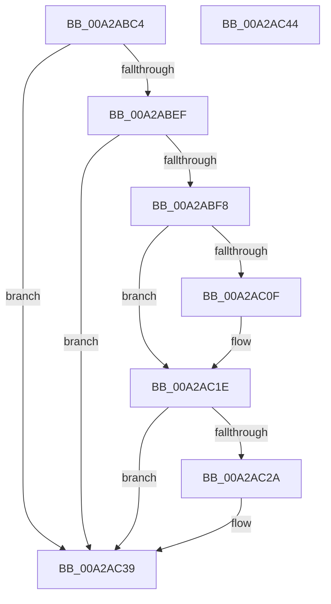

# PipClearDevNodeUserFlags

- RVA: `0x00A2ABC4`–`0x00A2AC45` (길이 `129` bytes)
- VA: `0x0000000140A2ABC4`
- 실행 섹션: `PAGE`
- PDB 이름 있음: `예`; PDB Function 태그: `아니요`
- unwind 정보 RVA: `0x0005CAAC`
- 디코드: `34`개 명령, `129/129` bytes 표시
- 미해석 바이트: `0` (있으면 어셈블리에 `.byte`로 보존)

> 이 문서는 커널 이미지의 기계어와 PDB 기호를 분석해 생성했습니다. 4번과 5번은 함수 원형과 자료형을 바이너리 사용 방식에서 추정한 C 해석이며 원본 소스 복구 결과는 아닙니다.

## 1. Dependencies

- 직접 호출 지점: **3**; 고유 호출 대상: **1**
- 직접 호출자로 확인된 함수: **11**
- RIP 상대 이미지 참조: **0**

### Outgoing calls
- `0x00A2ABFE` → [PnpRaiseNtPlugPlayDevicePropertyChangeEvent](../8F/PnpRaiseNtPlugPlayDevicePropertyChangeEvent_function_008F7D80.md) (function, `0x008F7D80`)
- `0x00A2AC19` → [PnpRaiseNtPlugPlayDevicePropertyChangeEvent](../8F/PnpRaiseNtPlugPlayDevicePropertyChangeEvent_function_008F7D80.md) (function, `0x008F7D80`)
- `0x00A2AC34` → [PnpRaiseNtPlugPlayDevicePropertyChangeEvent](../8F/PnpRaiseNtPlugPlayDevicePropertyChangeEvent_function_008F7D80.md) (function, `0x008F7D80`)

### Direct callers
- [PnpRemoveLockedDeviceNode](../../text/47/PnpRemoveLockedDeviceNode_function_004702AC.md) at `0x004704E5`
- [sub_006F3B38](../../text/6F/Unknown_function_006F3B38.md) at `0x006F3B6B`
- [PnpRestartDeviceNode](../72/PnpRestartDeviceNode_function_0072CD60.md) at `0x0072CD93`
- [PnpCancelRemoveLockedDeviceNode](../72/PnpCancelRemoveLockedDeviceNode_function_0072CFE0.md) at `0x0072D015`
- [PnpQueryRemoveLockedDeviceNode](../72/PnpQueryRemoveLockedDeviceNode_function_0072D210.md) at `0x0072D2EB`
- [PiProcessQueryDeviceState](../8F/PiProcessQueryDeviceState_function_008FA0F8.md) at `0x008FA28A`
- [PiProcessQueryDeviceState](../8F/PiProcessQueryDeviceState_function_008FA0F8.md) at `0x008FA294`
- [PiProcessQueryDeviceState](../8F/PiProcessQueryDeviceState_function_008FA0F8.md) at `0x008FA2E1`
- [IopRemoveDevice](../8F/IopRemoveDevice_function_008FC7FC.md) at `0x008FCA19`
- [PiProcessNewDeviceNode](PiProcessNewDeviceNode_function_00A28F20.md) at `0x00A2907A`
- [PnpProcessAssignResources](PnpProcessAssignResources_function_00A2A950.md) at `0x00A2AAAE`
- [PnpTrackQueryRemoveDevices](../AC/PnpTrackQueryRemoveDevices_function_00ACCF54.md) at `0x00ACCFAB`
- [sub_00B29934](../B2/Unknown_function_00B29934.md) at `0x00B29BB4`

### Static image references
- 디코드된 RIP-relative 메모리 참조가 없습니다.

## 2. Other-region calls and transfers

- 다른 실행 섹션으로 향하는 call: **0**
- 별도 외부 분기/꼬리 이동을 확인하지 못했습니다.

## 3. Assembly (complete function range)

```asm
00A2ABC4  48 89 5C 24 08                  mov qword ptr [rsp + 8], rbx
00A2ABC9  57                              push rdi
00A2ABCA  48 83 EC 20                     sub rsp, 0x20
00A2ABCE  8B B9 90 01 00 00               mov edi, dword ptr [rcx + 0x190]
00A2ABD4  48 8B D9                        mov rbx, rcx
00A2ABD7  F7 D2                           not edx
00A2ABD9  F0 21 91 90 01 00 00            lock and dword ptr [rcx + 0x190], edx
00A2ABE0  8B C7                           mov eax, edi
00A2ABE2  33 81 90 01 00 00               xor eax, dword ptr [rcx + 0x190]
00A2ABE8  A9 47 03 00 00                  test eax, 0x347
00A2ABED  74 4A                           je 0x140a2ac39
00A2ABEF  48 8B 51 30                     mov rdx, qword ptr [rcx + 0x30]
00A2ABF3  48 85 D2                        test rdx, rdx
00A2ABF6  74 41                           je 0x140a2ac39
00A2ABF8  41 B8 0B 00 00 00               mov r8d, 0xb
00A2ABFE  E8 7D D1 EC FF                  call 0x1408f7d80
00A2AC03  8B C7                           mov eax, edi
00A2AC05  33 83 90 01 00 00               xor eax, dword ptr [rbx + 0x190]
00A2AC0B  A8 40                           test al, 0x40
00A2AC0D  74 0F                           je 0x140a2ac1e
00A2AC0F  48 8B 53 30                     mov rdx, qword ptr [rbx + 0x30]
00A2AC13  41 B8 1D 00 00 00               mov r8d, 0x1d
00A2AC19  E8 62 D1 EC FF                  call 0x1408f7d80
00A2AC1E  33 BB 90 01 00 00               xor edi, dword ptr [rbx + 0x190]
00A2AC24  40 F6 C7 04                     test dil, 4
00A2AC28  74 0F                           je 0x140a2ac39
00A2AC2A  48 8B 53 30                     mov rdx, qword ptr [rbx + 0x30]
00A2AC2E  41 B8 1E 00 00 00               mov r8d, 0x1e
00A2AC34  E8 47 D1 EC FF                  call 0x1408f7d80
00A2AC39  48 8B 5C 24 30                  mov rbx, qword ptr [rsp + 0x30]
00A2AC3E  48 83 C4 20                     add rsp, 0x20
00A2AC42  5F                              pop rdi
00A2AC43  C3                              ret
00A2AC44  CC                              int3
```

## 4. C-style interpretation (structured pseudocode)

```c
__int64 __fastcall PipClearDevNodeUserFlags(__int64 a1, int a2)
{
    __int64 result;
    __int64 v_rdi;
    __int64 v_rsp;
    unsigned __int64 v_stack_p8;

    v_stack_p8 = v_rbx;
    v_rsp = (v_rsp) - (32);
    a2 = (unsigned int)(~(a2));
    result = (unsigned int)(((unsigned int)((unsigned int)((unsigned int)(*(unsigned int *)(a1 + 400))))) ^ (*(unsigned int *)(a1 + 400)));
    if ((((unsigned int)(result)) & (839)) == 0) goto loc_00A2AC39;
    if (*(unsigned __int64 *)(a1 + 48) == 0) goto loc_00A2AC39;
    result = PnpRaiseNtPlugPlayDevicePropertyChangeEvent(a1, *(unsigned __int64 *)(a1 + 48), 11, a4);
    result = (unsigned int)(((unsigned int)((unsigned int)((unsigned int)(*(unsigned int *)(a1 + 400))))) ^ (*(unsigned int *)(a1 + 400)));
    if ((((unsigned __int8)(result)) & (64)) != 0) {
        a2 = *(unsigned __int64 *)(a1 + 48);
        a3 = 29;
        result = PnpRaiseNtPlugPlayDevicePropertyChangeEvent(a1, a2, a3, a4);
    }
    v_rdi = (unsigned int)(((unsigned int)(*(unsigned int *)(a1 + 400))) ^ (*(unsigned int *)(a1 + 400)));
    if ((((unsigned __int8)(v_rdi)) & (4)) != 0) {
        a2 = *(unsigned __int64 *)(a1 + 48);
        a3 = 30;
        result = PnpRaiseNtPlugPlayDevicePropertyChangeEvent(a1, a2, a3, a4);
    }
    v_rsp = (v_rsp) + (32);
    return result;
}
```

## 5. (Beta) C Style

```c
int64_t PipClearDevNodeUserFlags(void *Arg1, int32_t Arg2)
{
    uint8_t *arg1 = (uint8_t *)Arg1;

    int64_t result;
    int64_t local_rdi;
    int64_t local_rsp;
    uint64_t v_stack_p8;

    v_stack_p8 = local_rbx;
    local_rsp = (local_rsp) - (32);
    Arg2 = (uint32_t)(~(Arg2));
    result = (uint32_t)(((uint32_t)((uint32_t)((uint32_t)(*(uint32_t *)(arg1 + 0x190))))) ^ (*(uint32_t *)(arg1 + 0x190)));
    if ((((uint32_t)(result)) & (839)) == 0) goto loc_00A2AC39;
    if (*(uint64_t *)(arg1 + 0x30) == 0) goto loc_00A2AC39;
    result = PnpRaiseNtPlugPlayDevicePropertyChangeEvent(Arg1, *(uint64_t *)(arg1 + 0x30), 11, a4);
    result = (uint32_t)(((uint32_t)((uint32_t)((uint32_t)(*(uint32_t *)(arg1 + 0x190))))) ^ (*(uint32_t *)(arg1 + 0x190)));
    if ((((uint8_t)(result)) & (64)) != 0) {
        Arg2 = *(uint64_t *)(arg1 + 0x30);
        a3 = 29;
        result = PnpRaiseNtPlugPlayDevicePropertyChangeEvent(Arg1, Arg2, a3, a4);
    }
    local_rdi = (uint32_t)(((uint32_t)(*(uint32_t *)(arg1 + 0x190))) ^ (*(uint32_t *)(arg1 + 0x190)));
    if ((((uint8_t)(local_rdi)) & (4)) != 0) {
        Arg2 = *(uint64_t *)(arg1 + 0x30);
        a3 = 30;
        result = PnpRaiseNtPlugPlayDevicePropertyChangeEvent(Arg1, Arg2, a3, a4);
    }
    local_rsp = (local_rsp) + (32);
    return result;
}
```

### 관측된 메모리 오프셋

구조체 형식이 확인되지 않은 접근은 인자 기준의 오프셋으로만 기록했습니다.

| 기준 인자 | 오프셋 표현 | 폭 (bit) | 접근 |
|---|---:|---:|---|
| `Arg1` | `+ 0x30` | `64` | `R` |
| `Arg1` | `+ 0x190` | `32` | `R` |
| `Arg1` | `+ 0x190` | `32` | `R/W` |

## 6. Execution-region graph

[열기: 2D/3D 그래프와 함수 탐색 컨트롤 패널](../../../control-panel.html?section=page&rva=0x00A2ABC4&view=graph)

- 2D 그래프는 위에서 아래로 흐르고, 3D 그래프는 빈 공간을 드래그해 회전합니다. Shift+드래그는 이동, 휠은 확대·축소, 함수 노드 선택은 대상 보고서 이동입니다.

### Static fallback


