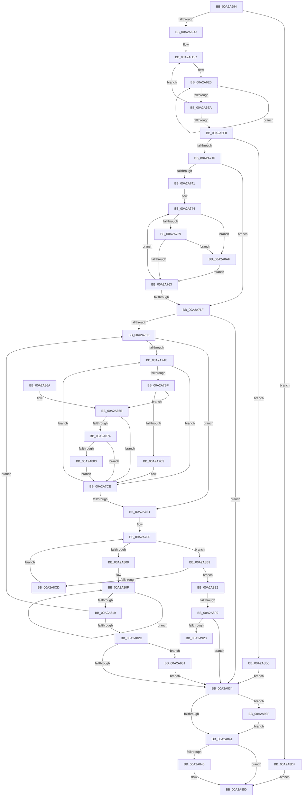

# PipFindDeviceOverrideEntry

- RVA: `0x00A2A694`–`0x00A2A949` (길이 `693` bytes)
- VA: `0x0000000140A2A694`
- 실행 섹션: `PAGE`
- PDB 이름 있음: `예`; PDB Function 태그: `예`
- unwind 정보 RVA: `0x000AC15C`
- 디코드: `186`개 명령, `693/693` bytes 표시
- 미해석 바이트: `0` (있으면 어셈블리에 `.byte`로 보존)

> 이 문서는 커널 이미지의 기계어와 PDB 기호를 분석해 생성했습니다. 4번과 5번은 함수 원형과 자료형을 바이너리 사용 방식에서 추정한 C 해석이며 원본 소스 복구 결과는 아닙니다.

## 1. Dependencies

- 직접 호출 지점: **9**; 고유 호출 대상: **8**
- 직접 호출자로 확인된 함수: **2**
- RIP 상대 이미지 참조: **3**

### Outgoing calls
- `0x00A2A70E` → [ExAllocatePool2](../../poolcode/B8/ExAllocatePool2_function_00B820F0.md) (function, `0x00B820F0`)
- `0x00A2A728` → [memcpy](../../text/6C/memcpy_function_006C6840.md) (function, `0x006C6840`)
- `0x00A2A78C` → [RtlInitUnicodeString](../../text/42/RtlInitUnicodeString_function_0042A780.md) (function, `0x0042A780`)
- `0x00A2A794` → [PsGetCurrentServerSiloGlobals](../../text/2F/PsGetCurrentServerSiloGlobals_function_002FE1F0.md) (function, `0x002FE1F0`)
- `0x00A2A84B` → [ExFreePoolWithTag](../../poolcode/B8/ExFreePoolWithTag_function_00B82870.md) (function, `0x00B82870`)
- `0x00A2A8C4` → [RtlEqualUnicodeString](../93/RtlEqualUnicodeString_function_00932A20.md) (function, `0x00932A20`)
- `0x00A2A919` → [IopOpenRegistryKeyEx](../A5/IopOpenRegistryKeyEx_function_00A51B44.md) (function, `0x00A51B44`)
- `0x00A2A935` → [ZwClose](../../text/6A/ZwClose_function_006AD2B0.md) (function, `0x006AD2B0`)
- `0x00A2A93F` → [ZwClose](../../text/6A/ZwClose_function_006AD2B0.md) (function, `0x006AD2B0`)

### Direct callers
- [PiQueryRemovableDeviceOverride](PiQueryRemovableDeviceOverride_function_00A2A474.md) at `0x00A2A522`
- [PiQueryRemovableDeviceOverride](PiQueryRemovableDeviceOverride_function_00A2A474.md) at `0x00A2A547`
- [PiQueryRemovableDeviceOverride](PiQueryRemovableDeviceOverride_function_00A2A474.md) at `0x00A2A582`
- [PiQueryRemovableDeviceOverride](PiQueryRemovableDeviceOverride_function_00A2A474.md) at `0x00A2A5A5`
- [sub_00B38904](../B3/Unknown_function_00B38904.md) at `0x00B389C7`

### Static image references
- `0x00A2A7E6` → RVA `0x00E66240` (`.data`; read)
- `0x00A2A7F5` → RVA `0x00E66238` (`.data`; read)
- `0x00A2A8F9` → RVA `0x00AFD290` (` ?? ::NNGAKEGL::`string'`; read)

## 2. Other-region calls and transfers

- 다른 실행 섹션으로 향하는 call: **7**
  - `0x00A2A70E` → [ExAllocatePool2](../../poolcode/B8/ExAllocatePool2_function_00B820F0.md) (`PAGE` → `POOLCODE`)
  - `0x00A2A728` → [memcpy](../../text/6C/memcpy_function_006C6840.md) (`PAGE` → `.text`)
  - `0x00A2A78C` → [RtlInitUnicodeString](../../text/42/RtlInitUnicodeString_function_0042A780.md) (`PAGE` → `.text`)
  - `0x00A2A794` → [PsGetCurrentServerSiloGlobals](../../text/2F/PsGetCurrentServerSiloGlobals_function_002FE1F0.md) (`PAGE` → `.text`)
  - `0x00A2A84B` → [ExFreePoolWithTag](../../poolcode/B8/ExFreePoolWithTag_function_00B82870.md) (`PAGE` → `POOLCODE`)
  - `0x00A2A935` → [ZwClose](../../text/6A/ZwClose_function_006AD2B0.md) (`PAGE` → `.text`)
  - `0x00A2A93F` → [ZwClose](../../text/6A/ZwClose_function_006AD2B0.md) (`PAGE` → `.text`)
- call이 아닌 외부 분기/꼬리 이동: **2**
  - `0x00A2A8F3` → [sub_00B38B6C](../B3/Unknown_function_00B38B6C.md) (`tail-transfer`)
  - `0x00A2A92C` → [sub_00B38B6C](../B3/Unknown_function_00B38B6C.md) (`tail-transfer`)

## 3. Assembly (complete function range)

```asm
00A2A694  48 89 5C 24 18                  mov qword ptr [rsp + 0x18], rbx
00A2A699  48 89 54 24 10                  mov qword ptr [rsp + 0x10], rdx
00A2A69E  55                              push rbp
00A2A69F  56                              push rsi
00A2A6A0  57                              push rdi
00A2A6A1  41 54                           push r12
00A2A6A3  41 55                           push r13
00A2A6A5  41 56                           push r14
00A2A6A7  41 57                           push r15
00A2A6A9  48 8B EC                        mov rbp, rsp
00A2A6AC  48 83 EC 40                     sub rsp, 0x40
00A2A6B0  45 33 FF                        xor r15d, r15d
00A2A6B3  0F 57 C0                        xorps xmm0, xmm0
00A2A6B6  0F 57 C9                        xorps xmm1, xmm1
00A2A6B9  4D 8B E8                        mov r13, r8
00A2A6BC  48 8B F1                        mov rsi, rcx
00A2A6BF  4C 89 7D 40                     mov qword ptr [rbp + 0x40], r15
00A2A6C3  0F 11 45 E0                     movups xmmword ptr [rbp - 0x20], xmm0
00A2A6C7  4C 89 7D 48                     mov qword ptr [rbp + 0x48], r15
00A2A6CB  0F 11 4D F0                     movups xmmword ptr [rbp - 0x10], xmm1
00A2A6CF  66 44 39 39                     cmp word ptr [rcx], r15w
00A2A6D3  0F 84 06 02 00 00               je 0x140a2a8df
00A2A6D9  41 8B DF                        mov ebx, r15d
00A2A6DC  48 83 C8 FF                     or rax, 0xffffffffffffffff
00A2A6E0  48 FF C0                        inc rax
00A2A6E3  66 44 39 3C 41                  cmp word ptr [rcx + rax*2], r15w
00A2A6E8  75 F6                           jne 0x140a2a6e0
00A2A6EA  FF C3                           inc ebx
00A2A6EC  03 D8                           add ebx, eax
00A2A6EE  48 8D 0C 5E                     lea rcx, [rsi + rbx*2]
00A2A6F2  66 44 39 39                     cmp word ptr [rcx], r15w
00A2A6F6  75 E4                           jne 0x140a2a6dc
00A2A6F8  FF C3                           inc ebx
00A2A6FA  41 B8 50 70 69 6E               mov r8d, 0x6e697050
00A2A700  44 8B F3                        mov r14d, ebx
00A2A703  B9 00 01 00 00                  mov ecx, 0x100
00A2A708  4D 03 F6                        add r14, r14
00A2A70B  49 8B D6                        mov rdx, r14
00A2A70E  E8 DD 79 15 00                  call 0x140b820f0
00A2A713  48 8B F8                        mov rdi, rax
00A2A716  48 85 C0                        test rax, rax
00A2A719  0F 84 B6 01 00 00               je 0x140a2a8d5
00A2A71F  4D 8B C6                        mov r8, r14
00A2A722  48 8B D6                        mov rdx, rsi
00A2A725  48 8B C8                        mov rcx, rax
00A2A728  E8 13 C1 C9 FF                  call 0x1406c6840
00A2A72D  66 03 DB                        add bx, bx
00A2A730  48 89 7D E8                     mov qword ptr [rbp - 0x18], rdi
00A2A734  66 89 5D E0                     mov word ptr [rbp - 0x20], bx
00A2A738  66 89 5D E2                     mov word ptr [rbp - 0x1e], bx
00A2A73C  66 D1 EB                        shr bx, 1
00A2A73F  74 2E                           je 0x140a2a76f
00A2A741  48 8B CF                        mov rcx, rdi
00A2A744  B8 FF FF 00 00                  mov eax, 0xffff
00A2A749  66 03 D8                        add bx, ax
00A2A74C  0F B7 01                        movzx eax, word ptr [rcx]
00A2A74F  66 83 F8 5C                     cmp ax, 0x5c
00A2A753  0F 84 56 01 00 00               je 0x140a2a8af
00A2A759  66 83 F8 2F                     cmp ax, 0x2f
00A2A75D  0F 84 4C 01 00 00               je 0x140a2a8af
00A2A763  66 89 01                        mov word ptr [rcx], ax
00A2A766  48 83 C1 02                     add rcx, 2
00A2A76A  66 85 DB                        test bx, bx
00A2A76D  75 D5                           jne 0x140a2a744
00A2A76F  41 BE 34 00 00 C0               mov r14d, 0xc0000034
00A2A775  4C 8B E7                        mov r12, rdi
00A2A778  41 8B DE                        mov ebx, r14d
00A2A77B  66 44 39 3F                     cmp word ptr [rdi], r15w
00A2A77F  0F 84 AF 00 00 00               je 0x140a2a834
00A2A785  49 8B D4                        mov rdx, r12
00A2A788  48 8D 4D F0                     lea rcx, [rbp - 0x10]
00A2A78C  E8 EF FF 9F FF                  call 0x14042a780
00A2A791  45 8B D7                        mov r10d, r15d
00A2A794  E8 57 3A 8D FF                  call 0x1402fe1f0
00A2A799  44 0F B7 4D F0                  movzx r9d, word ptr [rbp - 0x10]
00A2A79E  41 D1 E9                        shr r9d, 1
00A2A7A1  4C 8B 5D F8                     mov r11, qword ptr [rbp - 8]
00A2A7A5  48 8B 98 B0 04 00 00            mov rbx, qword ptr [rax + 0x4b0]
00A2A7AC  74 33                           je 0x140a2a7e1
00A2A7AE  45 0F B7 03                     movzx r8d, word ptr [r11]
00A2A7B2  41 FF C9                        dec r9d
00A2A7B5  4D 8D 5B 02                     lea r11, [r11 + 2]
00A2A7B9  41 83 F8 61                     cmp r8d, 0x61
00A2A7BD  72 0F                           jb 0x140a2a7ce
00A2A7BF  41 83 F8 7A                     cmp r8d, 0x7a
00A2A7C3  0F 87 A2 00 00 00               ja 0x140a2a86b
00A2A7C9  66 41 83 E8 20                  sub r8w, 0x20
00A2A7CE  45 69 D2 3F 00 01 00            imul r10d, r10d, 0x1003f
00A2A7D5  41 0F B7 C0                     movzx eax, r8w
00A2A7D9  44 03 D0                        add r10d, eax
00A2A7DC  45 85 C9                        test r9d, r9d
00A2A7DF  75 CD                           jne 0x140a2a7ae
00A2A7E1  33 D2                           xor edx, edx
00A2A7E3  41 8B C2                        mov eax, r10d
00A2A7E6  F7 35 54 BA 43 00               div dword ptr [rip + 0x43ba54]
00A2A7EC  41 8B DE                        mov ebx, r14d
00A2A7EF  8B F2                           mov esi, edx
00A2A7F1  48 C1 E6 04                     shl rsi, 4
00A2A7F5  48 03 35 3C BA 43 00            add rsi, qword ptr [rip + 0x43ba3c]
00A2A7FC  4C 8B 3E                        mov r15, qword ptr [rsi]
00A2A7FF  4C 3B FE                        cmp r15, rsi
00A2A802  0F 85 B1 00 00 00               jne 0x140a2a8b9
00A2A808  45 33 FF                        xor r15d, r15d
00A2A80B  48 83 C8 FF                     or rax, 0xffffffffffffffff
00A2A80F  48 FF C0                        inc rax
00A2A812  66 45 39 3C 44                  cmp word ptr [r12 + rax*2], r15w
00A2A817  75 F6                           jne 0x140a2a80f
00A2A819  4D 8D 24 44                     lea r12, [r12 + rax*2]
00A2A81D  49 83 C4 02                     add r12, 2
00A2A821  66 45 39 3C 24                  cmp word ptr [r12], r15w
00A2A826  0F 85 59 FF FF FF               jne 0x140a2a785
00A2A82C  85 DB                           test ebx, ebx
00A2A82E  0F 89 FD 00 00 00               jns 0x140a2a931
00A2A834  48 8B 4D 40                     mov rcx, qword ptr [rbp + 0x40]
00A2A838  48 85 C9                        test rcx, rcx
00A2A83B  0F 85 FE 00 00 00               jne 0x140a2a93f
00A2A841  48 85 FF                        test rdi, rdi
00A2A844  74 0A                           je 0x140a2a850
00A2A846  33 D2                           xor edx, edx
00A2A848  48 8B CF                        mov rcx, rdi
00A2A84B  E8 20 80 15 00                  call 0x140b82870
00A2A850  8B C3                           mov eax, ebx
00A2A852  48 8B 9C 24 90 00 00 00         mov rbx, qword ptr [rsp + 0x90]
00A2A85A  48 83 C4 40                     add rsp, 0x40
00A2A85E  41 5F                           pop r15
00A2A860  41 5E                           pop r14
00A2A862  41 5D                           pop r13
00A2A864  41 5C                           pop r12
00A2A866  5F                              pop rdi
00A2A867  5E                              pop rsi
00A2A868  5D                              pop rbp
00A2A869  C3                              ret
00A2A86A  CC                              int3
00A2A86B  48 85 DB                        test rbx, rbx
00A2A86E  0F 84 5A FF FF FF               je 0x140a2a7ce
00A2A874  B8 C0 00 00 00                  mov eax, 0xc0
00A2A879  66 44 3B C0                     cmp r8w, ax
00A2A87D  0F 82 4B FF FF FF               jb 0x140a2a7ce
00A2A883  49 8B C0                        mov rax, r8
00A2A886  41 8B D0                        mov edx, r8d
00A2A889  48 C1 E8 08                     shr rax, 8
00A2A88D  83 E2 0F                        and edx, 0xf
00A2A890  0F B7 0C 43                     movzx ecx, word ptr [rbx + rax*2]
00A2A894  41 8B C0                        mov eax, r8d
00A2A897  C1 E8 04                        shr eax, 4
00A2A89A  83 E0 0F                        and eax, 0xf
00A2A89D  03 C8                           add ecx, eax
00A2A89F  0F B7 0C 4B                     movzx ecx, word ptr [rbx + rcx*2]
00A2A8A3  03 CA                           add ecx, edx
00A2A8A5  66 44 03 04 4B                  add r8w, word ptr [rbx + rcx*2]
00A2A8AA  E9 1F FF FF FF                  jmp 0x140a2a7ce
00A2A8AF  B8 23 00 00 00                  mov eax, 0x23
00A2A8B4  E9 AA FE FF FF                  jmp 0x140a2a763
00A2A8B9  49 8D 57 10                     lea rdx, [r15 + 0x10]
00A2A8BD  41 B0 01                        mov r8b, 1
00A2A8C0  48 8D 4D F0                     lea rcx, [rbp - 0x10]
00A2A8C4  E8 57 81 F0 FF                  call 0x140932a20
00A2A8C9  84 C0                           test al, al
00A2A8CB  75 1C                           jne 0x140a2a8e9
00A2A8CD  4D 8B 3F                        mov r15, qword ptr [r15]
00A2A8D0  E9 2A FF FF FF                  jmp 0x140a2a7ff
00A2A8D5  BB 9A 00 00 C0                  mov ebx, 0xc000009a
00A2A8DA  E9 55 FF FF FF                  jmp 0x140a2a834
00A2A8DF  BB 34 00 00 C0                  mov ebx, 0xc0000034
00A2A8E4  E9 67 FF FF FF                  jmp 0x140a2a850
00A2A8E9  48 8B 55 40                     mov rdx, qword ptr [rbp + 0x40]
00A2A8ED  45 33 FF                        xor r15d, r15d
00A2A8F0  48 85 D2                        test rdx, rdx
00A2A8F3  0F 85 73 E2 10 00               jne 0x140b38b6c
00A2A8F9  48 8D 05 90 29 0D 00            lea rax, [rip + 0xd2990]
00A2A900  C7 45 E0 84 00 86 00            mov dword ptr [rbp - 0x20], 0x860084
00A2A907  41 B9 19 00 02 00               mov r9d, 0x20019
00A2A90D  48 89 45 E8                     mov qword ptr [rbp - 0x18], rax
00A2A911  4C 8D 45 E0                     lea r8, [rbp - 0x20]
00A2A915  48 8D 4D 40                     lea rcx, [rbp + 0x40]
00A2A919  E8 26 72 02 00                  call 0x140a51b44
00A2A91E  8B D8                           mov ebx, eax
00A2A920  85 C0                           test eax, eax
00A2A922  0F 88 0C FF FF FF               js 0x140a2a834
00A2A928  48 8B 55 40                     mov rdx, qword ptr [rbp + 0x40]
00A2A92C  E9 3B E2 10 00                  jmp 0x140b38b6c
00A2A931  48 8B 4D 48                     mov rcx, qword ptr [rbp + 0x48]
00A2A935  E8 76 29 C8 FF                  call 0x1406ad2b0
00A2A93A  E9 F5 FE FF FF                  jmp 0x140a2a834
00A2A93F  E8 6C 29 C8 FF                  call 0x1406ad2b0
00A2A944  E9 F8 FE FF FF                  jmp 0x140a2a841
```

## 4. C-style interpretation (structured pseudocode)

```c
__int64 __fastcall PipFindDeviceOverrideEntry(__int64 a1, __int64 a2, __int64 a3)
{
    __int64 result;
    __int64 v_r10;
    __int64 v_r12;
    __int64 v_r14;
    __int64 v_r15;
    __int64 v_rbx;
    __int64 v_rsi;
    __int64 v_rsp;
    unsigned __int64 v_stack_m40;
    unsigned __int64 v_stack_m48;
    unsigned __int64 v_stack_m50;
    unsigned __int16 v_stack_m56;
    unsigned __int64 v_stack_m58;
    unsigned __int64 v_stack_p10;
    unsigned __int64 v_stack_p18;
    unsigned __int64 v_stack_p8;

    v_stack_p18 = v_rbx;
    v_stack_p10 = a2;
    v_rsp = (v_rsp) - (64);
    v_r15 = 0;
    v_stack_p8 = 0;
    v_stack_m58 = v_xmm0;
    v_stack_p10 = 0;
    v_stack_m48 = v_xmm1;
    if ((*(unsigned __int16 *)(a1)) == 0) goto loc_00A2A8DF;
loc_00A2A6DC:
    result = (result) | (-1);
loc_00A2A6E0:
    result = (result) + 1;
    if ((*(unsigned __int16 *)(a1 + result * 2)) != 0) goto loc_00A2A6E0;
    v_rbx = (unsigned int)((0) + 1);
    v_rbx = (unsigned int)((v_rbx) + ((unsigned int)(result)));
    if ((*(unsigned __int16 *)(a1 + v_rbx * 2)) != 0) goto loc_00A2A6DC;
    v_rbx = (unsigned int)((v_rbx) + 1);
    v_r14 = ((unsigned int)((unsigned int)(v_rbx))) + ((unsigned int)((unsigned int)(v_rbx)));
    result = ExAllocatePool2(256, v_r14, (unsigned int)(0x6E697050ULL), a4);
    if (result == 0) goto loc_00A2A8D5;
    result = memcpy(result, a1, v_r14, a4);
    v_rbx = (unsigned __int16)((v_rbx) + ((unsigned __int16)(v_rbx)));
    v_stack_m50 = result;
    v_stack_m58 = (unsigned __int16)(v_rbx);
    v_stack_m56 = (unsigned __int16)(v_rbx);
    v_rbx = (unsigned __int16)((v_rbx) >> (1));
    if (condition_is_equal) goto loc_00A2A76F;
loc_00A2A744:
    v_rbx = (unsigned __int16)((v_rbx) + ((unsigned __int16)((unsigned int)(0xFFFFULL))));
    if (((unsigned __int16)(*(unsigned __int16 *)(result))) == 92) goto loc_00A2A8AF;
    if (((unsigned __int16)(*(unsigned __int16 *)(result))) == 47) goto loc_00A2A8AF;
loc_00A2A763:
    *(unsigned __int16 *)(result) = (unsigned __int16)(*(unsigned __int16 *)(result));
    a1 = (result) + (2);
    if ((unsigned __int16)(v_rbx) != 0) goto loc_00A2A744;
loc_00A2A76F:
    if ((*(unsigned __int16 *)(result)) == 0) goto loc_00A2A834;
loc_00A2A785:
    result = RtlInitUnicodeString(v_stack_m48, result, v_r14, a4);
    result = PsGetCurrentServerSiloGlobals(v_stack_m48, result, v_r14, a4);
    a4 = (unsigned int)((v_stack_m48) >> (1));
    if (condition_is_equal) goto loc_00A2A7E1;
loc_00A2A7AE:
    a4 = (unsigned int)((a4) - 1);
    if (((unsigned int)(*(unsigned __int16 *)(v_stack_m40))) < 97) goto loc_00A2A7CE;
    if (((unsigned int)(*(unsigned __int16 *)(v_stack_m40))) > 122) goto loc_00A2A86B;
    a3 = (unsigned __int16)((*(unsigned __int16 *)(v_stack_m40)) - (32));
loc_00A2A7CE:
    v_r10 = (unsigned int)((0) * (0));
    v_r10 = (unsigned int)((v_r10) + ((unsigned int)((unsigned __int16)(a3))));
    if ((unsigned int)(a4) != 0) goto loc_00A2A7AE;
loc_00A2A7E1:
    a2 = 0;
    v_rsi = (0) << (4);
    v_rsi = (v_rsi) + (*(unsigned __int64 *)(v_rip + 4438588));
loc_00A2A7FF:
    if ((*(unsigned __int64 *)(v_rsi)) != v_rsi) goto loc_00A2A8B9;
    v_r15 = 0;
    result = ((unsigned int)((unsigned int)(v_r10))) | (-1);
loc_00A2A80F:
    result = (result) + 1;
    if ((*(unsigned __int16 *)(result + result * 2)) != 0) goto loc_00A2A80F;
    v_r12 = (result + result * 2) + (2);
    if ((*(unsigned __int16 *)(v_r12)) != 0) goto loc_00A2A785;
    if (!sign_flag) goto loc_00A2A931;
loc_00A2A834:
    if (v_stack_p8 != 0) goto loc_00A2A93F;
loc_00A2A841:
    if (result != 0) {
        a2 = 0;
        a1 = result;
        result = ExFreePoolWithTag(a1, a2, a3, a4);
    }
    v_rsp = (v_rsp) + (64);
    return (unsigned int)((unsigned int)((unsigned int)((unsigned int)((unsigned int)(0xC0000034ULL)))));
loc_00A2A86B:
    if (v_stack_p18 == 0) goto loc_00A2A7CE;
    if (((unsigned __int16)(a3)) < 192) goto loc_00A2A7CE;
    result = (a3) >> (8);
    a2 = (unsigned int)(((unsigned int)((unsigned int)(a3))) & (15));
    result = (unsigned int)(((unsigned int)((unsigned int)(a3))) >> (4));
    result = (unsigned int)((result) & (15));
    a1 = (unsigned int)((*(unsigned __int16 *)(v_stack_p18 + result * 2)) + ((unsigned int)(result)));
    a1 = (unsigned int)((*(unsigned __int16 *)(v_stack_p18 + a1 * 2)) + ((unsigned int)(a2)));
    a3 = (unsigned __int16)((a3) + (*(unsigned __int16 *)(v_stack_p18 + a1 * 2)));
    goto loc_00A2A7CE;
loc_00A2A8AF:
    goto loc_00A2A763;
loc_00A2A8B9:
    result = RtlEqualUnicodeString(v_stack_m48, v_r15 + 16, 1, a4);
    if ((unsigned __int8)(result) != 0) goto loc_00A2A8E9;
    goto loc_00A2A7FF;
loc_00A2A8D5:
    goto loc_00A2A834;
loc_00A2A8DF:
    goto loc_00A2A850;
loc_00A2A8E9:
    v_r15 = 0;
    v_stack_m58 = 0x860084ULL;
    v_stack_m50 = v_rip + 862608;
    result = IopOpenRegistryKeyEx(v_stack_p8, v_stack_p8, v_stack_m58, (unsigned int)(0x20019ULL));
    if (sign_flag) goto loc_00A2A834;
loc_00A2A931:
    result = ZwClose(v_stack_p10, v_stack_p8, v_stack_m58, (unsigned int)(0x20019ULL));
    goto loc_00A2A834;
loc_00A2A93F:
    result = ZwClose(v_stack_p10, v_stack_p8, v_stack_m58, (unsigned int)(0x20019ULL));
    goto loc_00A2A841;
}
```

## 5. (Beta) C Style

```c
int64_t PipFindDeviceOverrideEntry(void *Arg1, int64_t Arg2, int64_t Arg3)
{
    uint8_t *arg1 = (uint8_t *)Arg1;

    int64_t result;
    int64_t local_r10;
    int64_t local_r12;
    int64_t local_r14;
    int64_t local_r15;
    int64_t local_rbx;
    int64_t local_rsi;
    int64_t local_rsp;
    uint64_t v_stack_m40;
    uint64_t v_stack_m48;
    uint64_t v_stack_m50;
    uint16_t v_stack_m56;
    uint64_t v_stack_m58;
    uint64_t v_stack_p10;
    uint64_t v_stack_p18;
    uint64_t v_stack_p8;

    v_stack_p18 = local_rbx;
    v_stack_p10 = Arg2;
    local_rsp = (local_rsp) - (64);
    local_r15 = 0;
    v_stack_p8 = 0;
    v_stack_m58 = v_xmm0;
    v_stack_p10 = 0;
    v_stack_m48 = v_xmm1;
    if ((*(uint16_t *)(arg1)) == 0) goto loc_00A2A8DF;
loc_00A2A6DC:
    result = (result) | (-1);
loc_00A2A6E0:
    result = (result) + 1;
    if ((*(uint16_t *)(arg1 + result * 2)) != 0) goto loc_00A2A6E0;
    local_rbx = (uint32_t)((0) + 1);
    local_rbx = (uint32_t)((local_rbx) + ((uint32_t)(result)));
    if ((*(uint16_t *)(arg1 + local_rbx * 2)) != 0) goto loc_00A2A6DC;
    local_rbx = (uint32_t)((local_rbx) + 1);
    local_r14 = ((uint32_t)((uint32_t)(local_rbx))) + ((uint32_t)((uint32_t)(local_rbx)));
    result = ExAllocatePool2(256, local_r14, (uint32_t)(0x6E697050ULL), a4);
    if (result == 0) goto loc_00A2A8D5;
    result = memcpy(result, Arg1, local_r14, a4);
    local_rbx = (uint16_t)((local_rbx) + ((uint16_t)(local_rbx)));
    v_stack_m50 = result;
    v_stack_m58 = (uint16_t)(local_rbx);
    v_stack_m56 = (uint16_t)(local_rbx);
    local_rbx = (uint16_t)((local_rbx) >> (1));
    if (condition_is_equal) goto loc_00A2A76F;
loc_00A2A744:
    local_rbx = (uint16_t)((local_rbx) + ((uint16_t)((uint32_t)(0xFFFFULL))));
    if (((uint16_t)(*(uint16_t *)(result))) == 92) goto loc_00A2A8AF;
    if (((uint16_t)(*(uint16_t *)(result))) == 47) goto loc_00A2A8AF;
loc_00A2A763:
    *(uint16_t *)(result) = (uint16_t)(*(uint16_t *)(result));
    Arg1 = (result) + (2);
    if ((uint16_t)(local_rbx) != 0) goto loc_00A2A744;
loc_00A2A76F:
    if ((*(uint16_t *)(result)) == 0) goto loc_00A2A834;
loc_00A2A785:
    result = RtlInitUnicodeString(v_stack_m48, result, local_r14, a4);
    result = PsGetCurrentServerSiloGlobals(v_stack_m48, result, local_r14, a4);
    a4 = (uint32_t)((v_stack_m48) >> (1));
    if (condition_is_equal) goto loc_00A2A7E1;
loc_00A2A7AE:
    a4 = (uint32_t)((a4) - 1);
    if (((uint32_t)(*(uint16_t *)(v_stack_m40))) < 97) goto loc_00A2A7CE;
    if (((uint32_t)(*(uint16_t *)(v_stack_m40))) > 122) goto loc_00A2A86B;
    Arg3 = (uint16_t)((*(uint16_t *)(v_stack_m40)) - (32));
loc_00A2A7CE:
    local_r10 = (uint32_t)((0) * (0));
    local_r10 = (uint32_t)((local_r10) + ((uint32_t)((uint16_t)(Arg3))));
    if ((uint32_t)(a4) != 0) goto loc_00A2A7AE;
loc_00A2A7E1:
    Arg2 = 0;
    local_rsi = (0) << (4);
    local_rsi = (local_rsi) + (*(uint64_t *)(v_rip + 0x43BA3C));
loc_00A2A7FF:
    if ((*(uint64_t *)(local_rsi)) != local_rsi) goto loc_00A2A8B9;
    local_r15 = 0;
    result = ((uint32_t)((uint32_t)(local_r10))) | (-1);
loc_00A2A80F:
    result = (result) + 1;
    if ((*(uint16_t *)(result + result * 2)) != 0) goto loc_00A2A80F;
    local_r12 = (result + result * 2) + (2);
    if ((*(uint16_t *)(local_r12)) != 0) goto loc_00A2A785;
    if (!sign_flag) goto loc_00A2A931;
loc_00A2A834:
    if (v_stack_p8 != 0) goto loc_00A2A93F;
loc_00A2A841:
    if (result != 0) {
        Arg2 = 0;
        Arg1 = result;
        result = ExFreePoolWithTag(Arg1, Arg2, Arg3, a4);
    }
    local_rsp = (local_rsp) + (64);
    return (uint32_t)((uint32_t)((uint32_t)((uint32_t)((uint32_t)(0xC0000034ULL)))));
loc_00A2A86B:
    if (v_stack_p18 == 0) goto loc_00A2A7CE;
    if (((uint16_t)(Arg3)) < 192) goto loc_00A2A7CE;
    result = (Arg3) >> (8);
    Arg2 = (uint32_t)(((uint32_t)((uint32_t)(Arg3))) & (15));
    result = (uint32_t)(((uint32_t)((uint32_t)(Arg3))) >> (4));
    result = (uint32_t)((result) & (15));
    Arg1 = (uint32_t)((*(uint16_t *)(v_stack_p18 + result * 2)) + ((uint32_t)(result)));
    Arg1 = (uint32_t)((*(uint16_t *)(v_stack_p18 + arg1 * 2)) + ((uint32_t)(Arg2)));
    Arg3 = (uint16_t)((Arg3) + (*(uint16_t *)(v_stack_p18 + arg1 * 2)));
    goto loc_00A2A7CE;
loc_00A2A8AF:
    goto loc_00A2A763;
loc_00A2A8B9:
    result = RtlEqualUnicodeString(v_stack_m48, local_r15 + 16, 1, a4);
    if ((uint8_t)(result) != 0) goto loc_00A2A8E9;
    goto loc_00A2A7FF;
loc_00A2A8D5:
    goto loc_00A2A834;
loc_00A2A8DF:
    goto loc_00A2A850;
loc_00A2A8E9:
    local_r15 = 0;
    v_stack_m58 = 0x860084ULL;
    v_stack_m50 = v_rip + 862608;
    result = IopOpenRegistryKeyEx(v_stack_p8, v_stack_p8, v_stack_m58, (uint32_t)(0x20019ULL));
    if (sign_flag) goto loc_00A2A834;
loc_00A2A931:
    result = ZwClose(v_stack_p10, v_stack_p8, v_stack_m58, (uint32_t)(0x20019ULL));
    goto loc_00A2A834;
loc_00A2A93F:
    result = ZwClose(v_stack_p10, v_stack_p8, v_stack_m58, (uint32_t)(0x20019ULL));
    goto loc_00A2A841;
}
```

### 관측된 메모리 오프셋

구조체 형식이 확인되지 않은 접근은 인자 기준의 오프셋으로만 기록했습니다.

| 기준 인자 | 오프셋 표현 | 폭 (bit) | 접근 |
|---|---:|---:|---|
| `Arg1` | `+ 0x0` | `16` | `R` |
| `Arg1` | `+ 0x0 + rax*2` | `16` | `R` |
| `Arg1` | `+ 0x0 + rbx*2` | `64` | `R` |

## 6. Execution-region graph

[열기: 2D/3D 그래프와 함수 탐색 컨트롤 패널](../../../control-panel.html?section=page&rva=0x00A2A694&view=graph)

- 2D 그래프는 위에서 아래로 흐르고, 3D 그래프는 빈 공간을 드래그해 회전합니다. Shift+드래그는 이동, 휠은 확대·축소, 함수 노드 선택은 대상 보고서 이동입니다.

### Static fallback


