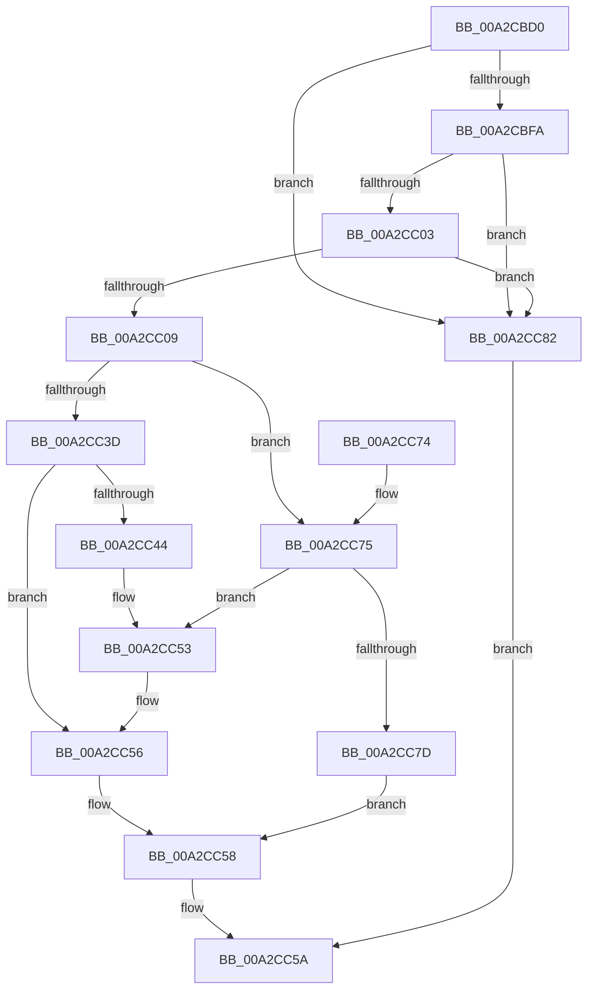

# PlugPlayGetDeviceProperty

- RVA: `0x00A2CBD0`–`0x00A2CC89` (길이 `185` bytes)
- VA: `0x0000000140A2CBD0`
- 실행 섹션: `PAGE`
- PDB 이름 있음: `예`; PDB Function 태그: `아니요`
- unwind 정보 RVA: `0x000AC674`
- 디코드: `56`개 명령, `185/185` bytes 표시
- 미해석 바이트: `0` (있으면 어셈블리에 `.byte`로 보존)

> 이 문서는 커널 이미지의 기계어와 PDB 기호를 분석해 생성했습니다. 4번과 5번은 함수 원형과 자료형을 바이너리 사용 방식에서 추정한 C 해석이며 원본 소스 복구 결과는 아닙니다.

## 1. Dependencies

- 직접 호출 지점: **2**; 고유 호출 대상: **2**
- 직접 호출자로 확인된 함수: **1**
- RIP 상대 이미지 참조: **0**

### Outgoing calls
- `0x00A2CC32` → [ZwPlugPlayControl](../../text/6A/ZwPlugPlayControl_function_006AF890.md) (function, `0x006AF890`)
- `0x00A2CC4E` → [memset](../../text/6C/memset_function_006C6C40.md) (function, `0x006C6C40`)

### Direct callers
- [PiPnpRtlGetDeviceNtPropertyRoutine](PiPnpRtlGetDeviceNtPropertyRoutine_function_00A2CB90.md) at `0x00A2CBBC`

### Static image references
- 디코드된 RIP-relative 메모리 참조가 없습니다.

## 2. Other-region calls and transfers

- 다른 실행 섹션으로 향하는 call: **2**
  - `0x00A2CC32` → [ZwPlugPlayControl](../../text/6A/ZwPlugPlayControl_function_006AF890.md) (`PAGE` → `.text`)
  - `0x00A2CC4E` → [memset](../../text/6C/memset_function_006C6C40.md) (`PAGE` → `.text`)
- 별도 외부 분기/꼬리 이동을 확인하지 못했습니다.

## 3. Assembly (complete function range)

```asm
00A2CBD0  48 8B C4                        mov rax, rsp
00A2CBD3  48 89 58 08                     mov qword ptr [rax + 8], rbx
00A2CBD7  48 89 70 10                     mov qword ptr [rax + 0x10], rsi
00A2CBDB  48 89 78 18                     mov qword ptr [rax + 0x18], rdi
00A2CBDF  4C 89 70 20                     mov qword ptr [rax + 0x20], r14
00A2CBE3  55                              push rbp
00A2CBE4  48 8B EC                        mov rbp, rsp
00A2CBE7  48 83 EC 50                     sub rsp, 0x50
00A2CBEB  41 8B F9                        mov edi, r9d
00A2CBEE  4D 8B F0                        mov r14, r8
00A2CBF1  48 85 C9                        test rcx, rcx
00A2CBF4  0F 84 88 00 00 00               je 0x140a2cc82
00A2CBFA  48 8B 5D 30                     mov rbx, qword ptr [rbp + 0x30]
00A2CBFE  48 85 DB                        test rbx, rbx
00A2CC01  74 7F                           je 0x140a2cc82
00A2CC03  83 7D 38 00                     cmp dword ptr [rbp + 0x38], 0
00A2CC07  75 79                           jne 0x140a2cc82
00A2CC09  0F 10 01                        movups xmm0, xmmword ptr [rcx]
00A2CC0C  83 65 E4 00                     and dword ptr [rbp - 0x1c], 0
00A2CC10  83 65 F4 00                     and dword ptr [rbp - 0xc], 0
00A2CC14  4C 89 45 E8                     mov qword ptr [rbp - 0x18], r8
00A2CC18  41 B8 28 00 00 00               mov r8d, 0x28
00A2CC1E  89 55 E0                        mov dword ptr [rbp - 0x20], edx
00A2CC21  48 8D 55 D0                     lea rdx, [rbp - 0x30]
00A2CC25  F3 0F 7F 45 D0                  movdqu xmmword ptr [rbp - 0x30], xmm0
00A2CC2A  44 89 4D F0                     mov dword ptr [rbp - 0x10], r9d
00A2CC2E  41 8D 48 E2                     lea ecx, [r8 - 0x1e]
00A2CC32  E8 59 2C C8 FF                  call 0x1406af890
00A2CC37  8B F0                           mov esi, eax
00A2CC39  85 C0                           test eax, eax
00A2CC3B  78 38                           js 0x140a2cc75
00A2CC3D  8B 4D F0                        mov ecx, dword ptr [rbp - 0x10]
00A2CC40  3B F9                           cmp edi, ecx
00A2CC42  76 12                           jbe 0x140a2cc56
00A2CC44  2B F9                           sub edi, ecx
00A2CC46  33 D2                           xor edx, edx
00A2CC48  44 8B C7                        mov r8d, edi
00A2CC4B  49 03 CE                        add rcx, r14
00A2CC4E  E8 ED 9F C9 FF                  call 0x1406c6c40
00A2CC53  8B 4D F0                        mov ecx, dword ptr [rbp - 0x10]
00A2CC56  89 0B                           mov dword ptr [rbx], ecx
00A2CC58  8B C6                           mov eax, esi
00A2CC5A  48 8B 5C 24 60                  mov rbx, qword ptr [rsp + 0x60]
00A2CC5F  48 8B 74 24 68                  mov rsi, qword ptr [rsp + 0x68]
00A2CC64  48 8B 7C 24 70                  mov rdi, qword ptr [rsp + 0x70]
00A2CC69  4C 8B 74 24 78                  mov r14, qword ptr [rsp + 0x78]
00A2CC6E  48 83 C4 50                     add rsp, 0x50
00A2CC72  5D                              pop rbp
00A2CC73  C3                              ret
00A2CC74  CC                              int3
00A2CC75  81 FE 23 00 00 C0               cmp esi, 0xc0000023
00A2CC7B  74 D6                           je 0x140a2cc53
00A2CC7D  83 23 00                        and dword ptr [rbx], 0
00A2CC80  EB D6                           jmp 0x140a2cc58
00A2CC82  B8 0D 00 00 C0                  mov eax, 0xc000000d
00A2CC87  EB D1                           jmp 0x140a2cc5a
```

## 4. C-style interpretation (structured pseudocode)

```c
__int64 __fastcall PlugPlayGetDeviceProperty(__int64 a1, int a2, __int64 a3, int a4, __int64 a5, unsigned int a6)
{
    __int64 result;
    __int64 v_rdi;
    __int64 v_rsp;
    unsigned int v_stack_m14;
    unsigned int v_stack_m18;
    unsigned __int64 v_stack_m20;
    unsigned int v_stack_m24;
    unsigned int v_stack_m28;
    unsigned __int64 v_stack_m38;
    unsigned __int64 v_stack_p10;
    unsigned __int64 v_stack_p18;
    unsigned __int64 v_stack_p20;
    unsigned __int64 v_stack_p8;

    *(unsigned __int64 *)(v_rsp + 8) = v_rbx;
    *(unsigned __int64 *)(v_rsp + 16) = v_rsi;
    *(unsigned __int64 *)(v_rsp + 24) = v_rdi;
    *(unsigned __int64 *)(v_rsp + 32) = v_r14;
    v_rsp = (v_rsp) - (80);
    if (a1 == 0) goto loc_00A2CC82;
    if (a5 == 0) goto loc_00A2CC82;
    if (a6 != 0) goto loc_00A2CC82;
    v_stack_m20 = a3;
    v_stack_m28 = a2;
    v_stack_m38 = v_xmm0;
    v_stack_m18 = a4;
    result = ZwPlugPlayControl(40 - 30, v_stack_m38, 40, a4);
    if (sign_flag) goto loc_00A2CC75;
    if (((unsigned int)((unsigned int)(a4))) <= ((unsigned int)((unsigned int)(v_stack_m18)))) goto loc_00A2CC56;
    v_rdi = (unsigned int)(((unsigned int)(a4)) - ((unsigned int)((unsigned int)(v_stack_m18))));
    a2 = 0;
    a1 = ((unsigned int)(v_stack_m18)) + (a3);
    result = memset(a1, a2, (unsigned int)((unsigned int)(v_rdi)), a4);
loc_00A2CC53:
loc_00A2CC56:
    *(unsigned int *)(a5) = (unsigned int)((unsigned int)(v_stack_m18));
loc_00A2CC58:
loc_00A2CC5A:
    v_rsp = (v_rsp) + (80);
    return (unsigned int)((unsigned int)((unsigned int)((unsigned int)(result))));
loc_00A2CC75:
    if (((unsigned int)(v_stack_p10)) == 0xC0000023ULL) goto loc_00A2CC53;
    goto loc_00A2CC58;
loc_00A2CC82:
    goto loc_00A2CC5A;
}
```

## 5. (Beta) C Style

```c
int64_t PlugPlayGetDeviceProperty(int64_t Arg1, int32_t Arg2, int64_t Arg3, int32_t Arg4, int64_t Arg5, uint32_t Arg6)
{
    int64_t result;
    int64_t local_rdi;
    int64_t local_rsp;
    uint32_t v_stack_m14;
    uint32_t v_stack_m18;
    uint64_t v_stack_m20;
    uint32_t v_stack_m24;
    uint32_t v_stack_m28;
    uint64_t v_stack_m38;
    uint64_t v_stack_p10;
    uint64_t v_stack_p18;
    uint64_t v_stack_p20;
    uint64_t v_stack_p8;

    *(uint64_t *)(local_rsp + 0x8) = local_rbx;
    *(uint64_t *)(local_rsp + 0x10) = local_rsi;
    *(uint64_t *)(local_rsp + 0x18) = local_rdi;
    *(uint64_t *)(local_rsp + 0x20) = local_r14;
    local_rsp = (local_rsp) - (80);
    if (Arg1 == 0) goto loc_00A2CC82;
    if (Arg5 == 0) goto loc_00A2CC82;
    if (Arg6 != 0) goto loc_00A2CC82;
    v_stack_m20 = Arg3;
    v_stack_m28 = Arg2;
    v_stack_m38 = v_xmm0;
    v_stack_m18 = Arg4;
    result = ZwPlugPlayControl(40 - 30, v_stack_m38, 40, Arg4);
    if (sign_flag) goto loc_00A2CC75;
    if (((uint32_t)((uint32_t)(Arg4))) <= ((uint32_t)((uint32_t)(v_stack_m18)))) goto loc_00A2CC56;
    local_rdi = (uint32_t)(((uint32_t)(Arg4)) - ((uint32_t)((uint32_t)(v_stack_m18))));
    Arg2 = 0;
    Arg1 = ((uint32_t)(v_stack_m18)) + (Arg3);
    result = memset(Arg1, Arg2, (uint32_t)((uint32_t)(local_rdi)), Arg4);
loc_00A2CC53:
loc_00A2CC56:
    *(uint32_t *)(Arg5) = (uint32_t)((uint32_t)(v_stack_m18));
loc_00A2CC58:
loc_00A2CC5A:
    local_rsp = (local_rsp) + (80);
    return (uint32_t)((uint32_t)((uint32_t)((uint32_t)(result))));
loc_00A2CC75:
    if (((uint32_t)(v_stack_p10)) == 0xC0000023ULL) goto loc_00A2CC53;
    goto loc_00A2CC58;
loc_00A2CC82:
    goto loc_00A2CC5A;
}
```

## 6. Execution-region graph

[열기: 2D/3D 그래프와 함수 탐색 컨트롤 패널](../../../control-panel.html?section=page&rva=0x00A2CBD0&view=graph)

- 2D 그래프는 위에서 아래로 흐르고, 3D 그래프는 빈 공간을 드래그해 회전합니다. Shift+드래그는 이동, 휠은 확대·축소, 함수 노드 선택은 대상 보고서 이동입니다.

### Static fallback


