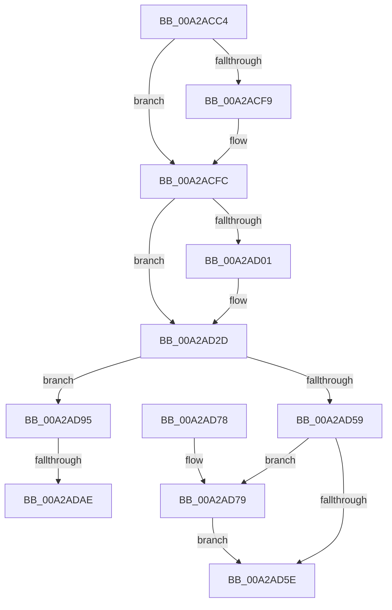

# PnpAllocateResources

- RVA: `0x00A2ACC4`–`0x00A2ADB6` (길이 `242` bytes)
- VA: `0x0000000140A2ACC4`
- 실행 섹션: `PAGE`
- PDB 이름 있음: `예`; PDB Function 태그: `예`
- unwind 정보 RVA: `0x000AC1F0`
- 디코드: `69`개 명령, `242/242` bytes 표시
- 미해석 바이트: `0` (있으면 어셈블리에 `.byte`로 보존)

> 이 문서는 커널 이미지의 기계어와 PDB 기호를 분석해 생성했습니다. 4번과 5번은 함수 원형과 자료형을 바이너리 사용 방식에서 추정한 C 해석이며 원본 소스 복구 결과는 아닙니다.

## 1. Dependencies

- 직접 호출 지점: **4**; 고유 호출 대상: **4**
- 직접 호출자로 확인된 함수: **2**
- RIP 상대 이미지 참조: **2**

### Outgoing calls
- `0x00A2AD28` → [KeWaitForSingleObject](../../text/20/KeWaitForSingleObject_function_0020E6B0.md) (function, `0x0020E6B0`)
- `0x00A2AD4E` → [PnpGetResourceRequirementsForAssignTable](PnpGetResourceRequirementsForAssignTable_function_00A2ADBC.md) (function, `0x00A2ADBC`)
- `0x00A2AD89` → [KeReleaseSemaphore](../../text/39/KeReleaseSemaphore_function_00397080.md) (function, `0x00397080`)
- `0x00A2AD8E` → [KeLeaveCriticalRegion](../../text/25/KeLeaveCriticalRegion_function_0025D8B0.md) (function, `0x0025D8B0`)

### Direct callers
- [IopLegacyResourceAllocation](../A0/IopLegacyResourceAllocation_function_00A07224.md) at `0x00A0732E`
- [PnpAssignResourcesToDevices](PnpAssignResourcesToDevices_function_00A2AC4C.md) at `0x00A2ACA0`

### Static image references
- `0x00A2AD0A` → RVA `0x00F8C360` (`.data`; read)
- `0x00A2AD95` → RVA `0x00F8C5F8` (`.data`; read)

## 2. Other-region calls and transfers

- 다른 실행 섹션으로 향하는 call: **3**
  - `0x00A2AD28` → [KeWaitForSingleObject](../../text/20/KeWaitForSingleObject_function_0020E6B0.md) (`PAGE` → `.text`)
  - `0x00A2AD89` → [KeReleaseSemaphore](../../text/39/KeReleaseSemaphore_function_00397080.md) (`PAGE` → `.text`)
  - `0x00A2AD8E` → [KeLeaveCriticalRegion](../../text/25/KeLeaveCriticalRegion_function_0025D8B0.md) (`PAGE` → `.text`)
- call이 아닌 외부 분기/꼬리 이동: **2**
  - `0x00A2ADA8` → [sub_00B38CDE + 0x5A](../B3/Unknown_function_00B38CDE.md) (`tail-transfer`)
  - `0x00A2ADB1` → [sub_00B38CDE](../B3/Unknown_function_00B38CDE.md) (`tail-transfer`)

## 3. Assembly (complete function range)

```asm
00A2ACC4  48 89 5C 24 20                  mov qword ptr [rsp + 0x20], rbx
00A2ACC9  44 88 44 24 18                  mov byte ptr [rsp + 0x18], r8b
00A2ACCE  55                              push rbp
00A2ACCF  56                              push rsi
00A2ACD0  57                              push rdi
00A2ACD1  41 54                           push r12
00A2ACD3  41 55                           push r13
00A2ACD5  41 56                           push r14
00A2ACD7  41 57                           push r15
00A2ACD9  48 83 EC 40                     sub rsp, 0x40
00A2ACDD  45 33 E4                        xor r12d, r12d
00A2ACE0  44 8B F1                        mov r14d, ecx
00A2ACE3  0F 57 C0                        xorps xmm0, xmm0
00A2ACE6  4D 8B E9                        mov r13, r9
00A2ACE9  45 8A F8                        mov r15b, r8b
00A2ACEC  48 8B F2                        mov rsi, rdx
00A2ACEF  0F 11 44 24 30                  movups xmmword ptr [rsp + 0x30], xmm0
00A2ACF4  4D 85 C9                        test r9, r9
00A2ACF7  74 03                           je 0x140a2acfc
00A2ACF9  45 88 21                        mov byte ptr [r9], r12b
00A2ACFC  45 84 C0                        test r8b, r8b
00A2ACFF  75 2C                           jne 0x140a2ad2d
00A2AD01  65 48 8B 04 25 88 01 00 00      mov rax, qword ptr gs:[0x188]
00A2AD0A  48 8D 0D 4F 16 56 00            lea rcx, [rip + 0x56164f]
00A2AD11  45 33 C9                        xor r9d, r9d
00A2AD14  4C 89 64 24 20                  mov qword ptr [rsp + 0x20], r12
00A2AD19  45 33 C0                        xor r8d, r8d
00A2AD1C  66 FF 88 E4 01 00 00            dec word ptr [rax + 0x1e4]
00A2AD23  90                              nop
00A2AD24  41 8D 51 04                     lea edx, [r9 + 4]
00A2AD28  E8 83 39 7E FF                  call 0x14020e6b0
00A2AD2D  49 8B FE                        mov rdi, r14
00A2AD30  44 89 B4 24 80 00 00 00         mov dword ptr [rsp + 0x80], r14d
00A2AD38  48 C1 E7 06                     shl rdi, 6
00A2AD3C  4C 8D 84 24 80 00 00 00         lea r8, [rsp + 0x80]
00A2AD44  48 8B CE                        mov rcx, rsi
00A2AD47  48 8D 2C 37                     lea rbp, [rdi + rsi]
00A2AD4B  48 8B D5                        mov rdx, rbp
00A2AD4E  E8 69 00 00 00                  call 0x140a2adbc
00A2AD53  8B D8                           mov ebx, eax
00A2AD55  85 C0                           test eax, eax
00A2AD57  79 3C                           jns 0x140a2ad95
00A2AD59  45 84 FF                        test r15b, r15b
00A2AD5C  74 1B                           je 0x140a2ad79
00A2AD5E  8B C3                           mov eax, ebx
00A2AD60  48 8B 9C 24 98 00 00 00         mov rbx, qword ptr [rsp + 0x98]
00A2AD68  48 83 C4 40                     add rsp, 0x40
00A2AD6C  41 5F                           pop r15
00A2AD6E  41 5E                           pop r14
00A2AD70  41 5D                           pop r13
00A2AD72  41 5C                           pop r12
00A2AD74  5F                              pop rdi
00A2AD75  5E                              pop rsi
00A2AD76  5D                              pop rbp
00A2AD77  C3                              ret
00A2AD78  CC                              int3
00A2AD79  45 33 C9                        xor r9d, r9d
00A2AD7C  48 8D 0D DD 15 56 00            lea rcx, [rip + 0x5615dd]
00A2AD83  33 D2                           xor edx, edx
00A2AD85  45 8D 41 01                     lea r8d, [r9 + 1]
00A2AD89  E8 F2 C2 96 FF                  call 0x140397080
00A2AD8E  E8 1D 2B 83 FF                  call 0x14025d8b0
00A2AD93  EB C9                           jmp 0x140a2ad5e
00A2AD95  44 38 25 5C 18 56 00            cmp byte ptr [rip + 0x56185c], r12b
00A2AD9C  41 B8 40 00 00 00               mov r8d, 0x40
00A2ADA2  41 B9 2D 02 00 C0               mov r9d, 0xc000022d
00A2ADA8  0F 85 8A DF 10 00               jne 0x140b38d38
00A2ADAE  48 8B C6                        mov rax, rsi
00A2ADB1  E9 28 DF 10 00                  jmp 0x140b38cde
```

## 4. C-style interpretation (structured pseudocode)

```c
__int64 __fastcall PnpAllocateResources(int a1, __int64 a2, int a3, __int64 a4)
{
    __int64 result;
    __int64 v_r12;
    __int64 v_rdi;
    __int64 v_rsp;
    unsigned __int64 v_stack_m48;
    unsigned __int64 v_stack_m58;
    unsigned __int8 v_stack_p18;
    unsigned __int64 v_stack_p20;
    unsigned int v_stack_p8;

    v_stack_p20 = v_rbx;
    v_stack_p18 = (unsigned __int8)(a3);
    v_rsp = (v_rsp) - (64);
    v_r12 = 0;
    v_stack_m48 = v_xmm0;
    if (a4 != 0) {
        *(unsigned __int8 *)(a4) = 0;
    }
    if ((unsigned __int8)(a3) == 0) {
        result = *(unsigned __int64 *)(gs_base + (0 + 392));
        a1 = v_rip + 5641807;
        a4 = 0;
        v_stack_m58 = 0;
        a3 = 0;
        a2 = a4 + 4;
        result = KeWaitForSingleObject(a1, a2, a3, a4);
    }
    v_stack_p8 = (unsigned int)((unsigned int)(a1));
    v_rdi = ((unsigned int)(a1)) << (6);
    result = PnpGetResourceRequirementsForAssignTable(a2, v_rdi + a2 * 1, v_stack_p8, a4);
    if (!sign_flag) goto loc_00A2AD95;
    if ((unsigned __int8)((unsigned __int8)(a3)) == 0) goto loc_00A2AD79;
loc_00A2AD5E:
    v_rsp = (v_rsp) + (64);
    return (unsigned int)((unsigned int)((unsigned int)((unsigned int)(result))));
loc_00A2AD79:
    a4 = 0;
    a2 = 0;
    result = KeReleaseSemaphore(v_rip + 5641693, a2, a4 + 1, a4);
    result = KeLeaveCriticalRegion(v_rip + 5641693, a2, a4 + 1, a4);
    goto loc_00A2AD5E;
loc_00A2AD95:
}
```

## 5. (Beta) C Style

```c
int64_t PnpAllocateResources(int32_t Arg1, int64_t Arg2, int32_t Arg3, int64_t Arg4)
{
    int64_t result;
    int64_t local_r12;
    int64_t local_rdi;
    int64_t local_rsp;
    uint64_t v_stack_m48;
    uint64_t v_stack_m58;
    uint8_t v_stack_p18;
    uint64_t v_stack_p20;
    uint32_t v_stack_p8;

    v_stack_p20 = local_rbx;
    v_stack_p18 = (uint8_t)(Arg3);
    local_rsp = (local_rsp) - (64);
    local_r12 = 0;
    v_stack_m48 = v_xmm0;
    if (Arg4 != 0) {
        *(uint8_t *)(Arg4) = 0;
    }
    if ((uint8_t)(Arg3) == 0) {
        result = *(uint64_t *)(gs_base + (0 + 0x188));
        Arg1 = v_rip + 5641807;
        Arg4 = 0;
        v_stack_m58 = 0;
        Arg3 = 0;
        Arg2 = Arg4 + 4;
        result = KeWaitForSingleObject(Arg1, Arg2, Arg3, Arg4);
    }
    v_stack_p8 = (uint32_t)((uint32_t)(Arg1));
    local_rdi = ((uint32_t)(Arg1)) << (6);
    result = PnpGetResourceRequirementsForAssignTable(Arg2, local_rdi + Arg2 * 1, v_stack_p8, Arg4);
    if (!sign_flag) goto loc_00A2AD95;
    if ((uint8_t)((uint8_t)(Arg3)) == 0) goto loc_00A2AD79;
loc_00A2AD5E:
    local_rsp = (local_rsp) + (64);
    return (uint32_t)((uint32_t)((uint32_t)((uint32_t)(result))));
loc_00A2AD79:
    Arg4 = 0;
    Arg2 = 0;
    result = KeReleaseSemaphore(v_rip + 5641693, Arg2, Arg4 + 1, Arg4);
    result = KeLeaveCriticalRegion(v_rip + 5641693, Arg2, Arg4 + 1, Arg4);
    goto loc_00A2AD5E;
loc_00A2AD95:
}
```

## 6. Execution-region graph

[열기: 2D/3D 그래프와 함수 탐색 컨트롤 패널](../../../control-panel.html?section=page&rva=0x00A2ACC4&view=graph)

- 2D 그래프는 위에서 아래로 흐르고, 3D 그래프는 빈 공간을 드래그해 회전합니다. Shift+드래그는 이동, 휠은 확대·축소, 함수 노드 선택은 대상 보고서 이동입니다.

### Static fallback


