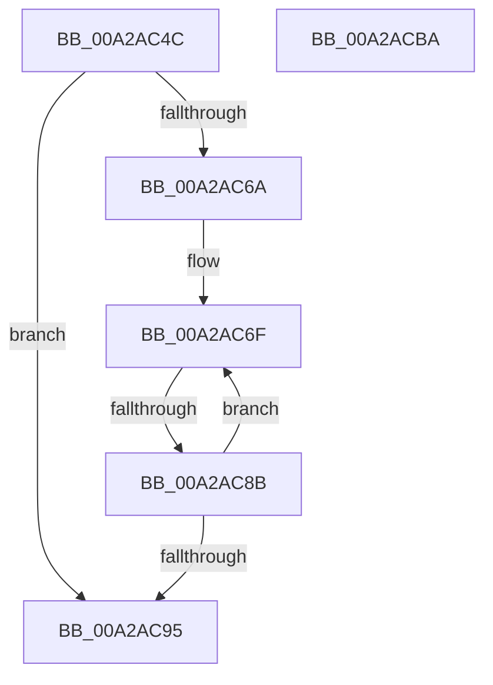

# PnpAssignResourcesToDevices

- RVA: `0x00A2AC4C`–`0x00A2ACBB` (길이 `111` bytes)
- VA: `0x0000000140A2AC4C`
- 실행 섹션: `PAGE`
- PDB 이름 있음: `예`; PDB Function 태그: `예`
- unwind 정보 RVA: `0x000AC1C8`
- 디코드: `36`개 명령, `111/111` bytes 표시
- 미해석 바이트: `0` (있으면 어셈블리에 `.byte`로 보존)

> 이 문서는 커널 이미지의 기계어와 PDB 기호를 분석해 생성했습니다. 4번과 5번은 함수 원형과 자료형을 바이너리 사용 방식에서 추정한 C 해석이며 원본 소스 복구 결과는 아닙니다.

## 1. Dependencies

- 직접 호출 지점: **1**; 고유 호출 대상: **1**
- 직접 호출자로 확인된 함수: **1**
- RIP 상대 이미지 참조: **0**

### Outgoing calls
- `0x00A2ACA0` → [PnpAllocateResources](PnpAllocateResources_function_00A2ACC4.md) (function, `0x00A2ACC4`)

### Direct callers
- [PnpProcessAssignResources](PnpProcessAssignResources_function_00A2A950.md) at `0x00A2AA4B`

### Static image references
- 디코드된 RIP-relative 메모리 참조가 없습니다.

## 2. Other-region calls and transfers

- 다른 실행 섹션으로 향하는 call: **0**
- call이 아닌 외부 분기/꼬리 이동: **1**
  - `0x00A2AC85` → [sub_00B38C36](../B3/Unknown_function_00B38C36.md) (`tail-transfer`)

## 3. Assembly (complete function range)

```asm
00A2AC4C  48 89 5C 24 10                  mov qword ptr [rsp + 0x10], rbx
00A2AC51  48 89 6C 24 18                  mov qword ptr [rsp + 0x18], rbp
00A2AC56  56                              push rsi
00A2AC57  57                              push rdi
00A2AC58  41 56                           push r14
00A2AC5A  48 83 EC 70                     sub rsp, 0x70
00A2AC5E  8B F9                           mov edi, ecx
00A2AC60  4D 8B F0                        mov r14, r8
00A2AC63  48 8B EA                        mov rbp, rdx
00A2AC66  85 C9                           test ecx, ecx
00A2AC68  74 2B                           je 0x140a2ac95
00A2AC6A  48 8B DA                        mov rbx, rdx
00A2AC6D  8B F7                           mov esi, edi
00A2AC6F  48 8B 03                        mov rax, qword ptr [rbx]
00A2AC72  4C 8B 80 38 01 00 00            mov r8, qword ptr [rax + 0x138]
00A2AC79  49 8B 50 28                     mov rdx, qword ptr [r8 + 0x28]
00A2AC7D  8B 82 8C 01 00 00               mov eax, dword ptr [rdx + 0x18c]
00A2AC83  A8 01                           test al, 1
00A2AC85  0F 85 AB DF 10 00               jne 0x140b38c36
00A2AC8B  48 83 C3 40                     add rbx, 0x40
00A2AC8F  48 83 EE 01                     sub rsi, 1
00A2AC93  75 DA                           jne 0x140a2ac6f
00A2AC95  4D 8B CE                        mov r9, r14
00A2AC98  45 33 C0                        xor r8d, r8d
00A2AC9B  48 8B D5                        mov rdx, rbp
00A2AC9E  8B CF                           mov ecx, edi
00A2ACA0  E8 1F 00 00 00                  call 0x140a2acc4
00A2ACA5  4C 8D 5C 24 70                  lea r11, [rsp + 0x70]
00A2ACAA  49 8B 5B 28                     mov rbx, qword ptr [r11 + 0x28]
00A2ACAE  49 8B 6B 30                     mov rbp, qword ptr [r11 + 0x30]
00A2ACB2  49 8B E3                        mov rsp, r11
00A2ACB5  41 5E                           pop r14
00A2ACB7  5F                              pop rdi
00A2ACB8  5E                              pop rsi
00A2ACB9  C3                              ret
00A2ACBA  CC                              int3
```

## 4. C-style interpretation (structured pseudocode)

```c
__int64 __fastcall PnpAssignResourcesToDevices(int a1, __int64 a2, __int64 a3)
{
    __int64 result;
    __int64 v_rbx;
    __int64 v_rsi;
    __int64 v_rsp;
    unsigned __int64 v_stack_m18;
    unsigned __int64 v_stack_p10;
    unsigned __int64 v_stack_p18;

    v_stack_p10 = v_rbx;
    v_stack_p18 = v_rbp;
    v_rsp = (v_rsp) - (112);
    if (a1 == 0) goto loc_00A2AC95;
loc_00A2AC6F:
    v_rbx = (a2) + (64);
    v_rsi = ((unsigned int)((unsigned int)((unsigned int)(a1)))) - (1);
    if (condition_is_not_equal) goto loc_00A2AC6F;
loc_00A2AC95:
    a3 = 0;
    result = PnpAllocateResources((unsigned int)((unsigned int)((unsigned int)(a1))), a2, a3, a3);
    return result;
}
```

## 5. (Beta) C Style

```c
int64_t PnpAssignResourcesToDevices(int32_t Arg1, void *Arg2, int64_t Arg3)
{
    uint8_t *arg2 = (uint8_t *)Arg2;

    int64_t result;
    int64_t local_rbx;
    int64_t local_rsi;
    int64_t local_rsp;
    uint64_t v_stack_m18;
    uint64_t v_stack_p10;
    uint64_t v_stack_p18;

    v_stack_p10 = local_rbx;
    v_stack_p18 = local_rbp;
    local_rsp = (local_rsp) - (112);
    if (Arg1 == 0) goto loc_00A2AC95;
loc_00A2AC6F:
    local_rbx = (Arg2) + (64);
    local_rsi = ((uint32_t)((uint32_t)((uint32_t)(Arg1)))) - (1);
    if (condition_is_not_equal) goto loc_00A2AC6F;
loc_00A2AC95:
    Arg3 = 0;
    result = PnpAllocateResources((uint32_t)((uint32_t)((uint32_t)(Arg1))), Arg2, Arg3, Arg3);
    return result;
}
```

### 관측된 메모리 오프셋

구조체 형식이 확인되지 않은 접근은 인자 기준의 오프셋으로만 기록했습니다.

| 기준 인자 | 오프셋 표현 | 폭 (bit) | 접근 |
|---|---:|---:|---|
| `Arg2` | `+ 0x0` | `64` | `R` |

## 6. Execution-region graph

[열기: 2D/3D 그래프와 함수 탐색 컨트롤 패널](../../../control-panel.html?section=page&rva=0x00A2AC4C&view=graph)

- 2D 그래프는 위에서 아래로 흐르고, 3D 그래프는 빈 공간을 드래그해 회전합니다. Shift+드래그는 이동, 휠은 확대·축소, 함수 노드 선택은 대상 보고서 이동입니다.

### Static fallback


