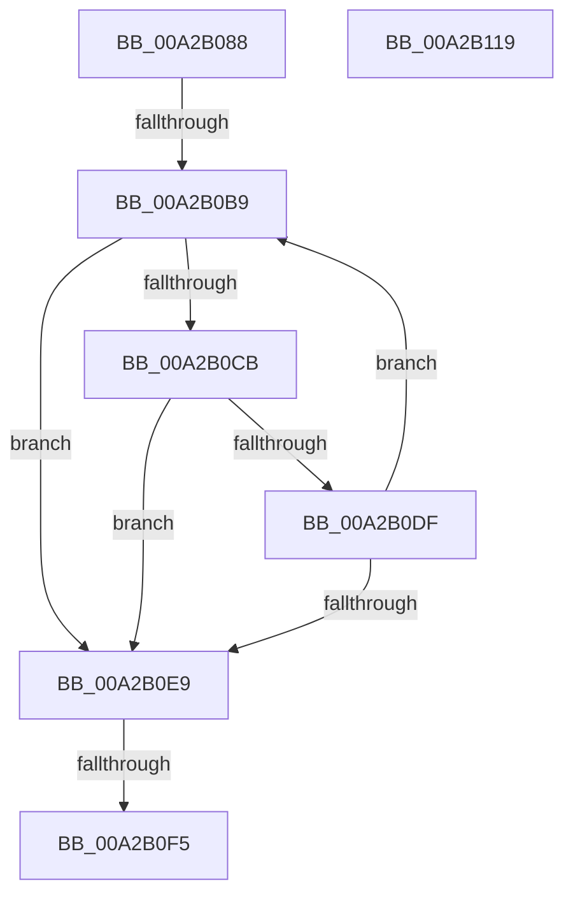

# PnpBusTypeGuidGetIndex

- RVA: `0x00A2B088`–`0x00A2B11A` (길이 `146` bytes)
- VA: `0x0000000140A2B088`
- 실행 섹션: `PAGE`
- PDB 이름 있음: `예`; PDB Function 태그: `예`
- unwind 정보 RVA: `0x0005C954`
- 디코드: `36`개 명령, `146/146` bytes 표시
- 미해석 바이트: `0` (있으면 어셈블리에 `.byte`로 보존)

> 이 문서는 커널 이미지의 기계어와 PDB 기호를 분석해 생성했습니다. 4번과 5번은 함수 원형과 자료형을 바이너리 사용 방식에서 추정한 C 해석이며 원본 소스 복구 결과는 아닙니다.

## 1. Dependencies

- 직접 호출 지점: **3**; 고유 호출 대상: **3**
- 직접 호출자로 확인된 함수: **1**
- RIP 상대 이미지 참조: **3**

### Outgoing calls
- `0x00A2B0A6` → [ExAcquireFastMutex](../../text/20/ExAcquireFastMutex_function_0020E5A0.md) (function, `0x0020E5A0`)
- `0x00A2B0D4` → [RtlCompareMemory](../../text/6B/RtlCompareMemory_function_006BA670.md) (function, `0x006BA670`)
- `0x00A2B0FC` → [ExReleaseFastMutex](../../text/25/ExReleaseFastMutex_function_002519C0.md) (function, `0x002519C0`)

### Direct callers
- [PnpQueryBusInformation](PnpQueryBusInformation_function_00A2AF8C.md) at `0x00A2AFEC`

### Static image references
- `0x00A2B09F` → RVA `0x00F8CC00` (`.data`; read)
- `0x00A2B0AD` → RVA `0x00F8CB28` (`.data`; read)
- `0x00A2B0BF` → RVA `0x00F8CB30` (`.data`; read)

## 2. Other-region calls and transfers

- 다른 실행 섹션으로 향하는 call: **3**
  - `0x00A2B0A6` → [ExAcquireFastMutex](../../text/20/ExAcquireFastMutex_function_0020E5A0.md) (`PAGE` → `.text`)
  - `0x00A2B0D4` → [RtlCompareMemory](../../text/6B/RtlCompareMemory_function_006BA670.md) (`PAGE` → `.text`)
  - `0x00A2B0FC` → [ExReleaseFastMutex](../../text/25/ExReleaseFastMutex_function_002519C0.md) (`PAGE` → `.text`)
- call이 아닌 외부 분기/꼬리 이동: **2**
  - `0x00A2B0B3` → [sub_00B390A0](../B3/Unknown_function_00B390A0.md) (`tail-transfer`)
  - `0x00A2B0EF` → [sub_00B390A0](../B3/Unknown_function_00B390A0.md) (`tail-transfer`)

## 3. Assembly (complete function range)

```asm
00A2B088  48 89 5C 24 08                  mov qword ptr [rsp + 8], rbx
00A2B08D  48 89 6C 24 10                  mov qword ptr [rsp + 0x10], rbp
00A2B092  48 89 74 24 18                  mov qword ptr [rsp + 0x18], rsi
00A2B097  57                              push rdi
00A2B098  48 83 EC 20                     sub rsp, 0x20
00A2B09C  48 8B E9                        mov rbp, rcx
00A2B09F  48 8D 0D 5A 1B 56 00            lea rcx, [rip + 0x561b5a]
00A2B0A6  E8 F5 34 7E FF                  call 0x14020e5a0
00A2B0AB  33 DB                           xor ebx, ebx
00A2B0AD  3B 1D 75 1A 56 00               cmp ebx, dword ptr [rip + 0x561a75]
00A2B0B3  0F 84 E7 DF 10 00               je 0x140b390a0
00A2B0B9  8B D3                           mov edx, ebx
00A2B0BB  48 C1 E2 04                     shl rdx, 4
00A2B0BF  48 03 15 6A 1A 56 00            add rdx, qword ptr [rip + 0x561a6a]
00A2B0C6  48 3B EA                        cmp rbp, rdx
00A2B0C9  74 1E                           je 0x140a2b0e9
00A2B0CB  41 B8 10 00 00 00               mov r8d, 0x10
00A2B0D1  48 8B CD                        mov rcx, rbp
00A2B0D4  E8 97 F5 C8 FF                  call 0x1406ba670
00A2B0D9  48 83 F8 10                     cmp rax, 0x10
00A2B0DD  74 0A                           je 0x140a2b0e9
00A2B0DF  FF C3                           inc ebx
00A2B0E1  3B 1D 41 1A 56 00               cmp ebx, dword ptr [rip + 0x561a41]
00A2B0E7  72 D0                           jb 0x140a2b0b9
00A2B0E9  3B 1D 39 1A 56 00               cmp ebx, dword ptr [rip + 0x561a39]
00A2B0EF  0F 84 AB DF 10 00               je 0x140b390a0
00A2B0F5  48 8D 0D 04 1B 56 00            lea rcx, [rip + 0x561b04]
00A2B0FC  E8 BF 68 82 FF                  call 0x1402519c0
00A2B101  48 8B 6C 24 38                  mov rbp, qword ptr [rsp + 0x38]
00A2B106  0F B7 C3                        movzx eax, bx
00A2B109  48 8B 5C 24 30                  mov rbx, qword ptr [rsp + 0x30]
00A2B10E  48 8B 74 24 40                  mov rsi, qword ptr [rsp + 0x40]
00A2B113  48 83 C4 20                     add rsp, 0x20
00A2B117  5F                              pop rdi
00A2B118  C3                              ret
00A2B119  CC                              int3
```

## 4. C-style interpretation (structured pseudocode)

```c
__int64 __fastcall PnpBusTypeGuidGetIndex(__int64 a1)
{
    __int64 result;
    __int64 v_rbx;
    __int64 v_rsp;
    unsigned __int64 v_stack_p10;
    unsigned __int64 v_stack_p18;
    unsigned __int64 v_stack_p8;

    v_stack_p8 = v_rbx;
    v_stack_p10 = v_rbp;
    v_stack_p18 = v_rsi;
    v_rsp = (v_rsp) - (32);
    result = ExAcquireFastMutex(v_rip + 5643098, a2, a3, a4);
    v_rbx = 0;
loc_00A2B0B9:
    a2 = (0) << (4);
    a2 = (a2) + (*(unsigned __int64 *)(v_rip + 5642858));
    if (a1 == a2) goto loc_00A2B0E9;
    result = RtlCompareMemory(a1, a2, 16, a4);
    if (result == 16) goto loc_00A2B0E9;
    v_rbx = (unsigned int)((v_rbx) + 1);
    if (((unsigned int)(v_rbx)) < (*(unsigned int *)(v_rip + 5642817))) goto loc_00A2B0B9;
loc_00A2B0E9:
    result = ExReleaseFastMutex(v_rip + 5643012, a2, 16, a4);
    v_rsp = (v_rsp) + (32);
    return (unsigned __int16)(v_rbx);
}
```

## 5. (Beta) C Style

```c
int64_t PnpBusTypeGuidGetIndex(int64_t Arg1)
{
    int64_t result;
    int64_t local_rbx;
    int64_t local_rsp;
    uint64_t v_stack_p10;
    uint64_t v_stack_p18;
    uint64_t v_stack_p8;

    v_stack_p8 = local_rbx;
    v_stack_p10 = local_rbp;
    v_stack_p18 = local_rsi;
    local_rsp = (local_rsp) - (32);
    result = ExAcquireFastMutex(v_rip + 5643098, a2, a3, a4);
    local_rbx = 0;
loc_00A2B0B9:
    a2 = (0) << (4);
    a2 = (a2) + (*(uint64_t *)(v_rip + 0x561A6A));
    if (Arg1 == a2) goto loc_00A2B0E9;
    result = RtlCompareMemory(Arg1, a2, 16, a4);
    if (result == 16) goto loc_00A2B0E9;
    local_rbx = (uint32_t)((local_rbx) + 1);
    if (((uint32_t)(local_rbx)) < (*(uint32_t *)(v_rip + 0x561A41))) goto loc_00A2B0B9;
loc_00A2B0E9:
    result = ExReleaseFastMutex(v_rip + 5643012, a2, 16, a4);
    local_rsp = (local_rsp) + (32);
    return (uint16_t)(local_rbx);
}
```

## 6. Execution-region graph

[열기: 2D/3D 그래프와 함수 탐색 컨트롤 패널](../../../control-panel.html?section=page&rva=0x00A2B088&view=graph)

- 2D 그래프는 위에서 아래로 흐르고, 3D 그래프는 빈 공간을 드래그해 회전합니다. Shift+드래그는 이동, 휠은 확대·축소, 함수 노드 선택은 대상 보고서 이동입니다.

### Static fallback


