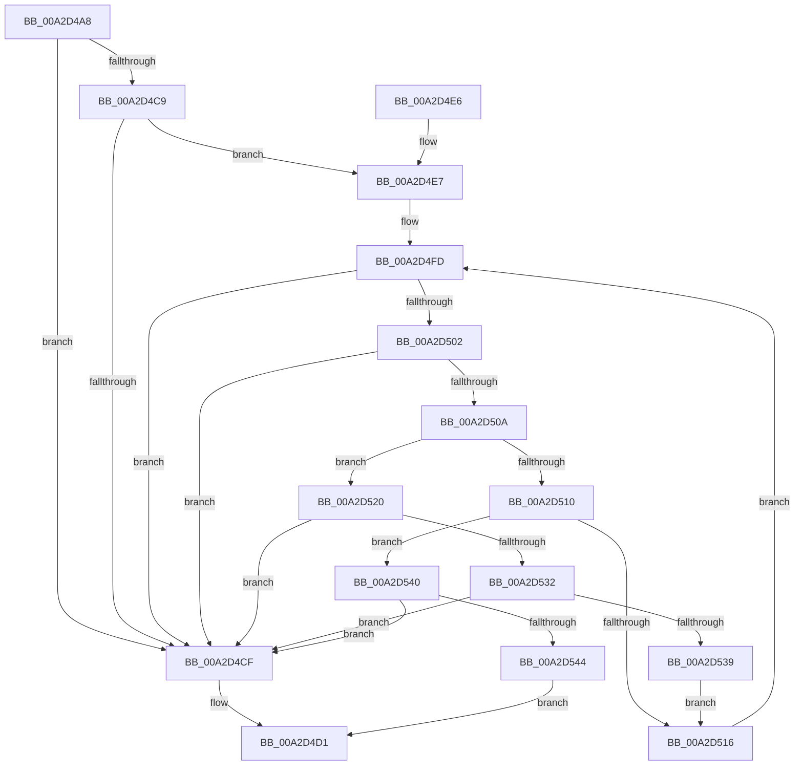

# PnpFindAlternateStringData

- RVA: `0x00A2D4A8`–`0x00A2D55E` (길이 `182` bytes)
- VA: `0x0000000140A2D4A8`
- 실행 섹션: `PAGE`
- PDB 이름 있음: `예`; PDB Function 태그: `아니요`
- unwind 정보 RVA: `0x000AC7C4`
- 디코드: `56`개 명령, `182/182` bytes 표시
- 미해석 바이트: `0` (있으면 어셈블리에 `.byte`로 보존)

> 이 문서는 커널 이미지의 기계어와 PDB 기호를 분석해 생성했습니다. 4번과 5번은 함수 원형과 자료형을 바이너리 사용 방식에서 추정한 C 해석이며 원본 소스 복구 결과는 아닙니다.

## 1. Dependencies

- 직접 호출 지점: **0**; 고유 호출 대상: **0**
- 직접 호출자로 확인된 함수: **3**
- RIP 상대 이미지 참조: **0**

### Outgoing calls
- 직접 디코드된 call 명령이 없습니다.

### Direct callers
- [PiGetDeviceRegistryProperty](../72/PiGetDeviceRegistryProperty_function_007280A8.md) at `0x007281F8`
- [PiProcessNewDeviceNode](PiProcessNewDeviceNode_function_00A28F20.md) at `0x00A2A071`
- [PiAuditDeviceOperation](../A8/PiAuditDeviceOperation_function_00A864DC.md) at `0x00A86B4E`

### Static image references
- 디코드된 RIP-relative 메모리 참조가 없습니다.

## 2. Other-region calls and transfers

- 다른 실행 섹션으로 향하는 call: **0**
- 별도 외부 분기/꼬리 이동을 확인하지 못했습니다.

## 3. Assembly (complete function range)

```asm
00A2D4A8  48 8B C4                        mov rax, rsp
00A2D4AB  48 89 58 08                     mov qword ptr [rax + 8], rbx
00A2D4AF  48 89 68 10                     mov qword ptr [rax + 0x10], rbp
00A2D4B3  48 89 70 18                     mov qword ptr [rax + 0x18], rsi
00A2D4B7  48 89 78 20                     mov qword ptr [rax + 0x20], rdi
00A2D4BB  44 8B DA                        mov r11d, edx
00A2D4BE  49 8B F8                        mov rdi, r8
00A2D4C1  4C 8B D1                        mov r10, rcx
00A2D4C4  83 FA 02                        cmp edx, 2
00A2D4C7  76 06                           jbe 0x140a2d4cf
00A2D4C9  66 83 39 40                     cmp word ptr [rcx], 0x40
00A2D4CD  74 18                           je 0x140a2d4e7
00A2D4CF  33 C0                           xor eax, eax
00A2D4D1  48 8B 5C 24 08                  mov rbx, qword ptr [rsp + 8]
00A2D4D6  48 8B 6C 24 10                  mov rbp, qword ptr [rsp + 0x10]
00A2D4DB  48 8B 74 24 18                  mov rsi, qword ptr [rsp + 0x18]
00A2D4E0  48 8B 7C 24 20                  mov rdi, qword ptr [rsp + 0x20]
00A2D4E5  C3                              ret
00A2D4E6  CC                              int3
00A2D4E7  33 ED                           xor ebp, ebp
00A2D4E9  49 8B C3                        mov rax, r11
00A2D4EC  48 D1 E8                        shr rax, 1
00A2D4EF  8B DD                           mov ebx, ebp
00A2D4F1  48 8D 34 41                     lea rsi, [rcx + rax*2]
00A2D4F5  48 83 C1 02                     add rcx, 2
00A2D4F9  48 8D 51 02                     lea rdx, [rcx + 2]
00A2D4FD  48 3B D6                        cmp rdx, rsi
00A2D500  73 CD                           jae 0x140a2d4cf
00A2D502  0F B7 01                        movzx eax, word ptr [rcx]
00A2D505  66 85 C0                        test ax, ax
00A2D508  74 C5                           je 0x140a2d4cf
00A2D50A  66 83 F8 2C                     cmp ax, 0x2c
00A2D50E  74 10                           je 0x140a2d520
00A2D510  66 83 F8 3B                     cmp ax, 0x3b
00A2D514  74 2A                           je 0x140a2d540
00A2D516  48 83 C1 02                     add rcx, 2
00A2D51A  48 83 C2 02                     add rdx, 2
00A2D51E  EB DD                           jmp 0x140a2d4fd
00A2D520  44 0F B7 02                     movzx r8d, word ptr [rdx]
00A2D524  BB F5 FF 00 00                  mov ebx, 0xfff5
00A2D529  41 8D 40 DD                     lea eax, [r8 - 0x23]
00A2D52D  66 85 C3                        test bx, ax
00A2D530  75 9D                           jne 0x140a2d4cf
00A2D532  66 41 83 F8 2B                  cmp r8w, 0x2b
00A2D537  74 96                           je 0x140a2d4cf
00A2D539  BB 01 00 00 00                  mov ebx, 1
00A2D53E  EB D6                           jmp 0x140a2d516
00A2D540  85 DB                           test ebx, ebx
00A2D542  74 8B                           je 0x140a2d4cf
00A2D544  48 83 C1 02                     add rcx, 2
00A2D548  B8 01 00 00 00                  mov eax, 1
00A2D54D  44 2B D1                        sub r10d, ecx
00A2D550  48 89 0F                        mov qword ptr [rdi], rcx
00A2D553  45 03 D3                        add r10d, r11d
00A2D556  45 89 11                        mov dword ptr [r9], r10d
00A2D559  E9 73 FF FF FF                  jmp 0x140a2d4d1
```

## 4. C-style interpretation (structured pseudocode)

```c
__int64 __fastcall PnpFindAlternateStringData(__int64 a1, int a2, __int64 a3, __int64 a4)
{
    __int64 result;
    __int64 v_r10;
    __int64 v_rbp;
    unsigned __int64 v_stack_p10;
    unsigned __int64 v_stack_p18;
    unsigned __int64 v_stack_p20;
    unsigned __int64 v_stack_p8;

    *(unsigned __int64 *)(v_rsp + 8) = v_rbx;
    *(unsigned __int64 *)(v_rsp + 16) = v_rbp;
    *(unsigned __int64 *)(v_rsp + 24) = v_rsi;
    *(unsigned __int64 *)(v_rsp + 32) = v_rdi;
    if (a2 <= 2) goto loc_00A2D4CF;
    if ((*(unsigned __int16 *)(a1)) == 64) goto loc_00A2D4E7;
loc_00A2D4CF:
    result = 0;
loc_00A2D4D1:
    return result;
loc_00A2D4E7:
    v_rbp = 0;
    result = ((unsigned int)(a2)) >> (1);
    a1 = (a1) + (2);
loc_00A2D4FD:
    if ((a1 + 2) >= (a1 + result * 2)) goto loc_00A2D4CF;
    if ((unsigned __int16)(*(unsigned __int16 *)(a1)) == 0) goto loc_00A2D4CF;
    if (((unsigned __int16)(*(unsigned __int16 *)(a1))) == 44) goto loc_00A2D520;
    if (((unsigned __int16)(*(unsigned __int16 *)(a1))) == 59) goto loc_00A2D540;
loc_00A2D516:
    a1 = (a1) + (2);
    a2 = (a1 + 2) + (2);
    goto loc_00A2D4FD;
loc_00A2D520:
    if ((((unsigned __int16)((unsigned int)(0xFFF5ULL))) & ((unsigned __int16)(*(unsigned __int16 *)(a2) - 35))) != 0) goto loc_00A2D4CF;
    if (((unsigned __int16)(*(unsigned __int16 *)(a2))) == 43) goto loc_00A2D4CF;
    goto loc_00A2D516;
loc_00A2D540:
    if (1 == 0) goto loc_00A2D4CF;
    a1 = (a1) + (2);
    v_r10 = (unsigned int)((a1) - ((unsigned int)(a1)));
    *(unsigned __int64 *)(v_stack_p20) = a1;
    v_r10 = (unsigned int)((v_r10) + ((unsigned int)((unsigned int)(a2))));
    *(unsigned int *)(a4) = (unsigned int)(v_r10);
    goto loc_00A2D4D1;
}
```

## 5. (Beta) C Style

```c
int64_t PnpFindAlternateStringData(void *Arg1, int32_t Arg2, void *Arg3, void *Arg4)
{
    uint8_t *arg1 = (uint8_t *)Arg1;
    uint8_t *arg3 = (uint8_t *)Arg3;
    uint8_t *arg4 = (uint8_t *)Arg4;

    int64_t result;
    int64_t local_r10;
    int64_t local_rbp;
    uint64_t v_stack_p10;
    uint64_t v_stack_p18;
    uint64_t v_stack_p20;
    uint64_t v_stack_p8;

    *(uint64_t *)(local_rsp + 0x8) = local_rbx;
    *(uint64_t *)(local_rsp + 0x10) = local_rbp;
    *(uint64_t *)(local_rsp + 0x18) = local_rsi;
    *(uint64_t *)(local_rsp + 0x20) = local_rdi;
    if (Arg2 <= 2) goto loc_00A2D4CF;
    if ((*(uint16_t *)(arg1)) == 64) goto loc_00A2D4E7;
loc_00A2D4CF:
    result = 0;
loc_00A2D4D1:
    return result;
loc_00A2D4E7:
    local_rbp = 0;
    result = ((uint32_t)(Arg2)) >> (1);
    Arg1 = (Arg1) + (2);
loc_00A2D4FD:
    if ((Arg1 + 2) >= (Arg1 + result * 2)) goto loc_00A2D4CF;
    if ((uint16_t)(*(uint16_t *)(arg1)) == 0) goto loc_00A2D4CF;
    if (((uint16_t)(*(uint16_t *)(arg1))) == 44) goto loc_00A2D520;
    if (((uint16_t)(*(uint16_t *)(arg1))) == 59) goto loc_00A2D540;
loc_00A2D516:
    Arg1 = (Arg1) + (2);
    Arg2 = (Arg1 + 2) + (2);
    goto loc_00A2D4FD;
loc_00A2D520:
    if ((((uint16_t)((uint32_t)(0xFFF5ULL))) & ((uint16_t)(*(uint16_t *)(Arg2) - 35))) != 0) goto loc_00A2D4CF;
    if (((uint16_t)(*(uint16_t *)(Arg2))) == 43) goto loc_00A2D4CF;
    goto loc_00A2D516;
loc_00A2D540:
    if (1 == 0) goto loc_00A2D4CF;
    Arg1 = (Arg1) + (2);
    local_r10 = (uint32_t)((Arg1) - ((uint32_t)(Arg1)));
    *(void **)(v_stack_p20) = Arg1;
    local_r10 = (uint32_t)((local_r10) + ((uint32_t)((uint32_t)(Arg2))));
    *(uint32_t *)(arg4) = (uint32_t)(local_r10);
    goto loc_00A2D4D1;
}
```

### 관측된 메모리 오프셋

구조체 형식이 확인되지 않은 접근은 인자 기준의 오프셋으로만 기록했습니다.

| 기준 인자 | 오프셋 표현 | 폭 (bit) | 접근 |
|---|---:|---:|---|
| `Arg1` | `+ 0x0` | `16` | `R` |
| `Arg1` | `+ 0x0 + rax*2` | `64` | `R` |
| `Arg1` | `+ 0x2` | `64` | `R` |
| `Arg3` | `+ 0x0` | `64` | `W` |
| `Arg4` | `+ 0x0` | `32` | `W` |

## 6. Execution-region graph

[열기: 2D/3D 그래프와 함수 탐색 컨트롤 패널](../../../control-panel.html?section=page&rva=0x00A2D4A8&view=graph)

- 2D 그래프는 위에서 아래로 흐르고, 3D 그래프는 빈 공간을 드래그해 회전합니다. Shift+드래그는 이동, 휠은 확대·축소, 함수 노드 선택은 대상 보고서 이동입니다.

### Static fallback


