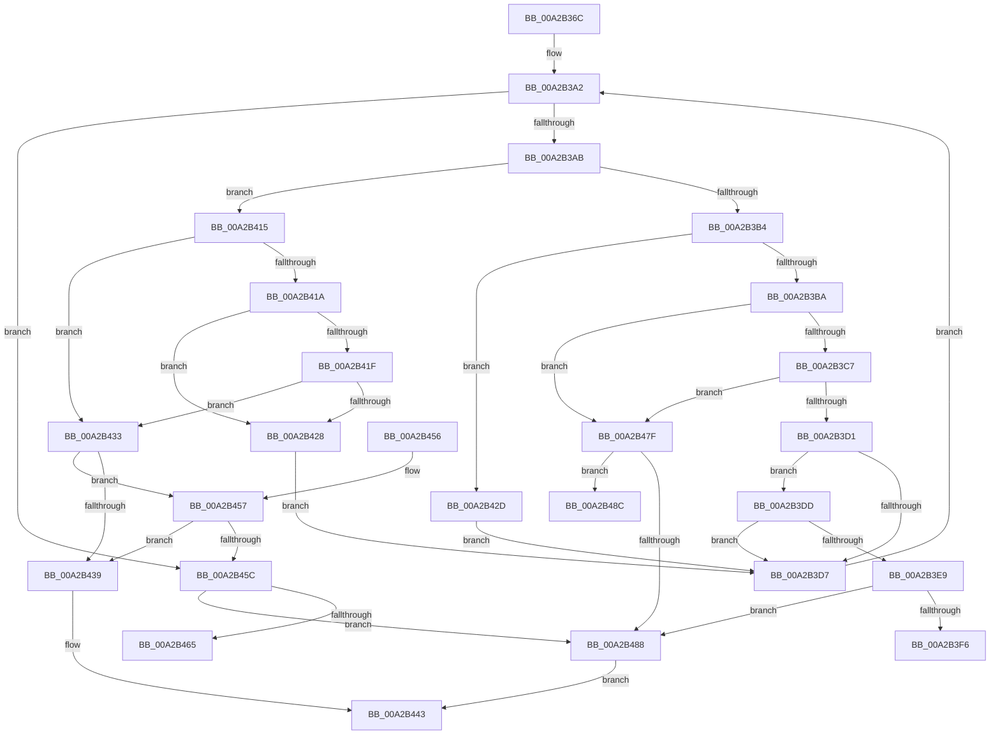

# PnpFixupID

- RVA: `0x00A2B36C`–`0x00A2B4A7` (길이 `315` bytes)
- VA: `0x0000000140A2B36C`
- 실행 섹션: `PAGE`
- PDB 이름 있음: `예`; PDB Function 태그: `예`
- unwind 정보 RVA: `0x000AC2A0`
- 디코드: `89`개 명령, `315/315` bytes 표시
- 미해석 바이트: `0` (있으면 어셈블리에 `.byte`로 보존)

> 이 문서는 커널 이미지의 기계어와 PDB 기호를 분석해 생성했습니다. 4번과 5번은 함수 원형과 자료형을 바이너리 사용 방식에서 추정한 C 해석이며 원본 소스 복구 결과는 아닙니다.

## 1. Dependencies

- 직접 호출 지점: **0**; 고유 호출 대상: **0**
- 직접 호출자로 확인된 함수: **3**
- RIP 상대 이미지 참조: **3**

### Outgoing calls
- 직접 디코드된 call 명령이 없습니다.

### Direct callers
- [PnpQueryID](../8F/PnpQueryID_function_008FB984.md) at `0x008FB9E9`
- [PiProcessNewDeviceNode](PiProcessNewDeviceNode_function_00A28F20.md) at `0x00A29138`
- [PiProcessNewDeviceNode](PiProcessNewDeviceNode_function_00A28F20.md) at `0x00A29B93`
- [PiProcessNewDeviceNode](PiProcessNewDeviceNode_function_00A28F20.md) at `0x00A29C3E`
- [PnpQueryDeviceID](PnpQueryDeviceID_function_00A2B21C.md) at `0x00A2B287`

### Static image references
- `0x00A2B3FD` → RVA `0x00AFDB30` (` ?? ::NNGAKEGL::`string'`; read)
- `0x00A2B46C` → RVA `0x00AFDB60` (` ?? ::NNGAKEGL::`string'`; read)
- `0x00A2B493` → RVA `0x00AFDB00` (` ?? ::NNGAKEGL::`string'`; read)

## 2. Other-region calls and transfers

- 다른 실행 섹션으로 향하는 call: **0**
- call이 아닌 외부 분기/꼬리 이동: **3**
  - `0x00A2B410` → [sub_00B3913E](../B3/Unknown_function_00B3913E.md) (`tail-transfer`)
  - `0x00A2B47A` → [sub_00B3913E](../B3/Unknown_function_00B3913E.md) (`tail-transfer`)
  - `0x00A2B4A2` → [sub_00B3913E](../B3/Unknown_function_00B3913E.md) (`tail-transfer`)

## 3. Assembly (complete function range)

```asm
00A2B36C  48 89 5C 24 08                  mov qword ptr [rsp + 8], rbx
00A2B371  48 89 74 24 18                  mov qword ptr [rsp + 0x18], rsi
00A2B376  55                              push rbp
00A2B377  57                              push rdi
00A2B378  41 56                           push r14
00A2B37A  48 8B EC                        mov rbp, rsp
00A2B37D  48 83 EC 40                     sub rsp, 0x40
00A2B381  33 F6                           xor esi, esi
00A2B383  8B C2                           mov eax, edx
00A2B385  0F 57 C0                        xorps xmm0, xmm0
00A2B388  45 8B D9                        mov r11d, r9d
00A2B38B  48 8B F9                        mov rdi, rcx
00A2B38E  44 8B D6                        mov r10d, esi
00A2B391  0F 11 45 F0                     movups xmmword ptr [rbp - 0x10], xmm0
00A2B395  48 8D 14 41                     lea rdx, [rcx + rax*2]
00A2B399  8B DE                           mov ebx, esi
00A2B39B  44 8D 76 5F                     lea r14d, [rsi + 0x5f]
00A2B39F  4C 8B C9                        mov r9, rcx
00A2B3A2  4C 3B CA                        cmp r9, rdx
00A2B3A5  0F 83 B1 00 00 00               jae 0x140a2b45c
00A2B3AB  41 0F B7 09                     movzx ecx, word ptr [r9]
00A2B3AF  66 85 C9                        test cx, cx
00A2B3B2  74 61                           je 0x140a2b415
00A2B3B4  66 83 F9 20                     cmp cx, 0x20
00A2B3B8  74 73                           je 0x140a2b42d
00A2B3BA  8D 41 E0                        lea eax, [rcx - 0x20]
00A2B3BD  66 41 3B C6                     cmp ax, r14w
00A2B3C1  0F 87 B8 00 00 00               ja 0x140a2b47f
00A2B3C7  66 83 F9 2C                     cmp cx, 0x2c
00A2B3CB  0F 84 AE 00 00 00               je 0x140a2b47f
00A2B3D1  66 83 F9 5C                     cmp cx, 0x5c
00A2B3D5  74 06                           je 0x140a2b3dd
00A2B3D7  49 83 C1 02                     add r9, 2
00A2B3DB  EB C5                           jmp 0x140a2b3a2
00A2B3DD  41 FF C2                        inc r10d
00A2B3E0  44 89 55 28                     mov dword ptr [rbp + 0x28], r10d
00A2B3E4  45 3B D3                        cmp r10d, r11d
00A2B3E7  76 EE                           jbe 0x140a2b3d7
00A2B3E9  48 8B 4D 40                     mov rcx, qword ptr [rbp + 0x40]
00A2B3ED  48 85 C9                        test rcx, rcx
00A2B3F0  0F 84 92 00 00 00               je 0x140a2b488
00A2B3F6  C7 45 F0 26 00 28 00            mov dword ptr [rbp - 0x10], 0x280026
00A2B3FD  48 8D 05 2C 27 0D 00            lea rax, [rip + 0xd272c]
00A2B404  C7 44 24 20 04 00 00 00         mov dword ptr [rsp + 0x20], 4
00A2B40C  4C 8D 4D 28                     lea r9, [rbp + 0x28]
00A2B410  E9 29 DD 10 00                  jmp 0x140b3913e
00A2B415  45 85 C0                        test r8d, r8d
00A2B418  74 19                           je 0x140a2b433
00A2B41A  48 85 DB                        test rbx, rbx
00A2B41D  74 09                           je 0x140a2b428
00A2B41F  48 8D 43 02                     lea rax, [rbx + 2]
00A2B423  4C 3B C8                        cmp r9, rax
00A2B426  74 0B                           je 0x140a2b433
00A2B428  49 8B D9                        mov rbx, r9
00A2B42B  EB AA                           jmp 0x140a2b3d7
00A2B42D  66 45 89 31                     mov word ptr [r9], r14w
00A2B431  EB A4                           jmp 0x140a2b3d7
00A2B433  41 83 FB FF                     cmp r11d, -1
00A2B437  75 1E                           jne 0x140a2b457
00A2B439  4C 2B CF                        sub r9, rdi
00A2B43C  49 D1 F9                        sar r9, 1
00A2B43F  41 8D 41 01                     lea eax, [r9 + 1]
00A2B443  48 8B 5C 24 60                  mov rbx, qword ptr [rsp + 0x60]
00A2B448  48 8B 74 24 70                  mov rsi, qword ptr [rsp + 0x70]
00A2B44D  48 83 C4 40                     add rsp, 0x40
00A2B451  41 5E                           pop r14
00A2B453  5F                              pop rdi
00A2B454  5D                              pop rbp
00A2B455  C3                              ret
00A2B456  CC                              int3
00A2B457  45 3B D3                        cmp r10d, r11d
00A2B45A  74 DD                           je 0x140a2b439
00A2B45C  48 8B 4D 40                     mov rcx, qword ptr [rbp + 0x40]
00A2B460  48 85 C9                        test rcx, rcx
00A2B463  74 23                           je 0x140a2b488
00A2B465  C7 45 F0 70 00 72 00            mov dword ptr [rbp - 0x10], 0x720070
00A2B46C  48 8D 05 ED 26 0D 00            lea rax, [rip + 0xd26ed]
00A2B473  89 74 24 20                     mov dword ptr [rsp + 0x20], esi
00A2B477  45 33 C9                        xor r9d, r9d
00A2B47A  E9 BF DC 10 00                  jmp 0x140b3913e
00A2B47F  48 8B 4D 40                     mov rcx, qword ptr [rbp + 0x40]
00A2B483  48 85 C9                        test rcx, rcx
00A2B486  75 04                           jne 0x140a2b48c
00A2B488  33 C0                           xor eax, eax
00A2B48A  EB B7                           jmp 0x140a2b443
00A2B48C  C7 45 F0 22 00 24 00            mov dword ptr [rbp - 0x10], 0x240022
00A2B493  48 8D 05 66 26 0D 00            lea rax, [rip + 0xd2666]
00A2B49A  C7 44 24 20 02 00 00 00         mov dword ptr [rsp + 0x20], 2
00A2B4A2  E9 97 DC 10 00                  jmp 0x140b3913e
```

## 4. C-style interpretation (structured pseudocode)

```c
__int64 __fastcall PnpFixupID(__int64 a1, int a2, int a3, int a4, __int64 a5)
{
    __int64 result;
    __int64 v_r10;
    __int64 v_rsi;
    __int64 v_rsp;
    unsigned __int64 v_stack_m28;
    unsigned int v_stack_m38;
    unsigned int v_stack_p10;
    unsigned __int64 v_stack_p18;
    unsigned int v_stack_p20;
    unsigned __int64 v_stack_p8;

    v_stack_p8 = v_rbx;
    v_stack_p18 = v_rsi;
    v_rsp = (v_rsp) - (64);
    v_rsi = 0;
    v_stack_m28 = v_xmm0;
loc_00A2B3A2:
    if (a1 >= (a1 + (unsigned int)(a2) * 2)) goto loc_00A2B45C;
    if ((unsigned __int16)(*(unsigned __int16 *)(a1)) == 0) goto loc_00A2B415;
    if (((unsigned __int16)(*(unsigned __int16 *)(a1))) == 32) goto loc_00A2B42D;
    if (((unsigned __int16)(*(unsigned __int16 *)(a1) - 32)) > ((unsigned __int16)(v_rsi + 95))) goto loc_00A2B47F;
    if (((unsigned __int16)(*(unsigned __int16 *)(a1))) == 44) goto loc_00A2B47F;
    if (((unsigned __int16)(*(unsigned __int16 *)(a1))) == 92) goto loc_00A2B3DD;
loc_00A2B3D7:
    a4 = (a1) + (2);
    goto loc_00A2B3A2;
loc_00A2B3DD:
    v_r10 = (unsigned int)((0) + 1);
    v_stack_p10 = (unsigned int)(v_r10);
    if (((unsigned int)(v_r10)) <= ((unsigned int)((unsigned int)(a4)))) goto loc_00A2B3D7;
    if (a5 == 0) goto loc_00A2B488;
    v_stack_m28 = 0x280026ULL;
    v_stack_m38 = 4;
loc_00A2B415:
    if (a3 == 0) goto loc_00A2B433;
    if (0 == 0) goto loc_00A2B428;
    if (v_stack_p10 == (0 + 2)) goto loc_00A2B433;
loc_00A2B428:
    goto loc_00A2B3D7;
loc_00A2B42D:
    *(unsigned __int16 *)(v_stack_p10) = (unsigned __int16)(v_rsi + 95);
    goto loc_00A2B3D7;
loc_00A2B433:
    if (((unsigned int)((unsigned int)(a4))) != -1) goto loc_00A2B457;
loc_00A2B439:
    a4 = (v_stack_p10) - (a1);
    a4 = (a4) >> (1);
loc_00A2B443:
    v_rsp = (v_rsp) + (64);
    return a4 + 1;
loc_00A2B457:
    if (((unsigned int)(v_r10)) == ((unsigned int)((unsigned int)(a4)))) goto loc_00A2B439;
loc_00A2B45C:
    if (a5 == 0) goto loc_00A2B488;
    v_stack_m28 = 0x720070ULL;
    v_stack_p20 = (unsigned int)(v_stack_p18);
    a4 = 0;
loc_00A2B47F:
    if (a5 != 0) goto loc_00A2B48C;
loc_00A2B488:
    result = 0;
    goto loc_00A2B443;
loc_00A2B48C:
    v_stack_m28 = 0x240022ULL;
    v_stack_p20 = 2;
}
```

## 5. (Beta) C Style

```c
int64_t PnpFixupID(void *Arg1, int32_t Arg2, int32_t Arg3, int32_t Arg4, int64_t Arg5)
{
    uint8_t *arg1 = (uint8_t *)Arg1;

    int64_t result;
    int64_t local_r10;
    int64_t local_rsi;
    int64_t local_rsp;
    uint64_t v_stack_m28;
    uint32_t v_stack_m38;
    uint32_t v_stack_p10;
    uint64_t v_stack_p18;
    uint32_t v_stack_p20;
    uint64_t v_stack_p8;

    v_stack_p8 = local_rbx;
    v_stack_p18 = local_rsi;
    local_rsp = (local_rsp) - (64);
    local_rsi = 0;
    v_stack_m28 = v_xmm0;
loc_00A2B3A2:
    if (Arg1 >= (Arg1 + (uint32_t)(Arg2) * 2)) goto loc_00A2B45C;
    if ((uint16_t)(*(uint16_t *)(arg1)) == 0) goto loc_00A2B415;
    if (((uint16_t)(*(uint16_t *)(arg1))) == 32) goto loc_00A2B42D;
    if (((uint16_t)(*(uint16_t *)(arg1) - 32)) > ((uint16_t)(local_rsi + 95))) goto loc_00A2B47F;
    if (((uint16_t)(*(uint16_t *)(arg1))) == 44) goto loc_00A2B47F;
    if (((uint16_t)(*(uint16_t *)(arg1))) == 92) goto loc_00A2B3DD;
loc_00A2B3D7:
    Arg4 = (Arg1) + (2);
    goto loc_00A2B3A2;
loc_00A2B3DD:
    local_r10 = (uint32_t)((0) + 1);
    v_stack_p10 = (uint32_t)(local_r10);
    if (((uint32_t)(local_r10)) <= ((uint32_t)((uint32_t)(Arg4)))) goto loc_00A2B3D7;
    if (Arg5 == 0) goto loc_00A2B488;
    v_stack_m28 = 0x280026ULL;
    v_stack_m38 = 4;
loc_00A2B415:
    if (Arg3 == 0) goto loc_00A2B433;
    if (0 == 0) goto loc_00A2B428;
    if (v_stack_p10 == (0 + 2)) goto loc_00A2B433;
loc_00A2B428:
    goto loc_00A2B3D7;
loc_00A2B42D:
    *(uint16_t *)(v_stack_p10) = (uint16_t)(local_rsi + 95);
    goto loc_00A2B3D7;
loc_00A2B433:
    if (((uint32_t)((uint32_t)(Arg4))) != -1) goto loc_00A2B457;
loc_00A2B439:
    Arg4 = (v_stack_p10) - (Arg1);
    Arg4 = (Arg4) >> (1);
loc_00A2B443:
    local_rsp = (local_rsp) + (64);
    return Arg4 + 1;
loc_00A2B457:
    if (((uint32_t)(local_r10)) == ((uint32_t)((uint32_t)(Arg4)))) goto loc_00A2B439;
loc_00A2B45C:
    if (Arg5 == 0) goto loc_00A2B488;
    v_stack_m28 = 0x720070ULL;
    v_stack_p20 = (uint32_t)(v_stack_p18);
    Arg4 = 0;
loc_00A2B47F:
    if (Arg5 != 0) goto loc_00A2B48C;
loc_00A2B488:
    result = 0;
    goto loc_00A2B443;
loc_00A2B48C:
    v_stack_m28 = 0x240022ULL;
    v_stack_p20 = 2;
}
```

### 관측된 메모리 오프셋

구조체 형식이 확인되지 않은 접근은 인자 기준의 오프셋으로만 기록했습니다.

| 기준 인자 | 오프셋 표현 | 폭 (bit) | 접근 |
|---|---:|---:|---|
| `Arg1` | `+ 0x0 + rax*2` | `64` | `R` |

## 6. Execution-region graph

[열기: 2D/3D 그래프와 함수 탐색 컨트롤 패널](../../../control-panel.html?section=page&rva=0x00A2B36C&view=graph)

- 2D 그래프는 위에서 아래로 흐르고, 3D 그래프는 빈 공간을 드래그해 회전합니다. Shift+드래그는 이동, 휠은 확대·축소, 함수 노드 선택은 대상 보고서 이동입니다.

### Static fallback


