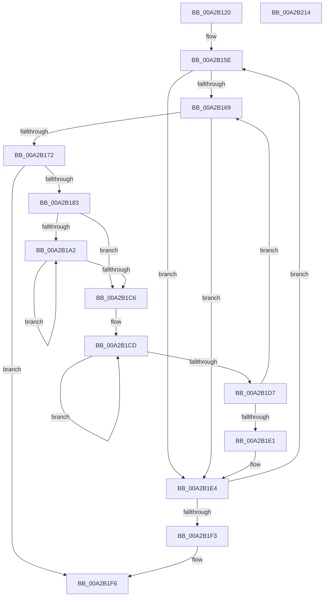

# PnpGenerateDeviceIdsHash

- RVA: `0x00A2B120`–`0x00A2B215` (길이 `245` bytes)
- VA: `0x0000000140A2B120`
- 실행 섹션: `PAGE`
- PDB 이름 있음: `예`; PDB Function 태그: `아니요`
- unwind 정보 RVA: `0x000AC264`
- 디코드: `74`개 명령, `245/245` bytes 표시
- 미해석 바이트: `0` (있으면 어셈블리에 `.byte`로 보존)

> 이 문서는 커널 이미지의 기계어와 PDB 기호를 분석해 생성했습니다. 4번과 5번은 함수 원형과 자료형을 바이너리 사용 방식에서 추정한 C 해석이며 원본 소스 복구 결과는 아닙니다.

## 1. Dependencies

- 직접 호출 지점: **3**; 고유 호출 대상: **3**
- 직접 호출자로 확인된 함수: **3**
- RIP 상대 이미지 참조: **0**

### Outgoing calls
- `0x00A2B17A` → [RtlInitUnicodeStringEx](../../text/46/RtlInitUnicodeStringEx_function_00463960.md) (function, `0x00463960`)
- `0x00A2B186` → [PsGetCurrentServerSiloGlobals](../../text/2F/PsGetCurrentServerSiloGlobals_function_002FE1F0.md) (function, `0x002FE1F0`)
- `0x00A2B1AD` → [NLS_UPCASE](../../text/3F/NLS_UPCASE_function_003FF700.md) (function, `0x003FF700`)

### Direct callers
- [PiProcessNewDeviceNode](PiProcessNewDeviceNode_function_00A28F20.md) at `0x00A29CB7`
- [PiCreateDriverSwDeviceCallback](../AB/PiCreateDriverSwDeviceCallback_function_00ABB420.md) at `0x00ABB7F3`
- [sub_00B1F622](../B1/Unknown_function_00B1F622.md) at `0x00B1F692`

### Static image references
- 디코드된 RIP-relative 메모리 참조가 없습니다.

## 2. Other-region calls and transfers

- 다른 실행 섹션으로 향하는 call: **3**
  - `0x00A2B17A` → [RtlInitUnicodeStringEx](../../text/46/RtlInitUnicodeStringEx_function_00463960.md) (`PAGE` → `.text`)
  - `0x00A2B186` → [PsGetCurrentServerSiloGlobals](../../text/2F/PsGetCurrentServerSiloGlobals_function_002FE1F0.md) (`PAGE` → `.text`)
  - `0x00A2B1AD` → [NLS_UPCASE](../../text/3F/NLS_UPCASE_function_003FF700.md) (`PAGE` → `.text`)
- 별도 외부 분기/꼬리 이동을 확인하지 못했습니다.

## 3. Assembly (complete function range)

```asm
00A2B120  48 8B C4                        mov rax, rsp
00A2B123  48 89 58 08                     mov qword ptr [rax + 8], rbx
00A2B127  48 89 68 10                     mov qword ptr [rax + 0x10], rbp
00A2B12B  48 89 70 18                     mov qword ptr [rax + 0x18], rsi
00A2B12F  57                              push rdi
00A2B130  41 54                           push r12
00A2B132  41 55                           push r13
00A2B134  41 56                           push r14
00A2B136  41 57                           push r15
00A2B138  48 83 EC 40                     sub rsp, 0x40
00A2B13C  45 33 ED                        xor r13d, r13d
00A2B13F  48 89 48 C8                     mov qword ptr [rax - 0x38], rcx
00A2B143  0F 57 C0                        xorps xmm0, xmm0
00A2B146  45 89 28                        mov dword ptr [r8], r13d
00A2B149  0F 11 40 B8                     movups xmmword ptr [rax - 0x48], xmm0
00A2B14D  41 8B FD                        mov edi, r13d
00A2B150  48 89 50 D0                     mov qword ptr [rax - 0x30], rdx
00A2B154  41 8B ED                        mov ebp, r13d
00A2B157  48 8D 70 C8                     lea rsi, [rax - 0x38]
00A2B15B  4D 8B F0                        mov r14, r8
00A2B15E  48 8B 1E                        mov rbx, qword ptr [rsi]
00A2B161  41 8B C5                        mov eax, r13d
00A2B164  48 85 DB                        test rbx, rbx
00A2B167  74 7B                           je 0x140a2b1e4
00A2B169  41 8B C5                        mov eax, r13d
00A2B16C  66 44 39 2B                     cmp word ptr [rbx], r13w
00A2B170  74 72                           je 0x140a2b1e4
00A2B172  48 8B D3                        mov rdx, rbx
00A2B175  48 8D 4C 24 20                  lea rcx, [rsp + 0x20]
00A2B17A  E8 E1 87 A3 FF                  call 0x140463960
00A2B17F  85 C0                           test eax, eax
00A2B181  78 73                           js 0x140a2b1f6
00A2B183  45 8B DD                        mov r11d, r13d
00A2B186  E8 65 30 8D FF                  call 0x1402fe1f0
00A2B18B  44 0F B7 54 24 20               movzx r10d, word ptr [rsp + 0x20]
00A2B191  41 D1 EA                        shr r10d, 1
00A2B194  4C 8B 7C 24 28                  mov r15, qword ptr [rsp + 0x28]
00A2B199  4C 8B A0 B0 04 00 00            mov r12, qword ptr [rax + 0x4b0]
00A2B1A0  74 24                           je 0x140a2b1c6
00A2B1A2  41 0F B7 17                     movzx edx, word ptr [r15]
00A2B1A6  49 8B CC                        mov rcx, r12
00A2B1A9  4D 8D 7F 02                     lea r15, [r15 + 2]
00A2B1AD  E8 4E 45 9D FF                  call 0x1403ff700
00A2B1B2  45 69 DB 3F 00 01 00            imul r11d, r11d, 0x1003f
00A2B1B9  44 0F B7 C8                     movzx r9d, ax
00A2B1BD  45 03 D9                        add r11d, r9d
00A2B1C0  41 83 C2 FF                     add r10d, -1
00A2B1C4  75 DC                           jne 0x140a2b1a2
00A2B1C6  41 03 FB                        add edi, r11d
00A2B1C9  48 83 C8 FF                     or rax, 0xffffffffffffffff
00A2B1CD  48 FF C0                        inc rax
00A2B1D0  66 44 39 2C 43                  cmp word ptr [rbx + rax*2], r13w
00A2B1D5  75 F6                           jne 0x140a2b1cd
00A2B1D7  48 8D 1C 43                     lea rbx, [rbx + rax*2]
00A2B1DB  48 83 C3 02                     add rbx, 2
00A2B1DF  75 88                           jne 0x140a2b169
00A2B1E1  41 8B C5                        mov eax, r13d
00A2B1E4  FF C5                           inc ebp
00A2B1E6  48 83 C6 08                     add rsi, 8
00A2B1EA  83 FD 02                        cmp ebp, 2
00A2B1ED  0F 82 6B FF FF FF               jb 0x140a2b15e
00A2B1F3  41 89 3E                        mov dword ptr [r14], edi
00A2B1F6  4C 8D 5C 24 40                  lea r11, [rsp + 0x40]
00A2B1FB  49 8B 5B 30                     mov rbx, qword ptr [r11 + 0x30]
00A2B1FF  49 8B 6B 38                     mov rbp, qword ptr [r11 + 0x38]
00A2B203  49 8B 73 40                     mov rsi, qword ptr [r11 + 0x40]
00A2B207  49 8B E3                        mov rsp, r11
00A2B20A  41 5F                           pop r15
00A2B20C  41 5E                           pop r14
00A2B20E  41 5D                           pop r13
00A2B210  41 5C                           pop r12
00A2B212  5F                              pop rdi
00A2B213  C3                              ret
00A2B214  CC                              int3
```

## 4. C-style interpretation (structured pseudocode)

```c
__int64 __fastcall PnpGenerateDeviceIdsHash(__int64 a1, __int64 a2, __int64 a3)
{
    __int64 result;
    __int64 v_r10;
    __int64 v_r11;
    __int64 v_r13;
    __int64 v_rbp;
    __int64 v_rbx;
    __int64 v_rdi;
    __int64 v_rsi;
    __int64 v_rsp;
    unsigned __int64 v_stack_m28;
    unsigned __int64 v_stack_m40;
    unsigned __int64 v_stack_m48;

    *(unsigned __int64 *)(v_rsp + 8) = v_rbx;
    *(unsigned __int64 *)(v_rsp + 16) = v_rbp;
    *(unsigned __int64 *)(v_rsp + 24) = v_rsi;
    v_rsp = (v_rsp) - (64);
    v_r13 = 0;
    *(unsigned __int64 *)(v_rsp - 56) = a1;
    *(unsigned int *)(a3) = 0;
    *(unsigned __int64 *)(v_rsp - 72) = v_xmm0;
    *(unsigned __int64 *)(v_rsp - 48) = a2;
loc_00A2B15E:
    if (*(unsigned __int64 *)(v_rsp - 56) == 0) goto loc_00A2B1E4;
loc_00A2B169:
    if ((*(unsigned __int16 *)(*(unsigned __int64 *)(v_rsp - 56))) == 0) goto loc_00A2B1E4;
    result = RtlInitUnicodeStringEx(v_stack_m48, *(unsigned __int64 *)(v_rsp - 56), a3, a4);
    if (sign_flag) goto loc_00A2B1F6;
    result = PsGetCurrentServerSiloGlobals(v_stack_m48, *(unsigned __int64 *)(v_rsp - 56), a3, a4);
    v_r10 = (unsigned int)((v_stack_m48) >> (1));
    if (condition_is_equal) goto loc_00A2B1C6;
loc_00A2B1A2:
    result = NLS_UPCASE(*(unsigned __int64 *)(result + 1200), *(unsigned __int16 *)(v_stack_m40), a3, a4);
    v_r11 = (unsigned int)((0) * (0));
    v_r11 = (unsigned int)((v_r11) + ((unsigned int)((unsigned __int16)(result))));
    v_r10 = (unsigned int)((v_r10) + (-1));
    if (condition_is_not_equal) goto loc_00A2B1A2;
loc_00A2B1C6:
    v_rdi = (unsigned int)((0) + ((unsigned int)(v_r11)));
    result = (result) | (-1);
loc_00A2B1CD:
    result = (result) + 1;
    if ((*(unsigned __int16 *)(*(unsigned __int64 *)(v_rsp - 56) + result * 2)) != 0) goto loc_00A2B1CD;
    v_rbx = (*(unsigned __int64 *)(v_rsp - 56) + result * 2) + (2);
    if (condition_is_not_equal) goto loc_00A2B169;
loc_00A2B1E4:
    v_rbp = (unsigned int)((0) + 1);
    v_rsi = (v_rsp - 56) + (8);
    if (((unsigned int)(v_rbp)) < 2) goto loc_00A2B15E;
    *(unsigned int *)(a3) = (unsigned int)(v_rdi);
loc_00A2B1F6:
    return 0;
}
```

## 5. (Beta) C Style

```c
int64_t PnpGenerateDeviceIdsHash(int64_t Arg1, int64_t Arg2, void *Arg3)
{
    uint8_t *arg3 = (uint8_t *)Arg3;

    int64_t result;
    int64_t local_r10;
    int64_t local_r11;
    int64_t local_r13;
    int64_t local_rbp;
    int64_t local_rbx;
    int64_t local_rdi;
    int64_t local_rsi;
    int64_t local_rsp;
    uint64_t v_stack_m28;
    uint64_t v_stack_m40;
    uint64_t v_stack_m48;

    *(uint64_t *)(local_rsp + 0x8) = local_rbx;
    *(uint64_t *)(local_rsp + 0x10) = local_rbp;
    *(uint64_t *)(local_rsp + 0x18) = local_rsi;
    local_rsp = (local_rsp) - (64);
    local_r13 = 0;
    *(uint64_t *)(local_rsp - 0x38) = Arg1;
    *(uint32_t *)(arg3) = 0;
    *(uint64_t *)(local_rsp - 0x48) = v_xmm0;
    *(uint64_t *)(local_rsp - 0x30) = Arg2;
loc_00A2B15E:
    if (*(uint64_t *)(local_rsp - 0x38) == 0) goto loc_00A2B1E4;
loc_00A2B169:
    if ((*(uint16_t *)(*(uint64_t *)(local_rsp - 0x38))) == 0) goto loc_00A2B1E4;
    result = RtlInitUnicodeStringEx(v_stack_m48, *(uint64_t *)(local_rsp - 0x38), Arg3, a4);
    if (sign_flag) goto loc_00A2B1F6;
    result = PsGetCurrentServerSiloGlobals(v_stack_m48, *(uint64_t *)(local_rsp - 0x38), Arg3, a4);
    local_r10 = (uint32_t)((v_stack_m48) >> (1));
    if (condition_is_equal) goto loc_00A2B1C6;
loc_00A2B1A2:
    result = NLS_UPCASE(*(uint64_t *)(result + 0x4B0), *(uint16_t *)(v_stack_m40), Arg3, a4);
    local_r11 = (uint32_t)((0) * (0));
    local_r11 = (uint32_t)((local_r11) + ((uint32_t)((uint16_t)(result))));
    local_r10 = (uint32_t)((local_r10) + (-1));
    if (condition_is_not_equal) goto loc_00A2B1A2;
loc_00A2B1C6:
    local_rdi = (uint32_t)((0) + ((uint32_t)(local_r11)));
    result = (result) | (-1);
loc_00A2B1CD:
    result = (result) + 1;
    if ((*(uint16_t *)(*(uint64_t *)(local_rsp - 0x38) + result * 2)) != 0) goto loc_00A2B1CD;
    local_rbx = (*(uint64_t *)(local_rsp - 0x38) + result * 2) + (2);
    if (condition_is_not_equal) goto loc_00A2B169;
loc_00A2B1E4:
    local_rbp = (uint32_t)((0) + 1);
    local_rsi = (local_rsp - 56) + (8);
    if (((uint32_t)(local_rbp)) < 2) goto loc_00A2B15E;
    *(uint32_t *)(arg3) = (uint32_t)(local_rdi);
loc_00A2B1F6:
    return 0;
}
```

### 관측된 메모리 오프셋

구조체 형식이 확인되지 않은 접근은 인자 기준의 오프셋으로만 기록했습니다.

| 기준 인자 | 오프셋 표현 | 폭 (bit) | 접근 |
|---|---:|---:|---|
| `Arg3` | `+ 0x0` | `32` | `W` |

## 6. Execution-region graph

[열기: 2D/3D 그래프와 함수 탐색 컨트롤 패널](../../../control-panel.html?section=page&rva=0x00A2B120&view=graph)

- 2D 그래프는 위에서 아래로 흐르고, 3D 그래프는 빈 공간을 드래그해 회전합니다. Shift+드래그는 이동, 휠은 확대·축소, 함수 노드 선택은 대상 보고서 이동입니다.

### Static fallback


