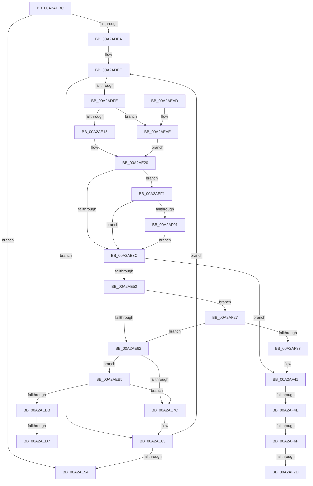

# PnpGetResourceRequirementsForAssignTable

- RVA: `0x00A2ADBC`–`0x00A2AF85` (길이 `457` bytes)
- VA: `0x0000000140A2ADBC`
- 실행 섹션: `PAGE`
- PDB 이름 있음: `예`; PDB Function 태그: `예`
- unwind 정보 RVA: `0x000AC21C`
- 디코드: `108`개 명령, `457/457` bytes 표시
- 미해석 바이트: `0` (있으면 어셈블리에 `.byte`로 보존)

> 이 문서는 커널 이미지의 기계어와 PDB 기호를 분석해 생성했습니다. 4번과 5번은 함수 원형과 자료형을 바이너리 사용 방식에서 추정한 C 해석이며 원본 소스 복구 결과는 아닙니다.

## 1. Dependencies

- 직접 호출 지점: **9**; 고유 호출 대상: **6**
- 직접 호출자로 확인된 함수: **3**
- RIP 상대 이미지 참조: **1**

### Outgoing calls
- `0x00A2AE27` → [ExAcquireFastMutex](../../text/20/ExAcquireFastMutex_function_0020E5A0.md) (function, `0x0020E5A0`)
- `0x00A2AE43` → [ExReleaseFastMutex](../../text/25/ExReleaseFastMutex_function_002519C0.md) (function, `0x002519C0`)
- `0x00A2AE73` → [IopQueryDeviceResources](../8F/IopQueryDeviceResources_function_008FC344.md) (function, `0x008FC344`)
- `0x00A2AEC2` → [ExAcquireFastMutex](../../text/20/ExAcquireFastMutex_function_0020E5A0.md) (function, `0x0020E5A0`)
- `0x00A2AED9` → [ExFreePoolWithTag](../../poolcode/B8/ExFreePoolWithTag_function_00B82870.md) (function, `0x00B82870`)
- `0x00A2AEE6` → [PipClearDevNodeFlags](../8F/PipClearDevNodeFlags_function_008F9F54.md) (function, `0x008F9F54`)
- `0x00A2AF03` → [ExFreePoolWithTag](../../poolcode/B8/ExFreePoolWithTag_function_00B82870.md) (function, `0x00B82870`)
- `0x00A2AF18` → [PipClearDevNodeFlags](../8F/PipClearDevNodeFlags_function_008F9F54.md) (function, `0x008F9F54`)
- `0x00A2AF62` → [PnpFilterResourceRequirementsList](../AD/PnpFilterResourceRequirementsList_function_00AD0D7C.md) (function, `0x00AD0D7C`)

### Direct callers
- [PnpReallocateResources](../73/PnpReallocateResources_function_0073E924.md) at `0x0073E9E1`
- [PnpQueryRebalanceWorker](../73/PnpQueryRebalanceWorker_function_0073F2EC.md) at `0x0073F39F`
- [PnpAllocateResources](PnpAllocateResources_function_00A2ACC4.md) at `0x00A2AD4E`

### Static image references
- `0x00A2AE20` → RVA `0x00F8C3E0` (`.data`; read)

## 2. Other-region calls and transfers

- 다른 실행 섹션으로 향하는 call: **5**
  - `0x00A2AE27` → [ExAcquireFastMutex](../../text/20/ExAcquireFastMutex_function_0020E5A0.md) (`PAGE` → `.text`)
  - `0x00A2AE43` → [ExReleaseFastMutex](../../text/25/ExReleaseFastMutex_function_002519C0.md) (`PAGE` → `.text`)
  - `0x00A2AEC2` → [ExAcquireFastMutex](../../text/20/ExAcquireFastMutex_function_0020E5A0.md) (`PAGE` → `.text`)
  - `0x00A2AED9` → [ExFreePoolWithTag](../../poolcode/B8/ExFreePoolWithTag_function_00B82870.md) (`PAGE` → `POOLCODE`)
  - `0x00A2AF03` → [ExFreePoolWithTag](../../poolcode/B8/ExFreePoolWithTag_function_00B82870.md) (`PAGE` → `POOLCODE`)
- call이 아닌 외부 분기/꼬리 이동: **6**
  - `0x00A2AED1` → [sub_00B39020](../B3/Unknown_function_00B39020.md) (`tail-transfer`)
  - `0x00A2AEEC` → [sub_00B39020](../B3/Unknown_function_00B39020.md) (`tail-transfer`)
  - `0x00A2AF48` → [sub_00B39020 + 0x21](../B3/Unknown_function_00B39020.md) (`tail-transfer`)
  - `0x00A2AF69` → [sub_00B39020 + 0x1C](../B3/Unknown_function_00B39020.md) (`tail-transfer`)
  - `0x00A2AF77` → [sub_00B39020 + 0x1C](../B3/Unknown_function_00B39020.md) (`tail-transfer`)
  - `0x00A2AF80` → [sub_00B39020 + 0x21](../B3/Unknown_function_00B39020.md) (`tail-transfer`)

## 3. Assembly (complete function range)

```asm
00A2ADBC  40 53                           push rbx
00A2ADBE  55                              push rbp
00A2ADBF  56                              push rsi
00A2ADC0  57                              push rdi
00A2ADC1  41 56                           push r14
00A2ADC3  48 83 EC 20                     sub rsp, 0x20
00A2ADC7  83 64 24 50 00                  and dword ptr [rsp + 0x50], 0
00A2ADCC  4D 8B F0                        mov r14, r8
00A2ADCF  83 64 24 58 00                  and dword ptr [rsp + 0x58], 0
00A2ADD4  48 8B EA                        mov rbp, rdx
00A2ADD7  48 83 64 24 60 00               and qword ptr [rsp + 0x60], 0
00A2ADDD  41 83 20 00                     and dword ptr [r8], 0
00A2ADE1  48 3B CA                        cmp rcx, rdx
00A2ADE4  0F 83 AA 00 00 00               jae 0x140a2ae94
00A2ADEA  48 8D 59 18                     lea rbx, [rcx + 0x18]
00A2ADEE  48 83 63 08 00                  and qword ptr [rbx + 8], 0
00A2ADF3  8B 43 F0                        mov eax, dword ptr [rbx - 0x10]
00A2ADF6  A8 20                           test al, 0x20
00A2ADF8  0F 85 85 00 00 00               jne 0x140a2ae83
00A2ADFE  48 83 63 10 00                  and qword ptr [rbx + 0x10], 0
00A2AE03  48 83 63 18 00                  and qword ptr [rbx + 0x18], 0
00A2AE08  48 8B 43 E8                     mov rax, qword ptr [rbx - 0x18]
00A2AE0C  48 85 C0                        test rax, rax
00A2AE0F  0F 84 99 00 00 00               je 0x140a2aeae
00A2AE15  48 8B 80 38 01 00 00            mov rax, qword ptr [rax + 0x138]
00A2AE1C  48 8B 78 28                     mov rdi, qword ptr [rax + 0x28]
00A2AE20  48 8D 0D B9 15 56 00            lea rcx, [rip + 0x5615b9]
00A2AE27  E8 74 37 7E FF                  call 0x14020e5a0
00A2AE2C  F7 87 8C 01 00 00 00 04 00 00   test dword ptr [rdi + 0x18c], 0x400
00A2AE36  0F 85 B5 00 00 00               jne 0x140a2aef1
00A2AE3C  48 8D 0D 9D 15 56 00            lea rcx, [rip + 0x56159d]
00A2AE43  E8 78 6B 82 FF                  call 0x1402519c0
00A2AE48  48 83 3B 00                     cmp qword ptr [rbx], 0
00A2AE4C  0F 85 EF 00 00 00               jne 0x140a2af41
00A2AE52  48 8B 8F B8 01 00 00            mov rcx, qword ptr [rdi + 0x1b8]
00A2AE59  48 85 C9                        test rcx, rcx
00A2AE5C  0F 85 C5 00 00 00               jne 0x140a2af27
00A2AE62  48 8B 4B E8                     mov rcx, qword ptr [rbx - 0x18]
00A2AE66  4C 8D 4C 24 50                  lea r9, [rsp + 0x50]
00A2AE6B  4C 8B C3                        mov r8, rbx
00A2AE6E  BA 01 00 00 00                  mov edx, 1
00A2AE73  E8 CC 14 ED FF                  call 0x1408fc344
00A2AE78  85 C0                           test eax, eax
00A2AE7A  79 39                           jns 0x140a2aeb5
00A2AE7C  89 43 20                        mov dword ptr [rbx + 0x20], eax
00A2AE7F  83 4B F0 20                     or dword ptr [rbx - 0x10], 0x20
00A2AE83  48 83 C3 40                     add rbx, 0x40
00A2AE87  48 8D 43 E8                     lea rax, [rbx - 0x18]
00A2AE8B  48 3B C5                        cmp rax, rbp
00A2AE8E  0F 82 5A FF FF FF               jb 0x140a2adee
00A2AE94  41 8B 06                        mov eax, dword ptr [r14]
00A2AE97  F7 D8                           neg eax
00A2AE99  1B C0                           sbb eax, eax
00A2AE9B  F7 D0                           not eax
00A2AE9D  25 01 00 00 C0                  and eax, 0xc0000001
00A2AEA2  48 83 C4 20                     add rsp, 0x20
00A2AEA6  41 5E                           pop r14
00A2AEA8  5F                              pop rdi
00A2AEA9  5E                              pop rsi
00A2AEAA  5D                              pop rbp
00A2AEAB  5B                              pop rbx
00A2AEAC  C3                              ret
00A2AEAD  CC                              int3
00A2AEAE  33 FF                           xor edi, edi
00A2AEB0  E9 6B FF FF FF                  jmp 0x140a2ae20
00A2AEB5  48 83 3B 00                     cmp qword ptr [rbx], 0
00A2AEB9  74 C1                           je 0x140a2ae7c
00A2AEBB  48 8D 0D 1E 15 56 00            lea rcx, [rip + 0x56151e]
00A2AEC2  E8 D9 36 7E FF                  call 0x14020e5a0
00A2AEC7  48 8B 8F B8 01 00 00            mov rcx, qword ptr [rdi + 0x1b8]
00A2AECE  48 85 C9                        test rcx, rcx
00A2AED1  0F 84 49 E1 10 00               je 0x140b39020
00A2AED7  33 D2                           xor edx, edx
00A2AED9  E8 92 79 15 00                  call 0x140b82870
00A2AEDE  BA 00 02 00 00                  mov edx, 0x200
00A2AEE3  48 8B CF                        mov rcx, rdi
00A2AEE6  E8 69 F0 EC FF                  call 0x1408f9f54
00A2AEEB  90                              nop
00A2AEEC  E9 2F E1 10 00                  jmp 0x140b39020
00A2AEF1  48 8B 8F B8 01 00 00            mov rcx, qword ptr [rdi + 0x1b8]
00A2AEF8  48 85 C9                        test rcx, rcx
00A2AEFB  0F 84 3B FF FF FF               je 0x140a2ae3c
00A2AF01  33 D2                           xor edx, edx
00A2AF03  E8 68 79 15 00                  call 0x140b82870
00A2AF08  48 83 A7 B8 01 00 00 00         and qword ptr [rdi + 0x1b8], 0
00A2AF10  BA 00 02 00 00                  mov edx, 0x200
00A2AF15  48 8B CF                        mov rcx, rdi
00A2AF18  E8 37 F0 EC FF                  call 0x1408f9f54
00A2AF1D  0F BA 6B F0 0A                  bts dword ptr [rbx - 0x10], 0xa
00A2AF22  E9 15 FF FF FF                  jmp 0x140a2ae3c
00A2AF27  F7 87 8C 01 00 00 00 02 00 00   test dword ptr [rdi + 0x18c], 0x200
00A2AF31  0F 85 2B FF FF FF               jne 0x140a2ae62
00A2AF37  48 89 0B                        mov qword ptr [rbx], rcx
00A2AF3A  C7 43 F4 04 00 00 00            mov dword ptr [rbx - 0xc], 4
00A2AF41  F7 43 F0 00 02 00 00            test dword ptr [rbx - 0x10], 0x200
00A2AF48  0F 84 F3 E0 10 00               je 0x140b39041
00A2AF4E  48 8B 97 A0 01 00 00            mov rdx, qword ptr [rdi + 0x1a0]
00A2AF55  4C 8D 4C 24 58                  lea r9, [rsp + 0x58]
00A2AF5A  48 8B 0B                        mov rcx, qword ptr [rbx]
00A2AF5D  4C 8D 44 24 60                  lea r8, [rsp + 0x60]
00A2AF62  E8 15 5E 0A 00                  call 0x140ad0d7c
00A2AF67  85 C0                           test eax, eax
00A2AF69  0F 88 CD E0 10 00               js 0x140b3903c
00A2AF6F  48 8B 44 24 60                  mov rax, qword ptr [rsp + 0x60]
00A2AF74  48 85 C0                        test rax, rax
00A2AF77  0F 84 BF E0 10 00               je 0x140b3903c
00A2AF7D  48 89 03                        mov qword ptr [rbx], rax
00A2AF80  E9 BC E0 10 00                  jmp 0x140b39041
```

## 4. C-style interpretation (structured pseudocode)

```c
__int64 __fastcall PnpGetResourceRequirementsForAssignTable(__int64 a1, __int64 a2, __int64 a3)
{
    __int64 result;
    __int64 v_rbx;
    __int64 v_rdi;
    __int64 v_rsp;
    unsigned int v_stack_p10;
    unsigned __int64 v_stack_p18;
    unsigned __int64 v_stack_p58;
    unsigned __int64 v_stack_p60;
    unsigned int v_stack_p8;

    v_rsp = (v_rsp) - (32);
    if (a1 >= a2) goto loc_00A2AE94;
loc_00A2ADEE:
    if ((((unsigned __int8)((unsigned int)(*(unsigned int *)(a1 + 24 - 16)))) & (32)) != 0) goto loc_00A2AE83;
    if (*(unsigned __int64 *)(a1 + 24 - 24) == 0) goto loc_00A2AEAE;
loc_00A2AE20:
    result = ExAcquireFastMutex(v_rip + 5641657, a2, a3, a4);
    if (((*(unsigned int *)(*(unsigned __int64 *)(*(unsigned __int64 *)(*(unsigned __int64 *)(a1 + 24 - 24) + 312) + 40) + 396)) & (0x400ULL)) != 0) goto loc_00A2AEF1;
loc_00A2AE3C:
    result = ExReleaseFastMutex(v_rip + 5641629, a2, a3, a4);
    if ((*(unsigned __int64 *)(a1 + 24)) != 0) goto loc_00A2AF41;
    if (*(unsigned __int64 *)(*(unsigned __int64 *)(*(unsigned __int64 *)(*(unsigned __int64 *)(a1 + 24 - 24) + 312) + 40) + 440) != 0) goto loc_00A2AF27;
loc_00A2AE62:
    result = IopQueryDeviceResources(*(unsigned __int64 *)(a1 + 24 - 24), 1, a1 + 24, v_stack_p8);
    if (!sign_flag) goto loc_00A2AEB5;
loc_00A2AE7C:
    *(unsigned int *)(a1 + 24 + 32) = (unsigned int)(result);
loc_00A2AE83:
    v_rbx = (a1 + 24) + (64);
    if ((v_rbx - 24) < a2) goto loc_00A2ADEE;
loc_00A2AE94:
    result = (unsigned int)(-((unsigned int)(*(unsigned int *)(a3))));
    result = (unsigned int)(~(result));
    result = (unsigned int)((result) & (0xC0000001ULL));
    v_rsp = (v_rsp) + (32);
    return result;
loc_00A2AEAE:
    v_rdi = 0;
    goto loc_00A2AE20;
loc_00A2AEB5:
    if ((*(unsigned __int64 *)(v_rbx)) == 0) goto loc_00A2AE7C;
    result = ExAcquireFastMutex(v_rip + 5641502, 1, a1 + 24, v_stack_p8);
    a2 = 0;
    result = ExFreePoolWithTag(*(unsigned __int64 *)(v_rdi + 440), a2, a1 + 24, v_stack_p8);
    result = PipClearDevNodeFlags(0, 512, a1 + 24, v_stack_p8);
loc_00A2AEF1:
    if (*(unsigned __int64 *)(v_rdi + 440) == 0) goto loc_00A2AE3C;
    a2 = 0;
    result = ExFreePoolWithTag(*(unsigned __int64 *)(v_rdi + 440), a2, a1 + 24, v_stack_p8);
    result = PipClearDevNodeFlags(0, 512, a1 + 24, v_stack_p8);
    goto loc_00A2AE3C;
loc_00A2AF27:
    if (((*(unsigned int *)(v_rdi + 396)) & (512)) != 0) goto loc_00A2AE62;
    *(unsigned __int64 *)(v_rbx) = 0;
    *(unsigned int *)(v_rbx - 12) = 4;
loc_00A2AF41:
    result = PnpFilterResourceRequirementsList(*(unsigned __int64 *)(v_rbx), *(unsigned __int64 *)(v_rdi + 416), v_stack_p60, v_stack_p58);
    *(unsigned __int64 *)(v_rbx) = v_stack_p60;
}
```

## 5. (Beta) C Style

```c
int64_t PnpGetResourceRequirementsForAssignTable(int64_t Arg1, int64_t Arg2, void *Arg3)
{
    uint8_t *arg3 = (uint8_t *)Arg3;

    int64_t result;
    int64_t local_rbx;
    int64_t local_rdi;
    int64_t local_rsp;
    uint32_t v_stack_p10;
    uint64_t v_stack_p18;
    uint64_t v_stack_p58;
    uint64_t v_stack_p60;
    uint32_t v_stack_p8;

    local_rsp = (local_rsp) - (32);
    if (Arg1 >= Arg2) goto loc_00A2AE94;
loc_00A2ADEE:
    if ((((uint8_t)((uint32_t)(*(uint32_t *)(Arg1 + 0x18 - 0x10)))) & (32)) != 0) goto loc_00A2AE83;
    if (*(uint64_t *)(Arg1 + 0x18 - 0x18) == 0) goto loc_00A2AEAE;
loc_00A2AE20:
    result = ExAcquireFastMutex(v_rip + 5641657, Arg2, Arg3, a4);
    if (((*(uint32_t *)(*(uint64_t *)(*(uint64_t *)(*(uint64_t *)(Arg1 + 0x18 - 0x18) + 0x138) + 0x28) + 0x18C)) & (0x400ULL)) != 0) goto loc_00A2AEF1;
loc_00A2AE3C:
    result = ExReleaseFastMutex(v_rip + 5641629, Arg2, Arg3, a4);
    if ((*(uint64_t *)(Arg1 + 0x18)) != 0) goto loc_00A2AF41;
    if (*(uint64_t *)(*(uint64_t *)(*(uint64_t *)(*(uint64_t *)(Arg1 + 0x18 - 0x18) + 0x138) + 0x28) + 0x1B8) != 0) goto loc_00A2AF27;
loc_00A2AE62:
    result = IopQueryDeviceResources(*(uint64_t *)(Arg1 + 0x18 - 0x18), 1, Arg1 + 24, v_stack_p8);
    if (!sign_flag) goto loc_00A2AEB5;
loc_00A2AE7C:
    *(uint32_t *)(Arg1 + 0x18 + 0x20) = (uint32_t)(result);
loc_00A2AE83:
    local_rbx = (Arg1 + 24) + (64);
    if ((local_rbx - 24) < Arg2) goto loc_00A2ADEE;
loc_00A2AE94:
    result = (uint32_t)(-((uint32_t)(*(uint32_t *)(arg3))));
    result = (uint32_t)(~(result));
    result = (uint32_t)((result) & (0xC0000001ULL));
    local_rsp = (local_rsp) + (32);
    return result;
loc_00A2AEAE:
    local_rdi = 0;
    goto loc_00A2AE20;
loc_00A2AEB5:
    if ((*(uint64_t *)(local_rbx)) == 0) goto loc_00A2AE7C;
    result = ExAcquireFastMutex(v_rip + 5641502, 1, Arg1 + 24, v_stack_p8);
    Arg2 = 0;
    result = ExFreePoolWithTag(*(uint64_t *)(local_rdi + 0x1B8), Arg2, Arg1 + 24, v_stack_p8);
    result = PipClearDevNodeFlags(0, 512, Arg1 + 24, v_stack_p8);
loc_00A2AEF1:
    if (*(uint64_t *)(local_rdi + 0x1B8) == 0) goto loc_00A2AE3C;
    Arg2 = 0;
    result = ExFreePoolWithTag(*(uint64_t *)(local_rdi + 0x1B8), Arg2, Arg1 + 24, v_stack_p8);
    result = PipClearDevNodeFlags(0, 512, Arg1 + 24, v_stack_p8);
    goto loc_00A2AE3C;
loc_00A2AF27:
    if (((*(uint32_t *)(local_rdi + 0x18C)) & (512)) != 0) goto loc_00A2AE62;
    *(uint64_t *)(local_rbx) = 0;
    *(uint32_t *)(local_rbx - 0xC) = 4;
loc_00A2AF41:
    result = PnpFilterResourceRequirementsList(*(uint64_t *)(local_rbx), *(uint64_t *)(local_rdi + 0x1A0), v_stack_p60, v_stack_p58);
    *(uint64_t *)(local_rbx) = v_stack_p60;
}
```

### 관측된 메모리 오프셋

구조체 형식이 확인되지 않은 접근은 인자 기준의 오프셋으로만 기록했습니다.

| 기준 인자 | 오프셋 표현 | 폭 (bit) | 접근 |
|---|---:|---:|---|
| `Arg3` | `+ 0x0` | `32` | `R` |
| `Arg3` | `+ 0x0` | `32` | `R/W` |

## 6. Execution-region graph

[열기: 2D/3D 그래프와 함수 탐색 컨트롤 패널](../../../control-panel.html?section=page&rva=0x00A2ADBC&view=graph)

- 2D 그래프는 위에서 아래로 흐르고, 3D 그래프는 빈 공간을 드래그해 회전합니다. Shift+드래그는 이동, 휠은 확대·축소, 함수 노드 선택은 대상 보고서 이동입니다.

### Static fallback


