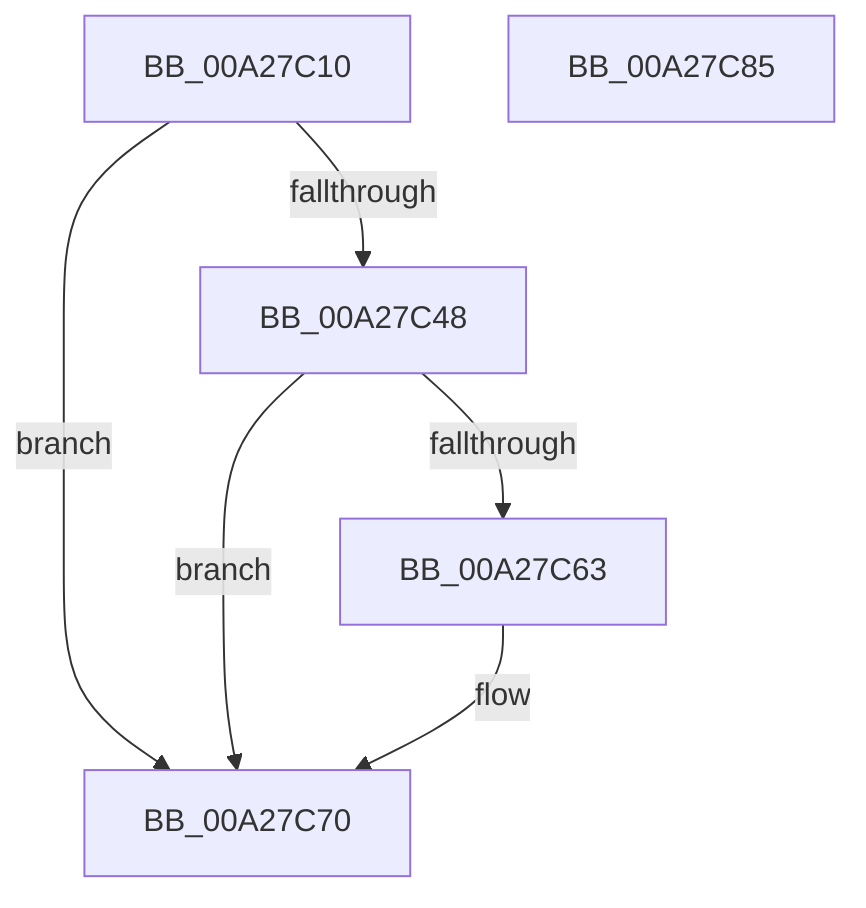

# PnpGetStableSystemBootTime

- RVA: `0x00A27C10`–`0x00A27C86` (길이 `118` bytes)
- VA: `0x0000000140A27C10`
- 실행 섹션: `PAGE`
- PDB 이름 있음: `예`; PDB Function 태그: `아니요`
- unwind 정보 RVA: `0x0005F638`
- 디코드: `34`개 명령, `118/118` bytes 표시
- 미해석 바이트: `0` (있으면 어셈블리에 `.byte`로 보존)

> 이 문서는 커널 이미지의 기계어와 PDB 기호를 분석해 생성했습니다. 4번과 5번은 함수 원형과 자료형을 바이너리 사용 방식에서 추정한 C 해석이며 원본 소스 복구 결과는 아닙니다.

## 1. Dependencies

- 직접 호출 지점: **3**; 고유 호출 대상: **3**
- 직접 호출자로 확인된 함수: **1**
- RIP 상대 이미지 참조: **1**

### Outgoing calls
- `0x00A27C3D` → [PipHardwareConfigGetLastUseTime](PipHardwareConfigGetLastUseTime_function_00A28238.md) (function, `0x00A28238`)
- `0x00A27C58` → [ZwQuerySystemInformation](../../text/6A/ZwQuerySystemInformation_function_006AD790.md) (function, `0x006AD790`)
- `0x00A27C7A` → [_security_check_cookie](../../text/6A/_security_check_cookie_function_006AC640.md) (function, `0x006AC640`)

### Direct callers
- [PipCallDriverAddDevice](PipCallDriverAddDevice_function_00A272E0.md) at `0x00A275DE`

### Static image references
- `0x00A27C16` → RVA `0x00E0A740` (`.data`; read)

## 2. Other-region calls and transfers

- 다른 실행 섹션으로 향하는 call: **2**
  - `0x00A27C58` → [ZwQuerySystemInformation](../../text/6A/ZwQuerySystemInformation_function_006AD790.md) (`PAGE` → `.text`)
  - `0x00A27C7A` → [_security_check_cookie](../../text/6A/_security_check_cookie_function_006AC640.md) (`PAGE` → `.text`)
- 별도 외부 분기/꼬리 이동을 확인하지 못했습니다.

## 3. Assembly (complete function range)

```asm
00A27C10  40 53                           push rbx
00A27C12  48 83 EC 60                     sub rsp, 0x60
00A27C16  48 8B 05 23 2B 3E 00            mov rax, qword ptr [rip + 0x3e2b23]
00A27C1D  48 33 C4                        xor rax, rsp
00A27C20  48 89 44 24 50                  mov qword ptr [rsp + 0x50], rax
00A27C25  0F 57 C0                        xorps xmm0, xmm0
00A27C28  48 8B D1                        mov rdx, rcx
00A27C2B  0F 11 44 24 20                  movups xmmword ptr [rsp + 0x20], xmm0
00A27C30  48 8B D9                        mov rbx, rcx
00A27C33  0F 11 44 24 30                  movups xmmword ptr [rsp + 0x30], xmm0
00A27C38  0F 11 44 24 40                  movups xmmword ptr [rsp + 0x40], xmm0
00A27C3D  E8 F6 05 00 00                  call 0x140a28238
00A27C42  8B D0                           mov edx, eax
00A27C44  85 C0                           test eax, eax
00A27C46  79 28                           jns 0x140a27c70
00A27C48  45 33 C9                        xor r9d, r9d
00A27C4B  48 8D 54 24 20                  lea rdx, [rsp + 0x20]
00A27C50  45 8D 41 30                     lea r8d, [r9 + 0x30]
00A27C54  41 8D 49 03                     lea ecx, [r9 + 3]
00A27C58  E8 33 5B C8 FF                  call 0x1406ad790
00A27C5D  8B D0                           mov edx, eax
00A27C5F  85 C0                           test eax, eax
00A27C61  78 0D                           js 0x140a27c70
00A27C63  48 8B 44 24 20                  mov rax, qword ptr [rsp + 0x20]
00A27C68  48 2B 44 24 40                  sub rax, qword ptr [rsp + 0x40]
00A27C6D  48 89 03                        mov qword ptr [rbx], rax
00A27C70  8B C2                           mov eax, edx
00A27C72  48 8B 4C 24 50                  mov rcx, qword ptr [rsp + 0x50]
00A27C77  48 33 CC                        xor rcx, rsp
00A27C7A  E8 C1 49 C8 FF                  call 0x1406ac640
00A27C7F  48 83 C4 60                     add rsp, 0x60
00A27C83  5B                              pop rbx
00A27C84  C3                              ret
00A27C85  CC                              int3
```

## 4. C-style interpretation (structured pseudocode)

```c
__int64 __fastcall PnpGetStableSystemBootTime(__int64 a1, __int64 a2, __int64 a3, int a4)
{
    __int64 result;
    __int64 v_rsp;
    unsigned __int64 v_stack_m18;
    unsigned __int64 v_stack_m28;
    unsigned __int64 v_stack_m38;
    unsigned __int64 v_stack_m48;

    v_rsp = (v_rsp) - (96);
    result = (*(unsigned __int64 *)(v_rip + 4074275)) ^ (v_rsp);
    v_stack_m18 = result;
    v_stack_m48 = v_xmm0;
    v_stack_m38 = v_xmm0;
    v_stack_m28 = v_xmm0;
    result = PipHardwareConfigGetLastUseTime(a1, a1, a3, a4);
    if (!sign_flag) goto loc_00A27C70;
    a4 = 0;
    result = ZwQuerySystemInformation(a4 + 3, v_stack_m48, a4 + 48, a4);
    if (!(sign_flag)) {
        result = v_stack_m48;
        result = (result) - (v_stack_m28);
        *(unsigned __int64 *)(a1) = result;
    }
    a1 = (v_stack_m18) ^ (v_rsp);
    result = _security_check_cookie(a1, (unsigned int)((unsigned int)(result)), a4 + 48, a4);
    v_rsp = (v_rsp) + (96);
    return result;
}
```

## 5. (Beta) C Style

```c
int64_t PnpGetStableSystemBootTime(void *Arg1, int64_t Arg2, int64_t Arg3, int32_t Arg4)
{
    uint8_t *arg1 = (uint8_t *)Arg1;

    int64_t result;
    int64_t local_rsp;
    uint64_t v_stack_m18;
    uint64_t v_stack_m28;
    uint64_t v_stack_m38;
    uint64_t v_stack_m48;

    local_rsp = (local_rsp) - (96);
    result = (*(uint64_t *)(v_rip + 0x3E2B23)) ^ (local_rsp);
    v_stack_m18 = result;
    v_stack_m48 = v_xmm0;
    v_stack_m38 = v_xmm0;
    v_stack_m28 = v_xmm0;
    result = PipHardwareConfigGetLastUseTime(Arg1, Arg1, Arg3, Arg4);
    if (!sign_flag) goto loc_00A27C70;
    Arg4 = 0;
    result = ZwQuerySystemInformation(Arg4 + 3, v_stack_m48, Arg4 + 48, Arg4);
    if (!(sign_flag)) {
        result = v_stack_m48;
        result = (result) - (v_stack_m28);
        *(uint64_t *)(arg1) = result;
    }
    Arg1 = (v_stack_m18) ^ (local_rsp);
    result = _security_check_cookie(Arg1, (uint32_t)((uint32_t)(result)), Arg4 + 48, Arg4);
    local_rsp = (local_rsp) + (96);
    return result;
}
```

### 관측된 메모리 오프셋

구조체 형식이 확인되지 않은 접근은 인자 기준의 오프셋으로만 기록했습니다.

| 기준 인자 | 오프셋 표현 | 폭 (bit) | 접근 |
|---|---:|---:|---|
| `Arg1` | `+ 0x0` | `64` | `W` |

## 6. Execution-region graph

[열기: 2D/3D 그래프와 함수 탐색 컨트롤 패널](../../../control-panel.html?section=page&rva=0x00A27C10&view=graph)

- 2D 그래프는 위에서 아래로 흐르고, 3D 그래프는 빈 공간을 드래그해 회전합니다. Shift+드래그는 이동, 휠은 확대·축소, 함수 노드 선택은 대상 보고서 이동입니다.

### Static fallback


