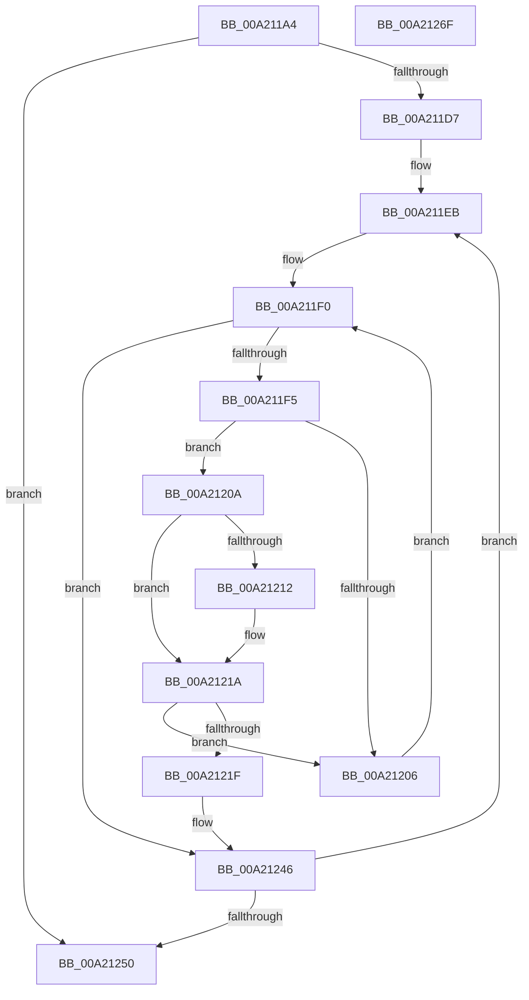

# PnpNotifyDerivedKeys

- RVA: `0x00A211A4`–`0x00A21270` (길이 `204` bytes)
- VA: `0x0000000140A211A4`
- 실행 섹션: `PAGE`
- PDB 이름 있음: `예`; PDB Function 태그: `아니요`
- unwind 정보 RVA: `0x000847EC`
- 디코드: `60`개 명령, `204/204` bytes 표시
- 미해석 바이트: `0` (있으면 어셈블리에 `.byte`로 보존)

> 이 문서는 커널 이미지의 기계어와 PDB 기호를 분석해 생성했습니다. 4번과 5번은 함수 원형과 자료형을 바이너리 사용 방식에서 추정한 C 해석이며 원본 소스 복구 결과는 아닙니다.

## 1. Dependencies

- 직접 호출 지점: **1**; 고유 호출 대상: **1**
- 직접 호출자로 확인된 함수: **2**
- RIP 상대 이미지 참조: **0**

### Outgoing calls
- `0x00A21241` → [guard_dispatch_icall](../../text/6B/guard_dispatch_icall_function_006BAAD0.md) (function, `0x006BAAD0`)

### Direct callers
- [PnpInterfaceClassRaisePropertyChangeEventWorker](../82/PnpInterfaceClassRaisePropertyChangeEventWorker_function_0082DC58.md) at `0x0082DCD9`
- [PnpUpdateInterfacesCallback](../82/PnpUpdateInterfacesCallback_function_0082DD40.md) at `0x0082DDCB`

### Static image references
- 디코드된 RIP-relative 메모리 참조가 없습니다.

## 2. Other-region calls and transfers

- 다른 실행 섹션으로 향하는 call: **1**
  - `0x00A21241` → [guard_dispatch_icall](../../text/6B/guard_dispatch_icall_function_006BAAD0.md) (`PAGE` → `.text`)
- 별도 외부 분기/꼬리 이동을 확인하지 못했습니다.

## 3. Assembly (complete function range)

```asm
00A211A4  48 8B C4                        mov rax, rsp
00A211A7  48 89 58 08                     mov qword ptr [rax + 8], rbx
00A211AB  48 89 68 10                     mov qword ptr [rax + 0x10], rbp
00A211AF  48 89 70 18                     mov qword ptr [rax + 0x18], rsi
00A211B3  48 89 78 20                     mov qword ptr [rax + 0x20], rdi
00A211B7  41 54                           push r12
00A211B9  41 56                           push r14
00A211BB  41 57                           push r15
00A211BD  48 83 EC 30                     sub rsp, 0x30
00A211C1  44 8B 54 24 78                  mov r10d, dword ptr [rsp + 0x78]
00A211C6  49 8B F1                        mov rsi, r9
00A211C9  45 8B F0                        mov r14d, r8d
00A211CC  4C 8B FA                        mov r15, rdx
00A211CF  4C 8B E1                        mov r12, rcx
00A211D2  45 85 D2                        test r10d, r10d
00A211D5  74 79                           je 0x140a21250
00A211D7  48 8B 5C 24 70                  mov rbx, qword ptr [rsp + 0x70]
00A211DC  41 8B FA                        mov edi, r10d
00A211DF  48 8B AC 24 80 00 00 00         mov rbp, qword ptr [rsp + 0x80]
00A211E7  48 83 C3 08                     add rbx, 8
00A211EB  44 8B 0B                        mov r9d, dword ptr [rbx]
00A211EE  33 D2                           xor edx, edx
00A211F0  41 3B D1                        cmp edx, r9d
00A211F3  73 51                           jae 0x140a21246
00A211F5  48 8B 43 F8                     mov rax, qword ptr [rbx - 8]
00A211F9  4C 8B 04 D0                     mov r8, qword ptr [rax + rdx*8]
00A211FD  41 8B 40 10                     mov eax, dword ptr [r8 + 0x10]
00A21201  39 46 10                        cmp dword ptr [rsi + 0x10], eax
00A21204  74 04                           je 0x140a2120a
00A21206  FF C2                           inc edx
00A21208  EB E6                           jmp 0x140a211f0
00A2120A  48 8B 0E                        mov rcx, qword ptr [rsi]
00A2120D  49 2B 08                        sub rcx, qword ptr [r8]
00A21210  75 08                           jne 0x140a2121a
00A21212  48 8B 4E 08                     mov rcx, qword ptr [rsi + 8]
00A21216  49 2B 48 08                     sub rcx, qword ptr [r8 + 8]
00A2121A  48 85 C9                        test rcx, rcx
00A2121D  75 E7                           jne 0x140a21206
00A2121F  48 8B 43 08                     mov rax, qword ptr [rbx + 8]
00A21223  44 8D 49 04                     lea r9d, [rcx + 4]
00A21227  48 89 45 10                     mov qword ptr [rbp + 0x10], rax
00A2122B  45 8B C6                        mov r8d, r14d
00A2122E  48 8B 84 24 88 00 00 00         mov rax, qword ptr [rsp + 0x88]
00A21236  49 8B D7                        mov rdx, r15
00A21239  49 8B CC                        mov rcx, r12
00A2123C  48 89 6C 24 20                  mov qword ptr [rsp + 0x20], rbp
00A21241  E8 8A 98 C9 FF                  call 0x1406baad0
00A21246  48 83 C3 18                     add rbx, 0x18
00A2124A  48 83 EF 01                     sub rdi, 1
00A2124E  75 9B                           jne 0x140a211eb
00A21250  48 8B 5C 24 50                  mov rbx, qword ptr [rsp + 0x50]
00A21255  48 8B 6C 24 58                  mov rbp, qword ptr [rsp + 0x58]
00A2125A  48 8B 74 24 60                  mov rsi, qword ptr [rsp + 0x60]
00A2125F  48 8B 7C 24 68                  mov rdi, qword ptr [rsp + 0x68]
00A21264  48 83 C4 30                     add rsp, 0x30
00A21268  41 5F                           pop r15
00A2126A  41 5E                           pop r14
00A2126C  41 5C                           pop r12
00A2126E  C3                              ret
00A2126F  CC                              int3
```

## 4. C-style interpretation (structured pseudocode)

```c
__int64 __fastcall PnpNotifyDerivedKeys(__int64 a1, __int64 a2, int a3, __int64 a4, __int64 a5, unsigned int a6, __int64 a7, __int64 a8)
{
    __int64 result;
    __int64 v_rbx;
    __int64 v_rdi;
    __int64 v_rsp;
    unsigned __int64 v_stack_m28;
    unsigned __int64 v_stack_p10;
    unsigned __int64 v_stack_p18;
    unsigned __int64 v_stack_p20;
    unsigned __int64 v_stack_p8;

    *(unsigned __int64 *)(v_rsp + 8) = v_rbx;
    *(unsigned __int64 *)(v_rsp + 16) = v_rbp;
    *(unsigned __int64 *)(v_rsp + 24) = v_rsi;
    *(unsigned __int64 *)(v_rsp + 32) = v_rdi;
    v_rsp = (v_rsp) - (48);
    if ((unsigned int)((unsigned int)(a6)) == 0) goto loc_00A21250;
    v_rbx = (a5) + (8);
loc_00A211EB:
    a2 = 0;
loc_00A211F0:
    if (0 >= ((unsigned int)((unsigned int)(*(unsigned int *)(v_rbx))))) goto loc_00A21246;
    if ((*(unsigned int *)(a4 + 16)) == ((unsigned int)((unsigned int)(*(unsigned int *)(*(unsigned __int64 *)(*(unsigned __int64 *)(v_rbx - 8) + a2 * 8) + 16))))) goto loc_00A2120A;
loc_00A21206:
    a2 = (unsigned int)((a2) + 1);
    goto loc_00A211F0;
loc_00A2120A:
    a1 = (*(unsigned __int64 *)(a4)) - (*(unsigned __int64 *)(*(unsigned __int64 *)(*(unsigned __int64 *)(v_rbx - 8) + a2 * 8)));
    if (!(condition_is_not_equal)) {
        a1 = *(unsigned __int64 *)(a4 + 8);
        a1 = (a1) - (*(unsigned __int64 *)(*(unsigned __int64 *)(*(unsigned __int64 *)(v_rbx - 8) + a2 * 8) + 8));
    }
    if (a1 != 0) goto loc_00A21206;
    *(unsigned __int64 *)(a7 + 16) = *(unsigned __int64 *)(v_rbx + 8);
    v_stack_m28 = a7;
    result = guard_dispatch_icall(a1, a2, (unsigned int)((unsigned int)((unsigned int)(a3))), a1 + 4);
loc_00A21246:
    v_rbx = (v_rbx) + (24);
    v_rdi = ((unsigned int)((unsigned int)((unsigned int)(a6)))) - (1);
    if (condition_is_not_equal) goto loc_00A211EB;
loc_00A21250:
    v_rsp = (v_rsp) + (48);
    return result;
}
```

## 5. (Beta) C Style

```c
int64_t PnpNotifyDerivedKeys(int64_t Arg1, int64_t Arg2, int32_t Arg3, void *Arg4, void *Arg5, uint32_t Arg6, void *Arg7, int64_t Arg8)
{
    uint8_t *arg4 = (uint8_t *)Arg4;
    uint8_t *arg5 = (uint8_t *)Arg5;
    uint8_t *arg7 = (uint8_t *)Arg7;

    int64_t result;
    int64_t local_rbx;
    int64_t local_rdi;
    int64_t local_rsp;
    uint64_t v_stack_m28;
    uint64_t v_stack_p10;
    uint64_t v_stack_p18;
    uint64_t v_stack_p20;
    uint64_t v_stack_p8;

    *(uint64_t *)(local_rsp + 0x8) = local_rbx;
    *(uint64_t *)(local_rsp + 0x10) = local_rbp;
    *(uint64_t *)(local_rsp + 0x18) = local_rsi;
    *(uint64_t *)(local_rsp + 0x20) = local_rdi;
    local_rsp = (local_rsp) - (48);
    if ((uint32_t)((uint32_t)(Arg6)) == 0) goto loc_00A21250;
    local_rbx = (Arg5) + (8);
loc_00A211EB:
    Arg2 = 0;
loc_00A211F0:
    if (0 >= ((uint32_t)((uint32_t)(*(uint32_t *)(local_rbx))))) goto loc_00A21246;
    if ((*(uint32_t *)(arg4 + 0x10)) == ((uint32_t)((uint32_t)(*(uint32_t *)(*(uint64_t *)(*(uint64_t *)(local_rbx - 0x8) + Arg2 * 8) + 0x10))))) goto loc_00A2120A;
loc_00A21206:
    Arg2 = (uint32_t)((Arg2) + 1);
    goto loc_00A211F0;
loc_00A2120A:
    Arg1 = (*(uint64_t *)(arg4)) - (*(uint64_t *)(*(uint64_t *)(*(uint64_t *)(local_rbx - 0x8) + Arg2 * 8)));
    if (!(condition_is_not_equal)) {
        Arg1 = *(uint64_t *)(arg4 + 0x8);
        Arg1 = (Arg1) - (*(uint64_t *)(*(uint64_t *)(*(uint64_t *)(local_rbx - 0x8) + Arg2 * 8) + 0x8));
    }
    if (Arg1 != 0) goto loc_00A21206;
    *(uint64_t *)(arg7 + 0x10) = *(uint64_t *)(local_rbx + 0x8);
    v_stack_m28 = Arg7;
    result = guard_dispatch_icall(Arg1, Arg2, (uint32_t)((uint32_t)((uint32_t)(Arg3))), Arg1 + 4);
loc_00A21246:
    local_rbx = (local_rbx) + (24);
    local_rdi = ((uint32_t)((uint32_t)((uint32_t)(Arg6)))) - (1);
    if (condition_is_not_equal) goto loc_00A211EB;
loc_00A21250:
    local_rsp = (local_rsp) + (48);
    return result;
}
```

### 관측된 메모리 오프셋

구조체 형식이 확인되지 않은 접근은 인자 기준의 오프셋으로만 기록했습니다.

| 기준 인자 | 오프셋 표현 | 폭 (bit) | 접근 |
|---|---:|---:|---|
| `Arg4` | `+ 0x0` | `64` | `R` |
| `Arg4` | `+ 0x8` | `64` | `R` |
| `Arg4` | `+ 0x10` | `32` | `R` |
| `Arg5` | `- 0x8` | `64` | `R` |
| `Arg5` | `+ 0x0` | `32` | `R` |
| `Arg5` | `+ 0x8` | `64` | `R` |
| `Arg7` | `+ 0x10` | `64` | `W` |

## 6. Execution-region graph

[열기: 2D/3D 그래프와 함수 탐색 컨트롤 패널](../../../control-panel.html?section=page&rva=0x00A211A4&view=graph)

- 2D 그래프는 위에서 아래로 흐르고, 3D 그래프는 빈 공간을 드래그해 회전합니다. Shift+드래그는 이동, 휠은 확대·축소, 함수 노드 선택은 대상 보고서 이동입니다.

### Static fallback


