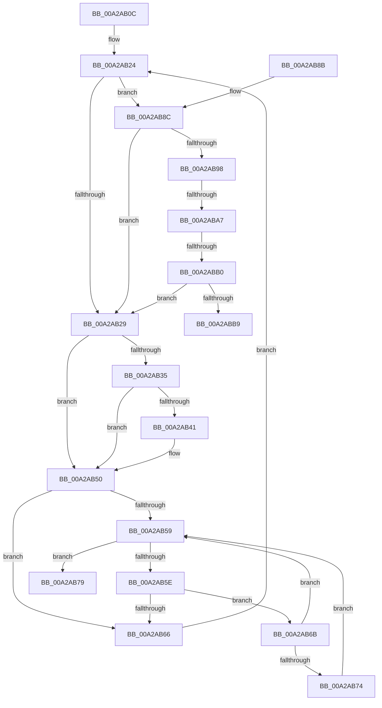

# PnpProcessAssignResourcesWorker

- RVA: `0x00A2AB0C`–`0x00A2ABBE` (길이 `178` bytes)
- VA: `0x0000000140A2AB0C`
- 실행 섹션: `PAGE`
- PDB 이름 있음: `예`; PDB Function 태그: `예`
- unwind 정보 RVA: `0x00069264`
- 디코드: `49`개 명령, `178/178` bytes 표시
- 미해석 바이트: `0` (있으면 어셈블리에 `.byte`로 보존)

> 이 문서는 커널 이미지의 기계어와 PDB 기호를 분석해 생성했습니다. 4번과 5번은 함수 원형과 자료형을 바이너리 사용 방식에서 추정한 C 해석이며 원본 소스 복구 결과는 아닙니다.

## 1. Dependencies

- 직접 호출 지점: **0**; 고유 호출 대상: **0**
- 직접 호출자로 확인된 함수: **1**
- RIP 상대 이미지 참조: **0**

### Outgoing calls
- 직접 디코드된 call 명령이 없습니다.

### Direct callers
- [PnpProcessAssignResources](PnpProcessAssignResources_function_00A2A950.md) at `0x00A2A9AC`

### Static image references
- 디코드된 RIP-relative 메모리 참조가 없습니다.

## 2. Other-region calls and transfers

- 다른 실행 섹션으로 향하는 call: **0**
- call이 아닌 외부 분기/꼬리 이동: **3**
  - `0x00A2ABA1` → [sub_00B38C28](../B3/Unknown_function_00B38C28.md) (`tail-transfer`)
  - `0x00A2ABAA` → [sub_00B38C28](../B3/Unknown_function_00B38C28.md) (`tail-transfer`)
  - `0x00A2ABB9` → [sub_00B38C28](../B3/Unknown_function_00B38C28.md) (`tail-transfer`)

## 3. Assembly (complete function range)

```asm
00A2AB0C  48 89 5C 24 08                  mov qword ptr [rsp + 8], rbx
00A2AB11  48 89 74 24 10                  mov qword ptr [rsp + 0x10], rsi
00A2AB16  57                              push rdi
00A2AB17  48 83 EC 20                     sub rsp, 0x20
00A2AB1B  48 8B FA                        mov rdi, rdx
00A2AB1E  48 8B F1                        mov rsi, rcx
00A2AB21  48 8B D9                        mov rbx, rcx
00A2AB24  83 3F 00                        cmp dword ptr [rdi], 0
00A2AB27  75 63                           jne 0x140a2ab8c
00A2AB29  F7 83 8C 01 00 00 00 60 00 00   test dword ptr [rbx + 0x18c], 0x6000
00A2AB33  75 1B                           jne 0x140a2ab50
00A2AB35  81 BB 2C 01 00 00 05 03 00 00   cmp dword ptr [rbx + 0x12c], 0x305
00A2AB3F  75 0F                           jne 0x140a2ab50
00A2AB41  8B 4F 04                        mov ecx, dword ptr [rdi + 4]
00A2AB44  48 8B 43 20                     mov rax, qword ptr [rbx + 0x20]
00A2AB48  48 89 44 CF 08                  mov qword ptr [rdi + rcx*8 + 8], rax
00A2AB4D  FF 47 04                        inc dword ptr [rdi + 4]
00A2AB50  48 8B 43 08                     mov rax, qword ptr [rbx + 8]
00A2AB54  48 85 C0                        test rax, rax
00A2AB57  75 0D                           jne 0x140a2ab66
00A2AB59  48 3B DE                        cmp rbx, rsi
00A2AB5C  74 1B                           je 0x140a2ab79
00A2AB5E  48 8B 03                        mov rax, qword ptr [rbx]
00A2AB61  48 85 C0                        test rax, rax
00A2AB64  74 05                           je 0x140a2ab6b
00A2AB66  48 8B D8                        mov rbx, rax
00A2AB69  EB B9                           jmp 0x140a2ab24
00A2AB6B  48 8B 43 10                     mov rax, qword ptr [rbx + 0x10]
00A2AB6F  48 85 C0                        test rax, rax
00A2AB72  74 E5                           je 0x140a2ab59
00A2AB74  48 8B D8                        mov rbx, rax
00A2AB77  EB E0                           jmp 0x140a2ab59
00A2AB79  48 8B 5C 24 30                  mov rbx, qword ptr [rsp + 0x30]
00A2AB7E  33 C0                           xor eax, eax
00A2AB80  48 8B 74 24 38                  mov rsi, qword ptr [rsp + 0x38]
00A2AB85  48 83 C4 20                     add rsp, 0x20
00A2AB89  5F                              pop rdi
00A2AB8A  C3                              ret
00A2AB8B  CC                              int3
00A2AB8C  F7 83 8C 01 00 00 00 20 00 00   test dword ptr [rbx + 0x18c], 0x2000
00A2AB96  74 91                           je 0x140a2ab29
00A2AB98  8B 83 94 01 00 00               mov eax, dword ptr [rbx + 0x194]
00A2AB9E  83 F8 0C                        cmp eax, 0xc
00A2ABA1  0F 84 81 E0 10 00               je 0x140b38c28
00A2ABA7  83 F8 21                        cmp eax, 0x21
00A2ABAA  0F 84 78 E0 10 00               je 0x140b38c28
00A2ABB0  83 F8 24                        cmp eax, 0x24
00A2ABB3  0F 85 70 FF FF FF               jne 0x140a2ab29
00A2ABB9  E9 6A E0 10 00                  jmp 0x140b38c28
```

## 4. C-style interpretation (structured pseudocode)

```c
__int64 __fastcall PnpProcessAssignResourcesWorker(__int64 a1, __int64 a2)
{
    __int64 result;
    __int64 v_rsp;
    unsigned __int64 v_stack_p10;
    unsigned __int64 v_stack_p8;

    v_stack_p8 = v_rbx;
    v_stack_p10 = v_rsi;
    v_rsp = (v_rsp) - (32);
loc_00A2AB24:
    if ((*(unsigned int *)(a2)) != 0) goto loc_00A2AB8C;
loc_00A2AB29:
    if (((*(unsigned int *)(a1 + 396)) & (0x6000ULL)) != 0) goto loc_00A2AB50;
    if ((*(unsigned int *)(a1 + 300)) == 773) {
        a1 = *(unsigned int *)(a2 + 4);
        result = *(unsigned __int64 *)(a1 + 32);
        *(unsigned __int64 *)(a2 + a1 * 8 + 8) = result;
    }
    if (*(unsigned __int64 *)(a1 + 8) != 0) goto loc_00A2AB66;
loc_00A2AB59:
    if (a1 == a1) goto loc_00A2AB79;
    if (*(unsigned __int64 *)(a1) == 0) goto loc_00A2AB6B;
loc_00A2AB66:
    goto loc_00A2AB24;
loc_00A2AB6B:
    if (*(unsigned __int64 *)(*(unsigned __int64 *)(a1) + 16) == 0) goto loc_00A2AB59;
    goto loc_00A2AB59;
loc_00A2AB79:
    result = 0;
    v_rsp = (v_rsp) + (32);
    return result;
loc_00A2AB8C:
    if (((*(unsigned int *)(v_stack_p8 + 396)) & (0x2000ULL)) == 0) goto loc_00A2AB29;
    if (((unsigned int)((unsigned int)(*(unsigned int *)(v_stack_p8 + 404)))) != 36) goto loc_00A2AB29;
}
```

## 5. (Beta) C Style

```c
int64_t PnpProcessAssignResourcesWorker(int64_t Arg1, void *Arg2)
{
    uint8_t *arg2 = (uint8_t *)Arg2;

    int64_t result;
    int64_t local_rsp;
    uint64_t v_stack_p10;
    uint64_t v_stack_p8;

    v_stack_p8 = local_rbx;
    v_stack_p10 = local_rsi;
    local_rsp = (local_rsp) - (32);
loc_00A2AB24:
    if ((*(uint32_t *)(arg2)) != 0) goto loc_00A2AB8C;
loc_00A2AB29:
    if (((*(uint32_t *)(Arg1 + 0x18C)) & (0x6000ULL)) != 0) goto loc_00A2AB50;
    if ((*(uint32_t *)(Arg1 + 0x12C)) == 773) {
        Arg1 = *(uint32_t *)(arg2 + 0x4);
        result = *(uint64_t *)(Arg1 + 0x20);
        *(uint64_t *)(arg2 + Arg1 * 8 + 0x8) = result;
    }
    if (*(uint64_t *)(Arg1 + 0x8) != 0) goto loc_00A2AB66;
loc_00A2AB59:
    if (Arg1 == Arg1) goto loc_00A2AB79;
    if (*(uint64_t *)(Arg1) == 0) goto loc_00A2AB6B;
loc_00A2AB66:
    goto loc_00A2AB24;
loc_00A2AB6B:
    if (*(uint64_t *)(*(uint64_t *)(Arg1) + 0x10) == 0) goto loc_00A2AB59;
    goto loc_00A2AB59;
loc_00A2AB79:
    result = 0;
    local_rsp = (local_rsp) + (32);
    return result;
loc_00A2AB8C:
    if (((*(uint32_t *)(v_stack_p8 + 0x18C)) & (0x2000ULL)) == 0) goto loc_00A2AB29;
    if (((uint32_t)((uint32_t)(*(uint32_t *)(v_stack_p8 + 0x194)))) != 36) goto loc_00A2AB29;
}
```

### 관측된 메모리 오프셋

구조체 형식이 확인되지 않은 접근은 인자 기준의 오프셋으로만 기록했습니다.

| 기준 인자 | 오프셋 표현 | 폭 (bit) | 접근 |
|---|---:|---:|---|
| `Arg2` | `+ 0x0` | `32` | `R` |
| `Arg2` | `+ 0x4` | `32` | `R` |
| `Arg2` | `+ 0x4` | `32` | `R/W` |
| `Arg2` | `+ 0x8 + rcx*8` | `64` | `W` |

## 6. Execution-region graph

[열기: 2D/3D 그래프와 함수 탐색 컨트롤 패널](../../../control-panel.html?section=page&rva=0x00A2AB0C&view=graph)

- 2D 그래프는 위에서 아래로 흐르고, 3D 그래프는 빈 공간을 드래그해 회전합니다. Shift+드래그는 이동, 휠은 확대·축소, 함수 노드 선택은 대상 보고서 이동입니다.

### Static fallback


