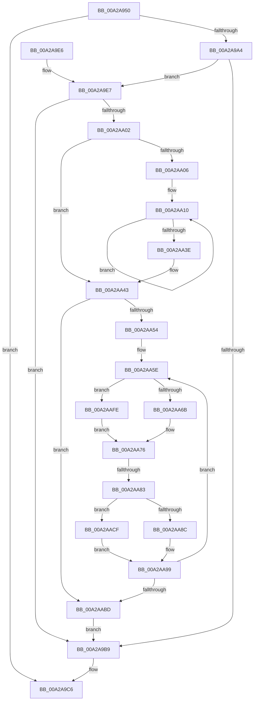

# PnpProcessAssignResources

- RVA: `0x00A2A950`–`0x00A2AB05` (길이 `437` bytes)
- VA: `0x0000000140A2A950`
- 실행 섹션: `PAGE`
- PDB 이름 있음: `예`; PDB Function 태그: `예`
- unwind 정보 RVA: `0x000AC188`
- 디코드: `117`개 명령, `437/437` bytes 표시
- 미해석 바이트: `0` (있으면 어셈블리에 `.byte`로 보존)

> 이 문서는 커널 이미지의 기계어와 PDB 기호를 분석해 생성했습니다. 4번과 5번은 함수 원형과 자료형을 바이너리 사용 방식에서 추정한 C 해석이며 원본 소스 복구 결과는 아닙니다.

## 1. Dependencies

- 직접 호출 지점: **12**; 고유 호출 대상: **10**
- 직접 호출자로 확인된 함수: **1**
- RIP 상대 이미지 참조: **2**

### Outgoing calls
- `0x00A2A997` → [ExAllocatePool2](../../poolcode/B8/ExAllocatePool2_function_00B820F0.md) (function, `0x00B820F0`)
- `0x00A2A9AC` → [PnpProcessAssignResourcesWorker](PnpProcessAssignResourcesWorker_function_00A2AB0C.md) (function, `0x00A2AB0C`)
- `0x00A2A9C1` → [ExFreePoolWithTag](../../poolcode/B8/ExFreePoolWithTag_function_00B82870.md) (function, `0x00B82870`)
- `0x00A2A9F5` → [ExAllocatePool2](../../poolcode/B8/ExAllocatePool2_function_00B820F0.md) (function, `0x00B820F0`)
- `0x00A2AA1C` → [memset](../../text/6C/memset_function_006C6C40.md) (function, `0x006C6C40`)
- `0x00A2AA4B` → [PnpAssignResourcesToDevices](PnpAssignResourcesToDevices_function_00A2AC4C.md) (function, `0x00A2AC4C`)
- `0x00A2AA94` → [PipSetDevNodeFlags](../8F/PipSetDevNodeFlags_function_008FC048.md) (function, `0x008FC048`)
- `0x00A2AAA1` → [PipSetDevNodeState](../../text/47/PipSetDevNodeState_function_00470708.md) (function, `0x00470708`)
- `0x00A2AAAE` → [PipClearDevNodeUserFlags](PipClearDevNodeUserFlags_function_00A2ABC4.md) (function, `0x00A2ABC4`)
- `0x00A2AAC5` → [ExFreePoolWithTag](../../poolcode/B8/ExFreePoolWithTag_function_00B82870.md) (function, `0x00B82870`)
- `0x00A2AAD6` → [ExAcquireFastMutex](../../text/20/ExAcquireFastMutex_function_0020E5A0.md) (function, `0x0020E5A0`)
- `0x00A2AAF7` → [ExReleaseFastMutex](../../text/25/ExReleaseFastMutex_function_002519C0.md) (function, `0x002519C0`)

### Direct callers
- [PipProcessDevNodeTree](../8F/PipProcessDevNodeTree_function_008F9068.md) at `0x008F9125`

### Static image references
- `0x00A2A96C` → RVA `0x00F8C668` (`.data`; read)
- `0x00A2AACF` → RVA `0x00F8C3E0` (`.data`; read)

## 2. Other-region calls and transfers

- 다른 실행 섹션으로 향하는 call: **8**
  - `0x00A2A997` → [ExAllocatePool2](../../poolcode/B8/ExAllocatePool2_function_00B820F0.md) (`PAGE` → `POOLCODE`)
  - `0x00A2A9C1` → [ExFreePoolWithTag](../../poolcode/B8/ExFreePoolWithTag_function_00B82870.md) (`PAGE` → `POOLCODE`)
  - `0x00A2A9F5` → [ExAllocatePool2](../../poolcode/B8/ExAllocatePool2_function_00B820F0.md) (`PAGE` → `POOLCODE`)
  - `0x00A2AA1C` → [memset](../../text/6C/memset_function_006C6C40.md) (`PAGE` → `.text`)
  - `0x00A2AAA1` → [PipSetDevNodeState](../../text/47/PipSetDevNodeState_function_00470708.md) (`PAGE` → `.text`)
  - `0x00A2AAC5` → [ExFreePoolWithTag](../../poolcode/B8/ExFreePoolWithTag_function_00B82870.md) (`PAGE` → `POOLCODE`)
  - `0x00A2AAD6` → [ExAcquireFastMutex](../../text/20/ExAcquireFastMutex_function_0020E5A0.md) (`PAGE` → `.text`)
  - `0x00A2AAF7` → [ExReleaseFastMutex](../../text/25/ExReleaseFastMutex_function_002519C0.md) (`PAGE` → `.text`)
- call이 아닌 외부 분기/꼬리 이동: **1**
  - `0x00A2AA7D` → [sub_00B38BAE](../B3/Unknown_function_00B38BAE.md) (`tail-transfer`)

## 3. Assembly (complete function range)

```asm
00A2A950  48 89 5C 24 08                  mov qword ptr [rsp + 8], rbx
00A2A955  48 89 6C 24 10                  mov qword ptr [rsp + 0x10], rbp
00A2A95A  48 89 74 24 18                  mov qword ptr [rsp + 0x18], rsi
00A2A95F  57                              push rdi
00A2A960  41 54                           push r12
00A2A962  41 55                           push r13
00A2A964  41 56                           push r14
00A2A966  41 57                           push r15
00A2A968  48 83 EC 20                     sub rsp, 0x20
00A2A96C  8B 05 F6 1C 56 00               mov eax, dword ptr [rip + 0x561cf6]
00A2A972  4D 8B E0                        mov r12, r8
00A2A975  0F B6 DA                        movzx ebx, dl
00A2A978  48 8B F9                        mov rdi, rcx
00A2A97B  BE 00 01 00 00                  mov esi, 0x100
00A2A980  40 32 ED                        xor bpl, bpl
00A2A983  41 B8 50 6E 70 35               mov r8d, 0x35706e50
00A2A989  40 88 6C 24 68                  mov byte ptr [rsp + 0x68], bpl
00A2A98E  8D 14 C5 08 00 00 00            lea edx, [rax*8 + 8]
00A2A995  8B CE                           mov ecx, esi
00A2A997  E8 54 77 15 00                  call 0x140b820f0
00A2A99C  4C 8B F8                        mov r15, rax
00A2A99F  48 85 C0                        test rax, rax
00A2A9A2  74 22                           je 0x140a2a9c6
00A2A9A4  48 8B D0                        mov rdx, rax
00A2A9A7  89 18                           mov dword ptr [rax], ebx
00A2A9A9  48 8B CF                        mov rcx, rdi
00A2A9AC  E8 5B 01 00 00                  call 0x140a2ab0c
00A2A9B1  41 8B 7F 04                     mov edi, dword ptr [r15 + 4]
00A2A9B5  85 FF                           test edi, edi
00A2A9B7  75 2E                           jne 0x140a2a9e7
00A2A9B9  BA 50 6E 70 35                  mov edx, 0x35706e50
00A2A9BE  49 8B CF                        mov rcx, r15
00A2A9C1  E8 AA 7E 15 00                  call 0x140b82870
00A2A9C6  48 8B 5C 24 50                  mov rbx, qword ptr [rsp + 0x50]
00A2A9CB  40 8A C5                        mov al, bpl
00A2A9CE  48 8B 6C 24 58                  mov rbp, qword ptr [rsp + 0x58]
00A2A9D3  48 8B 74 24 60                  mov rsi, qword ptr [rsp + 0x60]
00A2A9D8  48 83 C4 20                     add rsp, 0x20
00A2A9DC  41 5F                           pop r15
00A2A9DE  41 5E                           pop r14
00A2A9E0  41 5D                           pop r13
00A2A9E2  41 5C                           pop r12
00A2A9E4  5F                              pop rdi
00A2A9E5  C3                              ret
00A2A9E6  CC                              int3
00A2A9E7  8B D7                           mov edx, edi
00A2A9E9  41 B8 50 6E 70 36               mov r8d, 0x36706e50
00A2A9EF  C1 E2 06                        shl edx, 6
00A2A9F2  48 8B CE                        mov rcx, rsi
00A2A9F5  E8 F6 76 15 00                  call 0x140b820f0
00A2A9FA  4C 8B E8                        mov r13, rax
00A2A9FD  48 85 C0                        test rax, rax
00A2AA00  74 B7                           je 0x140a2a9b9
00A2AA02  85 FF                           test edi, edi
00A2AA04  74 3D                           je 0x140a2aa43
00A2AA06  48 8B F0                        mov rsi, rax
00A2AA09  4D 8D 77 08                     lea r14, [r15 + 8]
00A2AA0D  48 8B EF                        mov rbp, rdi
00A2AA10  49 8B 1E                        mov rbx, qword ptr [r14]
00A2AA13  33 D2                           xor edx, edx
00A2AA15  48 8B CE                        mov rcx, rsi
00A2AA18  44 8D 42 40                     lea r8d, [rdx + 0x40]
00A2AA1C  E8 1F C2 C9 FF                  call 0x1406c6c40
00A2AA21  48 83 66 18 00                  and qword ptr [rsi + 0x18], 0
00A2AA26  4D 8D 76 08                     lea r14, [r14 + 8]
00A2AA2A  48 89 1E                        mov qword ptr [rsi], rbx
00A2AA2D  C7 46 0C 04 00 00 00            mov dword ptr [rsi + 0xc], 4
00A2AA34  48 83 C6 40                     add rsi, 0x40
00A2AA38  48 83 ED 01                     sub rbp, 1
00A2AA3C  75 D2                           jne 0x140a2aa10
00A2AA3E  40 8A 6C 24 68                  mov bpl, byte ptr [rsp + 0x68]
00A2AA43  4D 8B C4                        mov r8, r12
00A2AA46  49 8B D5                        mov rdx, r13
00A2AA49  8B CF                           mov ecx, edi
00A2AA4B  E8 FC 01 00 00                  call 0x140a2ac4c
00A2AA50  85 FF                           test edi, edi
00A2AA52  74 69                           je 0x140a2aabd
00A2AA54  49 8D 75 28                     lea rsi, [r13 + 0x28]
00A2AA58  41 BE 23 00 00 00               mov r14d, 0x23
00A2AA5E  48 8B 46 D8                     mov rax, qword ptr [rsi - 0x28]
00A2AA62  48 85 C0                        test rax, rax
00A2AA65  0F 84 93 00 00 00               je 0x140a2aafe
00A2AA6B  48 8B 80 38 01 00 00            mov rax, qword ptr [rax + 0x138]
00A2AA72  48 8B 58 28                     mov rbx, qword ptr [rax + 0x28]
00A2AA76  44 8B 46 10                     mov r8d, dword ptr [rsi + 0x10]
00A2AA7A  45 85 C0                        test r8d, r8d
00A2AA7D  0F 88 2B E1 10 00               js 0x140b38bae
00A2AA83  48 83 3E 00                     cmp qword ptr [rsi], 0
00A2AA87  40 B5 01                        mov bpl, 1
00A2AA8A  75 43                           jne 0x140a2aacf
00A2AA8C  BA 00 01 00 00                  mov edx, 0x100
00A2AA91  48 8B CB                        mov rcx, rbx
00A2AA94  E8 AF 15 ED FF                  call 0x1408fc048
00A2AA99  BA 06 03 00 00                  mov edx, 0x306
00A2AA9E  48 8B CB                        mov rcx, rbx
00A2AAA1  E8 62 5C A4 FF                  call 0x140470708
00A2AAA6  BA 04 00 00 00                  mov edx, 4
00A2AAAB  48 8B CB                        mov rcx, rbx
00A2AAAE  E8 11 01 00 00                  call 0x140a2abc4
00A2AAB3  48 83 C6 40                     add rsi, 0x40
00A2AAB7  48 83 EF 01                     sub rdi, 1
00A2AABB  75 A1                           jne 0x140a2aa5e
00A2AABD  BA 50 6E 70 36                  mov edx, 0x36706e50
00A2AAC2  49 8B CD                        mov rcx, r13
00A2AAC5  E8 A6 7D 15 00                  call 0x140b82870
00A2AACA  E9 EA FE FF FF                  jmp 0x140a2a9b9
00A2AACF  48 8D 0D 0A 19 56 00            lea rcx, [rip + 0x56190a]
00A2AAD6  E8 C5 3A 7E FF                  call 0x14020e5a0
00A2AADB  48 8B 06                        mov rax, qword ptr [rsi]
00A2AADE  48 8D 0D FB 18 56 00            lea rcx, [rip + 0x5618fb]
00A2AAE5  48 89 83 A0 01 00 00            mov qword ptr [rbx + 0x1a0], rax
00A2AAEC  48 8B 46 08                     mov rax, qword ptr [rsi + 8]
00A2AAF0  48 89 83 A8 01 00 00            mov qword ptr [rbx + 0x1a8], rax
00A2AAF7  E8 C4 6E 82 FF                  call 0x1402519c0
00A2AAFC  EB 9B                           jmp 0x140a2aa99
00A2AAFE  33 DB                           xor ebx, ebx
00A2AB00  E9 71 FF FF FF                  jmp 0x140a2aa76
```

## 4. C-style interpretation (structured pseudocode)

```c
__int64 __fastcall PnpProcessAssignResources(__int64 a1, unsigned __int8 a2, __int64 a3)
{
    __int64 result;
    __int64 v_rbp;
    __int64 v_rbx;
    __int64 v_rdi;
    __int64 v_rsi;
    __int64 v_rsp;
    unsigned __int64 v_stack_p10;
    unsigned __int64 v_stack_p18;
    unsigned __int8 v_stack_p20;
    unsigned __int8 v_stack_p68;
    unsigned __int64 v_stack_p8;

    v_stack_p8 = v_rbx;
    v_stack_p10 = v_rbp;
    v_stack_p18 = v_rsi;
    v_rsp = (v_rsp) - (32);
    v_rbp = 0;
    v_stack_p20 = 0;
    result = ExAllocatePool2(256, (unsigned int)(*(unsigned int *)(v_rip + 5643510)) * 8 + 8, (unsigned int)(0x35706E50ULL), a4);
    if (result == 0) goto loc_00A2A9C6;
    *(unsigned int *)(result) = a2;
    result = PnpProcessAssignResourcesWorker(a1, result, (unsigned int)(0x35706E50ULL), a4);
    if ((unsigned int)((unsigned int)(*(unsigned int *)(result + 4))) != 0) goto loc_00A2A9E7;
loc_00A2A9B9:
    result = ExFreePoolWithTag(result, (unsigned int)(0x35706E50ULL), (unsigned int)(0x35706E50ULL), a4);
loc_00A2A9C6:
    v_rsp = (v_rsp) + (32);
    return 0;
loc_00A2A9E7:
    a2 = (unsigned int)(((unsigned int)((unsigned int)((unsigned int)(*(unsigned int *)(result + 4))))) << (6));
    result = ExAllocatePool2(v_stack_p18, a2, (unsigned int)(0x36706E50ULL), a4);
    if (result == 0) goto loc_00A2A9B9;
    if ((unsigned int)((unsigned int)(*(unsigned int *)(result + 4))) == 0) goto loc_00A2AA43;
loc_00A2AA10:
    a2 = 0;
    result = memset(result, a2, a2 + 64, a4);
    *(unsigned __int64 *)(result) = *(unsigned __int64 *)(result + 8);
    *(unsigned int *)(result + 12) = 4;
    v_rsi = (result) + (64);
    v_rbp = ((unsigned int)(*(unsigned int *)(result + 4))) - (1);
    if (condition_is_not_equal) goto loc_00A2AA10;
loc_00A2AA43:
    result = PnpAssignResourcesToDevices((unsigned int)((unsigned int)((unsigned int)(*(unsigned int *)(result + 4)))), result, a3, a4);
    if ((unsigned int)((unsigned int)(*(unsigned int *)(result + 4))) == 0) goto loc_00A2AABD;
loc_00A2AA5E:
    if (*(unsigned __int64 *)(result + 40 - 40) == 0) goto loc_00A2AAFE;
loc_00A2AA76:
    if ((*(unsigned __int64 *)(result + 40)) != 0) goto loc_00A2AACF;
    result = PipSetDevNodeFlags(*(unsigned __int64 *)(*(unsigned __int64 *)(*(unsigned __int64 *)(result + 40 - 40) + 312) + 40), 256, (unsigned int)(*(unsigned int *)(result + 40 + 16)), a4);
loc_00A2AA99:
    result = PipSetDevNodeState(*(unsigned __int64 *)(*(unsigned __int64 *)(*(unsigned __int64 *)(result + 40 - 40) + 312) + 40), 774, (unsigned int)(*(unsigned int *)(result + 40 + 16)), a4);
    result = PipClearDevNodeUserFlags(*(unsigned __int64 *)(*(unsigned __int64 *)(*(unsigned __int64 *)(result + 40 - 40) + 312) + 40), 4, (unsigned int)(*(unsigned int *)(result + 40 + 16)), a4);
    v_rsi = (result + 40) + (64);
    v_rdi = ((unsigned int)(*(unsigned int *)(result + 4))) - (1);
    if (condition_is_not_equal) goto loc_00A2AA5E;
loc_00A2AABD:
    result = ExFreePoolWithTag(result, (unsigned int)(0x36706E50ULL), (unsigned int)(*(unsigned int *)(result + 40 + 16)), a4);
    goto loc_00A2A9B9;
loc_00A2AACF:
    result = ExAcquireFastMutex(v_rip + 5642506, (unsigned int)(0x36706E50ULL), (unsigned int)(*(unsigned int *)(result + 40 + 16)), a4);
    *(unsigned __int64 *)(*(unsigned __int64 *)(*(unsigned __int64 *)(*(unsigned __int64 *)(result + 40 - 40) + 312) + 40) + 416) = *(unsigned __int64 *)(v_rsi);
    *(unsigned __int64 *)(*(unsigned __int64 *)(*(unsigned __int64 *)(*(unsigned __int64 *)(result + 40 - 40) + 312) + 40) + 424) = *(unsigned __int64 *)(v_rsi + 8);
    result = ExReleaseFastMutex(v_rip + 5642491, (unsigned int)(0x36706E50ULL), (unsigned int)(*(unsigned int *)(result + 40 + 16)), a4);
    goto loc_00A2AA99;
loc_00A2AAFE:
    v_rbx = 0;
    goto loc_00A2AA76;
}
```

## 5. (Beta) C Style

```c
int64_t PnpProcessAssignResources(int64_t Arg1, uint8_t Arg2, int64_t Arg3)
{
    int64_t result;
    int64_t local_rbp;
    int64_t local_rbx;
    int64_t local_rdi;
    int64_t local_rsi;
    int64_t local_rsp;
    uint64_t v_stack_p10;
    uint64_t v_stack_p18;
    uint8_t v_stack_p20;
    uint8_t v_stack_p68;
    uint64_t v_stack_p8;

    v_stack_p8 = local_rbx;
    v_stack_p10 = local_rbp;
    v_stack_p18 = local_rsi;
    local_rsp = (local_rsp) - (32);
    local_rbp = 0;
    v_stack_p20 = 0;
    result = ExAllocatePool2(256, (uint32_t)(*(uint32_t *)(v_rip + 0x561CF6)) * 8 + 8, (uint32_t)(0x35706E50ULL), a4);
    if (result == 0) goto loc_00A2A9C6;
    *(uint32_t *)(result) = Arg2;
    result = PnpProcessAssignResourcesWorker(Arg1, result, (uint32_t)(0x35706E50ULL), a4);
    if ((uint32_t)((uint32_t)(*(uint32_t *)(result + 0x4))) != 0) goto loc_00A2A9E7;
loc_00A2A9B9:
    result = ExFreePoolWithTag(result, (uint32_t)(0x35706E50ULL), (uint32_t)(0x35706E50ULL), a4);
loc_00A2A9C6:
    local_rsp = (local_rsp) + (32);
    return 0;
loc_00A2A9E7:
    Arg2 = (uint32_t)(((uint32_t)((uint32_t)((uint32_t)(*(uint32_t *)(result + 0x4))))) << (6));
    result = ExAllocatePool2(v_stack_p18, Arg2, (uint32_t)(0x36706E50ULL), a4);
    if (result == 0) goto loc_00A2A9B9;
    if ((uint32_t)((uint32_t)(*(uint32_t *)(result + 0x4))) == 0) goto loc_00A2AA43;
loc_00A2AA10:
    Arg2 = 0;
    result = memset(result, Arg2, Arg2 + 64, a4);
    *(uint64_t *)(result) = *(uint64_t *)(result + 0x8);
    *(uint32_t *)(result + 0xC) = 4;
    local_rsi = (result) + (64);
    local_rbp = ((uint32_t)(*(uint32_t *)(result + 0x4))) - (1);
    if (condition_is_not_equal) goto loc_00A2AA10;
loc_00A2AA43:
    result = PnpAssignResourcesToDevices((uint32_t)((uint32_t)((uint32_t)(*(uint32_t *)(result + 0x4)))), result, Arg3, a4);
    if ((uint32_t)((uint32_t)(*(uint32_t *)(result + 0x4))) == 0) goto loc_00A2AABD;
loc_00A2AA5E:
    if (*(uint64_t *)(result + 0x28 - 0x28) == 0) goto loc_00A2AAFE;
loc_00A2AA76:
    if ((*(uint64_t *)(result + 0x28)) != 0) goto loc_00A2AACF;
    result = PipSetDevNodeFlags(*(uint64_t *)(*(uint64_t *)(*(uint64_t *)(result + 0x28 - 0x28) + 0x138) + 0x28), 256, (uint32_t)(*(uint32_t *)(result + 0x28 + 0x10)), a4);
loc_00A2AA99:
    result = PipSetDevNodeState(*(uint64_t *)(*(uint64_t *)(*(uint64_t *)(result + 0x28 - 0x28) + 0x138) + 0x28), 774, (uint32_t)(*(uint32_t *)(result + 0x28 + 0x10)), a4);
    result = PipClearDevNodeUserFlags(*(uint64_t *)(*(uint64_t *)(*(uint64_t *)(result + 0x28 - 0x28) + 0x138) + 0x28), 4, (uint32_t)(*(uint32_t *)(result + 0x28 + 0x10)), a4);
    local_rsi = (result + 40) + (64);
    local_rdi = ((uint32_t)(*(uint32_t *)(result + 0x4))) - (1);
    if (condition_is_not_equal) goto loc_00A2AA5E;
loc_00A2AABD:
    result = ExFreePoolWithTag(result, (uint32_t)(0x36706E50ULL), (uint32_t)(*(uint32_t *)(result + 0x28 + 0x10)), a4);
    goto loc_00A2A9B9;
loc_00A2AACF:
    result = ExAcquireFastMutex(v_rip + 5642506, (uint32_t)(0x36706E50ULL), (uint32_t)(*(uint32_t *)(result + 0x28 + 0x10)), a4);
    *(uint64_t *)(*(uint64_t *)(*(uint64_t *)(*(uint64_t *)(result + 0x28 - 0x28) + 0x138) + 0x28) + 0x1A0) = *(uint64_t *)(local_rsi);
    *(uint64_t *)(*(uint64_t *)(*(uint64_t *)(*(uint64_t *)(result + 0x28 - 0x28) + 0x138) + 0x28) + 0x1A8) = *(uint64_t *)(local_rsi + 0x8);
    result = ExReleaseFastMutex(v_rip + 5642491, (uint32_t)(0x36706E50ULL), (uint32_t)(*(uint32_t *)(result + 0x28 + 0x10)), a4);
    goto loc_00A2AA99;
loc_00A2AAFE:
    local_rbx = 0;
    goto loc_00A2AA76;
}
```

## 6. Execution-region graph

[열기: 2D/3D 그래프와 함수 탐색 컨트롤 패널](../../../control-panel.html?section=page&rva=0x00A2A950&view=graph)

- 2D 그래프는 위에서 아래로 흐르고, 3D 그래프는 빈 공간을 드래그해 회전합니다. Shift+드래그는 이동, 휠은 확대·축소, 함수 노드 선택은 대상 보고서 이동입니다.

### Static fallback


