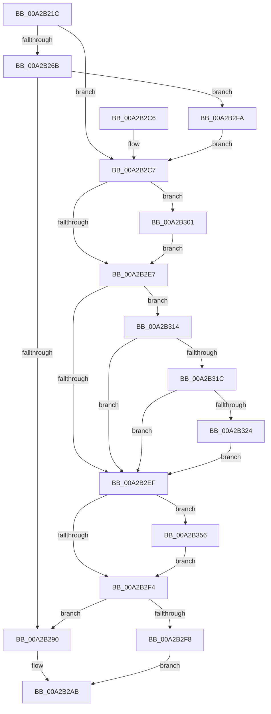

# PnpQueryDeviceID

- RVA: `0x00A2B21C`–`0x00A2B365` (길이 `329` bytes)
- VA: `0x0000000140A2B21C`
- 실행 섹션: `PAGE`
- PDB 이름 있음: `예`; PDB Function 태그: `아니요`
- unwind 정보 RVA: `0x000AC284`
- 디코드: `97`개 명령, `329/329` bytes 표시
- 미해석 바이트: `0` (있으면 어셈블리에 `.byte`로 보존)

> 이 문서는 커널 이미지의 기계어와 PDB 기호를 분석해 생성했습니다. 4번과 5번은 함수 원형과 자료형을 바이너리 사용 방식에서 추정한 C 해석이며 원본 소스 복구 결과는 아닙니다.

## 1. Dependencies

- 직접 호출 지점: **8**; 고유 호출 대상: **8**
- 직접 호출자로 확인된 함수: **1**
- RIP 상대 이미지 참조: **1**

### Outgoing calls
- `0x00A2B257` → [PnpIrpQueryID](../8F/PnpIrpQueryID_function_008FB714.md) (function, `0x008FB714`)
- `0x00A2B287` → [PnpFixupID](PnpFixupID_function_00A2B36C.md) (function, `0x00A2B36C`)
- `0x00A2B29B` → [wcschr](../../text/50/wcschr_function_00501A60.md) (function, `0x00501A60`)
- `0x00A2B2D2` → [PipSetDevNodeProblem](../8F/PipSetDevNodeProblem_function_008FDE0C.md) (function, `0x008FDE0C`)
- `0x00A2B301` → [PipSetDevNodeFlags](../8F/PipSetDevNodeFlags_function_008FC048.md) (function, `0x008FC048`)
- `0x00A2B30D` → [PnpSetInvalidIDEvent](../73/PnpSetInvalidIDEvent_function_0073832C.md) (function, `0x0073832C`)
- `0x00A2B34F` → [PnpLogEvent](../72/PnpLogEvent_function_0072C8FC.md) (function, `0x0072C8FC`)
- `0x00A2B35B` → [ExFreePoolWithTag](../../poolcode/B8/ExFreePoolWithTag_function_00B82870.md) (function, `0x00B82870`)

### Direct callers
- [PiProcessNewDeviceNode](PiProcessNewDeviceNode_function_00A28F20.md) at `0x00A29045`

### Static image references
- `0x00A2B327` → RVA `0x00AFDCA0` (` ?? ::NNGAKEGL::`string'`; read)

## 2. Other-region calls and transfers

- 다른 실행 섹션으로 향하는 call: **2**
  - `0x00A2B29B` → [wcschr](../../text/50/wcschr_function_00501A60.md) (`PAGE` → `.text`)
  - `0x00A2B35B` → [ExFreePoolWithTag](../../poolcode/B8/ExFreePoolWithTag_function_00B82870.md) (`PAGE` → `POOLCODE`)
- 별도 외부 분기/꼬리 이동을 확인하지 못했습니다.

## 3. Assembly (complete function range)

```asm
00A2B21C  48 8B C4                        mov rax, rsp
00A2B21F  48 89 58 10                     mov qword ptr [rax + 0x10], rbx
00A2B223  48 89 68 18                     mov qword ptr [rax + 0x18], rbp
00A2B227  56                              push rsi
00A2B228  57                              push rdi
00A2B229  41 54                           push r12
00A2B22B  41 56                           push r14
00A2B22D  41 57                           push r15
00A2B22F  48 83 EC 40                     sub rsp, 0x40
00A2B233  45 33 E4                        xor r12d, r12d
00A2B236  4D 8B F0                        mov r14, r8
00A2B239  4C 89 22                        mov qword ptr [rdx], r12
00A2B23C  4C 8B FA                        mov r15, rdx
00A2B23F  4D 89 20                        mov qword ptr [r8], r12
00A2B242  48 8B E9                        mov rbp, rcx
00A2B245  48 8B 49 20                     mov rcx, qword ptr [rcx + 0x20]
00A2B249  4C 8D 40 08                     lea r8, [rax + 8]
00A2B24D  33 D2                           xor edx, edx
00A2B24F  4C 89 60 08                     mov qword ptr [rax + 8], r12
00A2B253  44 89 60 CC                     mov dword ptr [rax - 0x34], r12d
00A2B257  E8 B8 04 ED FF                  call 0x1408fb714
00A2B25C  48 8B 7C 24 70                  mov rdi, qword ptr [rsp + 0x70]
00A2B261  8B D8                           mov ebx, eax
00A2B263  48 8D 75 10                     lea rsi, [rbp + 0x10]
00A2B267  85 C0                           test eax, eax
00A2B269  78 5C                           js 0x140a2b2c7
00A2B26B  48 8B 0E                        mov rcx, qword ptr [rsi]
00A2B26E  45 8D 4C 24 01                  lea r9d, [r12 + 1]
00A2B273  48 83 C1 38                     add rcx, 0x38
00A2B277  45 33 C0                        xor r8d, r8d
00A2B27A  48 89 4C 24 20                  mov qword ptr [rsp + 0x20], rcx
00A2B27F  BA C8 00 00 00                  mov edx, 0xc8
00A2B284  48 8B CF                        mov rcx, rdi
00A2B287  E8 E0 00 00 00                  call 0x140a2b36c
00A2B28C  03 C0                           add eax, eax
00A2B28E  74 6A                           je 0x140a2b2fa
00A2B290  BA 5C 00 00 00                  mov edx, 0x5c
00A2B295  49 89 3F                        mov qword ptr [r15], rdi
00A2B298  48 8B CF                        mov rcx, rdi
00A2B29B  E8 C0 67 AD FF                  call 0x140501a60
00A2B2A0  66 44 89 20                     mov word ptr [rax], r12w
00A2B2A4  48 83 C0 02                     add rax, 2
00A2B2A8  49 89 06                        mov qword ptr [r14], rax
00A2B2AB  4C 8D 5C 24 40                  lea r11, [rsp + 0x40]
00A2B2B0  8B C3                           mov eax, ebx
00A2B2B2  49 8B 5B 38                     mov rbx, qword ptr [r11 + 0x38]
00A2B2B6  49 8B 6B 40                     mov rbp, qword ptr [r11 + 0x40]
00A2B2BA  49 8B E3                        mov rsp, r11
00A2B2BD  41 5F                           pop r15
00A2B2BF  41 5E                           pop r14
00A2B2C1  41 5C                           pop r12
00A2B2C3  5F                              pop rdi
00A2B2C4  5E                              pop rsi
00A2B2C5  C3                              ret
00A2B2C6  CC                              int3
00A2B2C7  44 8B C3                        mov r8d, ebx
00A2B2CA  BA 09 00 00 00                  mov edx, 9
00A2B2CF  48 8B CD                        mov rcx, rbp
00A2B2D2  E8 35 2B ED FF                  call 0x1408fde0c
00A2B2D7  48 8B 0E                        mov rcx, qword ptr [rsi]
00A2B2DA  BA 00 00 20 00                  mov edx, 0x200000
00A2B2DF  85 91 8C 01 00 00               test dword ptr [rcx + 0x18c], edx
00A2B2E5  74 1A                           je 0x140a2b301
00A2B2E7  81 FB 38 00 04 C0               cmp ebx, 0xc0040038
00A2B2ED  75 25                           jne 0x140a2b314
00A2B2EF  48 85 FF                        test rdi, rdi
00A2B2F2  75 62                           jne 0x140a2b356
00A2B2F4  85 DB                           test ebx, ebx
00A2B2F6  79 98                           jns 0x140a2b290
00A2B2F8  EB B1                           jmp 0x140a2b2ab
00A2B2FA  BB 38 00 04 C0                  mov ebx, 0xc0040038
00A2B2FF  EB C6                           jmp 0x140a2b2c7
00A2B301  E8 42 0D ED FF                  call 0x1408fc048
00A2B306  48 8B 0E                        mov rcx, qword ptr [rsi]
00A2B309  48 83 C1 28                     add rcx, 0x28
00A2B30D  E8 1A D0 D0 FF                  call 0x14073832c
00A2B312  EB D3                           jmp 0x140a2b2e7
00A2B314  81 FB 9A 00 00 C0               cmp ebx, 0xc000009a
00A2B31A  74 D3                           je 0x140a2b2ef
00A2B31C  81 FB 0E 00 00 C0               cmp ebx, 0xc000000e
00A2B322  74 CB                           je 0x140a2b2ef
00A2B324  48 8B 0E                        mov rcx, qword ptr [rsi]
00A2B327  48 8D 05 72 29 0D 00            lea rax, [rip + 0xd2972]
00A2B32E  48 83 C1 38                     add rcx, 0x38
00A2B332  C7 44 24 30 4E 00 50 00         mov dword ptr [rsp + 0x30], 0x50004e
00A2B33A  45 33 C9                        xor r9d, r9d
00A2B33D  48 89 44 24 38                  mov qword ptr [rsp + 0x38], rax
00A2B342  44 8B C3                        mov r8d, ebx
00A2B345  44 89 64 24 20                  mov dword ptr [rsp + 0x20], r12d
00A2B34A  48 8D 54 24 30                  lea rdx, [rsp + 0x30]
00A2B34F  E8 A8 15 D0 FF                  call 0x14072c8fc
00A2B354  EB 99                           jmp 0x140a2b2ef
00A2B356  33 D2                           xor edx, edx
00A2B358  48 8B CF                        mov rcx, rdi
00A2B35B  E8 10 75 15 00                  call 0x140b82870
00A2B360  49 8B FC                        mov rdi, r12
00A2B363  EB 8F                           jmp 0x140a2b2f4
```

## 4. C-style interpretation (structured pseudocode)

```c
__int64 __fastcall PnpQueryDeviceID(__int64 a1, __int64 a2, __int64 a3)
{
    __int64 result;
    __int64 v_r12;
    __int64 v_rsp;
    unsigned int v_stack_m10;
    unsigned int v_stack_m20;
    unsigned __int64 v_stack_m28;
    unsigned __int64 v_stack_m48;
    unsigned __int64 v_stack_m8;
    unsigned __int64 v_stack_p8;

    *(unsigned __int64 *)(v_rsp + 16) = v_rbx;
    *(unsigned __int64 *)(v_rsp + 24) = v_rbp;
    v_rsp = (v_rsp) - (64);
    v_r12 = 0;
    *(unsigned __int64 *)(a2) = 0;
    *(unsigned __int64 *)(a3) = 0;
    a2 = 0;
    *(unsigned __int64 *)(v_rsp + 8) = 0;
    *(unsigned int *)(v_rsp - 52) = 0;
    result = PnpIrpQueryID(*(unsigned __int64 *)(a1 + 32), a2, v_rsp + 8, a4);
    if (sign_flag) goto loc_00A2B2C7;
    a1 = (*(unsigned __int64 *)(a1 + 16)) + (56);
    a3 = 0;
    v_stack_m48 = a1;
    result = PnpFixupID(v_stack_p8, 200, a3, v_r12 + 1);
    result = (unsigned int)((result) + ((unsigned int)(result)));
    if (condition_is_equal) goto loc_00A2B2FA;
loc_00A2B290:
    *(unsigned __int64 *)(a2) = v_stack_p8;
    result = wcschr(v_stack_p8, 92, a3, v_r12 + 1);
    *(unsigned __int16 *)(result) = 0;
    result = (result) + (2);
    *(unsigned __int64 *)(a3) = result;
loc_00A2B2AB:
    return (unsigned int)((unsigned int)((unsigned int)((unsigned int)(result))));
loc_00A2B2C7:
    result = PipSetDevNodeProblem(*(unsigned __int64 *)(v_stack_m28 + 64), 9, (unsigned int)((unsigned int)(*(unsigned __int64 *)(v_stack_m28 + 56))), v_r12 + 1);
    if (((*(unsigned int *)(*(unsigned __int64 *)(a1 + 16) + 396)) & ((unsigned int)((unsigned int)(0x200000ULL)))) == 0) goto loc_00A2B301;
loc_00A2B2E7:
    if (((unsigned int)(*(unsigned __int64 *)(v_stack_m28 + 56))) != 0xC0040038ULL) goto loc_00A2B314;
loc_00A2B2EF:
    if (v_stack_p8 != 0) goto loc_00A2B356;
loc_00A2B2F4:
    if (!sign_flag) goto loc_00A2B290;
    goto loc_00A2B2AB;
loc_00A2B2FA:
    goto loc_00A2B2C7;
loc_00A2B301:
    result = PipSetDevNodeFlags(*(unsigned __int64 *)(a1 + 16), (unsigned int)(0x200000ULL), (unsigned int)((unsigned int)(*(unsigned __int64 *)(v_stack_m28 + 56))), v_r12 + 1);
    a1 = (*(unsigned __int64 *)(a1 + 16)) + (40);
    result = PnpSetInvalidIDEvent(a1, (unsigned int)(0x200000ULL), (unsigned int)((unsigned int)(*(unsigned __int64 *)(v_stack_m28 + 56))), v_r12 + 1);
    goto loc_00A2B2E7;
loc_00A2B314:
    if (((unsigned int)((unsigned int)(0xC0040038ULL))) == 0xC000009AULL) goto loc_00A2B2EF;
    if (((unsigned int)((unsigned int)(0xC0040038ULL))) == 0xC000000EULL) goto loc_00A2B2EF;
    a1 = (*(unsigned __int64 *)(a1 + 16)) + (56);
    v_stack_m10 = 0x50004EULL;
    a4 = 0;
    v_stack_m8 = v_rip + 862578;
    v_stack_m20 = 0;
    result = PnpLogEvent(a1, v_stack_m10, (unsigned int)((unsigned int)((unsigned int)(0xC0040038ULL))), a4);
    goto loc_00A2B2EF;
loc_00A2B356:
    a2 = 0;
    result = ExFreePoolWithTag(v_stack_p8, a2, (unsigned int)((unsigned int)((unsigned int)(0xC0040038ULL))), a4);
    goto loc_00A2B2F4;
}
```

## 5. (Beta) C Style

```c
int64_t PnpQueryDeviceID(void *Arg1, void *Arg2, void *Arg3)
{
    uint8_t *arg1 = (uint8_t *)Arg1;
    uint8_t *arg2 = (uint8_t *)Arg2;
    uint8_t *arg3 = (uint8_t *)Arg3;

    int64_t result;
    int64_t local_r12;
    int64_t local_rsp;
    uint32_t v_stack_m10;
    uint32_t v_stack_m20;
    uint64_t v_stack_m28;
    uint64_t v_stack_m48;
    uint64_t v_stack_m8;
    uint64_t v_stack_p8;

    *(uint64_t *)(local_rsp + 0x10) = local_rbx;
    *(uint64_t *)(local_rsp + 0x18) = local_rbp;
    local_rsp = (local_rsp) - (64);
    local_r12 = 0;
    *(uint64_t *)(arg2) = 0;
    *(uint64_t *)(arg3) = 0;
    Arg2 = 0;
    *(uint64_t *)(local_rsp + 0x8) = 0;
    *(uint32_t *)(local_rsp - 0x34) = 0;
    result = PnpIrpQueryID(*(uint64_t *)(arg1 + 0x20), Arg2, local_rsp + 8, a4);
    if (sign_flag) goto loc_00A2B2C7;
    Arg1 = (*(uint64_t *)(arg1 + 0x10)) + (56);
    Arg3 = 0;
    v_stack_m48 = Arg1;
    result = PnpFixupID(v_stack_p8, 200, Arg3, local_r12 + 1);
    result = (uint32_t)((result) + ((uint32_t)(result)));
    if (condition_is_equal) goto loc_00A2B2FA;
loc_00A2B290:
    *(uint64_t *)(arg2) = v_stack_p8;
    result = wcschr(v_stack_p8, 92, Arg3, local_r12 + 1);
    *(uint16_t *)(result) = 0;
    result = (result) + (2);
    *(uint64_t *)(arg3) = result;
loc_00A2B2AB:
    return (uint32_t)((uint32_t)((uint32_t)((uint32_t)(result))));
loc_00A2B2C7:
    result = PipSetDevNodeProblem(*(uint64_t *)(v_stack_m28 + 0x40), 9, (uint32_t)((uint32_t)(*(uint64_t *)(v_stack_m28 + 0x38))), local_r12 + 1);
    if (((*(uint32_t *)(*(uint64_t *)(arg1 + 0x10) + 0x18C)) & ((uint32_t)((uint32_t)(0x200000ULL)))) == 0) goto loc_00A2B301;
loc_00A2B2E7:
    if (((uint32_t)(*(uint64_t *)(v_stack_m28 + 0x38))) != 0xC0040038ULL) goto loc_00A2B314;
loc_00A2B2EF:
    if (v_stack_p8 != 0) goto loc_00A2B356;
loc_00A2B2F4:
    if (!sign_flag) goto loc_00A2B290;
    goto loc_00A2B2AB;
loc_00A2B2FA:
    goto loc_00A2B2C7;
loc_00A2B301:
    result = PipSetDevNodeFlags(*(uint64_t *)(arg1 + 0x10), (uint32_t)(0x200000ULL), (uint32_t)((uint32_t)(*(uint64_t *)(v_stack_m28 + 0x38))), local_r12 + 1);
    Arg1 = (*(uint64_t *)(arg1 + 0x10)) + (40);
    result = PnpSetInvalidIDEvent(Arg1, (uint32_t)(0x200000ULL), (uint32_t)((uint32_t)(*(uint64_t *)(v_stack_m28 + 0x38))), local_r12 + 1);
    goto loc_00A2B2E7;
loc_00A2B314:
    if (((uint32_t)((uint32_t)(0xC0040038ULL))) == 0xC000009AULL) goto loc_00A2B2EF;
    if (((uint32_t)((uint32_t)(0xC0040038ULL))) == 0xC000000EULL) goto loc_00A2B2EF;
    Arg1 = (*(uint64_t *)(arg1 + 0x10)) + (56);
    v_stack_m10 = 0x50004EULL;
    a4 = 0;
    v_stack_m8 = v_rip + 862578;
    v_stack_m20 = 0;
    result = PnpLogEvent(Arg1, v_stack_m10, (uint32_t)((uint32_t)((uint32_t)(0xC0040038ULL))), a4);
    goto loc_00A2B2EF;
loc_00A2B356:
    Arg2 = 0;
    result = ExFreePoolWithTag(v_stack_p8, Arg2, (uint32_t)((uint32_t)((uint32_t)(0xC0040038ULL))), a4);
    goto loc_00A2B2F4;
}
```

### 관측된 메모리 오프셋

구조체 형식이 확인되지 않은 접근은 인자 기준의 오프셋으로만 기록했습니다.

| 기준 인자 | 오프셋 표현 | 폭 (bit) | 접근 |
|---|---:|---:|---|
| `Arg1` | `+ 0x0` | `64` | `R` |
| `Arg1` | `+ 0x10` | `64` | `R` |
| `Arg1` | `+ 0x20` | `64` | `R` |
| `Arg2` | `+ 0x0` | `64` | `W` |
| `Arg3` | `+ 0x0` | `64` | `W` |

## 6. Execution-region graph

[열기: 2D/3D 그래프와 함수 탐색 컨트롤 패널](../../../control-panel.html?section=page&rva=0x00A2B21C&view=graph)

- 2D 그래프는 위에서 아래로 흐르고, 3D 그래프는 빈 공간을 드래그해 회전합니다. Shift+드래그는 이동, 휠은 확대·축소, 함수 노드 선택은 대상 보고서 이동입니다.

### Static fallback


