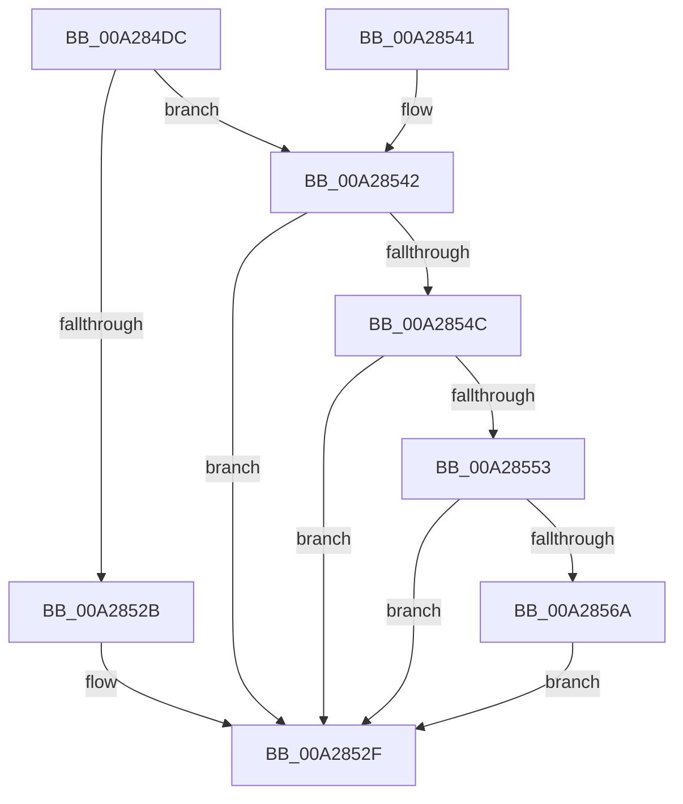

# PnpQueryExtendedAddress

- RVA: `0x00A284DC`–`0x00A28576` (길이 `154` bytes)
- VA: `0x0000000140A284DC`
- 실행 섹션: `PAGE`
- PDB 이름 있음: `예`; PDB Function 태그: `아니요`
- unwind 정보 RVA: `0x000AC070`
- 디코드: `44`개 명령, `154/154` bytes 표시
- 미해석 바이트: `0` (있으면 어셈블리에 `.byte`로 보존)

> 이 문서는 커널 이미지의 기계어와 PDB 기호를 분석해 생성했습니다. 4번과 5번은 함수 원형과 자료형을 바이너리 사용 방식에서 추정한 C 해석이며 원본 소스 복구 결과는 아닙니다.

## 1. Dependencies

- 직접 호출 지점: **3**; 고유 호출 대상: **2**
- 직접 호출자로 확인된 함수: **1**
- RIP 상대 이미지 참조: **1**

### Outgoing calls
- `0x00A28520` → [PnpQueryInterface](PnpQueryInterface_function_00A28D38.md) (function, `0x00A28D38`)
- `0x00A2855B` → [guard_dispatch_icall](../../text/6B/guard_dispatch_icall_function_006BAAD0.md) (function, `0x006BAAD0`)
- `0x00A2856F` → [guard_dispatch_icall](../../text/6B/guard_dispatch_icall_function_006BAAD0.md) (function, `0x006BAAD0`)

### Direct callers
- [PiProcessNewDeviceNode](PiProcessNewDeviceNode_function_00A28F20.md) at `0x00A290DD`

### Static image references
- `0x00A284F9` → RVA `0x00019F70` (`.rdata`; read)

## 2. Other-region calls and transfers

- 다른 실행 섹션으로 향하는 call: **2**
  - `0x00A2855B` → [guard_dispatch_icall](../../text/6B/guard_dispatch_icall_function_006BAAD0.md) (`PAGE` → `.text`)
  - `0x00A2856F` → [guard_dispatch_icall](../../text/6B/guard_dispatch_icall_function_006BAAD0.md) (`PAGE` → `.text`)
- 별도 외부 분기/꼬리 이동을 확인하지 못했습니다.

## 3. Assembly (complete function range)

```asm
00A284DC  4C 8B DC                        mov r11, rsp
00A284DF  49 89 5B 08                     mov qword ptr [r11 + 8], rbx
00A284E3  49 89 73 10                     mov qword ptr [r11 + 0x10], rsi
00A284E7  57                              push rdi
00A284E8  48 83 EC 60                     sub rsp, 0x60
00A284EC  33 C0                           xor eax, eax
00A284EE  0F 57 C0                        xorps xmm0, xmm0
00A284F1  0F 11 44 24 30                  movups xmmword ptr [rsp + 0x30], xmm0
00A284F6  48 8B DA                        mov rbx, rdx
00A284F9  48 8D 15 70 1A 5F FF            lea rdx, [rip - 0xa0e590]
00A28500  0F 11 44 24 40                  movups xmmword ptr [rsp + 0x40], xmm0
00A28505  8D 70 01                        lea esi, [rax + 1]
00A28508  49 89 43 E8                     mov qword ptr [r11 - 0x18], rax
00A2850C  44 8D 48 28                     lea r9d, [rax + 0x28]
00A28510  44 8B C6                        mov r8d, esi
00A28513  49 8D 43 C8                     lea rax, [r11 - 0x38]
00A28517  49 89 43 C0                     mov qword ptr [r11 - 0x40], rax
00A2851B  49 83 63 B8 00                  and qword ptr [r11 - 0x48], 0
00A28520  E8 13 08 00 00                  call 0x140a28d38
00A28525  8B F8                           mov edi, eax
00A28527  85 C0                           test eax, eax
00A28529  79 17                           jns 0x140a28542
00A2852B  48 83 0B FF                     or qword ptr [rbx], 0xffffffffffffffff
00A2852F  48 8B 5C 24 70                  mov rbx, qword ptr [rsp + 0x70]
00A28534  8B C7                           mov eax, edi
00A28536  48 8B 74 24 78                  mov rsi, qword ptr [rsp + 0x78]
00A2853B  48 83 C4 60                     add rsp, 0x60
00A2853F  5F                              pop rdi
00A28540  C3                              ret
00A28541  CC                              int3
00A28542  48 8B 44 24 50                  mov rax, qword ptr [rsp + 0x50]
00A28547  48 85 C0                        test rax, rax
00A2854A  74 E3                           je 0x140a2852f
00A2854C  66 39 74 24 32                  cmp word ptr [rsp + 0x32], si
00A28551  75 DC                           jne 0x140a2852f
00A28553  48 8B 4C 24 38                  mov rcx, qword ptr [rsp + 0x38]
00A28558  48 8B D3                        mov rdx, rbx
00A2855B  E8 70 25 C9 FF                  call 0x1406baad0
00A28560  48 8B 44 24 48                  mov rax, qword ptr [rsp + 0x48]
00A28565  48 85 C0                        test rax, rax
00A28568  74 C5                           je 0x140a2852f
00A2856A  48 8B 4C 24 38                  mov rcx, qword ptr [rsp + 0x38]
00A2856F  E8 5C 25 C9 FF                  call 0x1406baad0
00A28574  EB B9                           jmp 0x140a2852f
```

## 4. C-style interpretation (structured pseudocode)

```c
__int64 __fastcall PnpQueryExtendedAddress(__int64 a1, __int64 a2)
{
    __int64 result;
    __int64 v_rsp;
    unsigned __int64 v_stack_m28;
    unsigned __int64 v_stack_m38;
    unsigned __int64 v_stack_p10;
    unsigned __int16 v_stack_p32;
    unsigned __int64 v_stack_p38;
    unsigned __int64 v_stack_p48;
    unsigned __int64 v_stack_p50;
    unsigned __int64 v_stack_p8;

    *(unsigned __int64 *)(v_rsp + 8) = v_rbx;
    *(unsigned __int64 *)(v_rsp + 16) = v_rsi;
    v_rsp = (v_rsp) - (96);
    result = 0;
    v_stack_m38 = v_xmm0;
    v_stack_m28 = v_xmm0;
    *(unsigned __int64 *)(v_rsp - 24) = 0;
    *(unsigned __int64 *)(v_rsp - 64) = v_rsp - 56;
    result = PnpQueryInterface(a1, v_rip - 10544528, (unsigned int)((unsigned int)(result + 1)), result + 40);
    if (!sign_flag) goto loc_00A28542;
loc_00A2852F:
    v_rsp = (v_rsp) + (96);
    return (unsigned int)((unsigned int)((unsigned int)((unsigned int)(result))));
loc_00A28542:
    if (v_stack_p50 == 0) goto loc_00A2852F;
    if (v_stack_p32 != ((unsigned __int16)(v_stack_p10))) goto loc_00A2852F;
    result = guard_dispatch_icall(v_stack_p38, v_stack_p8, (unsigned int)((unsigned int)(result + 1)), result + 40);
    if (v_stack_p48 == 0) goto loc_00A2852F;
    result = guard_dispatch_icall(v_stack_p38, v_stack_p8, (unsigned int)((unsigned int)(result + 1)), result + 40);
    goto loc_00A2852F;
}
```

## 5. (Beta) C Style

```c
int64_t PnpQueryExtendedAddress(int64_t Arg1, void *Arg2)
{
    uint8_t *arg2 = (uint8_t *)Arg2;

    int64_t result;
    int64_t local_rsp;
    uint64_t v_stack_m28;
    uint64_t v_stack_m38;
    uint64_t v_stack_p10;
    uint16_t v_stack_p32;
    uint64_t v_stack_p38;
    uint64_t v_stack_p48;
    uint64_t v_stack_p50;
    uint64_t v_stack_p8;

    *(uint64_t *)(local_rsp + 0x8) = local_rbx;
    *(uint64_t *)(local_rsp + 0x10) = local_rsi;
    local_rsp = (local_rsp) - (96);
    result = 0;
    v_stack_m38 = v_xmm0;
    v_stack_m28 = v_xmm0;
    *(uint64_t *)(local_rsp - 0x18) = 0;
    *(uint64_t *)(local_rsp - 0x40) = local_rsp - 56;
    result = PnpQueryInterface(Arg1, v_rip - 10544528, (uint32_t)((uint32_t)(result + 1)), result + 40);
    if (!sign_flag) goto loc_00A28542;
loc_00A2852F:
    local_rsp = (local_rsp) + (96);
    return (uint32_t)((uint32_t)((uint32_t)((uint32_t)(result))));
loc_00A28542:
    if (v_stack_p50 == 0) goto loc_00A2852F;
    if (v_stack_p32 != ((uint16_t)(v_stack_p10))) goto loc_00A2852F;
    result = guard_dispatch_icall(v_stack_p38, v_stack_p8, (uint32_t)((uint32_t)(result + 1)), result + 40);
    if (v_stack_p48 == 0) goto loc_00A2852F;
    result = guard_dispatch_icall(v_stack_p38, v_stack_p8, (uint32_t)((uint32_t)(result + 1)), result + 40);
    goto loc_00A2852F;
}
```

### 관측된 메모리 오프셋

구조체 형식이 확인되지 않은 접근은 인자 기준의 오프셋으로만 기록했습니다.

| 기준 인자 | 오프셋 표현 | 폭 (bit) | 접근 |
|---|---:|---:|---|
| `Arg2` | `+ 0x0` | `64` | `R/W` |

## 6. Execution-region graph

[열기: 2D/3D 그래프와 함수 탐색 컨트롤 패널](../../../control-panel.html?section=page&rva=0x00A284DC&view=graph)

- 2D 그래프는 위에서 아래로 흐르고, 3D 그래프는 빈 공간을 드래그해 회전합니다. Shift+드래그는 이동, 휠은 확대·축소, 함수 노드 선택은 대상 보고서 이동입니다.

### Static fallback


