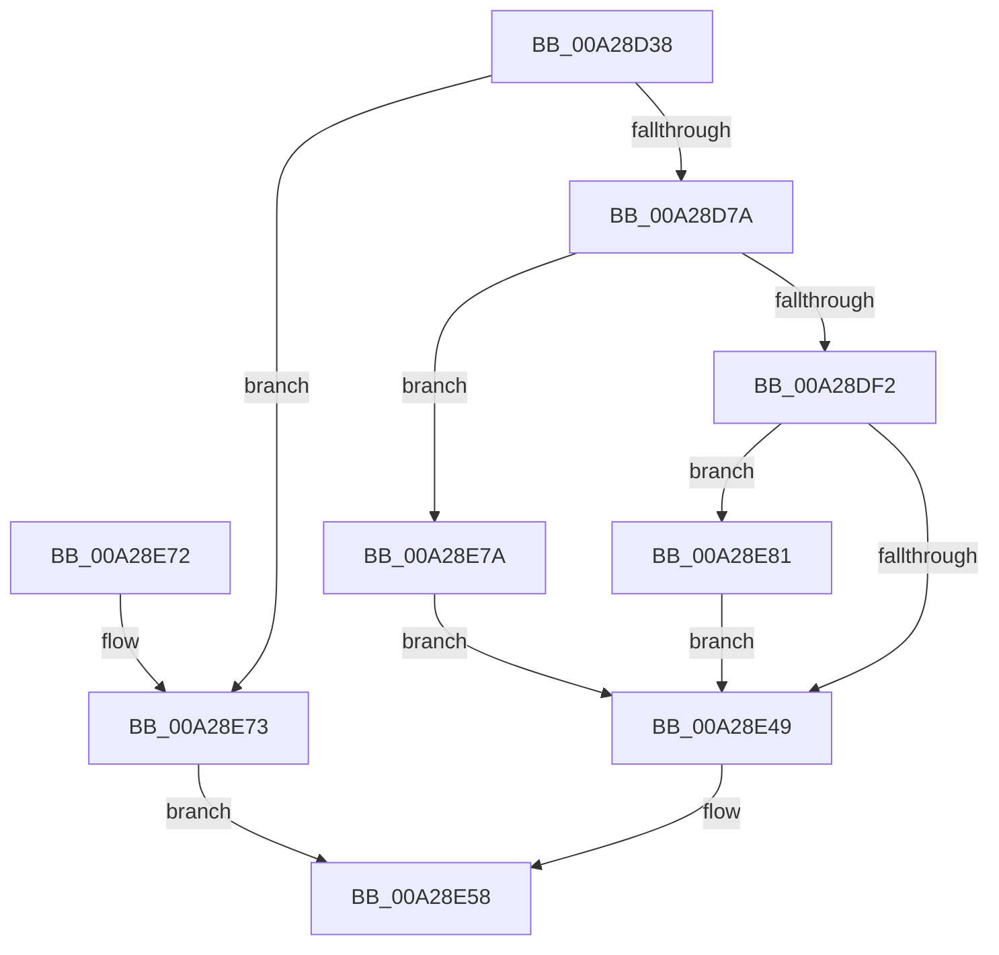

# PnpQueryInterface

- RVA: `0x00A28D38`–`0x00A28E9F` (길이 `359` bytes)
- VA: `0x0000000140A28D38`
- 실행 섹션: `PAGE`
- PDB 이름 있음: `예`; PDB Function 태그: `아니요`
- unwind 정보 RVA: `0x000AC0D0`
- 디코드: `93`개 명령, `359/359` bytes 표시
- 미해석 바이트: `0` (있으면 어셈블리에 `.byte`로 보존)

> 이 문서는 커널 이미지의 기계어와 PDB 기호를 분석해 생성했습니다. 4번과 5번은 함수 원형과 자료형을 바이너리 사용 방식에서 추정한 C 해석이며 원본 소스 복구 결과는 아닙니다.

## 1. Dependencies

- 직접 호출 지점: **8**; 고유 호출 대상: **8**
- 직접 호출자로 확인된 함수: **11**
- RIP 상대 이미지 참조: **0**

### Outgoing calls
- `0x00A28D8A` → [memset](../../text/6C/memset_function_006C6C40.md) (function, `0x006C6C40`)
- `0x00A28DA2` → [KeInitializeEvent](../../text/40/KeInitializeEvent_function_0040DD10.md) (function, `0x0040DD10`)
- `0x00A28DAF` → [IoGetAttachedDeviceReferenceWithTag](../../text/27/IoGetAttachedDeviceReferenceWithTag_function_00273B84.md) (function, `0x00273B84`)
- `0x00A28DE1` → [IopBuildAsynchronousFsdRequest](../../text/29/IopBuildAsynchronousFsdRequest_function_0029DD40.md) (function, `0x0029DD40`)
- `0x00A28DFE` → [IopQueueThreadIrp](../../text/20/IopQueueThreadIrp_function_002075C0.md) (function, `0x002075C0`)
- `0x00A28E3B` → [IofCallDriver](../../text/29/IofCallDriver_function_0029B4B0.md) (function, `0x0029B4B0`)
- `0x00A28E51` → [ObfDereferenceObjectWithTag](../../text/2F/ObfDereferenceObjectWithTag_function_002F78E0.md) (function, `0x002F78E0`)
- `0x00A28E94` → [KeWaitForSingleObject](../../text/20/KeWaitForSingleObject_function_0020E6B0.md) (function, `0x0020E6B0`)

### Direct callers
- [PnprQueryReplaceFeatures](../../text/5A/PnprQueryReplaceFeatures_function_005A8D08.md) at `0x005A8D81`
- [PiGetDmaAdapterFromBusInterface](../72/PiGetDmaAdapterFromBusInterface_function_00729744.md) at `0x007297C5`
- [IoQueryInterface](../72/IoQueryInterface_function_00729930.md) at `0x0072996E`
- [PnprIdentifyUnits](../73/PnprIdentifyUnits_function_00739B0C.md) at `0x00739B7F`
- [PnprIdentifyUnits](../73/PnprIdentifyUnits_function_00739B0C.md) at `0x00739BE7`
- [IopQueryBusResourceUpdateInterface](../73/IopQueryBusResourceUpdateInterface_function_0073DE44.md) at `0x0073DE9A`
- [PipUnprotectDevice](../74/PipUnprotectDevice_function_007409BC.md) at `0x00740A0E`
- [PiProcessDriversLoadedOnSecureDevice](PiProcessDriversLoadedOnSecureDevice_function_00A27F9C.md) at `0x00A27FEE`
- [IopQueryInterfaceRecurseUp](IopQueryInterfaceRecurseUp_function_00A283C8.md) at `0x00A28478`
- [PnpQueryExtendedAddress](PnpQueryExtendedAddress_function_00A284DC.md) at `0x00A28520`
- [PiIommuGetInterface](PiIommuGetInterface_function_00A285B0.md) at `0x00A28604`
- [PnpGetDeviceLocationStrings](PnpGetDeviceLocationStrings_function_00A286C0.md) at `0x00A287F8`

### Static image references
- 디코드된 RIP-relative 메모리 참조가 없습니다.

## 2. Other-region calls and transfers

- 다른 실행 섹션으로 향하는 call: **8**
  - `0x00A28D8A` → [memset](../../text/6C/memset_function_006C6C40.md) (`PAGE` → `.text`)
  - `0x00A28DA2` → [KeInitializeEvent](../../text/40/KeInitializeEvent_function_0040DD10.md) (`PAGE` → `.text`)
  - `0x00A28DAF` → [IoGetAttachedDeviceReferenceWithTag](../../text/27/IoGetAttachedDeviceReferenceWithTag_function_00273B84.md) (`PAGE` → `.text`)
  - `0x00A28DE1` → [IopBuildAsynchronousFsdRequest](../../text/29/IopBuildAsynchronousFsdRequest_function_0029DD40.md) (`PAGE` → `.text`)
  - `0x00A28DFE` → [IopQueueThreadIrp](../../text/20/IopQueueThreadIrp_function_002075C0.md) (`PAGE` → `.text`)
  - `0x00A28E3B` → [IofCallDriver](../../text/29/IofCallDriver_function_0029B4B0.md) (`PAGE` → `.text`)
  - `0x00A28E51` → [ObfDereferenceObjectWithTag](../../text/2F/ObfDereferenceObjectWithTag_function_002F78E0.md) (`PAGE` → `.text`)
  - `0x00A28E94` → [KeWaitForSingleObject](../../text/20/KeWaitForSingleObject_function_0020E6B0.md) (`PAGE` → `.text`)
- 별도 외부 분기/꼬리 이동을 확인하지 못했습니다.

## 3. Assembly (complete function range)

```asm
00A28D38  4C 8B DC                        mov r11, rsp
00A28D3B  49 89 5B 08                     mov qword ptr [r11 + 8], rbx
00A28D3F  49 89 6B 10                     mov qword ptr [r11 + 0x10], rbp
00A28D43  49 89 73 18                     mov qword ptr [r11 + 0x18], rsi
00A28D47  57                              push rdi
00A28D48  41 56                           push r14
00A28D4A  41 57                           push r15
00A28D4C  48 83 EC 70                     sub rsp, 0x70
00A28D50  0F 57 C0                        xorps xmm0, xmm0
00A28D53  41 0F B7 F9                     movzx edi, r9w
00A28D57  33 C0                           xor eax, eax
00A28D59  41 0F B7 E8                     movzx ebp, r8w
00A28D5D  4C 8B FA                        mov r15, rdx
00A28D60  48 8B D9                        mov rbx, rcx
00A28D63  0F 11 44 24 50                  movups xmmword ptr [rsp + 0x50], xmm0
00A28D68  49 89 43 D8                     mov qword ptr [r11 - 0x28], rax
00A28D6C  0F 11 44 24 40                  movups xmmword ptr [rsp + 0x40], xmm0
00A28D71  83 FF 20                        cmp edi, 0x20
00A28D74  0F 82 F9 00 00 00               jb 0x140a28e73
00A28D7A  4C 8B B4 24 B8 00 00 00         mov r14, qword ptr [rsp + 0xb8]
00A28D82  44 8B C7                        mov r8d, edi
00A28D85  49 8B CE                        mov rcx, r14
00A28D88  33 D2                           xor edx, edx
00A28D8A  E8 B1 DE C9 FF                  call 0x1406c6c40
00A28D8F  45 33 C0                        xor r8d, r8d
00A28D92  66 41 89 3E                     mov word ptr [r14], di
00A28D96  33 D2                           xor edx, edx
00A28D98  66 41 89 6E 02                  mov word ptr [r14 + 2], bp
00A28D9D  48 8D 4C 24 50                  lea rcx, [rsp + 0x50]
00A28DA2  E8 69 4F 9E FF                  call 0x14040dd10
00A28DA7  BA 50 6E 70 49                  mov edx, 0x49706e50
00A28DAC  48 8B CB                        mov rcx, rbx
00A28DAF  E8 D0 AD 84 FF                  call 0x140273b84
00A28DB4  48 8B 8C 24 88 00 00 00         mov rcx, qword ptr [rsp + 0x88]
00A28DBC  48 8B F0                        mov rsi, rax
00A28DBF  48 89 4C 24 30                  mov qword ptr [rsp + 0x30], rcx
00A28DC4  48 8D 44 24 40                  lea rax, [rsp + 0x40]
00A28DC9  45 33 C9                        xor r9d, r9d
00A28DCC  48 89 44 24 28                  mov qword ptr [rsp + 0x28], rax
00A28DD1  48 83 64 24 20 00               and qword ptr [rsp + 0x20], 0
00A28DD7  45 33 C0                        xor r8d, r8d
00A28DDA  48 8B D6                        mov rdx, rsi
00A28DDD  41 8D 49 1B                     lea ecx, [r9 + 0x1b]
00A28DE1  E8 5A 4F 87 FF                  call 0x14029dd40
00A28DE6  48 8B D8                        mov rbx, rax
00A28DE9  48 85 C0                        test rax, rax
00A28DEC  0F 84 88 00 00 00               je 0x140a28e7a
00A28DF2  48 8D 44 24 50                  lea rax, [rsp + 0x50]
00A28DF7  48 8B CB                        mov rcx, rbx
00A28DFA  48 89 43 50                     mov qword ptr [rbx + 0x50], rax
00A28DFE  E8 BD E7 7D FF                  call 0x1402075c0
00A28E03  48 8B 8B B8 00 00 00            mov rcx, qword ptr [rbx + 0xb8]
00A28E0A  48 8B D3                        mov rdx, rbx
00A28E0D  48 8B 84 24 B0 00 00 00         mov rax, qword ptr [rsp + 0xb0]
00A28E15  C6 43 40 00                     mov byte ptr [rbx + 0x40], 0
00A28E19  C7 43 30 BB 00 00 C0            mov dword ptr [rbx + 0x30], 0xc00000bb
00A28E20  C6 41 B9 08                     mov byte ptr [rcx - 0x47], 8
00A28E24  4C 89 79 C0                     mov qword ptr [rcx - 0x40], r15
00A28E28  66 89 79 C8                     mov word ptr [rcx - 0x38], di
00A28E2C  66 89 69 CA                     mov word ptr [rcx - 0x36], bp
00A28E30  4C 89 71 D0                     mov qword ptr [rcx - 0x30], r14
00A28E34  48 89 41 D8                     mov qword ptr [rcx - 0x28], rax
00A28E38  48 8B CE                        mov rcx, rsi
00A28E3B  E8 70 26 87 FF                  call 0x14029b4b0
00A28E40  8B D8                           mov ebx, eax
00A28E42  3D 03 01 00 00                  cmp eax, 0x103
00A28E47  74 38                           je 0x140a28e81
00A28E49  BA 50 6E 70 49                  mov edx, 0x49706e50
00A28E4E  48 8B CE                        mov rcx, rsi
00A28E51  E8 8A EA 8C FF                  call 0x1402f78e0
00A28E56  8B C3                           mov eax, ebx
00A28E58  4C 8D 5C 24 70                  lea r11, [rsp + 0x70]
00A28E5D  49 8B 5B 20                     mov rbx, qword ptr [r11 + 0x20]
00A28E61  49 8B 6B 28                     mov rbp, qword ptr [r11 + 0x28]
00A28E65  49 8B 73 30                     mov rsi, qword ptr [r11 + 0x30]
00A28E69  49 8B E3                        mov rsp, r11
00A28E6C  41 5F                           pop r15
00A28E6E  41 5E                           pop r14
00A28E70  5F                              pop rdi
00A28E71  C3                              ret
00A28E72  CC                              int3
00A28E73  B8 0D 00 00 C0                  mov eax, 0xc000000d
00A28E78  EB DE                           jmp 0x140a28e58
00A28E7A  BB 9A 00 00 C0                  mov ebx, 0xc000009a
00A28E7F  EB C8                           jmp 0x140a28e49
00A28E81  48 83 64 24 20 00               and qword ptr [rsp + 0x20], 0
00A28E87  48 8D 4C 24 50                  lea rcx, [rsp + 0x50]
00A28E8C  45 33 C9                        xor r9d, r9d
00A28E8F  45 33 C0                        xor r8d, r8d
00A28E92  33 D2                           xor edx, edx
00A28E94  E8 17 58 7E FF                  call 0x14020e6b0
00A28E99  8B 5C 24 40                     mov ebx, dword ptr [rsp + 0x40]
00A28E9D  EB AA                           jmp 0x140a28e49
```

## 4. C-style interpretation (structured pseudocode)

```c
__int64 __fastcall PnpQueryInterface(__int64 a1, __int64 a2, unsigned __int16 a3, int a4, __int64 a5, __int64 a6)
{
    __int64 result;
    __int64 v_rsp;
    unsigned __int64 v_stack_m18;
    unsigned __int64 v_stack_m20;
    unsigned int v_stack_m30;
    unsigned __int64 v_stack_m38;
    unsigned __int64 v_stack_m48;
    unsigned __int64 v_stack_m50;
    unsigned __int64 v_stack_m58;
    unsigned __int64 v_stack_m60;
    unsigned __int64 v_stack_m68;
    unsigned __int64 v_stack_p0;

    *(unsigned __int64 *)(v_rsp + 8) = v_rbx;
    *(unsigned __int64 *)(v_rsp + 16) = v_rbp;
    *(unsigned __int64 *)(v_rsp + 24) = v_rsi;
    v_rsp = (v_rsp) - (112);
    result = 0;
    v_stack_m38 = v_xmm0;
    *(unsigned __int64 *)(v_rsp - 40) = 0;
    v_stack_m48 = v_xmm0;
    if (((unsigned int)((unsigned __int16)(a4))) < 32) goto loc_00A28E73;
    a2 = 0;
    result = memset(a6, a2, (unsigned int)((unsigned int)((unsigned __int16)(a4))), a4);
    a3 = 0;
    *(unsigned __int16 *)(a6) = (unsigned __int16)((unsigned __int16)(a4));
    a2 = 0;
    *(unsigned __int16 *)(a6 + 2) = 0;
    result = KeInitializeEvent(v_stack_m38, a2, a3, a4);
    result = IoGetAttachedDeviceReferenceWithTag(a1, (unsigned int)(0x49706E50ULL), a3, a4);
    v_stack_m58 = v_stack_p0;
    a4 = 0;
    v_stack_m60 = v_stack_m48;
    a3 = 0;
    result = IopBuildAsynchronousFsdRequest(a4 + 27, result, a3, a4);
    if (result == 0) goto loc_00A28E7A;
    *(unsigned __int64 *)(result + 80) = v_stack_m38;
    result = IopQueueThreadIrp(result, result, a3, a4);
    *(unsigned __int8 *)(result + 64) = 0;
    *(unsigned int *)(result + 48) = 0xC00000BBULL;
    *(unsigned __int8 *)(*(unsigned __int64 *)(result + 184) - 71) = 8;
    *(unsigned __int64 *)(*(unsigned __int64 *)(result + 184) - 64) = 0;
    *(unsigned __int16 *)(*(unsigned __int64 *)(result + 184) - 56) = (unsigned __int16)((unsigned __int16)(a4));
    *(unsigned __int16 *)(*(unsigned __int64 *)(result + 184) - 54) = 0;
    *(unsigned __int64 *)(*(unsigned __int64 *)(result + 184) - 48) = a6;
    *(unsigned __int64 *)(*(unsigned __int64 *)(result + 184) - 40) = a5;
    result = IofCallDriver(result, result, a3, a4);
    if (((unsigned int)(result)) == 259) goto loc_00A28E81;
loc_00A28E49:
    result = ObfDereferenceObjectWithTag(result, (unsigned int)(0x49706E50ULL), a3, a4);
loc_00A28E58:
    return (unsigned int)((unsigned int)((unsigned int)((unsigned int)(result))));
loc_00A28E73:
    goto loc_00A28E58;
loc_00A28E7A:
    goto loc_00A28E49;
loc_00A28E81:
    a4 = 0;
    a3 = 0;
    a2 = 0;
    result = KeWaitForSingleObject(v_stack_m20, a2, a3, a4);
    goto loc_00A28E49;
}
```

## 5. (Beta) C Style

```c
int64_t PnpQueryInterface(int64_t Arg1, int64_t Arg2, uint16_t Arg3, int32_t Arg4, int64_t Arg5, void *Arg6)
{
    uint8_t *arg6 = (uint8_t *)Arg6;

    int64_t result;
    int64_t local_rsp;
    uint64_t v_stack_m18;
    uint64_t v_stack_m20;
    uint32_t v_stack_m30;
    uint64_t v_stack_m38;
    uint64_t v_stack_m48;
    uint64_t v_stack_m50;
    uint64_t v_stack_m58;
    uint64_t v_stack_m60;
    uint64_t v_stack_m68;
    uint64_t v_stack_p0;

    *(uint64_t *)(local_rsp + 0x8) = local_rbx;
    *(uint64_t *)(local_rsp + 0x10) = local_rbp;
    *(uint64_t *)(local_rsp + 0x18) = local_rsi;
    local_rsp = (local_rsp) - (112);
    result = 0;
    v_stack_m38 = v_xmm0;
    *(uint64_t *)(local_rsp - 0x28) = 0;
    v_stack_m48 = v_xmm0;
    if (((uint32_t)((uint16_t)(Arg4))) < 32) goto loc_00A28E73;
    Arg2 = 0;
    result = memset(Arg6, Arg2, (uint32_t)((uint32_t)((uint16_t)(Arg4))), Arg4);
    Arg3 = 0;
    *(uint16_t *)(arg6) = (uint16_t)((uint16_t)(Arg4));
    Arg2 = 0;
    *(uint16_t *)(arg6 + 0x2) = 0;
    result = KeInitializeEvent(v_stack_m38, Arg2, Arg3, Arg4);
    result = IoGetAttachedDeviceReferenceWithTag(Arg1, (uint32_t)(0x49706E50ULL), Arg3, Arg4);
    v_stack_m58 = v_stack_p0;
    Arg4 = 0;
    v_stack_m60 = v_stack_m48;
    Arg3 = 0;
    result = IopBuildAsynchronousFsdRequest(Arg4 + 27, result, Arg3, Arg4);
    if (result == 0) goto loc_00A28E7A;
    *(uint64_t *)(result + 0x50) = v_stack_m38;
    result = IopQueueThreadIrp(result, result, Arg3, Arg4);
    *(uint8_t *)(result + 0x40) = 0;
    *(uint32_t *)(result + 0x30) = 0xC00000BBULL;
    *(uint8_t *)(*(uint64_t *)(result + 0xB8) - 0x47) = 8;
    *(uint64_t *)(*(uint64_t *)(result + 0xB8) - 0x40) = 0;
    *(uint16_t *)(*(uint64_t *)(result + 0xB8) - 0x38) = (uint16_t)((uint16_t)(Arg4));
    *(uint16_t *)(*(uint64_t *)(result + 0xB8) - 0x36) = 0;
    *(void **)(*(uint64_t *)(result + 0xB8) - 0x30) = Arg6;
    *(uint64_t *)(*(uint64_t *)(result + 0xB8) - 0x28) = Arg5;
    result = IofCallDriver(result, result, Arg3, Arg4);
    if (((uint32_t)(result)) == 259) goto loc_00A28E81;
loc_00A28E49:
    result = ObfDereferenceObjectWithTag(result, (uint32_t)(0x49706E50ULL), Arg3, Arg4);
loc_00A28E58:
    return (uint32_t)((uint32_t)((uint32_t)((uint32_t)(result))));
loc_00A28E73:
    goto loc_00A28E58;
loc_00A28E7A:
    goto loc_00A28E49;
loc_00A28E81:
    Arg4 = 0;
    Arg3 = 0;
    Arg2 = 0;
    result = KeWaitForSingleObject(v_stack_m20, Arg2, Arg3, Arg4);
    goto loc_00A28E49;
}
```

### 관측된 메모리 오프셋

구조체 형식이 확인되지 않은 접근은 인자 기준의 오프셋으로만 기록했습니다.

| 기준 인자 | 오프셋 표현 | 폭 (bit) | 접근 |
|---|---:|---:|---|
| `Arg6` | `+ 0x0` | `16` | `W` |
| `Arg6` | `+ 0x2` | `16` | `W` |

## 6. Execution-region graph

[열기: 2D/3D 그래프와 함수 탐색 컨트롤 패널](../../../control-panel.html?section=page&rva=0x00A28D38&view=graph)

- 2D 그래프는 위에서 아래로 흐르고, 3D 그래프는 빈 공간을 드래그해 회전합니다. Shift+드래그는 이동, 휠은 확대·축소, 함수 노드 선택은 대상 보고서 이동입니다.

### Static fallback


