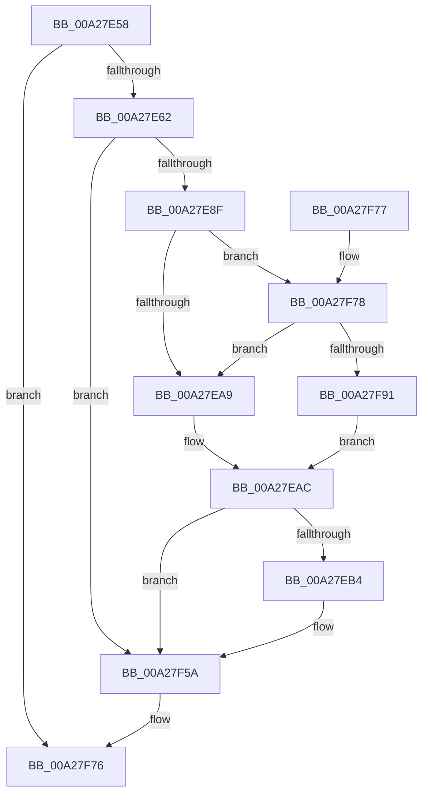

# PnpTraceClearDevNodeProblem

- RVA: `0x00A27E58`–`0x00A27F96` (길이 `318` bytes)
- VA: `0x0000000140A27E58`
- 실행 섹션: `PAGE`
- PDB 이름 있음: `예`; PDB Function 태그: `아니요`
- unwind 정보 RVA: `0x000ABFF0`
- 디코드: `66`개 명령, `318/318` bytes 표시
- 미해석 바이트: `0` (있으면 어셈블리에 `.byte`로 보존)

> 이 문서는 커널 이미지의 기계어와 PDB 기호를 분석해 생성했습니다. 4번과 5번은 함수 원형과 자료형을 바이너리 사용 방식에서 추정한 C 해석이며 원본 소스 복구 결과는 아닙니다.

## 1. Dependencies

- 직접 호출 지점: **2**; 고유 호출 대상: **2**
- 직접 호출자로 확인된 함수: **1**
- RIP 상대 이미지 참조: **5**

### Outgoing calls
- `0x00A27F55` → [tlgWriteAgg](../../text/2F/tlgWriteAgg_function_002F0F7C.md) (function, `0x002F0F7C`)
- `0x00A27F61` → [_security_check_cookie](../../text/6A/_security_check_cookie_function_006AC640.md) (function, `0x006AC640`)

### Direct callers
- [PipClearDevNodeProblem](PipClearDevNodeProblem_function_00A27C8C.md) at `0x00A27D2B`

### Static image references
- `0x00A27E74` → RVA `0x00E0A740` (`.data`; read)
- `0x00A27E82` → RVA `0x00E06F58` (`.data`; read)
- `0x00A27E9C` → RVA `0x00E06F68` (`.data`; read)
- `0x00A27EFE` → RVA `0x00047361` (`.rdata`; read)
- `0x00A27F78` → RVA `0x00E06F70` (`.data`; read)

## 2. Other-region calls and transfers

- 다른 실행 섹션으로 향하는 call: **2**
  - `0x00A27F55` → [tlgWriteAgg](../../text/2F/tlgWriteAgg_function_002F0F7C.md) (`PAGE` → `.text`)
  - `0x00A27F61` → [_security_check_cookie](../../text/6A/_security_check_cookie_function_006AC640.md) (`PAGE` → `.text`)
- 별도 외부 분기/꼬리 이동을 확인하지 못했습니다.

## 3. Assembly (complete function range)

```asm
00A27E58  41 83 F8 01                     cmp r8d, 1
00A27E5C  0F 84 14 01 00 00               je 0x140a27f76
00A27E62  48 89 5C 24 08                  mov qword ptr [rsp + 8], rbx
00A27E67  55                              push rbp
00A27E68  48 8D 6C 24 A9                  lea rbp, [rsp - 0x57]
00A27E6D  48 81 EC E0 00 00 00            sub rsp, 0xe0
00A27E74  48 8B 05 C5 28 3E 00            mov rax, qword ptr [rip + 0x3e28c5]
00A27E7B  48 33 C4                        xor rax, rsp
00A27E7E  48 89 45 47                     mov qword ptr [rbp + 0x47], rax
00A27E82  83 3D CF F0 3D 00 05            cmp dword ptr [rip + 0x3df0cf], 5
00A27E89  0F 86 CB 00 00 00               jbe 0x140a27f5a
00A27E8F  48 BB 00 00 00 00 00 80 00 00   movabs rbx, 0x800000000000
00A27E99  45 33 DB                        xor r11d, r11d
00A27E9C  48 85 1D C5 F0 3D 00            test qword ptr [rip + 0x3df0c5], rbx
00A27EA3  0F 85 CF 00 00 00               jne 0x140a27f78
00A27EA9  41 8A C3                        mov al, r11b
00A27EAC  84 C0                           test al, al
00A27EAE  0F 84 A6 00 00 00               je 0x140a27f5a
00A27EB4  48 8D 45 AF                     lea rax, [rbp - 0x51]
00A27EB8  44 89 4D AB                     mov dword ptr [rbp - 0x55], r9d
00A27EBC  48 89 45 D7                     mov qword ptr [rbp - 0x29], rax
00A27EC0  41 B9 09 00 00 00               mov r9d, 9
00A27EC6  48 8D 45 FF                     lea rax, [rbp - 1]
00A27ECA  48 C7 45 AF 01 00 00 00         mov qword ptr [rbp - 0x51], 1
00A27ED2  48 89 45 E7                     mov qword ptr [rbp - 0x19], rax
00A27ED6  48 8B 41 08                     mov rax, qword ptr [rcx + 8]
00A27EDA  48 89 45 F7                     mov qword ptr [rbp - 9], rax
00A27EDE  0F B7 01                        movzx eax, word ptr [rcx]
00A27EE1  48 8D 0D 70 F0 3D 00            lea rcx, [rip + 0x3df070]
00A27EE8  89 45 FF                        mov dword ptr [rbp - 1], eax
00A27EEB  48 8D 45 1F                     lea rax, [rbp + 0x1f]
00A27EEF  48 89 45 07                     mov qword ptr [rbp + 7], rax
00A27EF3  48 8B 42 08                     mov rax, qword ptr [rdx + 8]
00A27EF7  48 89 45 17                     mov qword ptr [rbp + 0x17], rax
00A27EFB  0F B7 02                        movzx eax, word ptr [rdx]
00A27EFE  48 8D 15 5C F4 61 FF            lea rdx, [rip - 0x9e0ba4]
00A27F05  89 45 1F                        mov dword ptr [rbp + 0x1f], eax
00A27F08  48 8D 45 A7                     lea rax, [rbp - 0x59]
00A27F0C  48 89 45 27                     mov qword ptr [rbp + 0x27], rax
00A27F10  48 8D 45 AB                     lea rax, [rbp - 0x55]
00A27F14  48 89 45 37                     mov qword ptr [rbp + 0x37], rax
00A27F18  48 8D 45 B7                     lea rax, [rbp - 0x49]
00A27F1C  48 89 44 24 20                  mov qword ptr [rsp + 0x20], rax
00A27F21  48 C7 45 DF 08 00 00 00         mov qword ptr [rbp - 0x21], 8
00A27F29  48 C7 45 EF 02 00 00 00         mov qword ptr [rbp - 0x11], 2
00A27F31  44 89 5D 03                     mov dword ptr [rbp + 3], r11d
00A27F35  48 C7 45 0F 02 00 00 00         mov qword ptr [rbp + 0xf], 2
00A27F3D  44 89 5D 23                     mov dword ptr [rbp + 0x23], r11d
00A27F41  44 89 45 A7                     mov dword ptr [rbp - 0x59], r8d
00A27F45  48 C7 45 2F 04 00 00 00         mov qword ptr [rbp + 0x2f], 4
00A27F4D  48 C7 45 3F 04 00 00 00         mov qword ptr [rbp + 0x3f], 4
00A27F55  E8 22 90 8C FF                  call 0x1402f0f7c
00A27F5A  48 8B 4D 47                     mov rcx, qword ptr [rbp + 0x47]
00A27F5E  48 33 CC                        xor rcx, rsp
00A27F61  E8 DA 46 C8 FF                  call 0x1406ac640
00A27F66  48 8B 9C 24 F0 00 00 00         mov rbx, qword ptr [rsp + 0xf0]
00A27F6E  48 81 C4 E0 00 00 00            add rsp, 0xe0
00A27F75  5D                              pop rbp
00A27F76  C3                              ret
00A27F77  CC                              int3
00A27F78  48 8B 05 F1 EF 3D 00            mov rax, qword ptr [rip + 0x3deff1]
00A27F7F  48 23 C3                        and rax, rbx
00A27F82  48 3B 05 E7 EF 3D 00            cmp rax, qword ptr [rip + 0x3defe7]
00A27F89  B0 01                           mov al, 1
00A27F8B  0F 85 18 FF FF FF               jne 0x140a27ea9
00A27F91  E9 16 FF FF FF                  jmp 0x140a27eac
```

## 4. C-style interpretation (structured pseudocode)

```c
__int64 __fastcall PnpTraceClearDevNodeProblem(__int64 a1, __int64 a2, int a3, int a4)
{
    __int64 result;
    __int64 v_r11;
    __int64 v_rsp;
    unsigned __int64 v_stack_m18;
    unsigned __int64 v_stack_m20;
    unsigned __int64 v_stack_m28;
    unsigned __int64 v_stack_m30;
    unsigned __int64 v_stack_m38;
    unsigned int v_stack_m3C;
    unsigned __int64 v_stack_m40;
    unsigned __int64 v_stack_m48;
    unsigned __int64 v_stack_m50;
    unsigned __int64 v_stack_m58;
    unsigned int v_stack_m5C;
    unsigned __int64 v_stack_m5F;
    unsigned __int64 v_stack_m60;
    unsigned __int64 v_stack_m68;
    unsigned __int64 v_stack_m70;
    unsigned __int64 v_stack_m78;
    unsigned __int64 v_stack_m80;
    unsigned __int64 v_stack_m88;
    unsigned __int64 v_stack_mA8;
    unsigned __int64 v_stack_mB0;
    unsigned int v_stack_mB4;
    unsigned __int64 v_stack_mB8;
    unsigned __int64 v_stack_mC8;
    unsigned __int64 v_stack_p8;

    if (a3 == 1) goto loc_00A27F76;
    v_stack_p8 = v_rbx;
    v_rsp = (v_rsp) - (224);
    result = (*(unsigned __int64 *)(v_rip + 4073669)) ^ (v_rsp);
    v_stack_m18 = result;
    if ((*(unsigned int *)(v_rip + 4059343)) <= 5) goto loc_00A27F5A;
    v_r11 = 0;
    if (((*(unsigned __int64 *)(v_rip + 4059333)) & (v_rbx)) != 0) goto loc_00A27F78;
loc_00A27EA9:
loc_00A27EAC:
    result = 0;
    if (0 != 0) {
        result = v_stack_mB0;
        v_stack_mB4 = a4;
        v_stack_m88 = result;
        a4 = 9;
        result = v_stack_m60;
        v_stack_mB0 = 1;
        v_stack_m78 = result;
        result = *(unsigned __int64 *)(a1 + 8);
        v_stack_m68 = result;
        result = *(unsigned __int16 *)(a1);
        a1 = v_rip + 4059248;
        v_stack_m60 = (unsigned int)(result);
        result = v_stack_m40;
        v_stack_m58 = result;
        result = *(unsigned __int64 *)(a2 + 8);
        v_stack_m48 = result;
        result = *(unsigned __int16 *)(a2);
        a2 = v_rip - 10357668;
        v_stack_m40 = (unsigned int)(result);
        result = v_stack_mB8;
        v_stack_m38 = result;
        result = v_stack_mB4;
        v_stack_m28 = result;
        result = v_stack_mA8;
        v_stack_mC8 = result;
        v_stack_m80 = 8;
        v_stack_m70 = 2;
        v_stack_m5C = 0;
        v_stack_m50 = 2;
        v_stack_m3C = 0;
        v_stack_mB8 = a3;
        v_stack_m30 = 4;
        v_stack_m20 = 4;
        result = tlgWriteAgg(a1, a2, a3, a4);
    }
    a1 = (v_stack_m18) ^ (v_rsp);
    result = _security_check_cookie(a1, a2, a3, a4);
    v_rsp = (v_rsp) + (224);
loc_00A27F76:
    return result;
loc_00A27F78:
    result = (*(unsigned __int64 *)(v_rip + 4059121)) & (v_stack_p8);
    if (result != (*(unsigned __int64 *)(v_rip + 4059111))) goto loc_00A27EA9;
    goto loc_00A27EAC;
}
```

## 5. (Beta) C Style

```c
int64_t PnpTraceClearDevNodeProblem(void *Arg1, void *Arg2, int32_t Arg3, int32_t Arg4)
{
    uint8_t *arg1 = (uint8_t *)Arg1;
    uint8_t *arg2 = (uint8_t *)Arg2;

    int64_t result;
    int64_t local_r11;
    int64_t local_rsp;
    uint64_t v_stack_m18;
    uint64_t v_stack_m20;
    uint64_t v_stack_m28;
    uint64_t v_stack_m30;
    uint64_t v_stack_m38;
    uint32_t v_stack_m3C;
    uint64_t v_stack_m40;
    uint64_t v_stack_m48;
    uint64_t v_stack_m50;
    uint64_t v_stack_m58;
    uint32_t v_stack_m5C;
    uint64_t v_stack_m5F;
    uint64_t v_stack_m60;
    uint64_t v_stack_m68;
    uint64_t v_stack_m70;
    uint64_t v_stack_m78;
    uint64_t v_stack_m80;
    uint64_t v_stack_m88;
    uint64_t v_stack_mA8;
    uint64_t v_stack_mB0;
    uint32_t v_stack_mB4;
    uint64_t v_stack_mB8;
    uint64_t v_stack_mC8;
    uint64_t v_stack_p8;

    if (Arg3 == 1) goto loc_00A27F76;
    v_stack_p8 = local_rbx;
    local_rsp = (local_rsp) - (224);
    result = (*(uint64_t *)(v_rip + 0x3E28C5)) ^ (local_rsp);
    v_stack_m18 = result;
    if ((*(uint32_t *)(v_rip + 0x3DF0CF)) <= 5) goto loc_00A27F5A;
    local_r11 = 0;
    if (((*(uint64_t *)(v_rip + 0x3DF0C5)) & (local_rbx)) != 0) goto loc_00A27F78;
loc_00A27EA9:
loc_00A27EAC:
    result = 0;
    if (0 != 0) {
        result = v_stack_mB0;
        v_stack_mB4 = Arg4;
        v_stack_m88 = result;
        Arg4 = 9;
        result = v_stack_m60;
        v_stack_mB0 = 1;
        v_stack_m78 = result;
        result = *(uint64_t *)(arg1 + 0x8);
        v_stack_m68 = result;
        result = *(uint16_t *)(arg1);
        Arg1 = v_rip + 4059248;
        v_stack_m60 = (uint32_t)(result);
        result = v_stack_m40;
        v_stack_m58 = result;
        result = *(uint64_t *)(arg2 + 0x8);
        v_stack_m48 = result;
        result = *(uint16_t *)(arg2);
        Arg2 = v_rip - 10357668;
        v_stack_m40 = (uint32_t)(result);
        result = v_stack_mB8;
        v_stack_m38 = result;
        result = v_stack_mB4;
        v_stack_m28 = result;
        result = v_stack_mA8;
        v_stack_mC8 = result;
        v_stack_m80 = 8;
        v_stack_m70 = 2;
        v_stack_m5C = 0;
        v_stack_m50 = 2;
        v_stack_m3C = 0;
        v_stack_mB8 = Arg3;
        v_stack_m30 = 4;
        v_stack_m20 = 4;
        result = tlgWriteAgg(Arg1, Arg2, Arg3, Arg4);
    }
    Arg1 = (v_stack_m18) ^ (local_rsp);
    result = _security_check_cookie(Arg1, Arg2, Arg3, Arg4);
    local_rsp = (local_rsp) + (224);
loc_00A27F76:
    return result;
loc_00A27F78:
    result = (*(uint64_t *)(v_rip + 0x3DEFF1)) & (v_stack_p8);
    if (result != (*(uint64_t *)(v_rip + 0x3DEFE7))) goto loc_00A27EA9;
    goto loc_00A27EAC;
}
```

### 관측된 메모리 오프셋

구조체 형식이 확인되지 않은 접근은 인자 기준의 오프셋으로만 기록했습니다.

| 기준 인자 | 오프셋 표현 | 폭 (bit) | 접근 |
|---|---:|---:|---|
| `Arg1` | `+ 0x0` | `16` | `R` |
| `Arg1` | `+ 0x8` | `64` | `R` |
| `Arg2` | `+ 0x0` | `16` | `R` |
| `Arg2` | `+ 0x8` | `64` | `R` |

## 6. Execution-region graph

[열기: 2D/3D 그래프와 함수 탐색 컨트롤 패널](../../../control-panel.html?section=page&rva=0x00A27E58&view=graph)

- 2D 그래프는 위에서 아래로 흐르고, 3D 그래프는 빈 공간을 드래그해 회전합니다. Shift+드래그는 이동, 휠은 확대·축소, 함수 노드 선택은 대상 보고서 이동입니다.

### Static fallback


