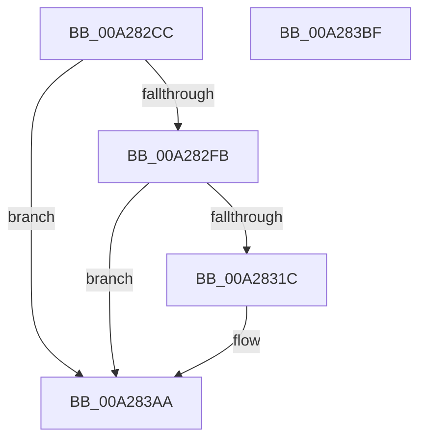

# PnpTraceSecureDeviceEnumeration

- RVA: `0x00A282CC`–`0x00A283C0` (길이 `244` bytes)
- VA: `0x0000000140A282CC`
- 실행 섹션: `PAGE`
- PDB 이름 있음: `예`; PDB Function 태그: `아니요`
- unwind 정보 RVA: `0x000AC058`
- 디코드: `51`개 명령, `244/244` bytes 표시
- 미해석 바이트: `0` (있으면 어셈블리에 `.byte`로 보존)

> 이 문서는 커널 이미지의 기계어와 PDB 기호를 분석해 생성했습니다. 4번과 5번은 함수 원형과 자료형을 바이너리 사용 방식에서 추정한 C 해석이며 원본 소스 복구 결과는 아닙니다.

## 1. Dependencies

- 직접 호출 지점: **3**; 고유 호출 대상: **3**
- 직접 호출자로 확인된 함수: **1**
- RIP 상대 이미지 참조: **3**

### Outgoing calls
- `0x00A2830C` → [tlgKeywordOn](../../text/42/tlgKeywordOn_function_0042EAA0.md) (function, `0x0042EAA0`)
- `0x00A283A5` → [tlgWriteTransfer_EtwWriteTransfer](../../text/42/tlgWriteTransfer_EtwWriteTransfer_function_004260E0.md) (function, `0x004260E0`)
- `0x00A283B1` → [_security_check_cookie](../../text/6A/_security_check_cookie_function_006AC640.md) (function, `0x006AC640`)

### Direct callers
- [PiProcessDriversLoadedOnSecureDevice](PiProcessDriversLoadedOnSecureDevice_function_00A27F9C.md) at `0x00A28051`

### Static image references
- `0x00A282DA` → RVA `0x00E0A740` (`.data`; read)
- `0x00A282E8` → RVA `0x00E06F90` (`.data`; read)
- `0x00A28328` → RVA `0x0004707B` (`.rdata`; read)

## 2. Other-region calls and transfers

- 다른 실행 섹션으로 향하는 call: **3**
  - `0x00A2830C` → [tlgKeywordOn](../../text/42/tlgKeywordOn_function_0042EAA0.md) (`PAGE` → `.text`)
  - `0x00A283A5` → [tlgWriteTransfer_EtwWriteTransfer](../../text/42/tlgWriteTransfer_EtwWriteTransfer_function_004260E0.md) (`PAGE` → `.text`)
  - `0x00A283B1` → [_security_check_cookie](../../text/6A/_security_check_cookie_function_006AC640.md) (`PAGE` → `.text`)
- 별도 외부 분기/꼬리 이동을 확인하지 못했습니다.

## 3. Assembly (complete function range)

```asm
00A282CC  40 55                           push rbp
00A282CE  48 8D 6C 24 A9                  lea rbp, [rsp - 0x57]
00A282D3  48 81 EC C0 00 00 00            sub rsp, 0xc0
00A282DA  48 8B 05 5F 24 3E 00            mov rax, qword ptr [rip + 0x3e245f]
00A282E1  48 33 C4                        xor rax, rsp
00A282E4  48 89 45 47                     mov qword ptr [rbp + 0x47], rax
00A282E8  83 3D A1 EC 3D 00 05            cmp dword ptr [rip + 0x3deca1], 5
00A282EF  44 8B D2                        mov r10d, edx
00A282F2  4C 8B C9                        mov r9, rcx
00A282F5  0F 86 AF 00 00 00               jbe 0x140a283aa
00A282FB  48 BA 00 00 00 00 00 40 00 00   movabs rdx, 0x400000000000
00A28305  48 8D 0D 84 EC 3D 00            lea rcx, [rip + 0x3dec84]
00A2830C  E8 8F 67 A0 FF                  call 0x14042eaa0
00A28311  45 33 DB                        xor r11d, r11d
00A28314  84 C0                           test al, al
00A28316  0F 84 8E 00 00 00               je 0x140a283aa
00A2831C  48 8D 45 CF                     lea rax, [rbp - 0x31]
00A28320  44 89 45 CB                     mov dword ptr [rbp - 0x35], r8d
00A28324  48 89 45 F7                     mov qword ptr [rbp - 9], rax
00A28328  48 8D 15 4C ED 61 FF            lea rdx, [rip - 0x9e12b4]
00A2832F  48 8D 45 1F                     lea rax, [rbp + 0x1f]
00A28333  48 C7 45 CF 00 08 00 00         mov qword ptr [rbp - 0x31], 0x800
00A2833B  48 89 45 07                     mov qword ptr [rbp + 7], rax
00A2833F  48 8D 0D 4A EC 3D 00            lea rcx, [rip + 0x3dec4a]
00A28346  49 8B 41 30                     mov rax, qword ptr [r9 + 0x30]
00A2834A  45 33 C0                        xor r8d, r8d
00A2834D  48 89 45 17                     mov qword ptr [rbp + 0x17], rax
00A28351  41 0F B7 41 28                  movzx eax, word ptr [r9 + 0x28]
00A28356  45 33 C9                        xor r9d, r9d
00A28359  89 45 1F                        mov dword ptr [rbp + 0x1f], eax
00A2835C  48 8D 45 C7                     lea rax, [rbp - 0x39]
00A28360  48 89 45 27                     mov qword ptr [rbp + 0x27], rax
00A28364  48 8D 45 CB                     lea rax, [rbp - 0x35]
00A28368  48 89 45 37                     mov qword ptr [rbp + 0x37], rax
00A2836C  48 8D 45 D7                     lea rax, [rbp - 0x29]
00A28370  48 89 44 24 28                  mov qword ptr [rsp + 0x28], rax
00A28375  C7 44 24 20 07 00 00 00         mov dword ptr [rsp + 0x20], 7
00A2837D  48 C7 45 FF 08 00 00 00         mov qword ptr [rbp - 1], 8
00A28385  48 C7 45 0F 02 00 00 00         mov qword ptr [rbp + 0xf], 2
00A2838D  44 89 5D 23                     mov dword ptr [rbp + 0x23], r11d
00A28391  44 89 55 C7                     mov dword ptr [rbp - 0x39], r10d
00A28395  48 C7 45 2F 04 00 00 00         mov qword ptr [rbp + 0x2f], 4
00A2839D  48 C7 45 3F 04 00 00 00         mov qword ptr [rbp + 0x3f], 4
00A283A5  E8 36 DD 9F FF                  call 0x1404260e0
00A283AA  48 8B 4D 47                     mov rcx, qword ptr [rbp + 0x47]
00A283AE  48 33 CC                        xor rcx, rsp
00A283B1  E8 8A 42 C8 FF                  call 0x1406ac640
00A283B6  48 81 C4 C0 00 00 00            add rsp, 0xc0
00A283BD  5D                              pop rbp
00A283BE  C3                              ret
00A283BF  CC                              int3
```

## 4. C-style interpretation (structured pseudocode)

```c
__int64 __fastcall PnpTraceSecureDeviceEnumeration(__int64 a1, int a2, int a3)
{
    __int64 result;
    __int64 v_r11;
    __int64 v_rsp;
    unsigned __int64 v_stack_m18;
    unsigned __int64 v_stack_m20;
    unsigned __int64 v_stack_m28;
    unsigned __int64 v_stack_m30;
    unsigned __int64 v_stack_m38;
    unsigned int v_stack_m3C;
    unsigned __int64 v_stack_m40;
    unsigned __int64 v_stack_m48;
    unsigned __int64 v_stack_m50;
    unsigned __int64 v_stack_m58;
    unsigned __int64 v_stack_m5F;
    unsigned __int64 v_stack_m60;
    unsigned __int64 v_stack_m68;
    unsigned __int64 v_stack_m88;
    unsigned __int64 v_stack_m90;
    unsigned int v_stack_m94;
    unsigned __int64 v_stack_m98;
    unsigned __int64 v_stack_mA0;
    unsigned int v_stack_mA8;

    v_rsp = (v_rsp) - (192);
    result = (*(unsigned __int64 *)(v_rip + 4072543)) ^ (v_rsp);
    v_stack_m18 = result;
    if ((*(unsigned int *)(v_rip + 4058273)) <= 5) goto loc_00A283AA;
    result = tlgKeywordOn(v_rip + 4058244, a2, a3, a1);
    v_r11 = 0;
    if ((unsigned __int8)(result) != 0) {
        result = v_stack_m90;
        v_stack_m94 = a3;
        v_stack_m68 = result;
        a2 = v_rip - 10359476;
        result = v_stack_m40;
        v_stack_m90 = 0x800ULL;
        v_stack_m58 = result;
        a1 = v_rip + 4058186;
        result = *(unsigned __int64 *)(a1 + 48);
        a3 = 0;
        v_stack_m48 = result;
        result = *(unsigned __int16 *)(a1 + 40);
        a4 = 0;
        v_stack_m40 = (unsigned int)(result);
        result = v_stack_m98;
        v_stack_m38 = result;
        result = v_stack_m94;
        v_stack_m28 = result;
        result = v_stack_m88;
        v_stack_mA0 = result;
        v_stack_mA8 = 7;
        v_stack_m60 = 8;
        v_stack_m50 = 2;
        v_stack_m3C = 0;
        v_stack_m98 = (unsigned int)((unsigned int)(a2));
        v_stack_m30 = 4;
        v_stack_m20 = 4;
        result = tlgWriteTransfer_EtwWriteTransfer(a1, a2, a3, a4);
    }
    a1 = (v_stack_m18) ^ (v_rsp);
    result = _security_check_cookie(a1, a2, a3, a4);
    v_rsp = (v_rsp) + (192);
    return result;
}
```

## 5. (Beta) C Style

```c
int64_t PnpTraceSecureDeviceEnumeration(int64_t Arg1, int32_t Arg2, int32_t Arg3)
{
    int64_t result;
    int64_t local_r11;
    int64_t local_rsp;
    uint64_t v_stack_m18;
    uint64_t v_stack_m20;
    uint64_t v_stack_m28;
    uint64_t v_stack_m30;
    uint64_t v_stack_m38;
    uint32_t v_stack_m3C;
    uint64_t v_stack_m40;
    uint64_t v_stack_m48;
    uint64_t v_stack_m50;
    uint64_t v_stack_m58;
    uint64_t v_stack_m5F;
    uint64_t v_stack_m60;
    uint64_t v_stack_m68;
    uint64_t v_stack_m88;
    uint64_t v_stack_m90;
    uint32_t v_stack_m94;
    uint64_t v_stack_m98;
    uint64_t v_stack_mA0;
    uint32_t v_stack_mA8;

    local_rsp = (local_rsp) - (192);
    result = (*(uint64_t *)(v_rip + 0x3E245F)) ^ (local_rsp);
    v_stack_m18 = result;
    if ((*(uint32_t *)(v_rip + 0x3DECA1)) <= 5) goto loc_00A283AA;
    result = tlgKeywordOn(v_rip + 4058244, Arg2, Arg3, Arg1);
    local_r11 = 0;
    if ((uint8_t)(result) != 0) {
        result = v_stack_m90;
        v_stack_m94 = Arg3;
        v_stack_m68 = result;
        Arg2 = v_rip - 10359476;
        result = v_stack_m40;
        v_stack_m90 = 0x800ULL;
        v_stack_m58 = result;
        Arg1 = v_rip + 4058186;
        result = *(uint64_t *)(Arg1 + 0x30);
        Arg3 = 0;
        v_stack_m48 = result;
        result = *(uint16_t *)(Arg1 + 0x28);
        a4 = 0;
        v_stack_m40 = (uint32_t)(result);
        result = v_stack_m98;
        v_stack_m38 = result;
        result = v_stack_m94;
        v_stack_m28 = result;
        result = v_stack_m88;
        v_stack_mA0 = result;
        v_stack_mA8 = 7;
        v_stack_m60 = 8;
        v_stack_m50 = 2;
        v_stack_m3C = 0;
        v_stack_m98 = (uint32_t)((uint32_t)(Arg2));
        v_stack_m30 = 4;
        v_stack_m20 = 4;
        result = tlgWriteTransfer_EtwWriteTransfer(Arg1, Arg2, Arg3, a4);
    }
    Arg1 = (v_stack_m18) ^ (local_rsp);
    result = _security_check_cookie(Arg1, Arg2, Arg3, a4);
    local_rsp = (local_rsp) + (192);
    return result;
}
```

## 6. Execution-region graph

[열기: 2D/3D 그래프와 함수 탐색 컨트롤 패널](../../../control-panel.html?section=page&rva=0x00A282CC&view=graph)

- 2D 그래프는 위에서 아래로 흐르고, 3D 그래프는 빈 공간을 드래그해 회전합니다. Shift+드래그는 이동, 휠은 확대·축소, 함수 노드 선택은 대상 보고서 이동입니다.

### Static fallback


