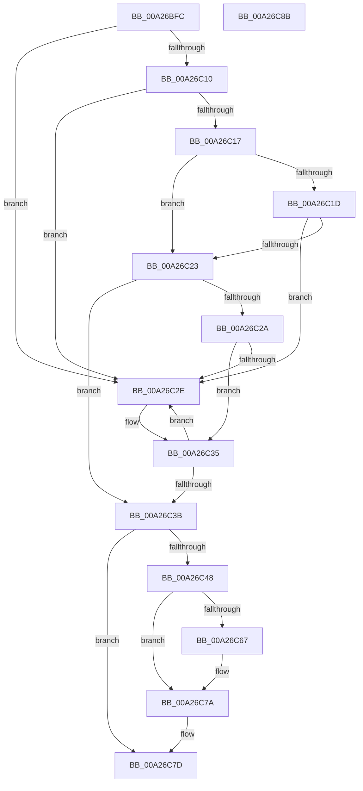

# PnpWatchdogTimerAllocate

- RVA: `0x00A26BFC`–`0x00A26C8C` (길이 `144` bytes)
- VA: `0x0000000140A26BFC`
- 실행 섹션: `PAGE`
- PDB 이름 있음: `예`; PDB Function 태그: `아니요`
- unwind 정보 RVA: `0x0005CAAC`
- 디코드: `46`개 명령, `144/144` bytes 표시
- 미해석 바이트: `0` (있으면 어셈블리에 `.byte`로 보존)

> 이 문서는 커널 이미지의 기계어와 PDB 기호를 분석해 생성했습니다. 4번과 5번은 함수 원형과 자료형을 바이너리 사용 방식에서 추정한 C 해석이며 원본 소스 복구 결과는 아닙니다.

## 1. Dependencies

- 직접 호출 지점: **1**; 고유 호출 대상: **1**
- 직접 호출자로 확인된 함수: **1**
- RIP 상대 이미지 참조: **1**

### Outgoing calls
- `0x00A26C3E` → [WdtpAllocateTimer](WdtpAllocateTimer_function_00A26C94.md) (function, `0x00A26C94`)

### Direct callers
- [PnpAllocateWatchdog](../../text/3F/PnpAllocateWatchdog_function_003FEE5C.md) at `0x003FEEB9`

### Static image references
- `0x00A26C67` → RVA `0x00835EA0` (`WdtpBarkWorkerThread`; read)

## 2. Other-region calls and transfers

- 다른 실행 섹션으로 향하는 call: **0**
- 별도 외부 분기/꼬리 이동을 확인하지 못했습니다.

## 3. Assembly (complete function range)

```asm
00A26BFC  48 89 5C 24 08                  mov qword ptr [rsp + 8], rbx
00A26C01  57                              push rdi
00A26C02  48 83 EC 20                     sub rsp, 0x20
00A26C06  33 DB                           xor ebx, ebx
00A26C08  48 8B F9                        mov rdi, rcx
00A26C0B  48 85 C9                        test rcx, rcx
00A26C0E  74 1E                           je 0x140a26c2e
00A26C10  8B 41 18                        mov eax, dword ptr [rcx + 0x18]
00A26C13  85 C0                           test eax, eax
00A26C15  74 17                           je 0x140a26c2e
00A26C17  48 39 59 08                     cmp qword ptr [rcx + 8], rbx
00A26C1B  75 06                           jne 0x140a26c23
00A26C1D  48 39 59 10                     cmp qword ptr [rcx + 0x10], rbx
00A26C21  74 0B                           je 0x140a26c2e
00A26C23  8B 49 1C                        mov ecx, dword ptr [rcx + 0x1c]
00A26C26  85 C9                           test ecx, ecx
00A26C28  74 11                           je 0x140a26c3b
00A26C2A  3B C8                           cmp ecx, eax
00A26C2C  77 07                           ja 0x140a26c35
00A26C2E  B9 05 00 00 00                  mov ecx, 5
00A26C33  CD 29                           int 0x29
00A26C35  48 39 5F 20                     cmp qword ptr [rdi + 0x20], rbx
00A26C39  74 F3                           je 0x140a26c2e
00A26C3B  48 8B 0F                        mov rcx, qword ptr [rdi]
00A26C3E  E8 51 00 00 00                  call 0x140a26c94
00A26C43  48 85 C0                        test rax, rax
00A26C46  74 35                           je 0x140a26c7d
00A26C48  0F 10 07                        movups xmm0, xmmword ptr [rdi]
00A26C4B  0F 10 4F 10                     movups xmm1, xmmword ptr [rdi + 0x10]
00A26C4F  0F 11 40 08                     movups xmmword ptr [rax + 8], xmm0
00A26C53  F2 0F 10 47 20                  movsd xmm0, qword ptr [rdi + 0x20]
00A26C58  0F 11 48 18                     movups xmmword ptr [rax + 0x18], xmm1
00A26C5C  F2 0F 11 40 28                  movsd qword ptr [rax + 0x28], xmm0
00A26C61  48 39 5F 10                     cmp qword ptr [rdi + 0x10], rbx
00A26C65  74 13                           je 0x140a26c7a
00A26C67  48 8D 0D 32 F2 E0 FF            lea rcx, [rip - 0x1f0dce]
00A26C6E  48 89 40 50                     mov qword ptr [rax + 0x50], rax
00A26C72  48 89 48 48                     mov qword ptr [rax + 0x48], rcx
00A26C76  48 89 58 38                     mov qword ptr [rax + 0x38], rbx
00A26C7A  48 8B D8                        mov rbx, rax
00A26C7D  48 8B C3                        mov rax, rbx
00A26C80  48 8B 5C 24 30                  mov rbx, qword ptr [rsp + 0x30]
00A26C85  48 83 C4 20                     add rsp, 0x20
00A26C89  5F                              pop rdi
00A26C8A  C3                              ret
00A26C8B  CC                              int3
```

## 4. C-style interpretation (structured pseudocode)

```c
__int64 __fastcall PnpWatchdogTimerAllocate(__int64 a1)
{
    __int64 result;
    __int64 v_rbx;
    __int64 v_rsp;
    unsigned __int64 v_stack_p8;

    v_stack_p8 = v_rbx;
    v_rsp = (v_rsp) - (32);
    v_rbx = 0;
    if (a1 == 0) goto loc_00A26C2E;
    if ((unsigned int)((unsigned int)(*(unsigned int *)(a1 + 24))) == 0) goto loc_00A26C2E;
    if ((*(unsigned __int64 *)(a1 + 8)) != 0) goto loc_00A26C23;
    if ((*(unsigned __int64 *)(a1 + 16)) == 0) goto loc_00A26C2E;
loc_00A26C23:
    if ((unsigned int)((unsigned int)(*(unsigned int *)(a1 + 28))) == 0) goto loc_00A26C3B;
    if (((unsigned int)((unsigned int)(*(unsigned int *)(a1 + 28)))) <= ((unsigned int)((unsigned int)(*(unsigned int *)(a1 + 24))))) {
        a1 = 5;
    }
    if ((*(unsigned __int64 *)(a1 + 32)) == 0) goto loc_00A26C2E;
loc_00A26C3B:
    result = WdtpAllocateTimer(*(unsigned __int64 *)(a1), a2, a3, a4);
    if (result == 0) goto loc_00A26C7D;
    *(unsigned __int64 *)(result + 8) = v_xmm0;
    *(unsigned __int64 *)(result + 24) = v_xmm1;
    *(unsigned __int64 *)(result + 40) = v_xmm0;
    if ((*(unsigned __int64 *)(a1 + 16)) != 0) {
        a1 = v_rip - 2035150;
        *(unsigned __int64 *)(result + 80) = result;
        *(unsigned __int64 *)(result + 72) = a1;
        *(unsigned __int64 *)(result + 56) = 0;
    }
loc_00A26C7D:
    v_rsp = (v_rsp) + (32);
    return result;
}
```

## 5. (Beta) C Style

```c
int64_t PnpWatchdogTimerAllocate(void *Arg1)
{
    uint8_t *arg1 = (uint8_t *)Arg1;

    int64_t result;
    int64_t local_rbx;
    int64_t local_rsp;
    uint64_t v_stack_p8;

    v_stack_p8 = local_rbx;
    local_rsp = (local_rsp) - (32);
    local_rbx = 0;
    if (Arg1 == NULL) goto loc_00A26C2E;
    if ((uint32_t)((uint32_t)(*(uint32_t *)(arg1 + 0x18))) == 0) goto loc_00A26C2E;
    if ((*(uint64_t *)(arg1 + 0x8)) != 0) goto loc_00A26C23;
    if ((*(uint64_t *)(arg1 + 0x10)) == 0) goto loc_00A26C2E;
loc_00A26C23:
    if ((uint32_t)((uint32_t)(*(uint32_t *)(arg1 + 0x1C))) == 0) goto loc_00A26C3B;
    if (((uint32_t)((uint32_t)(*(uint32_t *)(arg1 + 0x1C)))) <= ((uint32_t)((uint32_t)(*(uint32_t *)(arg1 + 0x18))))) {
        Arg1 = 5;
    }
    if ((*(uint64_t *)(arg1 + 0x20)) == 0) goto loc_00A26C2E;
loc_00A26C3B:
    result = WdtpAllocateTimer(*(uint64_t *)(arg1), a2, a3, a4);
    if (result == 0) goto loc_00A26C7D;
    *(uint64_t *)(result + 0x8) = v_xmm0;
    *(uint64_t *)(result + 0x18) = v_xmm1;
    *(uint64_t *)(result + 0x28) = v_xmm0;
    if ((*(uint64_t *)(arg1 + 0x10)) != 0) {
        Arg1 = v_rip - 2035150;
        *(uint64_t *)(result + 0x50) = result;
        *(void **)(result + 0x48) = Arg1;
        *(uint64_t *)(result + 0x38) = 0;
    }
loc_00A26C7D:
    local_rsp = (local_rsp) + (32);
    return result;
}
```

### 관측된 메모리 오프셋

구조체 형식이 확인되지 않은 접근은 인자 기준의 오프셋으로만 기록했습니다.

| 기준 인자 | 오프셋 표현 | 폭 (bit) | 접근 |
|---|---:|---:|---|
| `Arg1` | `+ 0x0` | `64` | `R` |
| `Arg1` | `+ 0x0` | `128` | `R` |
| `Arg1` | `+ 0x10` | `64` | `R` |
| `Arg1` | `+ 0x10` | `128` | `R` |
| `Arg1` | `+ 0x20` | `64` | `R` |

## 6. Execution-region graph

[열기: 2D/3D 그래프와 함수 탐색 컨트롤 패널](../../../control-panel.html?section=page&rva=0x00A26BFC&view=graph)

- 2D 그래프는 위에서 아래로 흐르고, 3D 그래프는 빈 공간을 드래그해 회전합니다. Shift+드래그는 이동, 휠은 확대·축소, 함수 노드 선택은 대상 보고서 이동입니다.

### Static fallback


