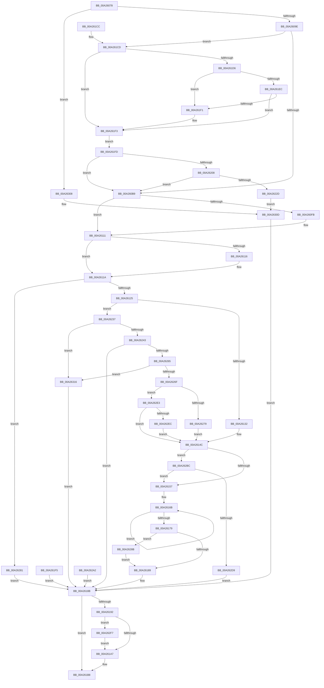

# PopBlackBoxUpdate

- RVA: `0x00A26078`–`0x00A26320` (길이 `680` bytes)
- VA: `0x0000000140A26078`
- 실행 섹션: `PAGE`
- PDB 이름 있음: `예`; PDB Function 태그: `아니요`
- unwind 정보 RVA: `0x000ABD8C`
- 디코드: `166`개 명령, `680/680` bytes 표시
- 미해석 바이트: `0` (있으면 어셈블리에 `.byte`로 보존)

> 이 문서는 커널 이미지의 기계어와 PDB 기호를 분석해 생성했습니다. 4번과 5번은 함수 원형과 자료형을 바이너리 사용 방식에서 추정한 C 해석이며 원본 소스 복구 결과는 아닙니다.

## 1. Dependencies

- 직접 호출 지점: **8**; 고유 호출 대상: **8**
- 직접 호출자로 확인된 함수: **1**
- RIP 상대 이미지 참조: **3**

### Outgoing calls
- `0x00A260E7` → [KeAbPreAcquire](../../text/21/KeAbPreAcquire_function_00210230.md) (function, `0x00210230`)
- `0x00A2610C` → [ExfAcquirePushLockExclusiveEx](../../text/20/ExfAcquirePushLockExclusiveEx_function_0020FC90.md) (function, `0x0020FC90`)
- `0x00A261AE` → [KeAbPostRelease](../../text/2E/KeAbPostRelease_function_002E1600.md) (function, `0x002E1600`)
- `0x00A261B3` → [KeLeaveCriticalRegion](../../text/25/KeLeaveCriticalRegion_function_0025D8B0.md) (function, `0x0025D8B0`)
- `0x00A26220` → [RtlTestProtectedAccess](../A1/RtlTestProtectedAccess_function_00A100C8.md) (function, `0x00A100C8`)
- `0x00A26298` → [memcpy](../../text/6C/memcpy_function_006C6840.md) (function, `0x006C6840`)
- `0x00A262C7` → [ExAllocatePool2](../../poolcode/B8/ExAllocatePool2_function_00B820F0.md) (function, `0x00B820F0`)
- `0x00A262FE` → [ExfTryToWakePushLock](../../text/26/ExfTryToWakePushLock_function_00265DD0.md) (function, `0x00265DD0`)

### Direct callers
- [NtPowerInformation](../95/NtPowerInformation_function_00955D80.md) at `0x00957EAB`

### Static image references
- `0x00A260A2` → RVA `0x00E07800` (`.data`; read)
- `0x00A260E0` → RVA `0x00F084E8` (`.data`; read)
- `0x00A260EF` → RVA `0x00F084E8` (`.data`; read/write)

## 2. Other-region calls and transfers

- 다른 실행 섹션으로 향하는 call: **7**
  - `0x00A260E7` → [KeAbPreAcquire](../../text/21/KeAbPreAcquire_function_00210230.md) (`PAGE` → `.text`)
  - `0x00A2610C` → [ExfAcquirePushLockExclusiveEx](../../text/20/ExfAcquirePushLockExclusiveEx_function_0020FC90.md) (`PAGE` → `.text`)
  - `0x00A261AE` → [KeAbPostRelease](../../text/2E/KeAbPostRelease_function_002E1600.md) (`PAGE` → `.text`)
  - `0x00A261B3` → [KeLeaveCriticalRegion](../../text/25/KeLeaveCriticalRegion_function_0025D8B0.md) (`PAGE` → `.text`)
  - `0x00A26298` → [memcpy](../../text/6C/memcpy_function_006C6840.md) (`PAGE` → `.text`)
  - `0x00A262C7` → [ExAllocatePool2](../../poolcode/B8/ExAllocatePool2_function_00B820F0.md) (`PAGE` → `POOLCODE`)
  - `0x00A262FE` → [ExfTryToWakePushLock](../../text/26/ExfTryToWakePushLock_function_00265DD0.md) (`PAGE` → `.text`)
- 별도 외부 분기/꼬리 이동을 확인하지 못했습니다.

## 3. Assembly (complete function range)

```asm
00A26078  48 89 5C 24 10                  mov qword ptr [rsp + 0x10], rbx
00A2607D  56                              push rsi
00A2607E  57                              push rdi
00A2607F  41 54                           push r12
00A26081  41 56                           push r14
00A26083  41 57                           push r15
00A26085  48 83 EC 20                     sub rsp, 0x20
00A26089  4C 8B F9                        mov r15, rcx
00A2608C  C6 44 24 50 00                  mov byte ptr [rsp + 0x50], 0
00A26091  48 63 41 18                     movsxd rax, dword ptr [rcx + 0x18]
00A26095  83 F8 18                        cmp eax, 0x18
00A26098  0F 87 6A 02 00 00               ja 0x140a26308
00A2609E  48 6B F0 68                     imul rsi, rax, 0x68
00A260A2  48 8D 05 57 17 3E 00            lea rax, [rip + 0x3e1757]
00A260A9  48 03 F0                        add rsi, rax
00A260AC  48 89 74 24 60                  mov qword ptr [rsp + 0x60], rsi
00A260B1  84 D2                           test dl, dl
00A260B3  0F 85 14 01 00 00               jne 0x140a261cd
00A260B9  45 8A 77 1C                     mov r14b, byte ptr [r15 + 0x1c]
00A260BD  41 80 E6 01                     and r14b, 1
00A260C1  C6 44 24 50 01                  mov byte ptr [rsp + 0x50], 1
00A260C6  65 48 8B 04 25 88 01 00 00      mov rax, qword ptr gs:[0x188]
00A260CF  48 83 CB FF                     or rbx, 0xffffffffffffffff
00A260D3  66 01 98 E4 01 00 00            add word ptr [rax + 0x1e4], bx
00A260DA  90                              nop
00A260DB  45 33 C0                        xor r8d, r8d
00A260DE  33 D2                           xor edx, edx
00A260E0  48 8D 0D 01 24 4E 00            lea rcx, [rip + 0x4e2401]
00A260E7  E8 44 A1 7E FF                  call 0x140210230
00A260EC  48 8B F8                        mov rdi, rax
00A260EF  F0 48 0F BA 2D EF 23 4E 00 00   lock bts qword ptr [rip + 0x4e23ef], 0
00A260F9  73 16                           jae 0x140a26111
00A260FB  4C 8D 05 E6 23 4E 00            lea r8, [rip + 0x4e23e6]
00A26102  48 8B D0                        mov rdx, rax
00A26105  48 8D 0D DC 23 4E 00            lea rcx, [rip + 0x4e23dc]
00A2610C  E8 7F 9B 7E FF                  call 0x14020fc90
00A26111  48 85 FF                        test rdi, rdi
00A26114  74 04                           je 0x140a2611a
00A26116  C6 47 0A 01                     mov byte ptr [rdi + 0xa], 1
00A2611A  8B 46 10                        mov eax, dword ptr [rsi + 0x10]
00A2611D  A8 02                           test al, 2
00A2611F  0F 85 5C 01 00 00               jne 0x140a26281
00A26125  49 8B 47 08                     mov rax, qword ptr [r15 + 8]
00A26129  45 84 F6                        test r14b, r14b
00A2612C  0F 85 05 01 00 00               jne 0x140a26237
00A26132  45 33 E4                        xor r12d, r12d
00A26135  BA 00 10 00 00                  mov edx, 0x1000
00A2613A  44 8B F2                        mov r14d, edx
00A2613D  48 3B C2                        cmp rax, rdx
00A26140  4C 0F 42 F0                     cmovb r14, rax
00A26144  48 89 46 60                     mov qword ptr [rsi + 0x60], rax
00A26148  4C 89 76 58                     mov qword ptr [rsi + 0x58], r14
00A2614C  48 83 7E 50 00                  cmp qword ptr [rsi + 0x50], 0
00A26151  0F 84 65 01 00 00               je 0x140a262bc
00A26157  49 B8 B0 03 00 00 80 F7 FF FF   movabs r8, 0xfffff780000003b0
00A26161  49 B9 08 00 00 00 80 F7 FF FF   movabs r9, 0xfffff78000000008
00A2616B  49 8B 10                        mov rdx, qword ptr [r8]
00A2616E  49 8B 09                        mov rcx, qword ptr [r9]
00A26171  49 8B 00                        mov rax, qword ptr [r8]
00A26174  48 3B D0                        cmp rdx, rax
00A26177  75 F2                           jne 0x140a2616b
00A26179  48 2B CA                        sub rcx, rdx
00A2617C  48 89 4E 48                     mov qword ptr [rsi + 0x48], rcx
00A26180  4D 85 F6                        test r14, r14
00A26183  0F 85 02 01 00 00               jne 0x140a2628b
00A26189  33 FF                           xor edi, edi
00A2618B  80 7C 24 50 00                  cmp byte ptr [rsp + 0x50], 0
00A26190  74 26                           je 0x140a261b8
00A26192  F0 48 0F C1 1D 4D 23 4E 00      lock xadd qword ptr [rip + 0x4e234d], rbx
00A2619B  80 E3 06                        and bl, 6
00A2619E  80 FB 02                        cmp bl, 2
00A261A1  0F 84 50 01 00 00               je 0x140a262f7
00A261A7  48 8D 0D 3A 23 4E 00            lea rcx, [rip + 0x4e233a]
00A261AE  E8 4D B4 8B FF                  call 0x1402e1600
00A261B3  E8 F8 76 83 FF                  call 0x14025d8b0
00A261B8  8B C7                           mov eax, edi
00A261BA  48 8B 5C 24 58                  mov rbx, qword ptr [rsp + 0x58]
00A261BF  48 83 C4 20                     add rsp, 0x20
00A261C3  41 5F                           pop r15
00A261C5  41 5E                           pop r14
00A261C7  41 5C                           pop r12
00A261C9  5F                              pop rdi
00A261CA  5E                              pop rsi
00A261CB  C3                              ret
00A261CC  CC                              int3
00A261CD  48 8B 41 08                     mov rax, qword ptr [rcx + 8]
00A261D1  48 85 C0                        test rax, rax
00A261D4  74 1D                           je 0x140a261f3
00A261D6  48 8B 09                        mov rcx, qword ptr [rcx]
00A261D9  48 8D 14 01                     lea rdx, [rcx + rax]
00A261DD  48 B8 00 00 FF FF FF 7F 00 00   movabs rax, 0x7fffffff0000
00A261E7  48 3B D0                        cmp rdx, rax
00A261EA  77 05                           ja 0x140a261f1
00A261EC  48 3B D1                        cmp rdx, rcx
00A261EF  73 02                           jae 0x140a261f3
00A261F1  8A 00                           mov al, byte ptr [rax]
00A261F3  EB 08                           jmp 0x140a261fd
00A261F5  8B F8                           mov edi, eax
00A261F7  48 83 CB FF                     or rbx, 0xffffffffffffffff
00A261FB  EB 8E                           jmp 0x140a2618b
00A261FD  8B 46 10                        mov eax, dword ptr [rsi + 0x10]
00A26200  A8 01                           test al, 1
00A26202  0F 84 B1 FE FF FF               je 0x140a260b9
00A26208  65 48 8B 04 25 88 01 00 00      mov rax, qword ptr gs:[0x188]
00A26211  48 8B 88 20 02 00 00            mov rcx, qword ptr [rax + 0x220]
00A26218  B2 61                           mov dl, 0x61
00A2621A  8A 89 FA 05 00 00               mov cl, byte ptr [rcx + 0x5fa]
00A26220  E8 A3 9E FE FF                  call 0x140a100c8
00A26225  84 C0                           test al, al
00A26227  0F 85 8C FE FF FF               jne 0x140a260b9
00A2622D  BF 22 00 00 C0                  mov edi, 0xc0000022
00A26232  E9 D6 00 00 00                  jmp 0x140a2630d
00A26237  4C 8B F0                        mov r14, rax
00A2623A  48 85 C0                        test rax, rax
00A2623D  0F 84 D3 00 00 00               je 0x140a26316
00A26243  4D 8B 67 10                     mov r12, qword ptr [r15 + 0x10]
00A26247  49 03 C4                        add rax, r12
00A2624A  48 8B CB                        mov rcx, rbx
00A2624D  49 3B C4                        cmp rax, r12
00A26250  48 0F 43 C8                     cmovae rcx, rax
00A26254  1B FF                           sbb edi, edi
00A26256  81 E7 95 00 00 C0               and edi, 0xc0000095
00A2625C  49 3B C4                        cmp rax, r12
00A2625F  0F 82 26 FF FF FF               jb 0x140a2618b
00A26265  48 3B 4E 60                     cmp rcx, qword ptr [rsi + 0x60]
00A26269  0F 87 A7 00 00 00               ja 0x140a26316
00A2626F  BA 00 10 00 00                  mov edx, 0x1000
00A26274  4C 3B E2                        cmp r12, rdx
00A26277  72 6A                           jb 0x140a262e3
00A26279  45 33 F6                        xor r14d, r14d
00A2627C  E9 CB FE FF FF                  jmp 0x140a2614c
00A26281  BF 22 00 00 C0                  mov edi, 0xc0000022
00A26286  E9 00 FF FF FF                  jmp 0x140a2618b
00A2628B  48 8B 4E 50                     mov rcx, qword ptr [rsi + 0x50]
00A2628F  49 03 CC                        add rcx, r12
00A26292  4D 8B C6                        mov r8, r14
00A26295  49 8B 17                        mov rdx, qword ptr [r15]
00A26298  E8 A3 05 CA FF                  call 0x1406c6840
00A2629D  E9 E7 FE FF FF                  jmp 0x140a26189
00A262A2  8B F8                           mov edi, eax
00A262A4  48 8B 44 24 60                  mov rax, qword ptr [rsp + 0x60]
00A262A9  48 83 60 58 00                  and qword ptr [rax + 0x58], 0
00A262AE  48 83 60 60 00                  and qword ptr [rax + 0x60], 0
00A262B3  48 83 CB FF                     or rbx, 0xffffffffffffffff
00A262B7  E9 CF FE FF FF                  jmp 0x140a2618b
00A262BC  B9 40 00 00 00                  mov ecx, 0x40
00A262C1  41 B8 4D 65 6D 20               mov r8d, 0x206d654d
00A262C7  E8 24 BE 15 00                  call 0x140b820f0
00A262CC  48 89 46 50                     mov qword ptr [rsi + 0x50], rax
00A262D0  48 85 C0                        test rax, rax
00A262D3  0F 85 7E FE FF FF               jne 0x140a26157
00A262D9  BF 9A 00 00 C0                  mov edi, 0xc000009a
00A262DE  E9 A8 FE FF FF                  jmp 0x140a2618b
00A262E3  48 3B CA                        cmp rcx, rdx
00A262E6  0F 86 60 FE FF FF               jbe 0x140a2614c
00A262EC  4C 8B F2                        mov r14, rdx
00A262EF  4D 2B F4                        sub r14, r12
00A262F2  E9 55 FE FF FF                  jmp 0x140a2614c
00A262F7  48 8D 0D EA 21 4E 00            lea rcx, [rip + 0x4e21ea]
00A262FE  E8 CD FA 83 FF                  call 0x140265dd0
00A26303  E9 9F FE FF FF                  jmp 0x140a261a7
00A26308  BF 0D 00 00 C0                  mov edi, 0xc000000d
00A2630D  48 83 CB FF                     or rbx, 0xffffffffffffffff
00A26311  E9 75 FE FF FF                  jmp 0x140a2618b
00A26316  BF 0D 00 00 C0                  mov edi, 0xc000000d
00A2631B  E9 6B FE FF FF                  jmp 0x140a2618b
```

## 4. C-style interpretation (structured pseudocode)

```c
__int64 __fastcall PopBlackBoxUpdate(__int64 a1, int a2, int a3)
{
    __int64 result;
    __int64 v_r12;
    __int64 v_r14;
    __int64 v_rbx;
    __int64 v_rdi;
    __int64 v_rsi;
    __int64 v_rsp;
    unsigned __int64 v_stack_p10;
    unsigned __int64 v_stack_p18;
    unsigned __int64 v_stack_p60;
    unsigned __int8 v_stack_p8;

    v_stack_p10 = v_rbx;
    v_rsp = (v_rsp) - (32);
    v_stack_p8 = 0;
    if (((unsigned int)((int)(*(unsigned int *)(a1 + 24)))) > 24) goto loc_00A26308;
    v_rsi = (v_rsi) * ((int)(*(unsigned int *)(a1 + 24)));
    v_rsi = (v_rsi) + (v_rip + 4069207);
    v_stack_p18 = v_rsi;
    if ((unsigned __int8)(a2) != 0) goto loc_00A261CD;
loc_00A260B9:
    v_r14 = (unsigned __int8)((*(unsigned __int8 *)(a1 + 28)) & (1));
    v_stack_p8 = 1;
    v_rbx = (v_rbx) | (-1);
    a3 = 0;
    a2 = 0;
    result = KeAbPreAcquire(v_rip + 5121025, a2, a3, a4);
    if (!(condition_is_above_or_equal)) {
        a3 = v_rip + 5120998;
        a2 = result;
        a1 = v_rip + 5120988;
        result = ExfAcquirePushLockExclusiveEx(a1, a2, a3, a4);
    }
    if (result != 0) {
        *(unsigned __int8 *)(result + 10) = 1;
    }
    if ((((unsigned __int8)((unsigned int)(*(unsigned int *)(v_rsi + 16)))) & (2)) != 0) goto loc_00A26281;
    if ((unsigned __int8)(v_r14) != 0) goto loc_00A26237;
    v_r12 = 0;
    v_r14 = (unsigned int)((unsigned int)((unsigned int)(0x1000ULL)));
    if ((*(unsigned __int64 *)(a1 + 8)) < ((unsigned int)(0x1000ULL))) { v_r14 = *(unsigned __int64 *)(a1 + 8); }
    *(unsigned __int64 *)(v_rsi + 96) = *(unsigned __int64 *)(a1 + 8);
    *(unsigned __int64 *)(v_rsi + 88) = v_r14;
loc_00A2614C:
    if ((*(unsigned __int64 *)(v_rsi + 80)) == 0) goto loc_00A262BC;
loc_00A26157:
loc_00A2616B:
    if ((*(unsigned __int64 *)(a3)) != (*(unsigned __int64 *)(a3))) goto loc_00A2616B;
    a1 = (*(unsigned __int64 *)(a4)) - (*(unsigned __int64 *)(a3));
    *(unsigned __int64 *)(v_rsi + 72) = a1;
    if (v_r14 != 0) goto loc_00A2628B;
loc_00A26189:
    v_rdi = 0;
loc_00A2618B:
    if (v_stack_p8 == 0) goto loc_00A261B8;
    v_rbx = (unsigned __int8)((v_rbx) & (6));
    if (((unsigned __int8)(v_rbx)) == 2) goto loc_00A262F7;
loc_00A261A7:
    result = KeAbPostRelease(v_rip + 5120826, *(unsigned __int64 *)(a3), a3, a4);
    result = KeLeaveCriticalRegion(v_rip + 5120826, *(unsigned __int64 *)(a3), a3, a4);
loc_00A261B8:
    v_rsp = (v_rsp) + (32);
    return 0;
loc_00A261CD:
    if (*(unsigned __int64 *)(v_rip + 5120826 + 8) == 0) goto loc_00A261F3;
    if ((*(unsigned __int64 *)(v_rip + 5120826) + *(unsigned __int64 *)(v_rip + 5120826 + 8) * 1) > (*(unsigned __int64 *)(v_rip + 5120826 + 8))) goto loc_00A261F1;
    result = *(unsigned __int64 *)(v_rip + 5120826 + 8);
    if ((*(unsigned __int64 *)(v_rip + 5120826) + *(unsigned __int64 *)(v_rip + 5120826 + 8) * 1) < (*(unsigned __int64 *)(v_rip + 5120826))) {
        result = *(unsigned __int8 *)(*(unsigned __int64 *)(v_rip + 5120826 + 8));
    }
    goto loc_00A261FD;
loc_00A261FD:
    if ((((unsigned __int8)((unsigned int)(*(unsigned int *)(v_rsi + 16)))) & (1)) == 0) goto loc_00A260B9;
    result = RtlTestProtectedAccess(*(unsigned __int8 *)(*(unsigned __int64 *)(*(unsigned __int64 *)(gs_base + (0 + 392)) + 544) + 1530), 97, a3, a4);
    if ((unsigned __int8)(result) != 0) goto loc_00A260B9;
    goto loc_00A2630D;
loc_00A26237:
    if (result == 0) goto loc_00A26316;
    result = (result) + (*(unsigned __int64 *)(a1 + 16));
    a1 = v_stack_p10;
    if (result >= (*(unsigned __int64 *)(a1 + 16))) { a1 = result; }
    v_rdi = (unsigned int)(((unsigned int)(0xC0000022ULL)) & (0xC0000095ULL));
    if (result < (*(unsigned __int64 *)(a1 + 16))) goto loc_00A2618B;
    if (a1 > (*(unsigned __int64 *)(v_rsi + 96))) goto loc_00A26316;
    if ((*(unsigned __int64 *)(a1 + 16)) < ((unsigned int)(0x1000ULL))) goto loc_00A262E3;
    v_r14 = 0;
    goto loc_00A2614C;
loc_00A26281:
    goto loc_00A2618B;
loc_00A2628B:
    a1 = (*(unsigned __int64 *)(v_rsi + 80)) + (*(unsigned __int64 *)(a1 + 16));
    result = memcpy(a1, *(unsigned __int64 *)(a1), 0, a4);
    goto loc_00A26189;
loc_00A262BC:
    result = ExAllocatePool2(64, *(unsigned __int64 *)(a1), (unsigned int)(0x206D654DULL), a4);
    *(unsigned __int64 *)(v_rsi + 80) = result;
    if (result != 0) goto loc_00A26157;
    goto loc_00A2618B;
loc_00A262E3:
    if (64 <= (*(unsigned __int64 *)(a1))) goto loc_00A2614C;
    v_r14 = (*(unsigned __int64 *)(a1)) - (*(unsigned __int64 *)(a1 + 16));
    goto loc_00A2614C;
loc_00A262F7:
    result = ExfTryToWakePushLock(v_rip + 5120490, *(unsigned __int64 *)(a1), (unsigned int)(0x206D654DULL), a4);
    goto loc_00A261A7;
loc_00A26308:
loc_00A2630D:
    v_rbx = (v_stack_p10) | (-1);
    goto loc_00A2618B;
loc_00A26316:
    goto loc_00A2618B;
}
```

## 5. (Beta) C Style

```c
int64_t PopBlackBoxUpdate(void *Arg1, int32_t Arg2, int32_t Arg3)
{
    uint8_t *arg1 = (uint8_t *)Arg1;

    int64_t result;
    int64_t local_r12;
    int64_t local_r14;
    int64_t local_rbx;
    int64_t local_rdi;
    int64_t local_rsi;
    int64_t local_rsp;
    uint64_t v_stack_p10;
    uint64_t v_stack_p18;
    uint64_t v_stack_p60;
    uint8_t v_stack_p8;

    v_stack_p10 = local_rbx;
    local_rsp = (local_rsp) - (32);
    v_stack_p8 = 0;
    if (((uint32_t)((int32_t)(*(uint32_t *)(arg1 + 0x18)))) > 24) goto loc_00A26308;
    local_rsi = (local_rsi) * ((int32_t)(*(uint32_t *)(arg1 + 0x18)));
    local_rsi = (local_rsi) + (v_rip + 4069207);
    v_stack_p18 = local_rsi;
    if ((uint8_t)(Arg2) != 0) goto loc_00A261CD;
loc_00A260B9:
    local_r14 = (uint8_t)((*(uint8_t *)(arg1 + 0x1C)) & (1));
    v_stack_p8 = 1;
    local_rbx = (local_rbx) | (-1);
    Arg3 = 0;
    Arg2 = 0;
    result = KeAbPreAcquire(v_rip + 5121025, Arg2, Arg3, a4);
    if (!(condition_is_above_or_equal)) {
        Arg3 = v_rip + 5120998;
        Arg2 = result;
        Arg1 = v_rip + 5120988;
        result = ExfAcquirePushLockExclusiveEx(Arg1, Arg2, Arg3, a4);
    }
    if (result != 0) {
        *(uint8_t *)(result + 0xA) = 1;
    }
    if ((((uint8_t)((uint32_t)(*(uint32_t *)(local_rsi + 0x10)))) & (2)) != 0) goto loc_00A26281;
    if ((uint8_t)(local_r14) != 0) goto loc_00A26237;
    local_r12 = 0;
    local_r14 = (uint32_t)((uint32_t)((uint32_t)(0x1000ULL)));
    if ((*(uint64_t *)(arg1 + 0x8)) < ((uint32_t)(0x1000ULL))) { local_r14 = *(uint64_t *)(arg1 + 0x8); }
    *(uint64_t *)(local_rsi + 0x60) = *(uint64_t *)(arg1 + 0x8);
    *(uint64_t *)(local_rsi + 0x58) = local_r14;
loc_00A2614C:
    if ((*(uint64_t *)(local_rsi + 0x50)) == 0) goto loc_00A262BC;
loc_00A26157:
loc_00A2616B:
    if ((*(uint64_t *)(Arg3)) != (*(uint64_t *)(Arg3))) goto loc_00A2616B;
    Arg1 = (*(uint64_t *)(a4)) - (*(uint64_t *)(Arg3));
    *(void **)(local_rsi + 0x48) = Arg1;
    if (local_r14 != 0) goto loc_00A2628B;
loc_00A26189:
    local_rdi = 0;
loc_00A2618B:
    if (v_stack_p8 == 0) goto loc_00A261B8;
    local_rbx = (uint8_t)((local_rbx) & (6));
    if (((uint8_t)(local_rbx)) == 2) goto loc_00A262F7;
loc_00A261A7:
    result = KeAbPostRelease(v_rip + 5120826, *(uint64_t *)(Arg3), Arg3, a4);
    result = KeLeaveCriticalRegion(v_rip + 5120826, *(uint64_t *)(Arg3), Arg3, a4);
loc_00A261B8:
    local_rsp = (local_rsp) + (32);
    return 0;
loc_00A261CD:
    if (*(uint64_t *)(v_rip + 0x4E233A + 0x8) == 0) goto loc_00A261F3;
    if ((*(uint64_t *)(v_rip + 0x4E233A) + *(uint64_t *)(v_rip + 0x4E233A + 0x8) * 1) > (*(uint64_t *)(v_rip + 0x4E233A + 0x8))) goto loc_00A261F1;
    result = *(uint64_t *)(v_rip + 0x4E233A + 0x8);
    if ((*(uint64_t *)(v_rip + 0x4E233A) + *(uint64_t *)(v_rip + 0x4E233A + 0x8) * 1) < (*(uint64_t *)(v_rip + 0x4E233A))) {
        result = *(uint8_t *)(*(uint64_t *)(v_rip + 0x4E233A + 0x8));
    }
    goto loc_00A261FD;
loc_00A261FD:
    if ((((uint8_t)((uint32_t)(*(uint32_t *)(local_rsi + 0x10)))) & (1)) == 0) goto loc_00A260B9;
    result = RtlTestProtectedAccess(*(uint8_t *)(*(uint64_t *)(*(uint64_t *)(gs_base + (0 + 0x188)) + 0x220) + 0x5FA), 97, Arg3, a4);
    if ((uint8_t)(result) != 0) goto loc_00A260B9;
    goto loc_00A2630D;
loc_00A26237:
    if (result == 0) goto loc_00A26316;
    result = (result) + (*(uint64_t *)(arg1 + 0x10));
    Arg1 = v_stack_p10;
    if (result >= (*(uint64_t *)(arg1 + 0x10))) { Arg1 = result; }
    local_rdi = (uint32_t)(((uint32_t)(0xC0000022ULL)) & (0xC0000095ULL));
    if (result < (*(uint64_t *)(arg1 + 0x10))) goto loc_00A2618B;
    if (Arg1 > (*(uint64_t *)(local_rsi + 0x60))) goto loc_00A26316;
    if ((*(uint64_t *)(arg1 + 0x10)) < ((uint32_t)(0x1000ULL))) goto loc_00A262E3;
    local_r14 = 0;
    goto loc_00A2614C;
loc_00A26281:
    goto loc_00A2618B;
loc_00A2628B:
    Arg1 = (*(uint64_t *)(local_rsi + 0x50)) + (*(uint64_t *)(arg1 + 0x10));
    result = memcpy(Arg1, *(uint64_t *)(arg1), 0, a4);
    goto loc_00A26189;
loc_00A262BC:
    result = ExAllocatePool2(64, *(uint64_t *)(arg1), (uint32_t)(0x206D654DULL), a4);
    *(uint64_t *)(local_rsi + 0x50) = result;
    if (result != 0) goto loc_00A26157;
    goto loc_00A2618B;
loc_00A262E3:
    if (64 <= (*(uint64_t *)(arg1))) goto loc_00A2614C;
    local_r14 = (*(uint64_t *)(arg1)) - (*(uint64_t *)(arg1 + 0x10));
    goto loc_00A2614C;
loc_00A262F7:
    result = ExfTryToWakePushLock(v_rip + 5120490, *(uint64_t *)(arg1), (uint32_t)(0x206D654DULL), a4);
    goto loc_00A261A7;
loc_00A26308:
loc_00A2630D:
    local_rbx = (v_stack_p10) | (-1);
    goto loc_00A2618B;
loc_00A26316:
    goto loc_00A2618B;
}
```

### 관측된 메모리 오프셋

구조체 형식이 확인되지 않은 접근은 인자 기준의 오프셋으로만 기록했습니다.

| 기준 인자 | 오프셋 표현 | 폭 (bit) | 접근 |
|---|---:|---:|---|
| `Arg1` | `+ 0x0` | `64` | `R` |
| `Arg1` | `+ 0x8` | `64` | `R` |
| `Arg1` | `+ 0x10` | `64` | `R` |
| `Arg1` | `+ 0x18` | `32` | `R` |
| `Arg1` | `+ 0x1C` | `8` | `R` |

## 6. Execution-region graph

[열기: 2D/3D 그래프와 함수 탐색 컨트롤 패널](../../../control-panel.html?section=page&rva=0x00A26078&view=graph)

- 2D 그래프는 위에서 아래로 흐르고, 3D 그래프는 빈 공간을 드래그해 회전합니다. Shift+드래그는 이동, 휠은 확대·축소, 함수 노드 선택은 대상 보고서 이동입니다.

### Static fallback


