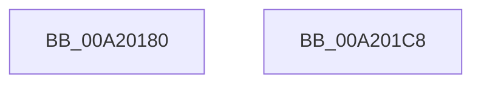

# PopPolicyTimeChange

- RVA: `0x00A20180`–`0x00A201C9` (길이 `73` bytes)
- VA: `0x0000000140A20180`
- 실행 섹션: `PAGE`
- PDB 이름 있음: `예`; PDB Function 태그: `아니요`
- unwind 정보 RVA: `0x00063458`
- 디코드: `19`개 명령, `73/73` bytes 표시
- 미해석 바이트: `0` (있으면 어셈블리에 `.byte`로 보존)

> 이 문서는 커널 이미지의 기계어와 PDB 기호를 분석해 생성했습니다. 4번과 5번은 함수 원형과 자료형을 바이너리 사용 방식에서 추정한 C 해석이며 원본 소스 복구 결과는 아닙니다.

## 1. Dependencies

- 직접 호출 지점: **4**; 고유 호출 대상: **4**
- 직접 호출자로 확인된 함수: **0**
- RIP 상대 이미지 참조: **2**

### Outgoing calls
- `0x00A20184` → [ExAcquireTimeRefreshLockShared](ExAcquireTimeRefreshLockShared_function_00A201D0.md) (function, `0x00A201D0`)
- `0x00A201AD` → [ZwUpdateWnfStateData](../../text/6B/ZwUpdateWnfStateData_function_006B0D10.md) (function, `0x006B0D10`)
- `0x00A201B2` → [ExReleaseTimeRefreshLockShared](ExReleaseTimeRefreshLockShared_function_00A2023C.md) (function, `0x00A2023C`)
- `0x00A201BC` → [PopEventCalloutDispatch](../../text/4B/PopEventCalloutDispatch_function_004B4870.md) (function, `0x004B4870`)

### Direct callers
- 이 함수 시작 RVA로 연결되는 직접 call은 확인되지 않았습니다. 간접 호출은 완전히 역산할 수 없습니다.

### Static image references
- `0x00A2018B` → RVA `0x00F0F080` (`.data`; read)
- `0x00A20196` → RVA `0x00019A20` (`.rdata`; read)

## 2. Other-region calls and transfers

- 다른 실행 섹션으로 향하는 call: **2**
  - `0x00A201AD` → [ZwUpdateWnfStateData](../../text/6B/ZwUpdateWnfStateData_function_006B0D10.md) (`PAGE` → `.text`)
  - `0x00A201BC` → [PopEventCalloutDispatch](../../text/4B/PopEventCalloutDispatch_function_004B4870.md) (`PAGE` → `.text`)
- 별도 외부 분기/꼬리 이동을 확인하지 못했습니다.

## 3. Assembly (complete function range)

```asm
00A20180  48 83 EC 48                     sub rsp, 0x48
00A20184  E8 47 00 00 00                  call 0x140a201d0
00A20189  33 C0                           xor eax, eax
00A2018B  48 8D 15 EE EE 4E 00            lea rdx, [rip + 0x4eeeee]
00A20192  89 44 24 30                     mov dword ptr [rsp + 0x30], eax
00A20196  48 8D 0D 83 98 5F FF            lea rcx, [rip - 0xa0677d]
00A2019D  89 44 24 28                     mov dword ptr [rsp + 0x28], eax
00A201A1  45 33 C9                        xor r9d, r9d
00A201A4  48 89 44 24 20                  mov qword ptr [rsp + 0x20], rax
00A201A9  44 8D 40 10                     lea r8d, [rax + 0x10]
00A201AD  E8 5E 0B C9 FF                  call 0x1406b0d10
00A201B2  E8 85 00 00 00                  call 0x140a2023c
00A201B7  33 D2                           xor edx, edx
00A201B9  8D 4A 03                        lea ecx, [rdx + 3]
00A201BC  E8 AF 46 A9 FF                  call 0x1404b4870
00A201C1  33 C0                           xor eax, eax
00A201C3  48 83 C4 48                     add rsp, 0x48
00A201C7  C3                              ret
00A201C8  CC                              int3
```

## 4. C-style interpretation (structured pseudocode)

```c
__int64 __fastcall PopPolicyTimeChange(__int64 a1, __int64 a2, __int64 a3, int a4)
{
    __int64 result;
    __int64 v_rsp;
    unsigned int v_stack_m18;
    unsigned int v_stack_m20;
    unsigned __int64 v_stack_m28;

    v_rsp = (v_rsp) - (72);
    result = ExAcquireTimeRefreshLockShared(a1, a2, a3, a4);
    result = 0;
    v_stack_m18 = 0;
    v_stack_m20 = 0;
    a4 = 0;
    v_stack_m28 = 0;
    result = ZwUpdateWnfStateData(v_rip - 10512253, v_rip + 5172974, result + 16, a4);
    result = ExReleaseTimeRefreshLockShared(v_rip - 10512253, v_rip + 5172974, result + 16, a4);
    a2 = 0;
    result = PopEventCalloutDispatch(a2 + 3, a2, result + 16, a4);
    result = 0;
    v_rsp = (v_rsp) + (72);
    return result;
}
```

## 5. (Beta) C Style

```c
int64_t PopPolicyTimeChange(int64_t Arg1, int64_t Arg2, int64_t Arg3, int32_t Arg4)
{
    int64_t result;
    int64_t local_rsp;
    uint32_t v_stack_m18;
    uint32_t v_stack_m20;
    uint64_t v_stack_m28;

    local_rsp = (local_rsp) - (72);
    result = ExAcquireTimeRefreshLockShared(Arg1, Arg2, Arg3, Arg4);
    result = 0;
    v_stack_m18 = 0;
    v_stack_m20 = 0;
    Arg4 = 0;
    v_stack_m28 = 0;
    result = ZwUpdateWnfStateData(v_rip - 10512253, v_rip + 5172974, result + 16, Arg4);
    result = ExReleaseTimeRefreshLockShared(v_rip - 10512253, v_rip + 5172974, result + 16, Arg4);
    Arg2 = 0;
    result = PopEventCalloutDispatch(Arg2 + 3, Arg2, result + 16, Arg4);
    result = 0;
    local_rsp = (local_rsp) + (72);
    return result;
}
```

## 6. Execution-region graph

[열기: 2D/3D 그래프와 함수 탐색 컨트롤 패널](../../../control-panel.html?section=page&rva=0x00A20180&view=graph)

- 2D 그래프는 위에서 아래로 흐르고, 3D 그래프는 빈 공간을 드래그해 회전합니다. Shift+드래그는 이동, 휠은 확대·축소, 함수 노드 선택은 대상 보고서 이동입니다.

### Static fallback


