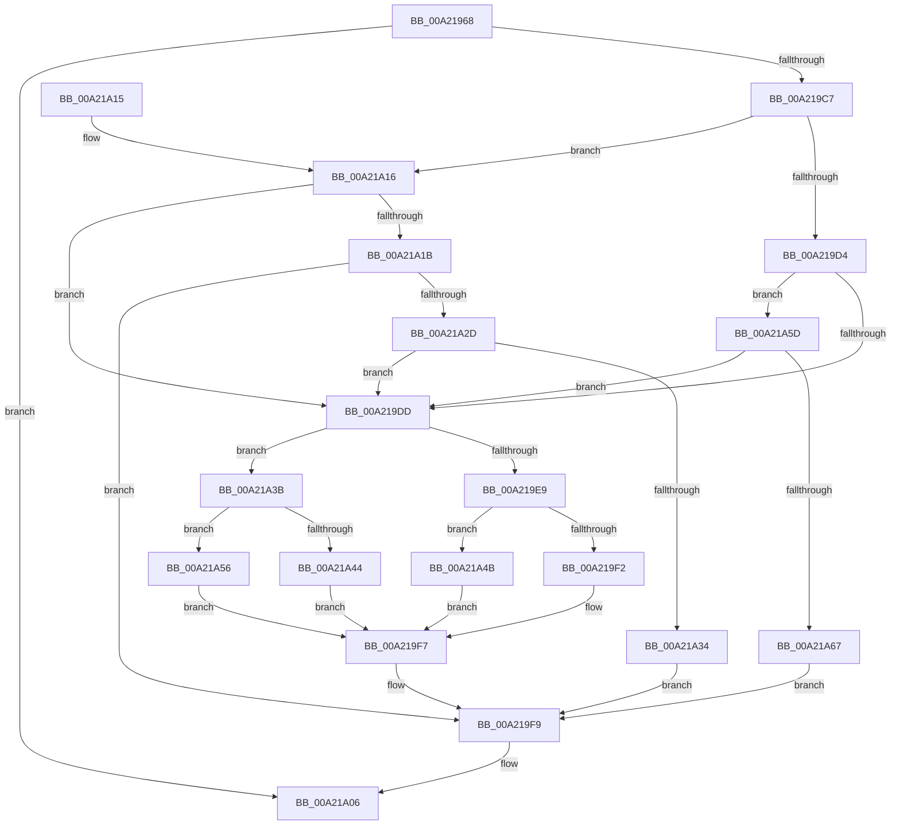

# PopPowerRequestActionInfo

- RVA: `0x00A21968`–`0x00A21A6E` (길이 `262` bytes)
- VA: `0x0000000140A21968`
- 실행 섹션: `PAGE`
- PDB 이름 있음: `예`; PDB Function 태그: `아니요`
- unwind 정보 RVA: `0x000AB1E4`
- 디코드: `74`개 명령, `262/262` bytes 표시
- 미해석 바이트: `0` (있으면 어셈블리에 `.byte`로 보존)

> 이 문서는 커널 이미지의 기계어와 PDB 기호를 분석해 생성했습니다. 4번과 5번은 함수 원형과 자료형을 바이너리 사용 방식에서 추정한 C 해석이며 원본 소스 복구 결과는 아닙니다.

## 1. Dependencies

- 직접 호출 지점: **7**; 고유 호출 대상: **7**
- 직접 호출자로 확인된 함수: **1**
- RIP 상대 이미지 참조: **1**

### Outgoing calls
- `0x00A219BC` → [ObpReferenceObjectByHandleWithTag](../86/ObpReferenceObjectByHandleWithTag_function_00869650.md) (function, `0x00869650`)
- `0x00A219F2` → [PopPowerRequestReferenceAcquire](../../text/47/PopPowerRequestReferenceAcquire_function_004776C0.md) (function, `0x004776C0`)
- `0x00A21A01` → [ObfDereferenceObjectWithTag](../../text/2F/ObfDereferenceObjectWithTag_function_002F78E0.md) (function, `0x002F78E0`)
- `0x00A21A22` → [SeIsAppContainerOrIdentifyLevelContext](SeIsAppContainerOrIdentifyLevelContext_function_00A21A74.md) (function, `0x00A21A74`)
- `0x00A21A44` → [PopPowerRequestReferenceRelease](../../text/47/PopPowerRequestReferenceRelease_function_004775B0.md) (function, `0x004775B0`)
- `0x00A21A4F` → [PopPowerRequestSpecialRequestSet](PopPowerRequestSpecialRequestSet_function_00A21B4C.md) (function, `0x00A21B4C`)
- `0x00A21A56` → [PopPowerRequestSpecialRequestClear](PopPowerRequestSpecialRequestClear_function_00A21C6C.md) (function, `0x00A21C6C`)

### Direct callers
- [NtPowerInformation](../95/NtPowerInformation_function_00955D80.md) at `0x00957087`

### Static image references
- `0x00A2198E` → RVA `0x00FC53B8` (`ALMOSTRO`; read)

## 2. Other-region calls and transfers

- 다른 실행 섹션으로 향하는 call: **3**
  - `0x00A219F2` → [PopPowerRequestReferenceAcquire](../../text/47/PopPowerRequestReferenceAcquire_function_004776C0.md) (`PAGE` → `.text`)
  - `0x00A21A01` → [ObfDereferenceObjectWithTag](../../text/2F/ObfDereferenceObjectWithTag_function_002F78E0.md) (`PAGE` → `.text`)
  - `0x00A21A44` → [PopPowerRequestReferenceRelease](../../text/47/PopPowerRequestReferenceRelease_function_004775B0.md) (`PAGE` → `.text`)
- 별도 외부 분기/꼬리 이동을 확인하지 못했습니다.

## 3. Assembly (complete function range)

```asm
00A21968  4C 8B DC                        mov r11, rsp
00A2196B  49 89 5B 18                     mov qword ptr [r11 + 0x18], rbx
00A2196F  55                              push rbp
00A21970  56                              push rsi
00A21971  57                              push rdi
00A21972  48 83 EC 40                     sub rsp, 0x40
00A21976  65 48 8B 04 25 88 01 00 00      mov rax, qword ptr gs:[0x188]
00A2197F  48 8B F1                        mov rsi, rcx
00A21982  49 83 63 E0 00                  and qword ptr [r11 - 0x20], 0
00A21987  33 D2                           xor edx, edx
00A21989  49 83 63 D8 00                  and qword ptr [r11 - 0x28], 0
00A2198E  4C 8B 05 23 3A 5A 00            mov r8, qword ptr [rip + 0x5a3a23]
00A21995  40 8A A8 32 02 00 00            mov bpl, byte ptr [rax + 0x232]
00A2199C  49 8D 43 10                     lea rax, [r11 + 0x10]
00A219A0  48 8B 09                        mov rcx, qword ptr [rcx]
00A219A3  44 8A CD                        mov r9b, bpl
00A219A6  49 83 63 10 00                  and qword ptr [r11 + 0x10], 0
00A219AB  49 89 43 D0                     mov qword ptr [r11 - 0x30], rax
00A219AF  C7 44 24 20 50 6F 50 72         mov dword ptr [rsp + 0x20], 0x72506f50
00A219B7  C6 44 24 60 00                  mov byte ptr [rsp + 0x60], 0
00A219BC  E8 8F 7C E4 FF                  call 0x140869650
00A219C1  8B D8                           mov ebx, eax
00A219C3  85 C0                           test eax, eax
00A219C5  78 3F                           js 0x140a21a06
00A219C7  8B 4E 08                        mov ecx, dword ptr [rsi + 8]
00A219CA  48 8B 7C 24 68                  mov rdi, qword ptr [rsp + 0x68]
00A219CF  83 E9 03                        sub ecx, 3
00A219D2  74 42                           je 0x140a21a16
00A219D4  83 F9 01                        cmp ecx, 1
00A219D7  0F 84 80 00 00 00               je 0x140a21a5d
00A219DD  80 7E 0C 00                     cmp byte ptr [rsi + 0xc], 0
00A219E1  48 8B CF                        mov rcx, rdi
00A219E4  8B 56 08                        mov edx, dword ptr [rsi + 8]
00A219E7  74 52                           je 0x140a21a3b
00A219E9  80 BF 98 00 00 00 00            cmp byte ptr [rdi + 0x98], 0
00A219F0  75 59                           jne 0x140a21a4b
00A219F2  E8 C9 5C A5 FF                  call 0x1404776c0
00A219F7  8B D8                           mov ebx, eax
00A219F9  BA 50 6F 50 72                  mov edx, 0x72506f50
00A219FE  48 8B CF                        mov rcx, rdi
00A21A01  E8 DA 5E 8D FF                  call 0x1402f78e0
00A21A06  8B C3                           mov eax, ebx
00A21A08  48 8B 5C 24 70                  mov rbx, qword ptr [rsp + 0x70]
00A21A0D  48 83 C4 40                     add rsp, 0x40
00A21A11  5F                              pop rdi
00A21A12  5E                              pop rsi
00A21A13  5D                              pop rbp
00A21A14  C3                              ret
00A21A15  CC                              int3
00A21A16  40 84 ED                        test bpl, bpl
00A21A19  74 C2                           je 0x140a219dd
00A21A1B  48 8D 54 24 60                  lea rdx, [rsp + 0x60]
00A21A20  33 C9                           xor ecx, ecx
00A21A22  E8 4D 00 00 00                  call 0x140a21a74
00A21A27  8B D8                           mov ebx, eax
00A21A29  85 C0                           test eax, eax
00A21A2B  78 CC                           js 0x140a219f9
00A21A2D  80 7C 24 60 00                  cmp byte ptr [rsp + 0x60], 0
00A21A32  74 A9                           je 0x140a219dd
00A21A34  BB 22 00 00 C0                  mov ebx, 0xc0000022
00A21A39  EB BE                           jmp 0x140a219f9
00A21A3B  80 BF 98 00 00 00 00            cmp byte ptr [rdi + 0x98], 0
00A21A42  75 12                           jne 0x140a21a56
00A21A44  E8 67 5B A5 FF                  call 0x1404775b0
00A21A49  EB AC                           jmp 0x140a219f7
00A21A4B  4C 8B 46 10                     mov r8, qword ptr [rsi + 0x10]
00A21A4F  E8 F8 00 00 00                  call 0x140a21b4c
00A21A54  EB A1                           jmp 0x140a219f7
00A21A56  E8 11 02 00 00                  call 0x140a21c6c
00A21A5B  EB 9A                           jmp 0x140a219f7
00A21A5D  40 80 FD 01                     cmp bpl, 1
00A21A61  0F 84 76 FF FF FF               je 0x140a219dd
00A21A67  BB BB 00 00 C0                  mov ebx, 0xc00000bb
00A21A6C  EB 8B                           jmp 0x140a219f9
```

## 4. C-style interpretation (structured pseudocode)

```c
__int64 __fastcall PopPowerRequestActionInfo(__int64 a1, int a2)
{
    __int64 result;
    __int64 v_rsp;
    unsigned int v_stack_m38;
    unsigned __int64 v_stack_p10;
    unsigned __int64 v_stack_p18;
    unsigned __int64 v_stack_p60;
    unsigned __int8 v_stack_p8;

    *(unsigned __int64 *)(v_rsp + 24) = v_rbx;
    v_rsp = (v_rsp) - (64);
    a2 = 0;
    *(unsigned __int64 *)(v_rsp - 48) = v_rsp + 16;
    v_stack_m38 = 0x72506F50ULL;
    v_stack_p8 = 0;
    result = ObpReferenceObjectByHandleWithTag(*(unsigned __int64 *)(a1), a2, *(unsigned __int64 *)(v_rip + 5913123), (unsigned __int8)(*(unsigned __int8 *)(*(unsigned __int64 *)(gs_base + (0 + 392)) + 562)));
    if (sign_flag) goto loc_00A21A06;
    a1 = (unsigned int)(((unsigned int)(*(unsigned int *)(a1 + 8))) - (3));
    if (condition_is_equal) goto loc_00A21A16;
    if (((unsigned int)(a1)) == 1) goto loc_00A21A5D;
loc_00A219DD:
    if ((*(unsigned __int8 *)(a1 + 12)) == 0) goto loc_00A21A3B;
    if ((*(unsigned __int8 *)(v_stack_p10 + 152)) != 0) goto loc_00A21A4B;
    result = PopPowerRequestReferenceAcquire(v_stack_p10, (unsigned int)(*(unsigned int *)(a1 + 8)), *(unsigned __int64 *)(v_rip + 5913123), (unsigned __int8)(*(unsigned __int8 *)(*(unsigned __int64 *)(gs_base + (0 + 392)) + 562)));
loc_00A219F7:
loc_00A219F9:
    result = ObfDereferenceObjectWithTag(v_stack_p10, (unsigned int)(0x72506F50ULL), *(unsigned __int64 *)(v_rip + 5913123), (unsigned __int8)(*(unsigned __int8 *)(*(unsigned __int64 *)(gs_base + (0 + 392)) + 562)));
loc_00A21A06:
    v_rsp = (v_rsp) + (64);
    return (unsigned int)((unsigned int)((unsigned int)((unsigned int)(result))));
loc_00A21A16:
    if ((unsigned __int8)(*(unsigned __int8 *)(*(unsigned __int64 *)(gs_base + (0 + 392)) + 562)) == 0) goto loc_00A219DD;
    a1 = 0;
    result = SeIsAppContainerOrIdentifyLevelContext(a1, v_stack_p60, *(unsigned __int64 *)(v_rip + 5913123), (unsigned __int8)(*(unsigned __int8 *)(*(unsigned __int64 *)(gs_base + (0 + 392)) + 562)));
    if (sign_flag) goto loc_00A219F9;
    if (v_stack_p60 == 0) goto loc_00A219DD;
    goto loc_00A219F9;
loc_00A21A3B:
    if ((*(unsigned __int8 *)(v_stack_p10 + 152)) != 0) goto loc_00A21A56;
    result = PopPowerRequestReferenceRelease(a1, v_stack_p60, *(unsigned __int64 *)(v_rip + 5913123), (unsigned __int8)(*(unsigned __int8 *)(*(unsigned __int64 *)(gs_base + (0 + 392)) + 562)));
    goto loc_00A219F7;
loc_00A21A4B:
    result = PopPowerRequestSpecialRequestSet(a1, v_stack_p60, *(unsigned __int64 *)(a1 + 16), (unsigned __int8)(*(unsigned __int8 *)(*(unsigned __int64 *)(gs_base + (0 + 392)) + 562)));
    goto loc_00A219F7;
loc_00A21A56:
    result = PopPowerRequestSpecialRequestClear(a1, v_stack_p60, *(unsigned __int64 *)(a1 + 16), (unsigned __int8)(*(unsigned __int8 *)(*(unsigned __int64 *)(gs_base + (0 + 392)) + 562)));
    goto loc_00A219F7;
loc_00A21A5D:
    if (((unsigned __int8)(*(unsigned __int8 *)(*(unsigned __int64 *)(gs_base + (0 + 392)) + 562))) == 1) goto loc_00A219DD;
    goto loc_00A219F9;
}
```

## 5. (Beta) C Style

```c
int64_t PopPowerRequestActionInfo(void *Arg1, int32_t Arg2)
{
    uint8_t *arg1 = (uint8_t *)Arg1;

    int64_t result;
    int64_t local_rsp;
    uint32_t v_stack_m38;
    uint64_t v_stack_p10;
    uint64_t v_stack_p18;
    uint64_t v_stack_p60;
    uint8_t v_stack_p8;

    *(uint64_t *)(local_rsp + 0x18) = local_rbx;
    local_rsp = (local_rsp) - (64);
    Arg2 = 0;
    *(uint64_t *)(local_rsp - 0x30) = local_rsp + 16;
    v_stack_m38 = 0x72506F50ULL;
    v_stack_p8 = 0;
    result = ObpReferenceObjectByHandleWithTag(*(uint64_t *)(arg1), Arg2, *(uint64_t *)(v_rip + 0x5A3A23), (uint8_t)(*(uint8_t *)(*(uint64_t *)(gs_base + (0 + 0x188)) + 0x232)));
    if (sign_flag) goto loc_00A21A06;
    Arg1 = (uint32_t)(((uint32_t)(*(uint32_t *)(arg1 + 0x8))) - (3));
    if (condition_is_equal) goto loc_00A21A16;
    if (((uint32_t)(Arg1)) == 1) goto loc_00A21A5D;
loc_00A219DD:
    if ((*(uint8_t *)(arg1 + 0xC)) == 0) goto loc_00A21A3B;
    if ((*(uint8_t *)(v_stack_p10 + 0x98)) != 0) goto loc_00A21A4B;
    result = PopPowerRequestReferenceAcquire(v_stack_p10, (uint32_t)(*(uint32_t *)(arg1 + 0x8)), *(uint64_t *)(v_rip + 0x5A3A23), (uint8_t)(*(uint8_t *)(*(uint64_t *)(gs_base + (0 + 0x188)) + 0x232)));
loc_00A219F7:
loc_00A219F9:
    result = ObfDereferenceObjectWithTag(v_stack_p10, (uint32_t)(0x72506F50ULL), *(uint64_t *)(v_rip + 0x5A3A23), (uint8_t)(*(uint8_t *)(*(uint64_t *)(gs_base + (0 + 0x188)) + 0x232)));
loc_00A21A06:
    local_rsp = (local_rsp) + (64);
    return (uint32_t)((uint32_t)((uint32_t)((uint32_t)(result))));
loc_00A21A16:
    if ((uint8_t)(*(uint8_t *)(*(uint64_t *)(gs_base + (0 + 0x188)) + 0x232)) == 0) goto loc_00A219DD;
    Arg1 = 0;
    result = SeIsAppContainerOrIdentifyLevelContext(Arg1, v_stack_p60, *(uint64_t *)(v_rip + 0x5A3A23), (uint8_t)(*(uint8_t *)(*(uint64_t *)(gs_base + (0 + 0x188)) + 0x232)));
    if (sign_flag) goto loc_00A219F9;
    if (v_stack_p60 == 0) goto loc_00A219DD;
    goto loc_00A219F9;
loc_00A21A3B:
    if ((*(uint8_t *)(v_stack_p10 + 0x98)) != 0) goto loc_00A21A56;
    result = PopPowerRequestReferenceRelease(Arg1, v_stack_p60, *(uint64_t *)(v_rip + 0x5A3A23), (uint8_t)(*(uint8_t *)(*(uint64_t *)(gs_base + (0 + 0x188)) + 0x232)));
    goto loc_00A219F7;
loc_00A21A4B:
    result = PopPowerRequestSpecialRequestSet(Arg1, v_stack_p60, *(uint64_t *)(arg1 + 0x10), (uint8_t)(*(uint8_t *)(*(uint64_t *)(gs_base + (0 + 0x188)) + 0x232)));
    goto loc_00A219F7;
loc_00A21A56:
    result = PopPowerRequestSpecialRequestClear(Arg1, v_stack_p60, *(uint64_t *)(arg1 + 0x10), (uint8_t)(*(uint8_t *)(*(uint64_t *)(gs_base + (0 + 0x188)) + 0x232)));
    goto loc_00A219F7;
loc_00A21A5D:
    if (((uint8_t)(*(uint8_t *)(*(uint64_t *)(gs_base + (0 + 0x188)) + 0x232))) == 1) goto loc_00A219DD;
    goto loc_00A219F9;
}
```

### 관측된 메모리 오프셋

구조체 형식이 확인되지 않은 접근은 인자 기준의 오프셋으로만 기록했습니다.

| 기준 인자 | 오프셋 표현 | 폭 (bit) | 접근 |
|---|---:|---:|---|
| `Arg1` | `+ 0x0` | `64` | `R` |
| `Arg1` | `+ 0x8` | `32` | `R` |
| `Arg1` | `+ 0xC` | `8` | `R` |
| `Arg1` | `+ 0x10` | `64` | `R` |

## 6. Execution-region graph

[열기: 2D/3D 그래프와 함수 탐색 컨트롤 패널](../../../control-panel.html?section=page&rva=0x00A21968&view=graph)

- 2D 그래프는 위에서 아래로 흐르고, 3D 그래프는 빈 공간을 드래그해 회전합니다. Shift+드래그는 이동, 휠은 확대·축소, 함수 노드 선택은 대상 보고서 이동입니다.

### Static fallback


