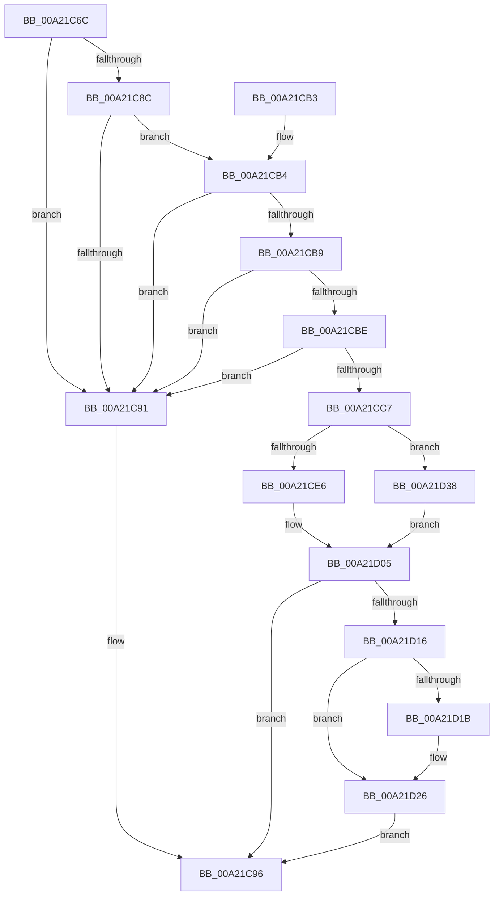

# PopPowerRequestSpecialRequestClear

- RVA: `0x00A21C6C`–`0x00A21D3F` (길이 `211` bytes)
- VA: `0x0000000140A21C6C`
- 실행 섹션: `PAGE`
- PDB 이름 있음: `예`; PDB Function 태그: `아니요`
- unwind 정보 RVA: `0x000AB224`
- 디코드: `57`개 명령, `211/211` bytes 표시
- 미해석 바이트: `0` (있으면 어셈블리에 `.byte`로 보존)

> 이 문서는 커널 이미지의 기계어와 PDB 기호를 분석해 생성했습니다. 4번과 5번은 함수 원형과 자료형을 바이너리 사용 방식에서 추정한 C 해석이며 원본 소스 복구 결과는 아닙니다.

## 1. Dependencies

- 직접 호출 지점: **4**; 고유 호출 대상: **4**
- 직접 호출자로 확인된 함수: **1**
- RIP 상대 이미지 참조: **1**

### Outgoing calls
- `0x00A21CD5` → [PopAcquireRwLockExclusive](../../text/43/PopAcquireRwLockExclusive_function_00430B44.md) (function, `0x00430B44`)
- `0x00A21D0C` → [PopReleaseRwLock](../../text/2D/PopReleaseRwLock_function_002DFBBC.md) (function, `0x002DFBBC`)
- `0x00A21D21` → [PsReleaseProcessWakeCounter](../88/PsReleaseProcessWakeCounter_function_0088B940.md) (function, `0x0088B940`)
- `0x00A21D2E` → [ObfDereferenceObjectWithTag](../../text/2F/ObfDereferenceObjectWithTag_function_002F78E0.md) (function, `0x002F78E0`)

### Direct callers
- [PopPowerRequestActionInfo](PopPowerRequestActionInfo_function_00A21968.md) at `0x00A21A56`

### Static image references
- `0x00A21CC7` → RVA `0x00F0ED20` (`.data`; read)

## 2. Other-region calls and transfers

- 다른 실행 섹션으로 향하는 call: **3**
  - `0x00A21CD5` → [PopAcquireRwLockExclusive](../../text/43/PopAcquireRwLockExclusive_function_00430B44.md) (`PAGE` → `.text`)
  - `0x00A21D0C` → [PopReleaseRwLock](../../text/2D/PopReleaseRwLock_function_002DFBBC.md) (`PAGE` → `.text`)
  - `0x00A21D2E` → [ObfDereferenceObjectWithTag](../../text/2F/ObfDereferenceObjectWithTag_function_002F78E0.md) (`PAGE` → `.text`)
- 별도 외부 분기/꼬리 이동을 확인하지 못했습니다.

## 3. Assembly (complete function range)

```asm
00A21C6C  48 8B C4                        mov rax, rsp
00A21C6F  48 89 58 08                     mov qword ptr [rax + 8], rbx
00A21C73  48 89 68 10                     mov qword ptr [rax + 0x10], rbp
00A21C77  48 89 70 18                     mov qword ptr [rax + 0x18], rsi
00A21C7B  48 89 78 20                     mov qword ptr [rax + 0x20], rdi
00A21C7F  41 56                           push r14
00A21C81  48 83 EC 20                     sub rsp, 0x20
00A21C85  48 8B F9                        mov rdi, rcx
00A21C88  85 D2                           test edx, edx
00A21C8A  74 05                           je 0x140a21c91
00A21C8C  83 EA 01                        sub edx, 1
00A21C8F  75 23                           jne 0x140a21cb4
00A21C91  BB 0D 00 00 C0                  mov ebx, 0xc000000d
00A21C96  48 8B 6C 24 38                  mov rbp, qword ptr [rsp + 0x38]
00A21C9B  8B C3                           mov eax, ebx
00A21C9D  48 8B 5C 24 30                  mov rbx, qword ptr [rsp + 0x30]
00A21CA2  48 8B 74 24 40                  mov rsi, qword ptr [rsp + 0x40]
00A21CA7  48 8B 7C 24 48                  mov rdi, qword ptr [rsp + 0x48]
00A21CAC  48 83 C4 20                     add rsp, 0x20
00A21CB0  41 5E                           pop r14
00A21CB2  C3                              ret
00A21CB3  CC                              int3
00A21CB4  83 EA 01                        sub edx, 1
00A21CB7  74 D8                           je 0x140a21c91
00A21CB9  83 FA 01                        cmp edx, 1
00A21CBC  75 D3                           jne 0x140a21c91
00A21CBE  80 B9 98 00 00 00 00            cmp byte ptr [rcx + 0x98], 0
00A21CC5  74 CA                           je 0x140a21c91
00A21CC7  48 8D 0D 52 D0 4E 00            lea rcx, [rip + 0x4ed052]
00A21CCE  33 ED                           xor ebp, ebp
00A21CD0  33 F6                           xor esi, esi
00A21CD2  45 32 F6                        xor r14b, r14b
00A21CD5  E8 6A EE A0 FF                  call 0x140430b44
00A21CDA  48 8B 87 88 00 00 00            mov rax, qword ptr [rdi + 0x88]
00A21CE1  48 85 C0                        test rax, rax
00A21CE4  74 52                           je 0x140a21d38
00A21CE6  48 8B B7 90 00 00 00            mov rsi, qword ptr [rdi + 0x90]
00A21CED  41 B6 01                        mov r14b, 1
00A21CF0  48 83 A7 90 00 00 00 00         and qword ptr [rdi + 0x90], 0
00A21CF8  48 8B E8                        mov rbp, rax
00A21CFB  48 83 A7 88 00 00 00 00         and qword ptr [rdi + 0x88], 0
00A21D03  33 DB                           xor ebx, ebx
00A21D05  48 8D 0D 14 D0 4E 00            lea rcx, [rip + 0x4ed014]
00A21D0C  E8 AB DE 8B FF                  call 0x1402dfbbc
00A21D11  45 84 F6                        test r14b, r14b
00A21D14  74 80                           je 0x140a21c96
00A21D16  48 85 F6                        test rsi, rsi
00A21D19  74 0B                           je 0x140a21d26
00A21D1B  48 8B D7                        mov rdx, rdi
00A21D1E  48 8B CE                        mov rcx, rsi
00A21D21  E8 1A 9C E6 FF                  call 0x14088b940
00A21D26  BA 50 6F 50 72                  mov edx, 0x72506f50
00A21D2B  48 8B CD                        mov rcx, rbp
00A21D2E  E8 AD 5B 8D FF                  call 0x1402f78e0
00A21D33  E9 5E FF FF FF                  jmp 0x140a21c96
00A21D38  BB 0D 00 00 C0                  mov ebx, 0xc000000d
00A21D3D  EB C6                           jmp 0x140a21d05
```

## 4. C-style interpretation (structured pseudocode)

```c
__int64 __fastcall PopPowerRequestSpecialRequestClear(__int64 a1, int a2)
{
    __int64 result;
    __int64 v_r14;
    __int64 v_rbp;
    __int64 v_rbx;
    __int64 v_rsi;
    __int64 v_rsp;
    unsigned __int64 v_stack_p10;
    unsigned __int64 v_stack_p18;
    unsigned __int64 v_stack_p20;
    unsigned __int64 v_stack_p8;

    *(unsigned __int64 *)(v_rsp + 8) = v_rbx;
    *(unsigned __int64 *)(v_rsp + 16) = v_rbp;
    *(unsigned __int64 *)(v_rsp + 24) = v_rsi;
    *(unsigned __int64 *)(v_rsp + 32) = v_rdi;
    v_rsp = (v_rsp) - (32);
    if (a2 == 0) goto loc_00A21C91;
    a2 = (unsigned int)((a2) - (1));
    if (condition_is_not_equal) goto loc_00A21CB4;
loc_00A21C91:
loc_00A21C96:
    v_rsp = (v_rsp) + (32);
    return (unsigned int)((unsigned int)((unsigned int)(0xC000000DULL)));
loc_00A21CB4:
    a2 = (unsigned int)((a2) - (1));
    if (condition_is_equal) goto loc_00A21C91;
    if (a2 != 1) goto loc_00A21C91;
    if ((*(unsigned __int8 *)(a1 + 152)) == 0) goto loc_00A21C91;
    v_rbp = 0;
    v_rsi = 0;
    v_r14 = 0;
    result = PopAcquireRwLockExclusive(v_rip + 5165138, a2, a3, a4);
    if (*(unsigned __int64 *)(v_stack_p20 + 136) == 0) goto loc_00A21D38;
    v_rbx = 0;
loc_00A21D05:
    result = PopReleaseRwLock(v_rip + 5165076, a2, a3, a4);
    if (1 == 0) goto loc_00A21C96;
    if (*(unsigned __int64 *)(v_stack_p20 + 144) != 0) {
        a2 = v_stack_p20;
        a1 = *(unsigned __int64 *)(v_stack_p20 + 144);
        result = PsReleaseProcessWakeCounter(a1, a2, a3, a4);
    }
    result = ObfDereferenceObjectWithTag(*(unsigned __int64 *)(v_stack_p20 + 136), (unsigned int)(0x72506F50ULL), a3, a4);
    goto loc_00A21C96;
loc_00A21D38:
    goto loc_00A21D05;
}
```

## 5. (Beta) C Style

```c
int64_t PopPowerRequestSpecialRequestClear(void *Arg1, int32_t Arg2)
{
    uint8_t *arg1 = (uint8_t *)Arg1;

    int64_t result;
    int64_t local_r14;
    int64_t local_rbp;
    int64_t local_rbx;
    int64_t local_rsi;
    int64_t local_rsp;
    uint64_t v_stack_p10;
    uint64_t v_stack_p18;
    uint64_t v_stack_p20;
    uint64_t v_stack_p8;

    *(uint64_t *)(local_rsp + 0x8) = local_rbx;
    *(uint64_t *)(local_rsp + 0x10) = local_rbp;
    *(uint64_t *)(local_rsp + 0x18) = local_rsi;
    *(uint64_t *)(local_rsp + 0x20) = local_rdi;
    local_rsp = (local_rsp) - (32);
    if (Arg2 == 0) goto loc_00A21C91;
    Arg2 = (uint32_t)((Arg2) - (1));
    if (condition_is_not_equal) goto loc_00A21CB4;
loc_00A21C91:
loc_00A21C96:
    local_rsp = (local_rsp) + (32);
    return (uint32_t)((uint32_t)((uint32_t)(0xC000000DULL)));
loc_00A21CB4:
    Arg2 = (uint32_t)((Arg2) - (1));
    if (condition_is_equal) goto loc_00A21C91;
    if (Arg2 != 1) goto loc_00A21C91;
    if ((*(uint8_t *)(arg1 + 0x98)) == 0) goto loc_00A21C91;
    local_rbp = 0;
    local_rsi = 0;
    local_r14 = 0;
    result = PopAcquireRwLockExclusive(v_rip + 5165138, Arg2, a3, a4);
    if (*(uint64_t *)(v_stack_p20 + 0x88) == 0) goto loc_00A21D38;
    local_rbx = 0;
loc_00A21D05:
    result = PopReleaseRwLock(v_rip + 5165076, Arg2, a3, a4);
    if (1 == 0) goto loc_00A21C96;
    if (*(uint64_t *)(v_stack_p20 + 0x90) != 0) {
        Arg2 = v_stack_p20;
        Arg1 = *(uint64_t *)(v_stack_p20 + 0x90);
        result = PsReleaseProcessWakeCounter(Arg1, Arg2, a3, a4);
    }
    result = ObfDereferenceObjectWithTag(*(uint64_t *)(v_stack_p20 + 0x88), (uint32_t)(0x72506F50ULL), a3, a4);
    goto loc_00A21C96;
loc_00A21D38:
    goto loc_00A21D05;
}
```

### 관측된 메모리 오프셋

구조체 형식이 확인되지 않은 접근은 인자 기준의 오프셋으로만 기록했습니다.

| 기준 인자 | 오프셋 표현 | 폭 (bit) | 접근 |
|---|---:|---:|---|
| `Arg1` | `+ 0x88` | `64` | `R` |
| `Arg1` | `+ 0x88` | `64` | `R/W` |
| `Arg1` | `+ 0x90` | `64` | `R` |
| `Arg1` | `+ 0x90` | `64` | `R/W` |
| `Arg1` | `+ 0x98` | `8` | `R` |

## 6. Execution-region graph

[열기: 2D/3D 그래프와 함수 탐색 컨트롤 패널](../../../control-panel.html?section=page&rva=0x00A21C6C&view=graph)

- 2D 그래프는 위에서 아래로 흐르고, 3D 그래프는 빈 공간을 드래그해 회전합니다. Shift+드래그는 이동, 휠은 확대·축소, 함수 노드 선택은 대상 보고서 이동입니다.

### Static fallback


