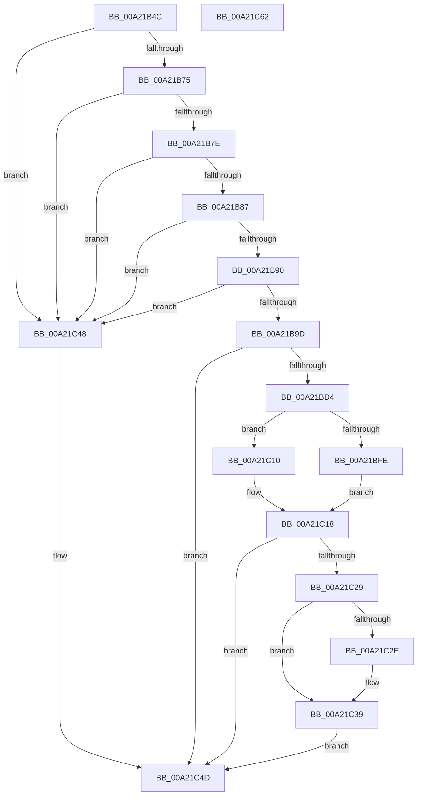

# PopPowerRequestSpecialRequestSet

- RVA: `0x00A21B4C`–`0x00A21C63` (길이 `279` bytes)
- VA: `0x0000000140A21B4C`
- 실행 섹션: `PAGE`
- PDB 이름 있음: `예`; PDB Function 태그: `아니요`
- unwind 정보 RVA: `0x000AB20C`
- 디코드: `74`개 명령, `279/279` bytes 표시
- 미해석 바이트: `0` (있으면 어셈블리에 `.byte`로 보존)

> 이 문서는 커널 이미지의 기계어와 PDB 기호를 분석해 생성했습니다. 4번과 5번은 함수 원형과 자료형을 바이너리 사용 방식에서 추정한 C 해석이며 원본 소스 복구 결과는 아닙니다.

## 1. Dependencies

- 직접 호출 지점: **6**; 고유 호출 대상: **6**
- 직접 호출자로 확인된 함수: **1**
- RIP 상대 이미지 참조: **2**

### Outgoing calls
- `0x00A21BC9` → [ObpReferenceObjectByHandleWithTag](../86/ObpReferenceObjectByHandleWithTag_function_00869650.md) (function, `0x00869650`)
- `0x00A21BE5` → [PsChargeProcessWakeCounter](../88/PsChargeProcessWakeCounter_function_0088BCD0.md) (function, `0x0088BCD0`)
- `0x00A21BEF` → [PopAcquirePowerRequestPushLock](../A6/PopAcquirePowerRequestPushLock_function_00A66D94.md) (function, `0x00A66D94`)
- `0x00A21C1F` → [PopReleaseRwLock](../../text/2D/PopReleaseRwLock_function_002DFBBC.md) (function, `0x002DFBBC`)
- `0x00A21C34` → [PsReleaseProcessWakeCounter](../88/PsReleaseProcessWakeCounter_function_0088B940.md) (function, `0x0088B940`)
- `0x00A21C41` → [ObfDereferenceObjectWithTag](../../text/2F/ObfDereferenceObjectWithTag_function_002F78E0.md) (function, `0x002F78E0`)

### Direct callers
- [PopPowerRequestActionInfo](PopPowerRequestActionInfo_function_00A21968.md) at `0x00A21A4F`

### Static image references
- `0x00A21BAE` → RVA `0x00FC6A98` (`ALMOSTRO`; read)
- `0x00A21C18` → RVA `0x00F0ED20` (`.data`; read)

## 2. Other-region calls and transfers

- 다른 실행 섹션으로 향하는 call: **2**
  - `0x00A21C1F` → [PopReleaseRwLock](../../text/2D/PopReleaseRwLock_function_002DFBBC.md) (`PAGE` → `.text`)
  - `0x00A21C41` → [ObfDereferenceObjectWithTag](../../text/2F/ObfDereferenceObjectWithTag_function_002F78E0.md) (`PAGE` → `.text`)
- 별도 외부 분기/꼬리 이동을 확인하지 못했습니다.

## 3. Assembly (complete function range)

```asm
00A21B4C  4C 8B DC                        mov r11, rsp
00A21B4F  49 89 5B 08                     mov qword ptr [r11 + 8], rbx
00A21B53  49 89 6B 10                     mov qword ptr [r11 + 0x10], rbp
00A21B57  56                              push rsi
00A21B58  57                              push rdi
00A21B59  41 56                           push r14
00A21B5B  48 83 EC 40                     sub rsp, 0x40
00A21B5F  49 83 63 20 00                  and qword ptr [r11 + 0x20], 0
00A21B64  45 32 F6                        xor r14b, r14b
00A21B67  4D 8B D0                        mov r10, r8
00A21B6A  48 8B F9                        mov rdi, rcx
00A21B6D  85 D2                           test edx, edx
00A21B6F  0F 84 D3 00 00 00               je 0x140a21c48
00A21B75  83 EA 01                        sub edx, 1
00A21B78  0F 84 CA 00 00 00               je 0x140a21c48
00A21B7E  83 EA 01                        sub edx, 1
00A21B81  0F 84 C1 00 00 00               je 0x140a21c48
00A21B87  83 FA 01                        cmp edx, 1
00A21B8A  0F 85 B8 00 00 00               jne 0x140a21c48
00A21B90  44 38 B1 98 00 00 00            cmp byte ptr [rcx + 0x98], r14b
00A21B97  0F 84 AB 00 00 00               je 0x140a21c48
00A21B9D  49 83 63 E0 00                  and qword ptr [r11 - 0x20], 0
00A21BA2  49 8D 43 20                     lea rax, [r11 + 0x20]
00A21BA6  49 83 63 D8 00                  and qword ptr [r11 - 0x28], 0
00A21BAB  44 8A CA                        mov r9b, dl
00A21BAE  4C 8B 05 E3 4E 5A 00            mov r8, qword ptr [rip + 0x5a4ee3]
00A21BB5  BA 00 20 00 00                  mov edx, 0x2000
00A21BBA  49 89 43 D0                     mov qword ptr [r11 - 0x30], rax
00A21BBE  49 8B CA                        mov rcx, r10
00A21BC1  C7 44 24 20 50 6F 50 72         mov dword ptr [rsp + 0x20], 0x72506f50
00A21BC9  E8 82 7A E4 FF                  call 0x140869650
00A21BCE  8B D8                           mov ebx, eax
00A21BD0  85 C0                           test eax, eax
00A21BD2  78 79                           js 0x140a21c4d
00A21BD4  48 8B 6C 24 78                  mov rbp, qword ptr [rsp + 0x78]
00A21BD9  33 D2                           xor edx, edx
00A21BDB  4C 8B CF                        mov r9, rdi
00A21BDE  48 8B CD                        mov rcx, rbp
00A21BE1  44 8D 42 03                     lea r8d, [rdx + 3]
00A21BE5  E8 E6 A0 E6 FF                  call 0x14088bcd0
00A21BEA  B1 01                           mov cl, 1
00A21BEC  48 8B F0                        mov rsi, rax
00A21BEF  E8 A0 51 04 00                  call 0x140a66d94
00A21BF4  48 83 BF 88 00 00 00 00         cmp qword ptr [rdi + 0x88], 0
00A21BFC  75 12                           jne 0x140a21c10
00A21BFE  48 89 AF 88 00 00 00            mov qword ptr [rdi + 0x88], rbp
00A21C05  33 DB                           xor ebx, ebx
00A21C07  48 89 B7 90 00 00 00            mov qword ptr [rdi + 0x90], rsi
00A21C0E  EB 08                           jmp 0x140a21c18
00A21C10  41 B6 01                        mov r14b, 1
00A21C13  BB 0D 00 00 C0                  mov ebx, 0xc000000d
00A21C18  48 8D 0D 01 D1 4E 00            lea rcx, [rip + 0x4ed101]
00A21C1F  E8 98 DF 8B FF                  call 0x1402dfbbc
00A21C24  45 84 F6                        test r14b, r14b
00A21C27  74 24                           je 0x140a21c4d
00A21C29  48 85 F6                        test rsi, rsi
00A21C2C  74 0B                           je 0x140a21c39
00A21C2E  48 8B D7                        mov rdx, rdi
00A21C31  48 8B CE                        mov rcx, rsi
00A21C34  E8 07 9D E6 FF                  call 0x14088b940
00A21C39  BA 50 6F 50 72                  mov edx, 0x72506f50
00A21C3E  48 8B CD                        mov rcx, rbp
00A21C41  E8 9A 5C 8D FF                  call 0x1402f78e0
00A21C46  EB 05                           jmp 0x140a21c4d
00A21C48  BB 0D 00 00 C0                  mov ebx, 0xc000000d
00A21C4D  48 8B 6C 24 68                  mov rbp, qword ptr [rsp + 0x68]
00A21C52  8B C3                           mov eax, ebx
00A21C54  48 8B 5C 24 60                  mov rbx, qword ptr [rsp + 0x60]
00A21C59  48 83 C4 40                     add rsp, 0x40
00A21C5D  41 5E                           pop r14
00A21C5F  5F                              pop rdi
00A21C60  5E                              pop rsi
00A21C61  C3                              ret
00A21C62  CC                              int3
```

## 4. C-style interpretation (structured pseudocode)

```c
__int64 __fastcall PopPowerRequestSpecialRequestSet(__int64 a1, int a2, __int64 a3)
{
    __int64 result;
    __int64 v_r14;
    __int64 v_rbx;
    __int64 v_rsp;
    unsigned int v_stack_m38;
    unsigned __int64 v_stack_p10;
    unsigned __int64 v_stack_p20;
    unsigned __int64 v_stack_p8;

    *(unsigned __int64 *)(v_rsp + 8) = v_rbx;
    *(unsigned __int64 *)(v_rsp + 16) = v_rbp;
    v_rsp = (v_rsp) - (64);
    v_r14 = 0;
    if (a2 == 0) goto loc_00A21C48;
    a2 = (unsigned int)((a2) - (1));
    if (condition_is_equal) goto loc_00A21C48;
    a2 = (unsigned int)((a2) - (1));
    if (condition_is_equal) goto loc_00A21C48;
    if (a2 != 1) goto loc_00A21C48;
    if ((*(unsigned __int8 *)(a1 + 152)) == 0) goto loc_00A21C48;
    *(unsigned __int64 *)(v_rsp - 48) = v_rsp + 32;
    v_stack_m38 = 0x72506F50ULL;
    result = ObpReferenceObjectByHandleWithTag(a3, (unsigned int)(0x2000ULL), *(unsigned __int64 *)(v_rip + 5918435), (unsigned __int8)(a2));
    if (sign_flag) goto loc_00A21C4D;
    a2 = 0;
    result = PsChargeProcessWakeCounter(v_stack_p20, a2, a2 + 3, a1);
    result = PopAcquirePowerRequestPushLock(1, a2, a2 + 3, a1);
    if ((*(unsigned __int64 *)(a1 + 136)) != 0) goto loc_00A21C10;
    *(unsigned __int64 *)(a1 + 136) = v_stack_p20;
    v_rbx = 0;
    *(unsigned __int64 *)(a1 + 144) = result;
    goto loc_00A21C18;
loc_00A21C10:
loc_00A21C18:
    result = PopReleaseRwLock(v_rip + 5165313, a2, a2 + 3, a1);
    if (1 == 0) goto loc_00A21C4D;
    if (result != 0) {
        a2 = a1;
        a1 = result;
        result = PsReleaseProcessWakeCounter(a1, a2, a2 + 3, a1);
    }
    result = ObfDereferenceObjectWithTag(v_stack_p20, (unsigned int)(0x72506F50ULL), a2 + 3, a1);
    goto loc_00A21C4D;
loc_00A21C48:
loc_00A21C4D:
    v_rsp = (v_rsp) + (64);
    return (unsigned int)((unsigned int)((unsigned int)(0xC000000DULL)));
}
```

## 5. (Beta) C Style

```c
int64_t PopPowerRequestSpecialRequestSet(void *Arg1, int32_t Arg2, int64_t Arg3)
{
    uint8_t *arg1 = (uint8_t *)Arg1;

    int64_t result;
    int64_t local_r14;
    int64_t local_rbx;
    int64_t local_rsp;
    uint32_t v_stack_m38;
    uint64_t v_stack_p10;
    uint64_t v_stack_p20;
    uint64_t v_stack_p8;

    *(uint64_t *)(local_rsp + 0x8) = local_rbx;
    *(uint64_t *)(local_rsp + 0x10) = local_rbp;
    local_rsp = (local_rsp) - (64);
    local_r14 = 0;
    if (Arg2 == 0) goto loc_00A21C48;
    Arg2 = (uint32_t)((Arg2) - (1));
    if (condition_is_equal) goto loc_00A21C48;
    Arg2 = (uint32_t)((Arg2) - (1));
    if (condition_is_equal) goto loc_00A21C48;
    if (Arg2 != 1) goto loc_00A21C48;
    if ((*(uint8_t *)(arg1 + 0x98)) == 0) goto loc_00A21C48;
    *(uint64_t *)(local_rsp - 0x30) = local_rsp + 32;
    v_stack_m38 = 0x72506F50ULL;
    result = ObpReferenceObjectByHandleWithTag(Arg3, (uint32_t)(0x2000ULL), *(uint64_t *)(v_rip + 0x5A4EE3), (uint8_t)(Arg2));
    if (sign_flag) goto loc_00A21C4D;
    Arg2 = 0;
    result = PsChargeProcessWakeCounter(v_stack_p20, Arg2, Arg2 + 3, Arg1);
    result = PopAcquirePowerRequestPushLock(1, Arg2, Arg2 + 3, Arg1);
    if ((*(uint64_t *)(arg1 + 0x88)) != 0) goto loc_00A21C10;
    *(uint64_t *)(arg1 + 0x88) = v_stack_p20;
    local_rbx = 0;
    *(uint64_t *)(arg1 + 0x90) = result;
    goto loc_00A21C18;
loc_00A21C10:
loc_00A21C18:
    result = PopReleaseRwLock(v_rip + 5165313, Arg2, Arg2 + 3, Arg1);
    if (1 == 0) goto loc_00A21C4D;
    if (result != 0) {
        Arg2 = Arg1;
        Arg1 = result;
        result = PsReleaseProcessWakeCounter(Arg1, Arg2, Arg2 + 3, Arg1);
    }
    result = ObfDereferenceObjectWithTag(v_stack_p20, (uint32_t)(0x72506F50ULL), Arg2 + 3, Arg1);
    goto loc_00A21C4D;
loc_00A21C48:
loc_00A21C4D:
    local_rsp = (local_rsp) + (64);
    return (uint32_t)((uint32_t)((uint32_t)(0xC000000DULL)));
}
```

### 관측된 메모리 오프셋

구조체 형식이 확인되지 않은 접근은 인자 기준의 오프셋으로만 기록했습니다.

| 기준 인자 | 오프셋 표현 | 폭 (bit) | 접근 |
|---|---:|---:|---|
| `Arg1` | `+ 0x88` | `64` | `R` |
| `Arg1` | `+ 0x88` | `64` | `W` |
| `Arg1` | `+ 0x90` | `64` | `W` |
| `Arg1` | `+ 0x98` | `8` | `R` |

## 6. Execution-region graph

[열기: 2D/3D 그래프와 함수 탐색 컨트롤 패널](../../../control-panel.html?section=page&rva=0x00A21B4C&view=graph)

- 2D 그래프는 위에서 아래로 흐르고, 3D 그래프는 빈 공간을 드래그해 회전합니다. Shift+드래그는 이동, 휠은 확대·축소, 함수 노드 선택은 대상 보고서 이동입니다.

### Static fallback


