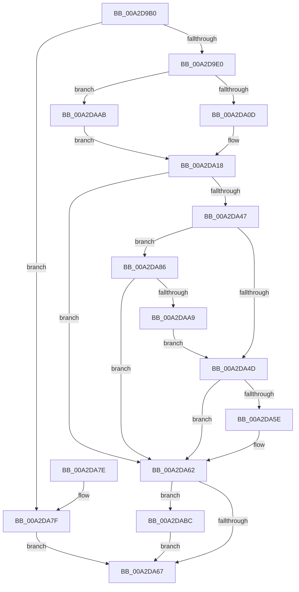

# PopPowerRequestStatsCreateSleepstudyBlocker

- RVA: `0x00A2D9B0`–`0x00A2DAC6` (길이 `278` bytes)
- VA: `0x0000000140A2D9B0`
- 실행 섹션: `PAGE`
- PDB 이름 있음: `예`; PDB Function 태그: `아니요`
- unwind 정보 RVA: `0x000AC844`
- 디코드: `80`개 명령, `278/278` bytes 표시
- 미해석 바이트: `0` (있으면 어셈블리에 `.byte`로 보존)

> 이 문서는 커널 이미지의 기계어와 PDB 기호를 분석해 생성했습니다. 4번과 5번은 함수 원형과 자료형을 바이너리 사용 방식에서 추정한 C 해석이며 원본 소스 복구 결과는 아닙니다.

## 1. Dependencies

- 직접 호출 지점: **5**; 고유 호출 대상: **5**
- 직접 호출자로 확인된 함수: **2**
- RIP 상대 이미지 참조: **2**

### Outgoing calls
- `0x00A2D9E9` → [RtlRandomEx](../../text/41/RtlRandomEx_function_0041AFE0.md) (function, `0x0041AFE0`)
- `0x00A2DA38` → [SleepstudyHelperCreateBlockerFromGuid](../../text/3D/SleepstudyHelperCreateBlockerFromGuid_function_003D3F70.md) (function, `0x003D3F70`)
- `0x00A2DA53` → [SleepstudyHelperBuildBlocker](SleepstudyHelperBuildBlocker_function_00A2DAD0.md) (function, `0x00A2DAD0`)
- `0x00A2DA9E` → [SleepstudyHelperSetBlockerVerboseDescription](SleepstudyHelperSetBlockerVerboseDescription_function_00A2DFB4.md) (function, `0x00A2DFB4`)
- `0x00A2DABF` → [SleepstudyHelperDestroyBlockerBuilder](SleepstudyHelperDestroyBlockerBuilder_function_00A2DE80.md) (function, `0x00A2DE80`)

### Direct callers
- [PopPowerRequestStatsCreate](PopPowerRequestStatsCreate_function_00A2D6DC.md) at `0x00A2D718`
- [PopPowerRequestStatsInitialize](../../init/C4/PopPowerRequestStatsInitialize_function_00C43D34.md) at `0x00C43DEA`

### Static image references
- `0x00A2D9CD` → RVA `0x00F07670` (`.data`; read)
- `0x00A2DAAB` → RVA `0x0001A1C0` (`.rdata`; read)

## 2. Other-region calls and transfers

- 다른 실행 섹션으로 향하는 call: **2**
  - `0x00A2D9E9` → [RtlRandomEx](../../text/41/RtlRandomEx_function_0041AFE0.md) (`PAGE` → `.text`)
  - `0x00A2DA38` → [SleepstudyHelperCreateBlockerFromGuid](../../text/3D/SleepstudyHelperCreateBlockerFromGuid_function_003D3F70.md) (`PAGE` → `.text`)
- 별도 외부 분기/꼬리 이동을 확인하지 못했습니다.

## 3. Assembly (complete function range)

```asm
00A2D9B0  48 89 5C 24 08                  mov qword ptr [rsp + 8], rbx
00A2D9B5  48 89 74 24 10                  mov qword ptr [rsp + 0x10], rsi
00A2D9BA  55                              push rbp
00A2D9BB  57                              push rdi
00A2D9BC  41 56                           push r14
00A2D9BE  48 8B EC                        mov rbp, rsp
00A2D9C1  48 83 EC 60                     sub rsp, 0x60
00A2D9C5  48 83 65 D0 00                  and qword ptr [rbp - 0x30], 0
00A2D9CA  4D 8B F0                        mov r14, r8
00A2D9CD  48 83 3D 9B 9C 4D 00 00         cmp qword ptr [rip + 0x4d9c9b], 0
00A2D9D5  8B DA                           mov ebx, edx
00A2D9D7  48 8B F1                        mov rsi, rcx
00A2D9DA  0F 84 9F 00 00 00               je 0x140a2da7f
00A2D9E0  48 83 65 E8 00                  and qword ptr [rbp - 0x18], 0
00A2D9E5  48 8D 4D 38                     lea rcx, [rbp + 0x38]
00A2D9E9  E8 F2 D5 9E FF                  call 0x14041afe0
00A2D9EE  8B C0                           mov eax, eax
00A2D9F0  0F 57 C9                        xorps xmm1, xmm1
00A2D9F3  48 89 45 E0                     mov qword ptr [rbp - 0x20], rax
00A2D9F7  0F 28 45 E0                     movaps xmm0, xmmword ptr [rbp - 0x20]
00A2D9FB  66 0F 7F 45 F0                  movdqa xmmword ptr [rbp - 0x10], xmm0
00A2DA00  0F 11 4D E0                     movups xmmword ptr [rbp - 0x20], xmm1
00A2DA04  83 FB 07                        cmp ebx, 7
00A2DA07  0F 85 9E 00 00 00               jne 0x140a2daab
00A2DA0D  C7 45 E0 DD AA DD AA            mov dword ptr [rbp - 0x20], 0xaaddaadd
00A2DA14  C6 45 E4 06                     mov byte ptr [rbp - 0x1c], 6
00A2DA18  48 8B 0D 51 9C 4D 00            mov rcx, qword ptr [rip + 0x4d9c51]
00A2DA1F  48 8D 45 D0                     lea rax, [rbp - 0x30]
00A2DA23  48 89 44 24 28                  mov qword ptr [rsp + 0x28], rax
00A2DA28  4C 8D 4E 08                     lea r9, [rsi + 8]
00A2DA2C  4C 8D 45 F0                     lea r8, [rbp - 0x10]
00A2DA30  89 5C 24 20                     mov dword ptr [rsp + 0x20], ebx
00A2DA34  48 8D 55 E0                     lea rdx, [rbp - 0x20]
00A2DA38  E8 33 65 9A FF                  call 0x1403d3f70
00A2DA3D  48 8B 7D D0                     mov rdi, qword ptr [rbp - 0x30]
00A2DA41  8B D8                           mov ebx, eax
00A2DA43  85 C0                           test eax, eax
00A2DA45  78 1B                           js 0x140a2da62
00A2DA47  8B 06                           mov eax, dword ptr [rsi]
00A2DA49  A8 01                           test al, 1
00A2DA4B  75 39                           jne 0x140a2da86
00A2DA4D  49 8B D6                        mov rdx, r14
00A2DA50  48 8B CF                        mov rcx, rdi
00A2DA53  E8 78 00 00 00                  call 0x140a2dad0
00A2DA58  8B D8                           mov ebx, eax
00A2DA5A  85 C0                           test eax, eax
00A2DA5C  78 04                           js 0x140a2da62
00A2DA5E  33 FF                           xor edi, edi
00A2DA60  33 DB                           xor ebx, ebx
00A2DA62  48 85 FF                        test rdi, rdi
00A2DA65  75 55                           jne 0x140a2dabc
00A2DA67  4C 8D 5C 24 60                  lea r11, [rsp + 0x60]
00A2DA6C  8B C3                           mov eax, ebx
00A2DA6E  49 8B 5B 20                     mov rbx, qword ptr [r11 + 0x20]
00A2DA72  49 8B 73 28                     mov rsi, qword ptr [r11 + 0x28]
00A2DA76  49 8B E3                        mov rsp, r11
00A2DA79  41 5E                           pop r14
00A2DA7B  5F                              pop rdi
00A2DA7C  5D                              pop rbp
00A2DA7D  C3                              ret
00A2DA7E  CC                              int3
00A2DA7F  BB BB 00 00 C0                  mov ebx, 0xc00000bb
00A2DA84  EB E1                           jmp 0x140a2da67
00A2DA86  44 8B 4E 2C                     mov r9d, dword ptr [rsi + 0x2c]
00A2DA8A  48 8D 46 30                     lea rax, [rsi + 0x30]
00A2DA8E  0F B7 56 28                     movzx edx, word ptr [rsi + 0x28]
00A2DA92  4C 8D 46 18                     lea r8, [rsi + 0x18]
00A2DA96  48 8B CF                        mov rcx, rdi
00A2DA99  48 89 44 24 20                  mov qword ptr [rsp + 0x20], rax
00A2DA9E  E8 11 05 00 00                  call 0x140a2dfb4
00A2DAA3  8B D8                           mov ebx, eax
00A2DAA5  85 C0                           test eax, eax
00A2DAA7  78 B9                           js 0x140a2da62
00A2DAA9  EB A2                           jmp 0x140a2da4d
00A2DAAB  0F 10 05 0E C7 5E FF            movups xmm0, xmmword ptr [rip - 0xa138f2]
00A2DAB2  F3 0F 7F 45 E0                  movdqu xmmword ptr [rbp - 0x20], xmm0
00A2DAB7  E9 5C FF FF FF                  jmp 0x140a2da18
00A2DABC  48 8B CF                        mov rcx, rdi
00A2DABF  E8 BC 03 00 00                  call 0x140a2de80
00A2DAC4  EB A1                           jmp 0x140a2da67
```

## 4. C-style interpretation (structured pseudocode)

```c
__int64 __fastcall PopPowerRequestStatsCreateSleepstudyBlocker(__int64 a1, int a2, __int64 a3)
{
    __int64 result;
    __int64 v_rbx;
    __int64 v_rdi;
    __int64 v_rsp;
    unsigned __int64 v_stack_m18;
    unsigned __int64 v_stack_m28;
    unsigned __int64 v_stack_m30;
    unsigned __int8 v_stack_m34;
    unsigned __int64 v_stack_m38;
    unsigned __int64 v_stack_m40;
    unsigned __int64 v_stack_m48;
    unsigned __int64 v_stack_m50;
    unsigned int v_stack_m58;
    unsigned __int64 v_stack_p10;
    unsigned __int64 v_stack_p20;
    unsigned __int64 v_stack_p8;

    v_stack_p8 = v_rbx;
    v_stack_p10 = v_rsi;
    v_rsp = (v_rsp) - (96);
    if ((*(unsigned __int64 *)(v_rip + 5086363)) == 0) goto loc_00A2DA7F;
    result = RtlRandomEx(v_stack_p20, a2, a3, a4);
    v_stack_m38 = (unsigned int)((unsigned int)(result));
    v_stack_m28 = v_xmm0;
    v_stack_m38 = v_xmm1;
    if (((unsigned int)((unsigned int)(a2))) != 7) goto loc_00A2DAAB;
    v_stack_m38 = 0xAADDAADDULL;
    v_stack_m34 = 6;
loc_00A2DA18:
    v_stack_m50 = v_stack_m48;
    v_stack_m58 = (unsigned int)((unsigned int)(a2));
    result = SleepstudyHelperCreateBlockerFromGuid(*(unsigned __int64 *)(v_rip + 5086289), v_stack_m38, v_stack_m28, a1 + 8);
    if (sign_flag) goto loc_00A2DA62;
    if ((((unsigned __int8)((unsigned int)(*(unsigned int *)(a1)))) & (1)) != 0) goto loc_00A2DA86;
loc_00A2DA4D:
    result = SleepstudyHelperBuildBlocker(v_stack_m48, a3, v_stack_m28, a1 + 8);
    v_rbx = (unsigned int)((unsigned int)(result));
    v_rdi = v_stack_m48;
    if (!(sign_flag)) {
        v_rdi = 0;
        v_rbx = 0;
    }
    if (0 != 0) goto loc_00A2DABC;
loc_00A2DA67:
    return 0;
loc_00A2DA7F:
    goto loc_00A2DA67;
loc_00A2DA86:
    v_stack_m40 = *(unsigned __int64 *)(v_stack_m18 + 40) + 48;
    result = SleepstudyHelperSetBlockerVerboseDescription(0, *(unsigned __int16 *)(*(unsigned __int64 *)(v_stack_m18 + 40) + 40), *(unsigned __int64 *)(v_stack_m18 + 40) + 24, (unsigned int)(*(unsigned int *)(*(unsigned __int64 *)(v_stack_m18 + 40) + 44)));
    if (sign_flag) goto loc_00A2DA62;
    goto loc_00A2DA4D;
loc_00A2DAAB:
    v_stack_m38 = v_xmm0;
    goto loc_00A2DA18;
loc_00A2DABC:
    result = SleepstudyHelperDestroyBlockerBuilder(0, *(unsigned __int16 *)(*(unsigned __int64 *)(v_stack_m18 + 40) + 40), *(unsigned __int64 *)(v_stack_m18 + 40) + 24, (unsigned int)(*(unsigned int *)(*(unsigned __int64 *)(v_stack_m18 + 40) + 44)));
    goto loc_00A2DA67;
}
```

## 5. (Beta) C Style

```c
int64_t PopPowerRequestStatsCreateSleepstudyBlocker(void *Arg1, int32_t Arg2, int64_t Arg3)
{
    uint8_t *arg1 = (uint8_t *)Arg1;

    int64_t result;
    int64_t local_rbx;
    int64_t local_rdi;
    int64_t local_rsp;
    uint64_t v_stack_m18;
    uint64_t v_stack_m28;
    uint64_t v_stack_m30;
    uint8_t v_stack_m34;
    uint64_t v_stack_m38;
    uint64_t v_stack_m40;
    uint64_t v_stack_m48;
    uint64_t v_stack_m50;
    uint32_t v_stack_m58;
    uint64_t v_stack_p10;
    uint64_t v_stack_p20;
    uint64_t v_stack_p8;

    v_stack_p8 = local_rbx;
    v_stack_p10 = local_rsi;
    local_rsp = (local_rsp) - (96);
    if ((*(uint64_t *)(v_rip + 0x4D9C9B)) == 0) goto loc_00A2DA7F;
    result = RtlRandomEx(v_stack_p20, Arg2, Arg3, a4);
    v_stack_m38 = (uint32_t)((uint32_t)(result));
    v_stack_m28 = v_xmm0;
    v_stack_m38 = v_xmm1;
    if (((uint32_t)((uint32_t)(Arg2))) != 7) goto loc_00A2DAAB;
    v_stack_m38 = 0xAADDAADDULL;
    v_stack_m34 = 6;
loc_00A2DA18:
    v_stack_m50 = v_stack_m48;
    v_stack_m58 = (uint32_t)((uint32_t)(Arg2));
    result = SleepstudyHelperCreateBlockerFromGuid(*(uint64_t *)(v_rip + 0x4D9C51), v_stack_m38, v_stack_m28, Arg1 + 8);
    if (sign_flag) goto loc_00A2DA62;
    if ((((uint8_t)((uint32_t)(*(uint32_t *)(arg1)))) & (1)) != 0) goto loc_00A2DA86;
loc_00A2DA4D:
    result = SleepstudyHelperBuildBlocker(v_stack_m48, Arg3, v_stack_m28, Arg1 + 8);
    local_rbx = (uint32_t)((uint32_t)(result));
    local_rdi = v_stack_m48;
    if (!(sign_flag)) {
        local_rdi = 0;
        local_rbx = 0;
    }
    if (0 != 0) goto loc_00A2DABC;
loc_00A2DA67:
    return 0;
loc_00A2DA7F:
    goto loc_00A2DA67;
loc_00A2DA86:
    v_stack_m40 = *(uint64_t *)(v_stack_m18 + 0x28) + 48;
    result = SleepstudyHelperSetBlockerVerboseDescription(0, *(uint16_t *)(*(uint64_t *)(v_stack_m18 + 0x28) + 0x28), *(uint64_t *)(v_stack_m18 + 0x28) + 24, (uint32_t)(*(uint32_t *)(*(uint64_t *)(v_stack_m18 + 0x28) + 0x2C)));
    if (sign_flag) goto loc_00A2DA62;
    goto loc_00A2DA4D;
loc_00A2DAAB:
    v_stack_m38 = v_xmm0;
    goto loc_00A2DA18;
loc_00A2DABC:
    result = SleepstudyHelperDestroyBlockerBuilder(0, *(uint16_t *)(*(uint64_t *)(v_stack_m18 + 0x28) + 0x28), *(uint64_t *)(v_stack_m18 + 0x28) + 24, (uint32_t)(*(uint32_t *)(*(uint64_t *)(v_stack_m18 + 0x28) + 0x2C)));
    goto loc_00A2DA67;
}
```

### 관측된 메모리 오프셋

구조체 형식이 확인되지 않은 접근은 인자 기준의 오프셋으로만 기록했습니다.

| 기준 인자 | 오프셋 표현 | 폭 (bit) | 접근 |
|---|---:|---:|---|
| `Arg1` | `+ 0x0` | `32` | `R` |
| `Arg1` | `+ 0x8` | `64` | `R` |
| `Arg1` | `+ 0x18` | `64` | `R` |
| `Arg1` | `+ 0x28` | `16` | `R` |
| `Arg1` | `+ 0x2C` | `32` | `R` |
| `Arg1` | `+ 0x30` | `64` | `R` |

## 6. Execution-region graph

[열기: 2D/3D 그래프와 함수 탐색 컨트롤 패널](../../../control-panel.html?section=page&rva=0x00A2D9B0&view=graph)

- 2D 그래프는 위에서 아래로 흐르고, 3D 그래프는 빈 공간을 드래그해 회전합니다. Shift+드래그는 이동, 휠은 확대·축소, 함수 노드 선택은 대상 보고서 이동입니다.

### Static fallback


